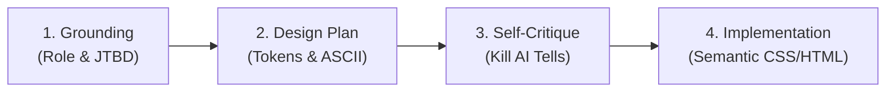

# UI/UX Design Intelligence Skill

This skill equips the AI agent with senior design leadership and frontend engineering expertise. It translates domain requirements into memorable, accessible, high-performance interfaces while explicitly preventing "AI slop" (clichéd gradients, predictable cards, generic microcopy, and cookie-cutter layouts).

---

## 1. Core Philosophy: Intentionality Over Intensity

1. **Ground in the Subject Matter**: Design choices must reflect the specific domain (Enterprise AI-assisted Recruitment & Candidate Sourcing).
   - *Candidate Persona*: Empathetic, frictionless, reassuring, transparent on AI usage, clear status badges.
   - *Recruiter Persona*: High-density data workspace, split-pane side-by-side review (PDF vs AI rubric), fast keyboard triage.
   - *Admin Persona*: Operational auditability, security metrics, tenant privacy toggles.
2. **Eliminate "AI Slop" Anti-Patterns**:
   - ❌ NO generic slate-gray cards on faint purple gradient backgrounds.
   - ❌ NO arbitrary "01 / 02 / 03" sequence badges unless representing a literal sequential workflow.
   - ❌ NO accenting a single random word in a headline with italic or colored gradient.
   - ❌ NO uninformative button labels like "Submit" or "Click Here"; use clear active verbs like "Tải lên CV & Nộp đơn", "Xác nhận Đạt phỏng vấn".
   - ❌ NO layout-shifting spinners that push content down; use dimension-matched skeleton placeholders.
   - ❌ NO emoji used as system icons; use clean, accessible SVG icons (Lucide/Heroicons style).

---

## 2. The 4-Step Design Workflow

When designing any screen, wireframe, or component, execute this sequence:

### Step 1: Grounding in the User & Job-To-Be-Done (JTBD)
- Identify the active persona: Candidate, Recruiter, Company Admin, or System Admin.
- Pinpoint the primary action: What is the single most critical decision or outcome on this screen?
- Determine information hierarchy: What data must be instantly scannable without scrolling?

### Step 2: Design Planning (Tokens & Layout)
- Define a strict palette (4–6 semantic HSL variables: background, surface, text primary/muted, brand accent, status colors).
- Set typography hierarchy with maximum line length `< 80ch`.
- Sketch layout structure using ASCII wireframes before writing CSS/HTML.

### Step 3: Self-Critique & Review
Ask these critical filter questions:
- *Does this look like a standard AI template?* If yes, vary spacing, simplify borders, or alter the hierarchy.
- *Is color used as the only indicator for AI scores or application statuses?* (Must combine text + badge + icon).
- *Is there excessive motion?* Limit non-user-triggered animations to a single intentional reveal or loading skeleton.

### Step 4: Implementation & Polish
- Implement using **100% Vanilla CSS Custom Properties** (avoid Tailwind unless explicitly requested).
- Adhere to the 10-level priority hierarchy below.

---

## 3. Ten-Level Hierarchy of Priority

Follow this strict priority order (Priority 1 = highest):

| Priority | Category | Critical Checks | Anti-Patterns to Avoid |
|:---:|---|---|---|
| **1** | **Accessibility (WCAG 2.1 AA)** | Contrast ratio $\ge$ 4.5:1 (normal text) & 3:1 (large text/borders). Visible 2px focus ring (`:focus-visible`). ARIA attributes (`aria-expanded`, `aria-live`). | Removing outline on focus. Icon buttons without `aria-label`. Low-contrast gray text. |
| **2** | **Touch & Interaction** | Minimum interactive target size **44×44px**. Minimum 8px spacing between touch targets. Immediate tactile feedback (`:hover`, `:active`). | Clickable links `< 24px` tall. Zero visual feedback on action dispatch. |
| **3** | **Performance & Zero CLS** | Cumulative Layout Shift **CLS < 0.1**. Skeleton loaders reserve exact height/width of final content. Lazy-load offscreen images and heavy panels. | Sudden DOM reflow when AI response arrives. Spinner pushing content down. |
| **4** | **Visual Theme & Cohesion** | Unified design token system (`hsl()`). Consistent corner radii (4px, 8px, 12px, 16px). Sharp SVG icons with `aria-hidden="true"`. | Inconsistent border radii. Mixing random hex codes in inline styles. Emoji as icons. |
| **5** | **Layout & Ergonomics** | Dual-pane split view for dense review tasks (50/50 or 55/45). Mobile-responsive stacking (`@media (max-width: 768px)`). | Horizontal scroll on mobile. Truncating critical data without tooltips. |
| **6** | **Typography & Readability** | Modern font stack (`Inter`, `Plus Jakarta Sans`, `system-ui`). Line height 1.5–1.6 for body. Base font 16px. Max line width 75–80 characters. | Font size `< 12px` for readable text. Excessive uppercase styling in headings. |
| **7** | **Context-Aware Motion** | Fast, functional micro-interactions (150ms–200ms `ease-out`). Respect `prefers-reduced-motion: reduce`. Single orchestrated entrance. | Bouncing/sliding entrance on every scroll. Constant pulsing badges distracting focus. |
| **8** | **Forms & Error Handling** | Persistent visible labels (no disappearing placeholders). Inline field validation on blur. Specific, non-apologetic error guidance. | Submitting form to discover errors at top. Vague error texts ("Something went wrong"). |
| **9** | **Predictable Navigation** | Persistent breadcrumbs. Deep-linkable state (URL reflects filters & active tab). Clear active menu indicator. | Broken browser back button in modals. Missing breadcrumb on multi-level pages. |
| **10** | **Data & AI Explainability** | Transparent AI score breakdowns (Rubric 100đ). Color-blind accessible chart indicators. Explicit "AI Suggestion" disclaimer tag. | Black-box AI percentage without criteria. Relying only on red/green for pass/fail. |

---

## 4. Responsible AI UX Standards (Project-Specific)

Because this platform leverages AWS Bedrock for CV screening, all interfaces must uphold strict Responsible AI principles:

1. **Human-in-the-Loop Authority**: The AI only recommends; human recruiters hold ultimate authority to approve, reject, or interview.
2. **Transparent Scoring Breakdown**: Never display a raw score (e.g. `82/100`) in isolation. Always pair it with the 4 rubric pillars:
   - *Kinh nghiệm liên quan (35đ)*
   - *Kỹ năng kỹ thuật (30đ)*
   - *Học vấn & Chứng chỉ (15đ)*
   - *Độ phù hợp văn hóa & mục tiêu (20đ)*
3. **Evidence Citations**: Every AI claim must cite specific text excerpts or page numbers from the candidate's CV.
4. **Audit & Edit Traceability**: If a recruiter overrides an AI score, display a clear indicator (`Recruiter Adjusted: 88đ (AI: 75đ)`) alongside recruiter notes and timestamp.

---

## 5. Pre-Delivery Quality Checklist

Before finalizing any UI specification, wireframe, or frontend code, verify:
- [ ] Palette adheres to project tokens (Dark Obsidian / Clean Slate) without hardcoded `#hex` values.
- [ ] All interactive buttons and links have visible hover, active, and keyboard `:focus-visible` styles.
- [ ] Skeleton loaders match the geometry of the target cards and tables.
- [ ] No layout shift occurs when toggling between tabs or loading asynchronous AI data.
- [ ] Text contrast meets WCAG 2.1 AA standards across both Light and Dark themes.
- [ ] Error and empty states are designed with helpful recovery CTAs.
