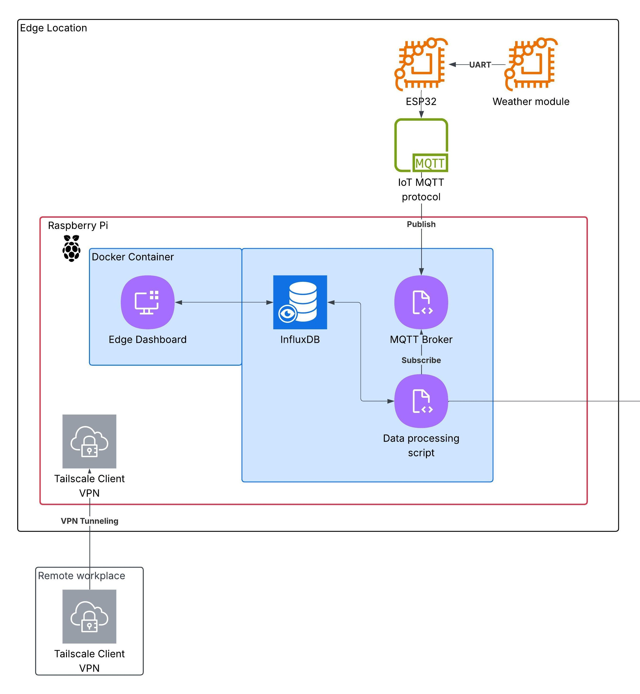
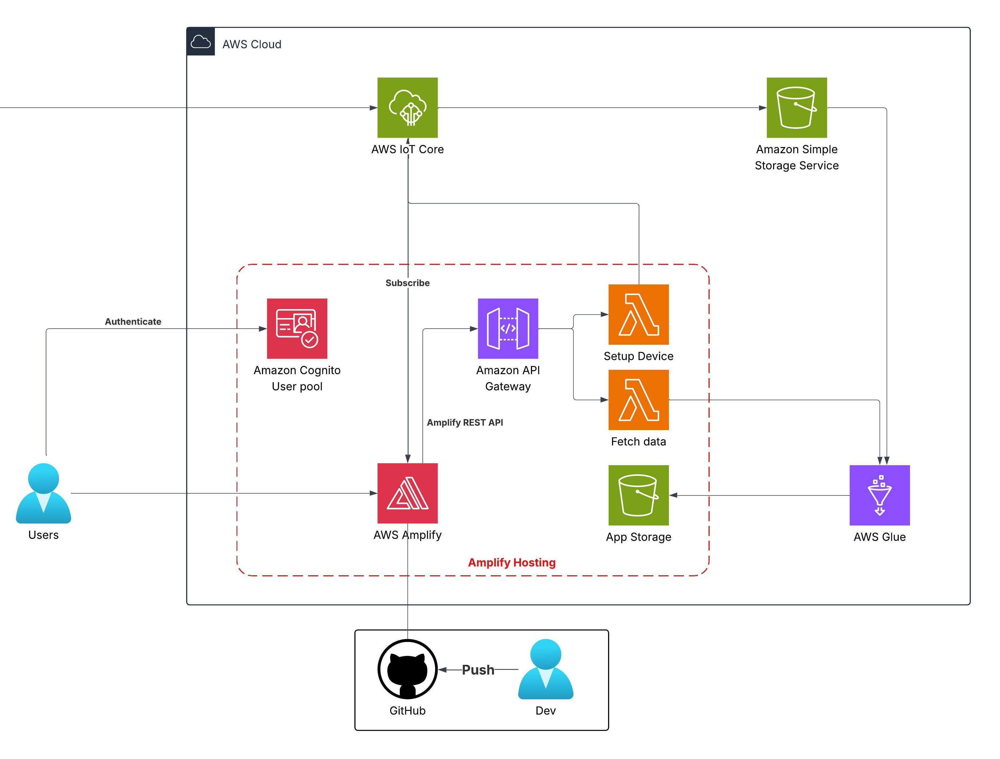
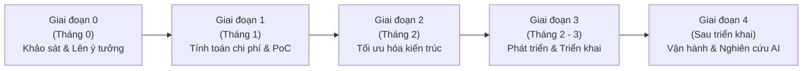

# BẢN ĐỀ XUẤT GIẢI PHÁP WORKSHOP (PROPOSAL)

# Đề tài: IoT Weather Platform for Lab Research
### *Giải pháp AWS Serverless hợp nhất cho giám sát thời tiết thời gian thực*

---

> [!WARNING]
> **LƯU Ý QUAN TRỌNG:**  
> Các thông tin trong tài liệu này được thiết kế làm **khung mẫu tham khảo (Template)**. Vui lòng không sao chép nguyên văn vào bài báo cáo chính thức của bạn.
> 
> *Mục đích tài liệu:* Cung cấp bản tóm tắt tổng thể về bài toán, kiến trúc kỹ thuật, lộ trình triển khai, dự toán chi phí và kế hoạch quản trị rủi ro cho Workshop.

---

## 1. Tóm tắt điều hành (Executive Summary)

* **Đối tượng triển khai:** Nhóm nghiên cứu **ITea Lab** tại TP. Hồ Chí Minh.
* **Mục tiêu chính:** Nâng cao năng lực thu thập, lưu trữ tập trung và phân tích dữ liệu thời tiết tự động theo thời gian thực.
* **Quy mô hệ thống:**
  * Giai đoạn ban đầu: Hỗ trợ vận hành **5 trạm thời tiết** tại thực địa.
  * Khả năng mở rộng: Sẵn sàng scale lên **10 – 15 trạm** mà không cần thay đổi kiến trúc cốt lõi.
* **Thiết bị thu thập:** Thiết bị biên **Raspberry Pi** kết hợp vi điều khiển và cảm biến **ESP32**, truyền dữ liệu liên tục qua giao thức tiêu chuẩn **MQTT**.
* **Công nghệ đám mây:** Tận dụng tối đa mô hình **AWS Serverless** giúp giám sát thời gian thực, phục vụ phân tích dự đoán dữ liệu và tối ưu chi phí vận hành ở mức tối thiểu.
* **Bảo mật truy cập:** Phân quyền và giới hạn truy cập cho 5 thành viên phòng lab thông qua **Amazon Cognito**.

---

## 2. Tuyên bố vấn đề & Mục tiêu (Problem Statement)

### 2.1. Vấn đề thực tế (Current Challenges)
* **Thu thập dữ liệu thủ công:** Các trạm đo hiện tại yêu cầu nhân lực đến tận nơi sao chép dữ liệu, gây tốn thời gian và rất khó mở rộng khi số lượng trạm tăng lên.
* **Thiếu hệ thống dữ liệu tập trung:** Chưa có nền tảng lưu trữ hợp nhất để trực quan hóa hoặc phân tích dữ liệu thời tiết theo thời gian thực.
* **Chi phí giải pháp bên ngoài cao:** Các nền tảng IoT thương mại (SaaS) từ bên thứ ba thường phức tạp và có chi phí duy trì vượt quá ngân sách nghiên cứu của phòng lab.

### 2.2. Giải pháp đề xuất (Proposed Solution)
Xây dựng nền tảng IoT Serverless nội bộ trên AWS với kiến trúc gọn nhẹ, hiệu năng cao:
* **Tiếp nhận dữ liệu (Ingestion):** Sử dụng `AWS IoT Core` để lắng nghe và quản lý kết nối MQTT từ các trạm biên.
* **Lưu trữ dữ liệu (Storage):** Lưu trữ toàn bộ dữ liệu thô (Data Lake) trên `Amazon S3` và phân vùng dữ liệu đã qua xử lý sang bucket phân tích.
* **Xử lý & ETL (Data Processing):** `AWS Glue Crawlers` tự động lập chỉ mục schema; `AWS Glue ETL Jobs` trích xuất, làm sạch và chuyển đổi dữ liệu.
* **API & Logic trung gian:** `AWS Lambda` kết hợp `Amazon API Gateway` phục vụ cấu hình thiết bị và truy vấn dữ liệu nhanh.
* **Giao diện ứng dụng (Web Frontend):** Ứng dụng `Next.js` được host thông qua `AWS Amplify`, cung cấp dashboard trực quan và phân tích xu hướng.
* **Quản trị người dùng:** `Amazon Cognito` quản lý danh tính và bảo vệ các API nội bộ.

### 2.3. Lợi ích & Hoàn vốn đầu tư (ROI & Benefits)
* **Nền tảng nghiên cứu dài hạn:** Tạo nguồn dữ liệu sạch, liên tục làm đầu vào phục vụ các nhà nghiên cứu AI/Data Science huấn luyện mô hình.
* **Tự động hóa vận hành:** Giảm 100% việc tổng hợp báo cáo thủ công, nâng cao độ chính xác và tính toàn vẹn của dữ liệu thời tiết.
* **Chi phí siêu tiết kiệm:** Chi phí hạ tầng Cloud chỉ khoảng **0,70 USD/tháng (~8,40 USD/năm)** theo AWS Pricing Calculator.
* **Thời gian hoàn vốn (ROI):** Ước tính từ **6 – 12 tháng** nhờ tiết kiệm đáng kể giờ công thao tác thủ công của kỹ thuật viên.

---

## 3. Kiến trúc Giải pháp (System Architecture)

### 3.1. Tổng quan Kiến trúc
Hệ thống kết hợp giữa lớp thiết bị biên (**Edge Computing**) và lớp đám mây không máy chủ (**AWS Serverless**). Dữ liệu cảm biến được lọc và nén tại Raspberry Pi trước khi xuất bản (publish) lên AWS IoT Core, kích hoạt chuỗi xử lý và lưu trữ tự động.

---

### 3.2. Sơ đồ Kiến trúc Hệ thống

#### Sơ đồ 1: Kiến trúc Trạm thời tiết tại Biên (Edge Location)

*Hình 1: Mô hình trạm biên gồm ESP32 (UART) kết nối Raspberry Pi chạy Docker (MQTT Broker, InfluxDB, Local Dashboard, VPN Tailscale).*

#### Sơ đồ 2: Kiến trúc Nền tảng Đám mây (AWS Cloud Platform)

*Hình 2: Luồng dữ liệu AWS Serverless từ IoT Core -> S3 Data Lake -> AWS Glue -> Lambda / API Gateway -> Amplify Hosting Next.js.*

---

### 3.3. Danh mục Dịch vụ AWS Sử dụng

| Dịch vụ AWS | Phân loại | Mục đích & Vai trò trong hệ thống | Cấu hình dự kiến |
| :--- | :--- | :--- | :--- |
| **AWS IoT Core** | Ingestion | Cổng tiếp nhận MQTT từ các trạm thời tiết, điều phối quy tắc dữ liệu (Rules Engine) | 5 thiết bị, ~45.000 msgs/tháng |
| **Amazon S3** | Storage | Lưu trữ dữ liệu thô (Data Lake) và dữ liệu ứng dụng sau khi làm sạch | 2 S3 Buckets, lưu trữ ~6 GB |
| **AWS Glue** | Data Integration | Crawler quét dữ liệu tự động và chạy tác vụ ETL chuyển đổi định dạng | 1 Crawler, 2 DPU ETL Jobs |
| **AWS Lambda** | Compute | Xử lý logic thiết lập thiết bị (`Setup Device`) và truy xuất dữ liệu (`Fetch Data`) | 2 hàm Lambda, 512 MB memory |
| **Amazon API Gateway** | API Management | Cung cấp RESTful API bảo mật cho ứng dụng Web kết nối xuống Backend | REST API (~2.000 requests/tháng) |
| **AWS Amplify** | Web Hosting | Lưu trữ, build và triển khai tự động (CI/CD) cho giao diện Next.js | Amplify Hosting, tích hợp GitHub |
| **Amazon Cognito** | Security & Auth | Quản lý định danh, xác thực và phân quyền truy cập cho người dùng | User Pool (giới hạn 5 users nội bộ) |

---

### 3.4. Thiết kế các Thành phần Chi tiết

* **Thiết bị biên (Edge Device):**
  * Vi điều khiển **ESP32** đọc tín hiệu từ module cảm biến qua giao tiếp UART và gửi gói tin qua MQTT nội bộ.
  * **Raspberry Pi** chạy hệ điều hành Raspbian, cấu hình Docker chứa: Local MQTT Broker, InfluxDB (lưu tạm thời), kịch bản Python xử lý dữ liệu và Tailscale Client VPN để quản trị từ xa an toàn.
* **Tiếp nhận & Lưu trữ (Ingestion & Storage):**
  * Dữ liệu từ Raspberry Pi gửi định kỳ lên `AWS IoT Core` qua kết nối bảo mật TLS/MQTT.
  * IoT Topic Rule tự động chuyển tiếp tin nhắn lưu trực tiếp vào `S3 Raw Bucket` dưới dạng JSON thô theo từng ngày.
* **Xử lý & Tinh chế dữ liệu (ETL & Analytics):**
  * `AWS Glue Crawler` định kỳ quét cấu trúc schema từ S3 Raw Bucket.
  * `AWS Glue ETL Job` nén, lọc bỏ dữ liệu nhiễu và lưu trữ vào `S3 Processed Bucket` phục vụ phân tích nhanh.
* **Giao diện Web & Xác thực (Frontend & Auth):**
  * Giao diện xây dựng bằng **Next.js**, host trên **AWS Amplify** giúp tối ưu SSR/SSG và giảm thiểu việc phải gọi Lambda liên tục.
  * **Amazon Cognito User Pool** đảm bảo chỉ có các tài khoản được cấp phép trong phòng lab mới có thể đăng nhập xem dữ liệu.

---

## 4. Triển khai Kỹ thuật (Technical Implementation)

### 4.1. Các Giai đoạn Triển khai

1. **Giai đoạn 0 - Nghiên cứu & Thiết kế kiến trúc sơ bộ (1 tháng trước kỳ thực tập):**
   * Đánh giá hiện trạng trạm thời tiết cũ, nghiên cứu giao tiếp ESP32, Docker trên Raspberry Pi.
   * Lên sơ đồ kiến trúc đám mây AWS Serverless ban đầu.
2. **Giai đoạn 1 - Dự toán ngân sách & Đánh giá tính khả thi (Tháng 1):**
   * Sử dụng AWS Pricing Calculator để mô phỏng chi phí theo lưu lượng thực tế.
   * Kiểm tra tính khả thi của các gói dịch vụ và mức hỗ trợ AWS Free Tier.
3. **Giai đoạn 2 - Tinh chỉnh kiến trúc & Tối ưu chi phí (Tháng 2):**
   * Điều chỉnh vai trò của Next.js trên Amplify để giảm tải số lượng request đến Lambda.
   * Hoàn thiện sơ đồ kiến trúc đạt chuẩn AWS Well-Architected.
4. **Giai đoạn 3 - Phát triển, Kiểm thử & Đưa vào vận hành (Tháng 2 – 3):**
   * Lập trình firmware cảm biến ESP32, cấu hình Docker container trên Raspberry Pi.
   * Triển khai tài nguyên AWS bằng **AWS CDK / SDK** và cấu hình CI/CD qua GitHub.
   * Kiểm thử tích hợp toàn diện, nghiệm thu và bàn giao hệ thống.

---

### 4.2. Yêu cầu Kỹ thuật Chi tiết

* **Yêu cầu đối với Trạm thời tiết biên:**
  * *Phần cứng:* Cảm biến nhiệt độ, độ ẩm, lượng mưa, vận tốc gió; ESP32 MCU; Raspberry Pi 5.
  * *Hệ điều hành & Ứng dụng:* Raspbian OS, Docker Engine, Python script xử lý dữ liệu.
  * *Băng thông mạng:* Wi-Fi / 4G với dung lượng gửi trung bình khoảng **1 MB/ngày/trạm**.
* **Yêu cầu đối với Nền tảng Đám mây Cloud:**
  * Thành thạo các dịch vụ: AWS IoT Core, S3, Glue, Lambda, API Gateway, Amplify, Cognito.
  * Phương pháp triển khai: Áp dụng Hạ tầng dưới dạng mã (**Infrastructure as Code - IaC**) bằng **AWS CDK / SDK**.
  * Kiến trúc ứng dụng: Next.js Fullstack (Server-side rendering & Static Generation).

---

## 5. Lộ trình & Mốc Triển khai (Roadmap & Milestones)

| Thời gian | Giai đoạn | Nhiệm vụ trọng tâm | Kết quả đầu ra (Deliverables) |
| :--- | :--- | :--- | :--- |
| **Tháng 0** | Tiền triển khai | Đánh giá trạm thời tiết hiện tại, nghiên cứu công nghệ | Báo cáo hiện trạng & Sơ đồ ý tưởng |
| **Tháng 1** | Khởi động dự án | Học chuyên sâu AWS, nâng cấp phần cứng trạm đo | Bảng dự toán chi phí AWS Calculator & Bộ linh kiện PoC |
| **Tháng 2** | Thiết kế & Tinh chỉnh | Thiết kế chi tiết kiến trúc, tối ưu chi phí & bảo mật | Sơ đồ chuẩn AWS & Code IaC ban đầu |
| **Tháng 3** | Xây dựng & Vận hành | Lập trình phần cứng, viết API, build Web, kiểm thử | Hệ thống Live Demo hoàn chỉnh, tài liệu Lab Guide |
| **Sau tháng 3** | Mở rộng & Nghiên cứu | Giám sát vận hành, thu thập dữ liệu phục vụ model AI | Tập dataset thời tiết 1 năm & Báo cáo đánh giá |

---

## 6. Ước tính Ngân sách & Tối ưu Chi phí (Cost Estimation)

### 6.1. Bảng Dự toán Chi phí Hạ tầng Đám mây (AWS Monthly Cost)

> [!TIP]
> *Nguồn trích xuất:* **AWS Pricing Calculator** (Dựa trên kịch bản 5 trạm IoT truyền dữ liệu liên tục).

| Dịch vụ AWS | Thông số ước tính theo tháng | Chi phí / Tháng (USD) |
| :--- | :--- | :--- |
| **AWS Lambda** | 1.000 requests, 512 MB memory, thời gian chạy ngắn | **0,00 USD** *(Nằm trong Free Tier)* |
| **Amazon S3 Standard** | 6 GB dung lượng lưu trữ, 2.100 requests, 1 GB quét dữ liệu | **0,15 USD** |
| **Data Transfer** | 1 GB Data In, 1 GB Data Out | **0,02 USD** |
| **AWS Amplify Hosting** | 256 MB dung lượng, thời gian phản hồi ~500ms | **0,35 USD** |
| **Amazon API Gateway** | 2.000 REST requests/tháng | **0,01 USD** |
| **AWS Glue ETL Jobs** | 2 DPU xử lý định kỳ | **0,02 USD** |
| **AWS Glue Crawlers** | 1 Crawler quét dữ liệu định kỳ | **0,07 USD** |
| **AWS IoT Core (MQTT)** | 5 thiết bị, ~45.000 tin nhắn MQTT/tháng | **0,08 USD** |
| **TỔNG CHI PHÍ AWS** | **Hạ tầng Cloud vận hành 5 trạm đo thời tiết** | **~0,70 USD / tháng** *(~8,40 USD / năm)* |

---

### 6.2. Chi phí Thiết bị Phần cứng (Hardware Cost)
* **Tổng chi phí đầu tư phần cứng ban đầu:** **265 USD** *(Khoản đầu tư 1 lần)*.
* **Hạng mục chi tiết:** Bao gồm bo mạch vi xử lý **Raspberry Pi 5**, vi điều khiển **ESP32**, các module cảm biến chuyên dụng (nhiệt độ, độ ẩm, áp suất khí quyển, lượng mưa, cảm biến đo hướng và tốc độ gió) cùng phụ kiện nguồn/hộp bảo vệ ngoài trời.

---

### 6.3. Chiến lược Tối ưu Hóa Chi phí (Cost Optimization)
* **Tận dụng tối đa AWS Free Tier:** Cấu hình mức tiêu thụ của Lambda, S3 và DynamoDB (nếu có) luôn nằm trong giới hạn miễn phí hàng tháng.
* **Giảm tải Lambda qua Next.js:** Đưa logic render và caching lên Next.js trên Amplify để tránh gọi hàm Lambda không cần thiết.
* **Bộ đệm dữ liệu tại biên:** Raspberry Pi gom dữ liệu thành từng batch trước khi gửi lên IoT Core để tiết kiệm số lượng tin nhắn MQTT.
* **Vòng đời dữ liệu (S3 Lifecycle):** Tự động chuyển dữ liệu cũ hơn 90 ngày từ S3 Standard sang S3 Glacier Flexible Retrieval để giảm thiểu chi phí lưu trữ lâu dài.

---

## 7. Đánh giá Rủi ro & Kế hoạch Dự phòng (Risk Management)

### 7.1. Ma trận Rủi ro (Risk Matrix)

| Rủi ro tiềm ẩn | Mức độ ảnh hưởng | Xác suất xảy ra | Chiến lược giảm thiểu (Mitigation) | Kế hoạch dự phòng (Contingency Plan) |
| :--- | :---: | :---: | :--- | :--- |
| **Mất kết nối mạng (Wi-Fi/4G tại trạm biên)** | **Trung bình** | **Trung bình** | Cấu hình lưu trữ đệm cục bộ (Local Buffer) trong InfluxDB trên Raspberry Pi qua Docker; tự động gửi bù khi có mạng. | Truy cập trực tiếp qua VPN Tailscale hoặc tải dữ liệu thủ công từ thẻ nhớ trạm đo. |
| **Hỏng hóc cảm biến ngoài trời** | **Cao** | **Thấp** | Kiểm tra và bảo dưỡng định kỳ; sử dụng cảm biến chuẩn công nghiệp có hộp chống nước; thiết lập thuật toán phát hiện giá trị bất thường (outlier). | Chuẩn bị sẵn linh kiện module ESP32 và cảm biến thay thế ngay tại chỗ. |
| **Vượt ngân sách AWS ngoài ý muốn** | **Trung bình** | **Thấp** | Thiết lập ngưỡng cảnh báo chi phí qua **AWS Budgets** và gửi thông báo qua email/SNS; áp dụng chính sách ngắt tài nguyên. | Sử dụng script IaC (AWS CDK) để hủy hoặc thu nhỏ quy mô hạ tầng nhanh chóng. |

---

### 7.2. Kế hoạch Dự phòng Kỹ thuật (Fallback Procedures)
* Nếu hệ thống AWS Cloud gặp sự cố bất khả kháng, các trạm Raspberry Pi vẫn duy trì chế độ ghi dữ liệu offline vào database cục bộ trong tối thiểu 30 ngày.
* Toàn bộ mã nguồn hạ tầng đám mây được quản lý bằng **AWS CDK / CloudFormation**, cho phép tái triển khai toàn bộ hệ thống sang một AWS Region khác trong vòng dưới 30 phút.

---

## 8. Kết quả Kỳ vọng & Định hướng Tương lai (Expected Outcomes)

### 8.1. Cải tiến Kỹ thuật
* **Tự động hóa 100%:** Chuyển đổi hoàn toàn quy trình ghi chép và đo lường thủ công sang pipeline thu thập dữ liệu thời gian thực tự động.
* **Khả năng mở rộng vượt trội:** Dễ dàng thêm mới các trạm thời tiết (mở rộng lên 10 – 15 trạm) chỉ bằng việc đăng ký thiết bị mới trên AWS IoT Core mà không cần can thiệp cấu hình lại backend.

### 8.2. Giá trị Dài hạn cho Nghiên cứu
* **Kho dữ liệu chuẩn hóa:** Xây dựng tập dữ liệu thời tiết chất lượng cao liên tục trong 1 năm phục vụ đào tạo các mô hình trí tuệ nhân tạo (Machine Learning/AI) dự báo vi khí hậu.
* **Khả năng tái sử dụng (Reusability):** Mô hình kiến trúc Serverless IoT này có thể được nhân rộng và áp dụng cho các đề tài IoT khác trong khuôn khổ phòng lab và các kỳ thực tập tiếp theo.