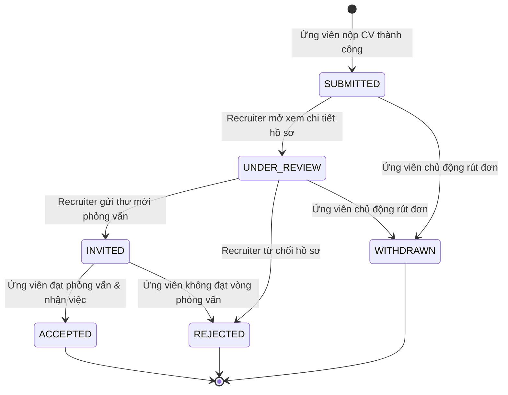
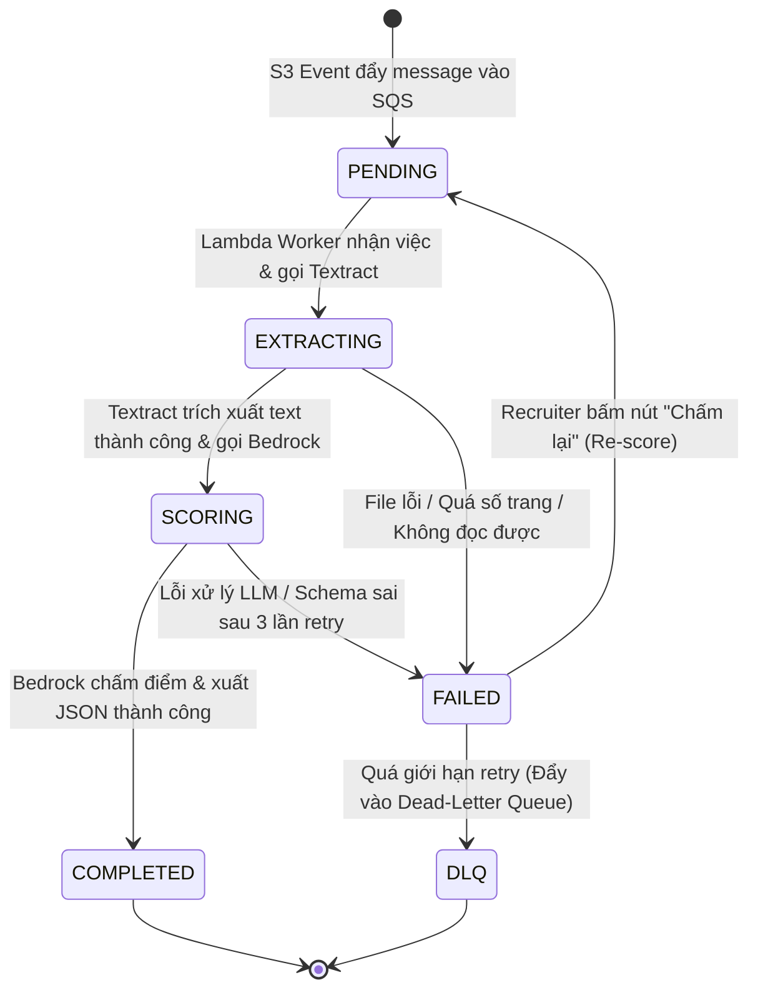

# ĐẶC TẢ YÊU CẦU PHẦN MỀM (SOFTWARE REQUIREMENTS SPECIFICATION - SRS)

# Hệ thống: AI CV Screening Portal
> **Phiên bản:** 1.0 — Ngày lập: 27/10/2026  
> **Trạng thái:** Đã thống nhất yêu cầu (Requirements Approved)

---

## 1. Giới thiệu & Mục đích

Tài liệu này đặc tả chi tiết toàn bộ các yêu cầu chức năng (Functional Requirements - FRs) và yêu cầu phi chức năng (Non-Functional Requirements - NFRs) cho hệ thống **AI CV Screening Portal** — nền tảng tuyển dụng thông minh vận hành trên hạ tầng AWS Serverless kết hợp Generative AI.

Tài liệu đóng vai trò làm chuẩn cơ sở để:
* Thiết kế Use Case và luồng dữ liệu (`docs/software/02-use-cases.md`).
* Thiết kế mô hình cơ sở dữ liệu DynamoDB và giao diện API (`03-database-design.md`, `04-api-spec.md`).
* Triển khai mã nguồn hạ tầng (IaC) và ứng dụng Web trong các Phase tiếp theo.
* Xây dựng bộ kịch bản kiểm thử nghiệm thu (`06-test-plan.md`).

---

## 2. Tổng quan Hệ thống

**AI CV Screening Portal** giải quyết bài toán sàng lọc hồ sơ ứng viên tự động cho các nhà tuyển dụng và doanh nghiệp thông qua 3 trụ cột:
1. **Cổng thông tin tuyển dụng tương tác:** Cho phép đăng tin tuyển dụng chuẩn mực và tiếp nhận hồ sơ trực tuyến an toàn.
2. **AI Document & GenAI Pipeline:** Tự động trích xuất nội dung văn bản từ file CV PDF (Amazon Textract) và đối soát đa chiều với bản mô tả công việc (Amazon Bedrock LLM) để chấm điểm và tóm tắt có cấu trúc.
3. **Tính minh bạch & Trải nghiệm đa chiều:** Cung cấp bảng xếp hạng định lượng cho Nhà tuyển dụng, đồng thời cung cấp phản hồi điểm mạnh/yếu của AI cho Ứng viên để nâng cao năng lực cá nhân.

---

## 3. Các Actor & Ma trận Phân quyền

Hệ thống định nghĩa **3 tác nhân con người (Human Actors)** và **1 tác nhân hệ thống (System Actor)**:

| Actor | Mã vai trò | Mô tả vai trò | Phân nhóm Cognito |
| :--- | :---: | :--- | :--- |
| **Ứng viên (Candidate)** | `CDD` | Người tìm việc; tạo hồ sơ cá nhân, tìm kiếm việc làm, nộp CV (PDF/DOCX), theo dõi trạng thái ứng tuyển và xem kết quả phân tích AI. | `candidate` |
| **Nhà tuyển dụng (Recruiter)** | `RCT` | Đại diện cho Doanh nghiệp (HR Team); quản lý hồ sơ công ty, đăng tin tuyển dụng, xem bảng xếp hạng AI, đánh giá ứng viên (Human-in-the-loop), khai thác Talent Pool và gửi email phỏng vấn. | `recruiter` |
| **Quản trị viên (Admin)** | `AD` | Quản trị vận hành hệ thống; kiểm duyệt tài khoản Recruiter, gỡ bỏ tin tuyển dụng vi phạm, giám sát sức khỏe hạ tầng, xử lý các yêu cầu tuân thủ dữ liệu. | `admin` |
| **Hệ thống AI (System Worker)** | `SYS` | Quy trình nền tự động (Asynchronous Worker); trích xuất text từ PDF/DOCX, khử PII, gọi Amazon Bedrock chấm điểm theo rubric và phân tích Skill Gap. | *IAM Service Role* |

### Ma trận Quyền hạn (Permission Matrix)

| Mã chức năng | Chức năng / Nghiệp vụ chi tiết | Candidate (`CDD`) | Recruiter (`RCT`) | Admin (`AD`) | Ghi chú |
| :---: | :--- | :---: | :---: | :---: | :--- |
| **CDD01** | Đăng ký, Xác thực OTP Cognito & Đăng nhập | ✅ | ❌ | ❌ | Luồng tài khoản dành riêng cho Ứng viên |
| **CDD02** | Quản lý Hồ sơ Cá nhân & Danh mục Năng lực | ✅ | ❌ | ❌ | Cập nhật kỹ năng, học vấn, kinh nghiệm, link dự án |
| **CDD03** | Quản lý & Lưu trữ CV (Đặt CV mặc định) | ✅ | ❌ | ❌ | Quản lý nhiều bản CV cá nhân để nộp nhanh |
| **CDD04** | Tìm kiếm & Lọc Tin tuyển dụng | ✅ | ✅ | ✅ | Public, người dùng chưa đăng nhập vẫn tra cứu được |
| **CDD05** | Lưu Tin yêu thích & Đăng ký Job Alerts | ✅ | ❌ | ❌ | Cá nhân hóa tìm việc & nhận email thông báo (Post-MVP) |
| **CDD06** | Nộp Hồ sơ Trực tiếp qua S3 Presigned URL | ✅ | ❌ | ❌ | Hỗ trợ PDF/DOCX tối đa 5MB, chống nộp trùng lặp |
| **CDD07** | Theo dõi Trạng thái Tuyển dụng & Lịch sử Đơn | ✅ | ❌ | ❌ | Theo dõi đồng thời `status` và `ai_status` |
| **CDD08** | Xem Báo cáo Đánh giá AI Minh bạch | ✅ | ❌ | ❌ | Xem điểm số, điểm mạnh, kỹ năng cần hoàn thiện |
| **CDD09** | Rút Đơn Ứng tuyển (`WITHDRAWN`) | ✅ | ❌ | ❌ | Chủ động rút đơn khi chưa có quyết định cuối |
| **CDD10** | Quản lý Quyền riêng tư, Sự đồng ý & DSR | ✅ | ❌ | ❌ | Bật/tắt Talent Pool, yêu cầu xuất/xóa dữ liệu cá nhân |
| **CDD11** | Nhận Email Xác nhận, Mời Phỏng vấn, Từ chối | ✅ | ❌ | ❌ | Tự động nhận email gửi qua Amazon SES |
| **RCT01** | Xác thực & Quản lý Hồ sơ Công ty (Company Profile) | ❌ | ✅ | ✅ | Recruiter quản lý công ty mình; Admin kiểm duyệt |
| **RCT02** | Đăng & Quản lý Tin tuyển dụng (Job Posting) | ❌ | ✅ | ✅ | HR Team cùng công ty cùng quản lý chung tin |
| **RCT03** | Xem Bảng Xếp hạng Ứng viên Thông minh theo JD | ❌ | ✅ | ✅ | Tự động xếp hạng theo điểm AI, lọc theo Match Level |
| **RCT04** | Giao diện Đối chiếu Song song (Side-by-side View) | ❌ | ✅ | ✅ | Xem đồng thời CV gốc, Clean text và Đánh giá AI |
| **RCT05** | Đánh giá Thủ công, Ghi chú & Human-in-the-Loop | ❌ | ✅ | ✅ | Nhập ghi chú, chấm điểm, con người ra quyết định |
| **RCT06** | Cập nhật Trạng thái & Nhật ký Kiểm toán (Audit Trail) | ❌ | ✅ | ✅ | Ghi nhận người sửa, thời gian, lý do chuyển trạng thái |
| **RCT07** | Yêu cầu Chấm điểm lại AI (Re-score Trigger) | ❌ | ✅ | ✅ | Kích hoạt khi sửa JD hoặc ứng viên cập nhật CV |
| **RCT08** | Báo cáo Phân tích Khoảng trống Kỹ năng (Skill Gap) | ❌ | ✅ | ✅ | Thống kê Top skills có sẵn và skills thiếu hụt theo JD |
| **RCT09** | Khai thác & Quản trị Kho Tài năng (Talent Pool) | ❌ | ✅ | ✅ | Lưu ứng viên tiềm năng vào kho dữ liệu công ty |
| **RCT10** | Gợi ý Ứng viên từ Talent Pool (Talent Rediscovery) | ❌ | ✅ | ✅ | AI quét gợi ý ứng viên cũ phù hợp cho tin JD mới |
| **RCT11** | Gửi Email Mời Phỏng vấn / Từ chối (SES) | ❌ | ✅ | ❌ | Gửi thư tuyển dụng chuyên nghiệp qua Amazon SES |
| **RCT12** | Mở/Tải CV Gốc & Nhật ký Truy cập (Access Log) | ❌ | ✅ | ✅ | Presigned URL tạm thời; ghi vết truy cập bảo mật |
| **AD01** | Bảng Điều khiển Tổng quan Hệ thống (Admin Dashboard) | ❌ | ❌ | ✅ | Thống kê số liệu người dùng, tin đăng, hồ sơ toàn sàn |
| **AD02** | Kiểm duyệt & Khóa Tài khoản Doanh nghiệp / User | ❌ | ❌ | ✅ | Kích hoạt hoặc khóa tài khoản có dấu hiệu vi phạm |
| **AD03** | Kiểm duyệt & Gỡ bỏ Tin Tuyển dụng Vi phạm | ❌ | ❌ | ✅ | Gỡ bỏ nội dung sai phạm tiêu chuẩn tuyển dụng |
| **AD04** | Giám sát Vận hành & Cảnh báo Sức khỏe (DLQ) | ❌ | ❌ | ✅ | Cảnh báo CloudWatch Alarms / SQS Dead-Letter Queue |
| **AD05** | Quản trị Tuân thủ Quyền riêng tư & Vòng đời Dữ liệu | ❌ | ❌ | ✅ | Giám sát S3 Lifecycle, xử lý DSR & Anonymization |

---

## 4. Yêu cầu Chức năng Phân rã theo Vai trò (Role-based Functional Requirements)

Mục này đặc tả thuần túy các **tính năng và hành động** mà từng tác nhân có thể thực hiện trên hệ thống (What the system does). Các quy định, logic kiểm tra và điều kiện nghiệp vụ ràng buộc được dẫn chiếu cụ thể đến **Mục 5 (Quy tắc Nghiệp vụ - Business Rules)**.

### 4.1. Nhóm Chức năng dành cho Ứng viên (Candidate - CDD)

* **CDD01 (Đăng ký, Xác thực & Đăng nhập):**
  * Đăng ký tài khoản người tìm việc bằng Email và Mật khẩu theo chuẩn bảo mật `[BR-AUTH-01]`.
  * Nhận mã OTP kích hoạt tài khoản gửi qua Amazon Cognito và xác thực email `[BR-AUTH-02]`.
  * Đăng nhập thành công, nhận JWT Token mang vai trò `candidate`, tự động vào trang cá nhân.
  * Quản lý phiên làm việc và chủ động đăng xuất khỏi hệ thống.
* **CDD02 (Quản lý Hồ sơ Cá nhân & Danh mục Năng lực):**
  * Cập nhật thông tin cá nhân: Họ tên, số điện thoại liên hệ, chức danh chuyên môn mong muốn.
  * Khai báo danh mục kỹ năng chuyên môn, trình độ học vấn, kinh nghiệm làm việc và các liên kết dự án trực tuyến (Portfolio, GitHub, LinkedIn).
* **CDD03 (Quản lý & Lưu trữ CV Cá nhân):**
  * Tải lên và quản lý danh sách các file CV cá nhân trên hệ thống.
  * Chỉ định một file làm "CV Mặc định" để nộp hồ sơ nhanh chóng cho các vị trí tuyển dụng.
  * Thay thế file CV mặc định và xem lịch sử các phiên bản CV đã sử dụng.
* **CDD04 (Tìm kiếm & Khám phá Việc làm):**
  * Tìm kiếm tin tuyển dụng theo từ khóa tiêu đề, kỹ năng chuyên môn hoặc tên công ty tuyển dụng.
  * Lọc tin tuyển dụng theo cấp bậc, địa điểm làm việc (On-site, Remote, Hybrid), khoảng lương và ngày đăng tin.
* **CDD05 (Lưu Việc làm Yêu thích & Đăng ký Job Alerts):** *(Giai đoạn mở rộng / Post-MVP)*
  * Đánh dấu lưu (Bookmark) các tin tuyển dụng quan tâm vào danh mục "Việc làm đã lưu".
  * Đăng ký nhận thông báo email tự động (qua SES) khi có tin tuyển dụng mới khớp với tiêu chí mong muốn.
* **CDD06 (Nộp Hồ sơ Tuyển dụng Trực tiếp qua S3 Presigned URL):**
  * Gọi API nhận S3 Presigned URL và tải file trực tiếp từ trình duyệt lên S3 `[BR-DOC-03]`.
  * Tuân thủ quy định về định dạng, dung lượng tối đa và kiểm tra chống nộp trùng lặp `[BR-DOC-01, BR-DOC-02]`.
* **CDD07 (Theo dõi Trạng thái Tuyển dụng & Lịch sử Đơn):**
  * Xem danh sách các vị trí đã ứng tuyển kèm nhãn trạng thái trực quan.
  * Theo dõi song song trạng thái nghiệp vụ tuyển dụng (`status`) và tiến độ xử lý của AI (`ai_status`) theo ma trận trạng thái `[BR-STATE-01]`.
  * Xem lịch sử chi tiết các mốc thời gian thay đổi trạng thái của hồ sơ.
* **CDD08 (Xem Báo cáo Đánh giá AI Minh bạch):**
  * Mở xem chi tiết kết quả đánh giá của AI đối với CV của chính mình:
    * Điểm số tổng quan và điểm thành phần theo 4 tiêu chí rubric `[BR-SCORING-01]`.
    * Phân loại mức độ phù hợp (`Strong Match`, `Potential Match`, `Not Match`) `[BR-SCORING-02]`.
    * Danh sách các điểm mạnh nổi bật và danh mục các kỹ năng còn thiếu để định hướng hoàn thiện năng lực.
* **CDD09 (Rút Đơn Ứng tuyển - Application Withdrawal):**
  * Thực hiện rút đơn ứng tuyển khi hồ sơ thỏa mãn điều kiện cho phép `[BR-STATE-02]`.
  * Hệ thống cập nhật trạng thái `WITHDRAWN`, ngừng tiến trình xét duyệt và gửi thông báo cho Recruiter.
* **CDD10 (Quản lý Quyền riêng tư, Sự đồng ý & Quyền DSR):**
  * Xem thông báo quyền riêng tư (Privacy Notice) trước khi nộp hồ sơ.
  * Quản lý sự đồng ý riêng biệt (xử lý AI cho đơn hiện tại; cho phép lưu Talent Pool tương lai) `[BR-PRIV-01]`.
  * Thực thi quyền chủ thể dữ liệu (DSR): Tải về bản sao dữ liệu cá nhân (JSON), chỉnh sửa hoặc yêu cầu xóa dữ liệu hồ sơ `[BR-PRIV-02]`.
* **CDD11 (Nhận Thông báo Email Tuyển dụng Tự động):**
  * Tự động nhận email xác nhận nộp hồ sơ thành công, thư mời phỏng vấn hoặc thư thông báo kết quả qua Amazon SES `[BR-STATE-03]`.

---

### 4.2. Nhóm Chức năng dành cho Nhà tuyển dụng (Recruiter - RCT)

* **RCT01 (Xác thực & Quản lý Tổ chức Doanh nghiệp - Company Profile):**
  * Đăng ký/đăng nhập tài khoản Recruiter, xác thực OTP Cognito, nhận JWT Token chứa `company_id`.
  * Tạo mới hồ sơ Công ty (Tên, Logo, Website, Địa chỉ, Mô tả) hoặc tham gia Công ty qua mã mời `[BR-AUTH-03]`.
  * Cho phép nhiều thành viên HR Team cùng tham gia quản trị chung tin đăng và hồ sơ ứng viên của công ty.
* **RCT02 (Quản lý Tin tuyển dụng - Job Posting):**
  * Tạo mới tin tuyển dụng gắn liền với `CompanyId` (Tiêu đề, địa điểm, cấp bậc, mức lương, JD text, kỹ năng bắt buộc, tiêu chí ưu tiên).
  * Cập nhật, chỉnh sửa thông tin tin tuyển dụng đang ở trạng thái `ACTIVE`.
  * Đóng tin tuyển dụng (`CLOSED`) hoặc mở lại tin khi có nhu cầu tuyển dụng tiếp.
* **RCT03 (Bảng Xếp hạng Ứng viên Thông minh theo Điểm AI):**
  * Xem danh sách toàn bộ ứng viên nộp theo từng tin tuyển dụng, tự động sắp xếp theo điểm số AI từ cao xuống thấp.
  * Lọc nhanh danh sách theo các mức xếp loại phù hợp của AI `[BR-SCORING-02]`.
* **RCT04 (Giao diện Đối chiếu Song song - Side-by-side Review):**
  * Mở giao diện xem chi tiết ứng viên 3 cột trên cùng một màn hình:
    * Cột 1: File CV gốc (PDF/DOCX) hiển thị qua Document Viewer bảo mật.
    * Cột 2: Văn bản trích xuất sạch (Clean Extracted Text) sau bước khử PII.
    * Cột 3: Báo cáo đánh giá chi tiết của AI: điểm tổng, điểm thành phần, điểm mạnh/yếu và trích dẫn đối soát từ CV.
* **RCT05 (Đánh giá Thủ công, Ghi chú & Quyết định Tuyển dụng):**
  * Nhập nhận xét đánh giá cá nhân (Recruiter Notes), chấm điểm thủ công (Manual Rating: 1–5 sao).
  * Phân định ranh giới giữa kết quả gợi ý của AI và quyết định của Recruiter; đảm bảo con người nắm quyền kiểm soát và chịu trách nhiệm tuyển dụng cuối cùng `[BR-HITL-01]`.
* **RCT06 (Quản lý Trạng thái Tuyển dụng & Nhật ký Kiểm toán):**
  * Chủ động chuyển trạng thái tuyển dụng của ứng viên theo quy trình ATS `[BR-STATE-01]`.
  * Hệ thống tự động ghi nhận nhật ký kiểm toán không thể sửa xóa (`Audit Trail`) kèm lý do thay đổi `[BR-HITL-02]`.
* **RCT07 (Yêu cầu Chấm điểm lại AI - Re-score Trigger):**
  * Kích hoạt yêu cầu AI chấm điểm lại khi tin JD thay đổi hoặc khi ứng viên nộp lại bản CV mới `[BR-RETRY-01]`.
* **RCT08 (Báo cáo Phân tích Khoảng trống Kỹ năng - Skill Gap Analytics):**
  * Xem biểu đồ và bảng số liệu phân tích tổng hợp trên toàn bộ pool ứng viên theo từng tin tuyển dụng:
    * *Top Skills Found (Kỹ năng phổ biến nhất):* Tỷ lệ ứng viên sở hữu các kỹ năng yêu cầu.
    * *Key Skill Gaps (Kỹ năng thiếu hụt nhất):* Thống kê các kỹ năng bắt buộc trong JD nhưng tỷ lệ đáp ứng thấp nhất.
* **RCT09 (Khai thác & Quản trị Kho Tài năng - Talent Pool Management):**
  * Chuyển các hồ sơ tiềm năng bị từ chối vào Talent Pool của công ty theo đúng tiêu chuẩn và sự đồng ý `[BR-POOL-01, BR-POOL-02]`.
  * Tìm kiếm, lọc và phân loại hồ sơ trong Talent Pool theo kỹ năng, kinh nghiệm và tóm tắt năng lực của AI.
* **RCT10 (Gợi ý Ứng viên từ Kho Tài năng cho Tin mới - Talent Rediscovery):**
  * Kích hoạt AI tự động quét so khớp yêu cầu của JD mới với các hồ sơ đang có trong Talent Pool của công ty, tự động đề xuất top ứng viên tiềm năng mà không cần ứng viên nộp lại từ đầu.
* **RCT11 (Tương tác Tuyển dụng & Gửi Email qua SES):**
  * Gửi email mời phỏng vấn (`status = INVITED`) hoặc gửi thư từ chối lịch sự (`status = REJECTED`) tự động qua Amazon SES `[BR-STATE-03]`.
  * Gửi email mời ứng tuyển nhanh đến các ứng viên tiềm năng được gợi ý từ Talent Pool.
* **RCT12 (Bảo mật Tải file CV & Nhật ký Truy cập):**
  * Mở và tải file CV gốc thông qua S3 Presigned URL tạm thời `[BR-DOC-03]`.
  * Hệ thống ghi nhận nhật ký truy cập (Access Log) để bảo vệ quyền riêng tư và ngăn ngừa rò rỉ dữ liệu `[NFR-SEC-05]`.

---

### 4.3. Nhóm Chức năng dành cho Quản trị viên (Admin - AD)

* **AD01 (Bảng Điều khiển Quản trị Toàn diện - Admin Dashboard):**
  * Giám sát bảng số liệu thống kê thời gian thực trên toàn sàn: số lượng người dùng (Candidate, Recruiter), số tin tuyển dụng (Active/Closed), tổng số CV tiếp nhận và tỷ lệ xử lý AI thành công.
* **AD02 (Kiểm duyệt & Quản lý Tài khoản Doanh nghiệp / User):**
  * Xem danh sách các nhà tuyển dụng và doanh nghiệp mới đăng ký; kích hoạt hoặc khóa tài khoản vi phạm chính sách hoặc gian lận.
* **AD03 (Kiểm duyệt & Gỡ bỏ Tin Tuyển dụng Vi phạm):**
  * Rà soát danh mục tin tuyển dụng trên toàn hệ thống; đóng hoặc gỡ bỏ tin tuyển dụng có nội dung sai lệch hoặc vi phạm tiêu chuẩn.
* **AD04 (Giám sát Vận hành Hạ tầng & Xử lý Lỗi Dead-Letter Queue - DLQ):**
  * Theo dõi số lượng message tồn đọng trong Dead-Letter Queue (DLQ), tỷ lệ lỗi của các hàm Lambda Worker; nhận cảnh báo CloudWatch Alarms `[NFR-OPS-02, NFR-REL-02]`.
* **AD05 (Quản trị Tuân thủ Quyền riêng tư & Vòng đời Dữ liệu):**
  * Giám sát việc thực thi chính sách vòng đời lưu trữ dữ liệu `[NFR-DATA-01, NFR-DATA-02]`.
  * Tiếp nhận và xử lý các yêu cầu DSR cấp hệ thống; phê duyệt quy trình hủy định danh (`CandidateId = ANONYMIZED_USER`) và xóa file CV vật lý trên S3 khi người dùng yêu cầu xóa tài khoản `[BR-PRIV-02]`.

---

### 4.4. Nhóm Chức năng Xử lý Nền Tự động của Hệ thống AI (System Worker - SYS)

* **SYS01 (Điều phối Xử lý Bất đồng bộ qua Hàng đợi SQS):**
  * Nhận sự kiện S3 Event Notification khi có file CV mới, đẩy message vào Amazon SQS và gán `ai_status = PENDING`.
  * Lambda Worker lấy message từ SQS để xử lý theo thứ tự, giải phóng tải cho Web Client.
* **SYS02 (Xử lý Đa định dạng & Trích xuất Văn bản PDF/DOCX):**
  * Cập nhật `ai_status = EXTRACTING`.
  * Trích xuất văn bản từ file PDF qua Amazon Textract hoặc đọc cấu trúc OpenXML từ file DOCX thành văn bản thuần `[BR-DOC-01]`.
* **SYS03 (Đối soát Đa chiều & Chấm điểm Tự động qua Bedrock LLM):**
  * Cập nhật `ai_status = SCORING`.
  * Đưa nội dung CV đã qua bộ lọc khử PII `[NFR-SEC-03]` và nội dung JD vào System Prompt an toàn `[NFR-SEC-04]`.
  * Gọi Amazon Bedrock (Claude 3 Haiku) chấm điểm định lượng theo rubric `[BR-SCORING-01]` và xuất kết quả chuẩn JSON Schema `[BR-SCORING-03]`.
  * Lưu trữ kết quả vào DynamoDB và cập nhật `ai_status = COMPLETED`.
* **SYS04 (Cơ chế Tự phục hồi, Retry & Đẩy lỗi vào Dead-Letter Queue):**
  * Tự động thử lại tối đa 3 lần cho các lỗi mạng tạm thời hoặc timeout `[NFR-REL-02]`.
  * Nếu file hỏng hoặc lỗi không thể khắc phục: Cập nhật `ai_status = FAILED` kèm lý do chi tiết; đẩy message vào DLQ để cách ly và phát cảnh báo lỗi.

---

## 5. Quy tắc Nghiệp vụ & Chính sách Vận hành (Business Rules - BR)

Mục này quy định toàn bộ các **luật lệ, điều kiện logic, công thức tính toán và ràng buộc nghiệp vụ** mà phần mềm bắt buộc phải tuân thủ trong quá trình xử lý:

### 5.1. Quy tắc Xác thực & Tổ chức (BR-AUTH)

* **BR-AUTH-01 (Tiêu chuẩn Độ mạnh Mật khẩu):** Mật khẩu tài khoản phải có độ dài tối thiểu **8 ký tự**, bắt buộc chứa ít nhất 1 chữ cái in hoa, 1 chữ số và 1 ký tự đặc biệt (ví dụ: `@`, `#`, `$`, `%`).
* **BR-AUTH-02 (Xác thực Email & Quản lý Phiên):**
  * Người dùng bắt buộc phải xác thực mã OTP gửi qua email từ Amazon Cognito trước khi đăng nhập lần đầu.
  * Token xác thực JWT có thời hạn hiệu lực tối đa là **1 giờ (60 phút)**. Khi token hết hạn, người dùng phải thực hiện làm mới token (Refresh Token) hoặc đăng nhập lại.
* **BR-AUTH-03 (Phân quyền HR Team theo Công ty):**
  * Mỗi tài khoản Recruiter bắt buộc phải liên kết với một `CompanyId`.
  * Mọi thành viên HR Team thuộc cùng một `CompanyId` đều có quyền xem, chỉnh sửa tin tuyển dụng và đánh giá danh sách ứng viên thuộc công ty đó. Recruiter tuyệt đối không được phép xem dữ liệu của công ty khác.

---

### 5.2. Quy tắc Định dạng & Nộp Hồ sơ (BR-DOC)

* **BR-DOC-01 (Định dạng & Giới hạn Kích thước File):**
  * Hệ thống chỉ chấp nhận đúng 2 định dạng file: **PDF** (`.pdf`) và **Microsoft Word** (`.docx`). Tuyệt đối từ chối các định dạng ảnh rời (.jpg/.png) hoặc file nén (.zip/.rar).
  * Dung lượng file tối đa là **5 MB**. Độ dài hồ sơ khuyến nghị từ **1 đến 3 trang**.
* **BR-DOC-02 (Chống Nộp Trùng lặp):**
  * Mỗi ứng viên (căn cứ theo `CandidateId`) chỉ được phép nộp tối đa **1 hồ sơ đang hoạt động** cho mỗi vị trí tuyển dụng (`JobId`).
  * Hồ sơ được coi là "đang hoạt động" khi có trạng thái nghiệp vụ `status` thuộc nhóm: `SUBMITTED`, `UNDER_REVIEW`, `INVITED`.
  * Ứng viên chỉ được phép nộp lại nếu hồ sơ trước đó đã có quyết định kết thúc (`REJECTED`) hoặc ứng viên đã chủ động rút đơn (`WITHDRAWN`).
* **BR-DOC-03 (Thời hạn S3 Presigned URL):**
  * Presigned URL dùng để tải file CV lên S3 hoặc mở/tải file CV gốc có thời gian hết hạn nghiêm ngặt là **5 phút**. Sau 5 phút, đường dẫn tự động vô hiệu lực.

---

### 5.3. Quy tắc Chuyển trạng thái Tuyển dụng & Rút đơn (BR-STATE)

* **BR-STATE-01 (Ma trận Chuyển Trạng thái Tuyển dụng Hợp lệ):**
  * Trạng thái khởi tạo mặc định khi nộp thành công là **`SUBMITTED`**.
  * Chuyển từ `SUBMITTED` sang `UNDER_REVIEW`: Tự động kích hoạt khi Recruiter lần đầu mở xem chi tiết hồ sơ.
  * Chuyển từ `UNDER_REVIEW` sang `INVITED`: Khi Recruiter chọn mời phỏng vấn.
  * Chuyển từ `UNDER_REVIEW` sang `REJECTED`: Khi Recruiter đánh giá hồ sơ chưa phù hợp.
  * Chuyển từ `INVITED` sang `ACCEPTED`: Khi ứng viên hoàn thành tốt phỏng vấn và nhận việc.
  * Chuyển từ `INVITED` sang `REJECTED`: Khi ứng viên không đạt vòng phỏng vấn.
  * Không cho phép nhảy cóc trạng thái (ví dụ: từ `SUBMITTED` nhảy thẳng sang `ACCEPTED`).
* **BR-STATE-02 (Điều kiện Rút đơn Ứng tuyển - Withdrawal Policy):**
  * Ứng viên **chỉ được phép rút đơn** (`status = WITHDRAWN`) khi hồ sơ đang ở trạng thái **`SUBMITTED`** hoặc **`UNDER_REVIEW`**.
  * Khi hồ sơ đã chuyển sang **`INVITED`**, **`ACCEPTED`** hoặc **`REJECTED`**, hệ thống **vô hiệu hóa** nút rút đơn nhằm bảo đảm tính toàn vẹn và tính pháp lý của quy trình tuyển dụng.
* **BR-STATE-03 (Tự động Kích hoạt Email Tuyển dụng):**
  * Chuyển sang `INVITED` bắt buộc tự động kích hoạt Amazon SES gửi email mời phỏng vấn.
  * Chuyển sang `REJECTED` bắt buộc tự động kích hoạt Amazon SES gửi email phản hồi từ chối lịch sự.

---

### 5.4. Quy tắc Rubric Chấm điểm AI & Xếp loại (BR-SCORING)

* **BR-SCORING-01 (Thang điểm 100 & Tỷ trọng 4 Tiêu chí Cốt lõi):**
  * Điểm tổng của hồ sơ được chấm theo thang điểm 100 dựa trên trọng số chuẩn hóa:
    1. **Kỹ năng Chuyên môn (Technical Skills) — Trọng số 40% (Tối đa 40 điểm):** Đối soát mức độ trùng khớp giữa kỹ năng yêu cầu trong JD với kỹ năng thực tế trong CV.
    2. **Kinh nghiệm Thực tế (Work Experience) — Trọng số 30% (Tối đa 30 điểm):** Số năm kinh nghiệm, độ tương đồng chức danh và độ phức tạp của các dự án đã thực hiện.
    3. **Học vấn & Chứng chỉ (Education & Certifications) — Trọng số 15% (Tối đa 15 điểm):** Chuyên ngành đào tạo phù hợp và các chứng chỉ chuyên nghiệp uy tín liên quan.
    4. **Kỹ năng Mềm & Trình bày (Soft Skills & Presentation) — Trọng số 15% (Tối đa 15 điểm):** Bố cục mạch lạc, kỹ năng giao tiếp và mức độ tương thích văn hóa công việc.
* **BR-SCORING-02 (Ngưỡng Phân loại Mức độ Phù hợp - Match Level):**
  * **Xuất sắc / Phù hợp cao (`Strong Match`):** Tổng điểm ≥ **80 điểm**.
  * **Tiềm năng (`Potential Match`):** Tổng điểm từ **60 đến 79 điểm**.
  * **Chưa phù hợp (`Not Match`):** Tổng điểm **< 60 điểm**.
* **BR-SCORING-03 (Chuẩn hóa Định dạng Đầu ra JSON Schema):**
  * Kết quả từ Amazon Bedrock bắt buộc phải tuân thủ nghiêm ngặt JSON Schema gồm 7 trường dữ liệu chuẩn: `total_score`, `match_level`, `criteria_scores`, `key_strengths`, `areas_for_improvement`, `executive_summary`, `suggested_interview_questions`.

```json
{
  "total_score": 85,
  "match_level": "STRONG_MATCH",
  "criteria_scores": {
    "technical_skills": { "score": 36, "max_score": 40, "analysis": "..." },
    "work_experience": { "score": 25, "max_score": 30, "analysis": "..." },
    "education_certifications": { "score": 12, "max_score": 15, "analysis": "..." },
    "soft_skills_presentation": { "score": 12, "max_score": 15, "analysis": "..." }
  },
  "key_strengths": ["..."],
  "areas_for_improvement": ["..."],
  "executive_summary": "...",
  "suggested_interview_questions": ["..."]
}
```

---

### 5.5. Quy tắc Con người Giám sát & Ra quyết định (BR-HITL)

* **BR-HITL-01 (Nguyên tắc Phân định AI vs Quyết định Tuyển dụng):**
  * Toàn bộ điểm số, xếp hạng và nhận xét của AI chỉ mang tính chất **hỗ trợ tham khảo định lượng (Decision Support)**.
  * Tuyệt đối không cho phép hệ thống AI tự động loại bỏ (`REJECTED`) hoặc tự động gửi thư mời phỏng vấn (`INVITED`) cho ứng viên. Quyết định chuyển trạng thái tuyển dụng nghiệp vụ bắt buộc phải do Recruiter là con người click thực hiện.
* **BR-HITL-02 (Bắt buộc Ghi nhận Nhật ký Kiểm toán - Audit Trail):**
  * Mọi hành động chuyển trạng thái tuyển dụng (`status`) hoặc chấm điểm thủ công (Manual Rating) bắt buộc phải tạo một bản ghi Audit Trail bất biến gồm: `ApplicationId`, `RecruiterId`, `Timestamp`, `PreviousStatus`, `NewStatus`, `Reason/Comment`.

---

### 5.6. Quy tắc Chấm điểm lại AI (BR-RETRY)

* **BR-RETRY-01 (Điều kiện Kích hoạt & Hạn mức Re-score):**
  * Recruiter chỉ được kích hoạt "Chấm điểm lại (Re-score)" khi:
    1. Nội dung JD của tin tuyển dụng vừa được điều chỉnh; hoặc
    2. Ứng viên được cấp quyền nộp bổ sung phiên bản CV mới; hoặc
    3. Lần chấm trước gặp sự cố kỹ thuật (`ai_status = FAILED`).
  * Áp dụng cơ chế Rate Limiting: Tối đa **3 lần / giờ / hồ sơ** nhằm kiểm soát chi phí gọi Amazon Bedrock.

---

### 5.7. Quy tắc Khai thác Kho Tài năng Doanh nghiệp (BR-POOL)

* **BR-POOL-01 (Tiêu chuẩn Đưa hồ sơ vào Talent Pool):**
  * Chỉ những ứng viên bị từ chối ở vị trí ứng tuyển hiện tại nhưng có điểm đánh giá AI thuộc mức **`Strong Match`** (≥ 80 điểm) hoặc **`Potential Match`** (60–79 điểm) mới đủ điều kiện lưu vào Talent Pool của công ty.
* **BR-POOL-02 (Quy định về Sự đồng ý & Thời hạn Lưu giữ):**
  * Việc lưu trữ hồ sơ vào Talent Pool bắt buộc phải có sự đồng ý của ứng viên (Opt-in Consent theo `[BR-PRIV-01]`).
  * Thời hạn lưu giữ tối đa trong Talent Pool là **12 tháng**. Sau 12 tháng, hệ thống tự động gửi email gia hạn sự đồng ý hoặc tự động ẩn danh hóa hồ sơ.

---

### 5.8. Quy tắc Quyền riêng tư & Hủy định danh khi Xóa tài khoản (BR-PRIV)

* **BR-PRIV-01 (Tách biệt Sự đồng ý theo Mục đích - Granular Consent):**
  * Ứng viên bắt buộc phải tích chọn đồng ý cho phép xử lý CV bằng mô hình AI để phục vụ sàng lọc cho tin tuyển dụng hiện tại (Điều kiện bắt buộc để nộp hồ sơ).
  * Ứng viên có quyền tùy chọn (Opt-in) cho phép hay không cho phép lưu trữ hồ sơ vào Talent Pool để nhận cơ hội việc làm tương lai. Mọi sự thay đổi đồng ý đều được ghi log thời gian.
* **BR-PRIV-02 (Chính sách Xóa tài khoản & Anonymization):**
  * Khi người dùng gửi yêu cầu xóa tài khoản, hệ thống áp dụng cơ chế **Hủy định danh kết hợp Xóa có kiểm soát (Anonymization & Controlled Purge)**:
    1. Xóa vĩnh viễn file CV gốc trên Amazon S3.
    2. Xóa toàn bộ PII (Email, Họ tên, Số điện thoại, Địa chỉ, Ảnh) trên bảng User và Application.
    3. Chuyển đổi mã định danh trên các bản ghi giao dịch tuyển dụng và Audit Trail thành `CandidateId = ANONYMIZED_USER` nhằm đảm bảo tính toàn vẹn số liệu thống kê cho Recruiter và đáp ứng nghĩa vụ kiểm toán pháp lý của doanh nghiệp.

---

## 6. Vòng đời Trạng thái Hệ thống (System State Lifecycles)

Để bảo đảm nguyên tắc phân rã (**Decoupling**), hệ thống tách biệt hoàn toàn giữa **Vòng đời Nghiệp vụ Tuyển dụng (Business Status)** và **Vòng đời Xử lý Kỹ thuật của AI (AI Processing Status)** qua 2 trường thuộc tính độc lập trên cùng bản ghi `Application` trong cơ sở dữ liệu DynamoDB.

```text
Bản ghi Application trên DynamoDB:
├── status:    [ SUBMITTED | UNDER_REVIEW | INVITED | ACCEPTED | REJECTED | WITHDRAWN ] (Nghiệp vụ)
└── ai_status: [ PENDING | EXTRACTING | SCORING | COMPLETED | FAILED ]                  (Tiến trình AI)
```

---

### 6.1. Vòng đời 1: Nghiệp vụ Tuyển dụng Truyền thống (Trường `status`)

Phản ánh tiến trình tương tác giữa Con người (Ứng viên & Nhà tuyển dụng) theo chuẩn mực của hệ thống quản lý tuyển dụng (ATS):



| Trạng thái (`status`) | Ý nghĩa nghiệp vụ | Tác nhân kích hoạt | Hành động tiếp theo |
| :--- | :--- | :---: | :--- |
| **`SUBMITTED`** | Hồ sơ đã được nộp thành công vào hệ thống. | Ứng viên (`CDD`) | Chờ AI xử lý điểm và Recruiter mở xem. |
| **`UNDER_REVIEW`** | Nhà tuyển dụng đã mở xem chi tiết hồ sơ hoặc đang cân nhắc. | Nhà tuyển dụng (`RCT`) | Đánh giá, chuẩn bị mời phỏng vấn hoặc từ chối. |
| **`INVITED`** | Ứng viên được chọn vào danh sách phỏng vấn; hệ thống tự động gửi thư mời qua Amazon SES. | Nhà tuyển dụng (`RCT`) | Tiến hành phỏng vấn trực tiếp / online. |
| **`ACCEPTED`** | Ứng viên vượt qua kỳ phỏng vấn và chính thức trúng tuyển. | Nhà tuyển dụng (`RCT`) | Hoàn tất quy trình tuyển dụng cho ứng viên. |
| **`REJECTED`** | Hồ sơ chưa phù hợp hoặc không đạt phỏng vấn; hệ thống gửi email phản hồi lịch sự. | Nhà tuyển dụng (`RCT`) | Đóng hồ sơ ứng viên. |
| **`WITHDRAWN`** | Ứng viên chủ động rút đơn trước khi có quyết định phỏng vấn/nhận việc. | Ứng viên (`CDD`) | Dừng quy trình xét duyệt đơn; cập nhật giao diện Recruiter. |

---

### 6.2. Vòng đời 2: Tiến trình Xử lý Kỹ thuật của AI Pipeline (Trường `ai_status`)

Phản ánh tiến trình chạy ngầm bất đồng bộ (Asynchronous Background Job) của các dịch vụ AWS AI:



| Trạng thái (`ai_status`) | Ý nghĩa kỹ thuật | Thành phần AWS thực thi | Hành vi hệ thống |
| :--- | :--- | :---: | :--- |
| **`PENDING`** | File CV đã nằm trên S3, message đang chờ trong hàng đợi SQS. | `Amazon S3` -> `Amazon SQS` | Worker chuẩn bị nhận việc. |
| **`EXTRACTING`** | Đang gọi dịch vụ trích xuất văn bản từ file PDF/DOCX. | `AWS Lambda` + `Amazon Textract` | Đọc toàn bộ nội dung text thô của CV. |
| **`SCORING`** | Đã có text; đang gửi prompt tới Bedrock LLM để đối soát JD và chấm điểm. | `AWS Lambda` + `Amazon Bedrock` | Chấm điểm, tóm tắt, xuất JSON theo schema. |
| **`COMPLETED`** | AI hoàn tất phân tích thành công; toàn bộ điểm và nhận xét đã lưu vào DynamoDB. | `Amazon DynamoDB` | Dashboard hiển thị điểm số và thứ hạng ngay lập tức. |
| **`FAILED`** | Xử lý lỗi (File hỏng, timeout, lỗi schema sau 3 lần retry). | `Amazon SQS` + `DLQ` + `CloudWatch` | Bắn Alarm cảnh báo; kích hoạt nút "Thử chấm lại" trên UI. |

---

### 6.3. Tính Độc lập & Tương tác giữa 2 Vòng đời

1. **Khả năng chịu lỗi và tính bền bỉ (Fault Tolerance):**
   * Nếu AI Pipeline gặp sự cố (`ai_status = FAILED`), hồ sơ ứng tuyển của ứng viên **không bị mất hoặc bị hủy**. Trạng thái nghiệp vụ vẫn là `SUBMITTED`, nhà tuyển dụng vẫn có thể click mở file CV gốc từ S3 để duyệt thủ công như quy trình truyền thống.
2. **AI đóng vai trò Trợ lý tăng tốc (AI as an Accelerator):**
   * Khi `ai_status = COMPLETED`, hệ thống tự động điền điểm số và thứ hạng lên bảng Dashboard, giúp Recruiter ra quyết định chuyển `status` sang `INVITED` nhanh gấp nhiều lần.
3. **Hỗ trợ thao tác tái xử lý (Re-processability):**
   * Trong trường hợp Recruiter cập nhật lại nội dung JD hoặc muốn chạy lại AI với prompt mới, Recruiter có thể bấm nút **"Chấm lại (Re-score)"** `[BR-RETRY-01]`. Lúc này chỉ có `ai_status` chuyển từ `COMPLETED`/`FAILED` về lại `PENDING`, hoàn toàn không ảnh hưởng đến lịch sử ứng tuyển nghiệp vụ của ứng viên.

---

## 7. Yêu cầu Phi Chức năng (Non-Functional Requirements - NFR)

Mục này đặc tả các **tiêu chuẩn chất lượng, quy chuẩn kỹ thuật và chính sách an toàn/bảo mật** mà kiến trúc hệ thống bắt buộc phải đáp ứng:

### 7.1. Hiệu năng & Khả năng Chịu tải (NFR-PERF)

* **NFR-PERF-01 (Thời gian Xử lý End-to-End):** Toàn bộ quy trình từ lúc ứng viên hoàn tất tải file lên S3 đến khi kết quả chấm điểm xuất hiện trên Dashboard của Recruiter phải hoàn tất trong **dưới 60 giây** (thời gian trung bình từ 20 – 40 giây).
* **NFR-PERF-02 (Thời gian Phản hồi API):** Các API tra cứu dữ liệu (đọc danh sách tin tuyển dụng, lấy kết quả ứng viên) có thời gian phản hồi **dưới 500 ms** (p95).
* **NFR-PERF-03 (Khả năng Tiếp nhận Đồng thời):** Hệ thống hàng đợi Amazon SQS có khả năng tiếp nhận đồng thời ít nhất **50 CV được nộp cùng một thời điểm** mà không làm đứt gãy luồng xử lý hoặc mất mát dữ liệu.

---

### 7.2. An toàn & Bảo mật Thông tin (NFR-SEC)

* **NFR-SEC-01 (Bảo vệ Tài nguyên Lưu trữ S3):**
  * S3 Bucket chứa CV bắt buộc cấu hình **Block All Public Access** 100%.
  * Bắt buộc mã hóa dữ liệu tại chỗ (Server-Side Encryption) bằng **Amazon S3-managed keys (SSE-S3)** hoặc **AWS KMS**.
  * File CV chỉ được truy cập gián tiếp thông qua **S3 Presigned URL** với thời hạn tối đa 5 phút `[BR-DOC-03]`.
* **NFR-SEC-02 (Nguyên tắc Quyền tối thiểu - Least Privilege):**
  * Mọi IAM Role của Lambda Function chỉ được cấp quyền tối thiểu đúng với phạm vi thực thi (ví dụ: Lambda trích xuất chỉ có quyền đọc từ CV Bucket và ghi vào DynamoDB).
  * Tuyệt đối không hard-code bất kỳ API Key, Secret Access Key hoặc mật khẩu vào source code hay commit lên Git.
* **NFR-SEC-03 (Bộ lọc Khử Thông tin Nhạy cảm - PII & Bias Redaction):**
  * Tự động làm mờ hoặc loại bỏ các thông tin nhân khẩu học (tuổi tác, giới tính, tình trạng hôn nhân, ảnh chân dung, địa chỉ nhà chi tiết) trước khi dữ liệu được chuyển đến Amazon Bedrock.
  * Đảm bảo tính công bằng, tuân thủ các nguyên tắc AI có trách nhiệm (Responsible & Unbiased AI).
* **NFR-SEC-04 (Phòng vệ Tấn công Prompt Injection):**
  * Toàn bộ nội dung văn bản CV trích xuất từ Textract hoặc OpenXML được cô lập nghiêm ngặt trong các cặp thẻ XML/JSON (ví dụ: `<candidate_cv>...</candidate_cv>`).
  * System Prompt có chỉ thị kiên quyết yêu cầu mô hình LLM bỏ qua mọi câu lệnh yêu cầu sửa điểm hoặc chỉ đạo hành vi nằm trong phần nội dung CV.
* **NFR-SEC-05 (Kiểm soát Truy cập & Nhật ký Tải CV - Access Logging):**
  * Chỉ Recruiter phụ trách tin tuyển dụng của công ty mới được cấp quyền lấy Presigned URL mở file CV gốc.
  * Mọi hành động tạo URL mở hoặc tải file CV gốc đều được ghi nhận vào Access Audit Log (gồm: `UserId`, `IP`, `Timestamp`, `ApplicationId`) để phòng ngừa rò rỉ dữ liệu.

---

### 7.3. Cam kết Bảo mật Dữ liệu AI (NFR-AI-GOV)

* **NFR-AI-GOV-01 (Cam kết Zero Model Training):**
  * Tận dụng chính sách cam kết dữ liệu của Amazon Bedrock: Dữ liệu CV, câu lệnh prompt và kết quả chấm điểm tuyệt đối **không** được AWS hay bất kỳ bên thứ ba nào sử dụng để huấn luyện (train), tái huấn luyện hoặc tinh chỉnh (fine-tune) bất kỳ mô hình ngôn ngữ nền tảng nào.

---

### 7.4. Độ tin cậy & Tính sẵn sàng (NFR-REL)

* **NFR-REL-01 (Tính Sẵn sàng cao Đa vùng - Multi-AZ):**
  * Hệ thống vận hành dựa trên tính sẵn sàng cao mặc định trên nhiều Availability Zones (Multi-AZ) của các dịch vụ AWS Serverless (Amazon S3, DynamoDB, Lambda, SQS).
* **NFR-REL-02 (Khả năng Tự phục hồi & Cách ly Lỗi DLQ):**
  * Hàng đợi SQS được cấu hình `maxReceiveCount = 3` để tự động thử lại khi có lỗi tạm thời.
  * Tự động cách ly các bản tin lỗi vào Dead-Letter Queue (DLQ) khi vượt quá 3 lần thử, ngăn chặn nguy cơ tắc nghẽn luồng xử lý worker.
* **NFR-REL-03 (Cơ chế Idempotency):**
  * Xử lý lại cùng một thông điệp từ SQS không tạo ra bản ghi điểm số trùng lặp trong DynamoDB.

---

### 7.5. Giám sát & Quản trị Vận hành (NFR-OPS)

* **NFR-OPS-01 (Quản lý Log có Cấu trúc - Structured Logging):**
  * Tất cả các Lambda Function phải xuất log định dạng JSON chuẩn, kèm theo `TraceId` và `ApplicationId` để phục vụ truy vết xuyên suốt luồng xử lý.
* **NFR-OPS-02 (Cảnh báo Tự động qua CloudWatch Alarms):**
  * Tự động kích hoạt cảnh báo email (Amazon SNS) khi Dead-Letter Queue có từ 1 message trở lên (`ApproximateNumberOfMessagesVisible >= 1`).
  * Cảnh báo khi tỷ lệ lỗi Lambda (5xx Errors) vượt quá 5% trong vòng 5 phút.
* **NFR-OPS-03 (Thời hạn Lưu trữ Nhật ký - Log Retention):**
  * Thiết lập Log Retention cho toàn bộ CloudWatch Log Groups là **14 ngày** để tiết kiệm chi phí lưu trữ.

---

### 7.6. Vòng đời Lưu giữ Dữ liệu & Tối ưu Chi phí (NFR-DATA & NFR-COST)

* **NFR-DATA-01 (Chính sách Tự động Dọn dẹp S3 Lifecycle):**
  * Cấu hình **S3 Lifecycle Rule** tự động xóa các file CV sau **90 ngày** kể từ khi tin tuyển dụng đóng (đối với hồ sơ không lưu vào Talent Pool) nhằm giảm chi phí lưu trữ và tuân thủ nguyên tắc bảo vệ quyền riêng tư dữ liệu cá nhân.
* **NFR-DATA-02 (Tự động Xóa Bản ghi Quá hạn qua DynamoDB TTL):**
  * Kích hoạt thuộc tính **DynamoDB Time-to-Live (TTL)** để tự động dọn dẹp các bản ghi tạm hoặc kết quả đánh giá đã quá thời hạn lưu trữ hợp pháp.
* **NFR-COST-01 (Tối ưu Hóa Chi phí Vận hành):**
  * Toàn bộ kiến trúc chạy trên mô hình tiêu thụ đến đâu trả tiền đến đó (Serverless Pay-as-you-go). Duy trì tổng chi phí vận hành thử nghiệm **dưới 2,00 USD / tháng**.

---

## 8. Ràng buộc Kỹ thuật & Giả định (Constraints & Assumptions)

1. **Định dạng tài liệu:** Hệ thống hỗ trợ 2 định dạng chuẩn: **PDF** (`.pdf`) và **Microsoft Word** (`.docx`). Không hỗ trợ các định dạng file ảnh rời (JPEG/PNG) hoặc file nén (.zip/.rar).
2. **Kích thước file:** Giới hạn tối đa **5 MB** và số trang khuyến nghị từ **1 đến 3 trang** `[BR-DOC-01]`.
3. **Mô hình Ngôn ngữ:** Giả định tài khoản AWS đã được cấp quyền truy cập mô hình ngôn ngữ lớn trên Amazon Bedrock (khuyến nghị **Anthropic Claude 3 Haiku** để đạt tốc độ xử lý cao nhất với chi phí thấp nhất).
4. **Môi trường gửi Email:** Do Amazon SES ban đầu ở chế độ Sandbox, các địa chỉ email dùng để kiểm thử (cả ứng viên và nhà tuyển dụng) cần được Verify trước trên AWS SES Console.
