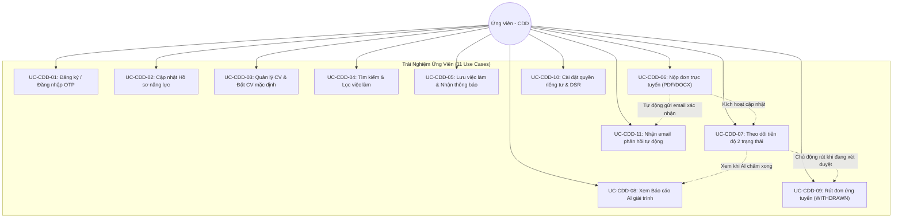
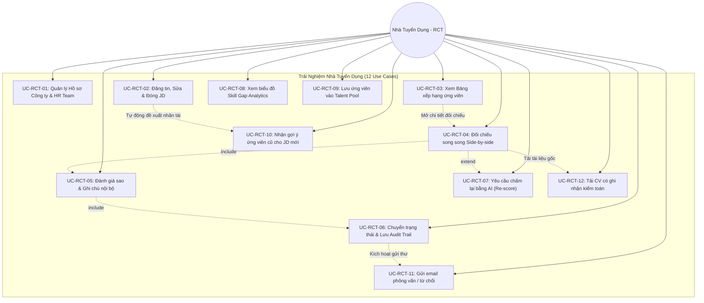
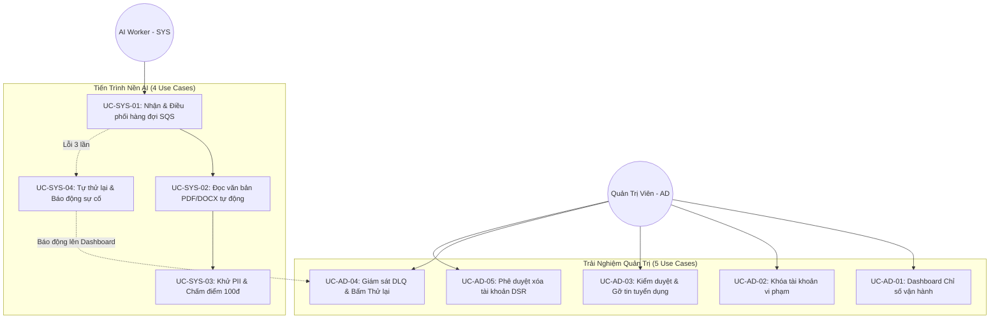

# ĐẶC TẢ TRƯỜNG HỢP SỬ DỤNG (USE CASE SPECIFICATIONS)

# Đề tài: AI CV Screening Portal — Nền Tảng Tuyển Dụng Thông Minh Tích Hợp Generative AI
> **Tài liệu:** Use Case Specifications (Đặc tả trường hợp sử dụng phần mềm)  
> **Mã tài liệu:** `DOC-SW-02-UC`  
> **Phiên bản:** `2.0` · **Ngày ban hành:** 27/10/2026 · **Trạng thái:** Chính thức (Customer-Centric Approved Baseline)  
> **Tài liệu tham chiếu:** [01-requirements.md](file:///d:/AWS/workshop/docs/software/01-requirements.md) (SRS v1.0)

---

## 1. Mục đích & Định hướng Tiếp cận

Tài liệu này đặc tả chi tiết toàn bộ **32 trường hợp sử dụng (Use Cases)** của hệ thống **AI CV Screening Portal** theo **hướng người dùng và tương tác trải nghiệm (Customer-Centric Interaction Flow)** thay vì mô tả thuần túy các chi tiết kỹ thuật hạ tầng.

Tài liệu tập trung làm rõ:
1. **Ý định & Hành vi người dùng (User Actions):** Người dùng nhìn thấy gì, thao tác gì (nhập liệu, bấm nút, kéo thả, lựa chọn).
2. **Phản hồi của Hệ thống (System Feedback):** Hệ thống phản hồi trực quan ra sao trên giao diện (mở modal, hiển thị thông báo, thanh tiến trình, nhãn trạng thái màu sắc, gửi email).
3. **Các kịch bản rẽ nhánh & Xử lý ngoại lệ thân thiện:** Hướng dẫn người dùng cách xử lý khi gặp lỗi (nộp trùng, file quá dung lượng, hết hạn phiên làm việc,...).
4. **Ánh xạ 1:1 chuẩn xác:** Đảm bảo bao phủ toàn bộ 32 yêu cầu chức năng (`CDD01..11`, `RCT01..12`, `AD01..05`, `SYS01..04`) và các quy tắc nghiệp vụ (`BR`).

---

## 2. Danh mục Tác nhân (Actors)

| Mã Actor | Tên Tác nhân | Vai trò trong Hệ sinh thái Trải nghiệm |
| :---: | :--- | :--- |
| **`CDD`** | **Ứng viên (Candidate)** | Người tìm việc; tương tác với cổng thông tin việc làm, tạo hồ sơ năng lực, nộp CV (PDF/DOCX), theo dõi trạng thái hồ sơ theo thời gian thực, xem giải trình đánh giá năng lực minh bạch của AI, thực hiện quyền rút đơn và quản lý quyền riêng tư dữ liệu cá nhân. |
| **`RCT`** | **Nhà tuyển dụng (Recruiter)** | Chuyên viên nhân sự đại diện cho doanh nghiệp (làm việc theo HR Team); đăng tin tuyển dụng, xem bảng xếp hạng ứng viên do AI phân tích, đối chiếu trực quan CV gốc với nhận xét AI (Side-by-side Review), đưa ra quyết định tuyển dụng (Human-in-the-Loop), ghi chú nội bộ có nhật ký kiểm toán và khai thác Kho tài năng (Talent Pool). |
| **`AD`** | **Quản trị viên (Administrator)** | Người vận hành sàn tuyển dụng; theo dõi dashboard chỉ số sức khỏe hệ thống, kiểm duyệt nội dung tin tuyển dụng và tài khoản, theo dõi xử lý các hồ sơ gặp sự cố (DLQ) và phê duyệt các yêu cầu hủy định danh tài khoản người dùng theo luật dữ liệu cá nhân. |
| **`SYS`** | **Tiến trình Xử lý Nền (System AI Worker)** | Tác nhân hệ thống tự động chạy ngầm; đảm nhiệm việc trích xuất văn bản từ CV, chạy bộ lọc khử thông tin nhạy cảm để đảm bảo chấm điểm không thiên vị, điều phối AI phân tích đối soát với JD, cập nhật kết quả và kích hoạt gửi email thông báo cho người dùng. |

---

## 3. Danh mục 32 Use Cases (1:1 với SRS)

| STT | Mã Use Case | Tên Trường hợp Sử dụng | Actor Chính | Mã FR | Ràng buộc Nghiệp vụ (`BR`) |
| :---: | :---: | :--- | :---: | :---: | :--- |
| **I** | **PHÂN HỆ ỨNG VIÊN (CANDIDATE - CDD): 11 USE CASES** | | | |
| 1 | `UC-CDD-01` | Đăng ký, Xác thực OTP & Đăng nhập tài khoản | `CDD` | `CDD01` | `BR-AUTH-01`, `BR-AUTH-02` |
| 2 | `UC-CDD-02` | Quản lý Hồ sơ Cá nhân & Danh mục Kỹ năng | `CDD` | `CDD02` | `BR-PRIV-01` |
| 3 | `UC-CDD-03` | Quản lý Kho CV Cá nhân & Thiết lập CV Mặc định | `CDD` | `CDD03` | `BR-DOC-01`, `BR-DOC-02` |
| 4 | `UC-CDD-04` | Tìm kiếm & Khám phá Cơ hội Việc làm | `CDD` | `CDD04` | — |
| 5 | `UC-CDD-05` | Lưu Việc làm Yêu thích & Đăng ký Nhận tin Tuyển dụng | `CDD` | `CDD05` | — |
| 6 | `UC-CDD-06` | Nộp Hồ sơ Ứng tuyển Trực tuyến (Hỗ trợ PDF & Word) | `CDD` | `CDD06` | `BR-DOC-01..04`, `BR-PRIV-01` |
| 7 | `UC-CDD-07` | Theo dõi Tiến trình Tuyển dụng & Lịch sử Hồ sơ | `CDD` | `CDD07` | `BR-STATE-01` |
| 8 | `UC-CDD-08` | Xem Báo cáo Đánh giá Năng lực Minh bạch từ AI | `CDD` | `CDD08` | `BR-SCORING-01`, `BR-SCORING-02` |
| 9 | `UC-CDD-09` | Rút Đơn Ứng tuyển Tuyển dụng (`WITHDRAWN`) | `CDD` | `CDD09` | `BR-STATE-01`, `BR-STATE-02` |
| 10 | `UC-CDD-10` | Quản lý Quyền riêng tư, Sự đồng ý & Quyền DSR | `CDD` | `CDD10` | `BR-PRIV-01`, `BR-PRIV-02` |
| 11 | `UC-CDD-11` | Nhận Thông báo Email Tuyển dụng Tự động | `CDD` | `CDD11` | `BR-STATE-03` |
| **II** | **PHÂN HỆ NHÀ TUYỂN DỤNG (RECRUITER - RCT): 12 USE CASES** | | | |
| 12 | `UC-RCT-01` | Quản lý Hồ sơ Công ty & Cộng tác Nhóm HR (Company Profile) | `RCT` | `RCT01` | `BR-AUTH-03` |
| 13 | `UC-RCT-02` | Soạn thảo, Xuất bản & Đóng tin Tuyển dụng (JD) | `RCT` | `RCT02` | `BR-AUTH-03` |
| 14 | `UC-RCT-03` | Xem Bảng Xếp hạng Ứng viên Thông minh theo Điểm AI | `RCT` | `RCT03` | `BR-SCORING-02` |
| 15 | `UC-RCT-04` | Đối chiếu Song song 3 Cột (Side-by-side Review) | `RCT` | `RCT04` | — |
| 16 | `UC-RCT-05` | Đánh giá Thủ công, Ghi chú & Chấm điểm Sao (Human-in-the-Loop) | `RCT` | `RCT05` | `BR-HITL-01` |
| 17 | `UC-RCT-06` | Chuyển Trạng thái Tuyển dụng & Lưu Nhật ký Kiểm toán (Audit Trail) | `RCT` | `RCT06` | `BR-STATE-01`, `BR-HITL-02` |
| 18 | `UC-RCT-07` | Kích hoạt Yêu cầu Chấm lại Hồ sơ (Trigger Re-score) | `RCT` | `RCT07` | `BR-RETRY-01`, `BR-RETRY-02` |
| 19 | `UC-RCT-08` | Xem Báo cáo Phân tích Khoảng trống Kỹ năng (Skill Gap Analytics) | `RCT` | `RCT08` | — |
| 20 | `UC-RCT-09` | Lưu trữ & Quản trị Kho Tài năng (Talent Pool) | `RCT` | `RCT09` | `BR-POOL-01..03` |
| 21 | `UC-RCT-10` | Khai thác Gợi ý Ứng viên từ Kho Tài năng cho Tin mới (Rediscovery) | `RCT` | `RCT10` | `BR-POOL-01..02` |
| 22 | `UC-RCT-11` | Gửi Email Mời Phỏng vấn & Thư Từ chối qua SES | `RCT` | `RCT11` | `BR-STATE-03` |
| 23 | `UC-RCT-12` | Tải File CV An toàn & Nhật ký Kiểm toán Truy cập (Access Log) | `RCT` | `RCT12` | `BR-DOC-03`, `NFR-SEC-05` |
| **III** | **PHÂN HỆ QUẢN TRỊ VIÊN (ADMINISTRATOR - AD): 5 USE CASES** | | | |
| 24 | `UC-AD-01` | Bảng Điều khiển Quản trị Chỉ số Vận hành (Admin Dashboard) | `AD` | `AD01` | — |
| 25 | `UC-AD-02` | Kiểm duyệt & Khóa Tài khoản Người dùng Vi phạm | `AD` | `AD02` | `NFR-SEC-01` |
| 26 | `UC-AD-03` | Kiểm duyệt & Gỡ bỏ Tin Tuyển dụng Vi phạm Tiêu chuẩn | `AD` | `AD03` | — |
| 27 | `UC-AD-04` | Giám sát Sự cố Hàng đợi Lỗi DLQ & Kích hoạt Thử lại (Redrive) | `AD` | `AD04` | `NFR-REL-02`, `NFR-OPS-02` |
| 28 | `UC-AD-05` | Phê duyệt & Thực thi Yêu cầu Hủy định danh DSR (`ANONYMIZED_USER`) | `AD` | `AD05` | `BR-PRIV-02`, `NFR-DATA-01..02` |
| **IV** | **PHÂN HỆ TIẾN TRÌNH NỀN AI (SYSTEM WORKER - SYS): 4 USE CASES** | | | |
| 29 | `UC-SYS-01` | Tiếp nhận & Điều phối Hồ sơ Bất đồng bộ qua Hàng đợi | `SYS` | `SYS01` | `NFR-REL-01`, `NFR-REL-03` |
| 30 | `UC-SYS-02` | Tự động Nhận diện Định dạng & Trích xuất Văn bản PDF/DOCX | `SYS` | `SYS02` | `BR-DOC-01`, `NFR-COST-01` |
| 31 | `UC-SYS-03` | Khử Dữ liệu Nhạy cảm PII & Chấm điểm Bedrock Rubric 100đ | `SYS` | `SYS03` | `BR-SCORING-01..03`, `NFR-SEC-03..04` |
| 32 | `UC-SYS-04` | Tự phục hồi Khi Quá tải & Cách ly Bản tin Sự cố vào DLQ | `SYS` | `SYS04` | `NFR-REL-02`, `NFR-OPS-02` |

---

## 4. Sơ đồ Use Case Tổng quan & Phân hệ (Mermaid)

### 4.1. Sơ đồ Phân hệ Ứng viên (`CDD` — 11 Use Cases)

---

### 4.2. Sơ đồ Phân hệ Nhà tuyển dụng (`RCT` — 12 Use Cases)

---

### 4.3. Sơ đồ Phân hệ Quản trị (`AD`) & Hệ thống Nền (`SYS`)

---

## 5. Đặc tả Chi tiết Toàn bộ 32 Use Cases theo Hướng Tương tác Khách hàng

---

### PHÂN HỆ I: ỨNG VIÊN (CANDIDATE - `CDD`)

---

#### 5.1. UC-CDD-01: Đăng ký, Xác thực OTP & Đăng nhập tài khoản
* **Actor chính:** Ứng viên (`CDD`).
* **Ý định người dùng:** Tạo tài khoản định danh để bắt đầu tìm việc và ứng tuyển, đăng nhập an toàn mà không sợ lộ mật khẩu.
* **Điểm chạm (UI Context):** Trang Đăng ký / Đăng nhập (`SCR-CDD-AUTH`), Modal nhập mã xác thực OTP.
* **Tiền điều kiện:** Ứng viên có hộp thư email đang hoạt động.
* **Hậu điều kiện:** Tài khoản được kích hoạt, ứng viên đăng nhập thành công và được chuyển hướng vào Trang chủ Việc làm kèm thông báo chào mừng.
* **Kịch bản Tương tác Chính (Main Flow):**
  1. **[Ứng viên]** Bấm nút **"Đăng ký"** ở góc trên màn hình, điền Email, Họ tên, Số điện thoại và Mật khẩu cá nhân.
  2. **[Hệ thống]** Kiểm tra độ mạnh mật khẩu theo thời gian thực (hiển thị checklist xanh: đủ 8 ký tự, có chữ hoa, thường, số, ký tự đặc biệt theo `BR-AUTH-01`). Khi ứng viên bấm "Tiếp tục", hệ thống gửi email chứa mã OTP 6 số và mở modal "Xác thực Email".
  3. **[Ứng viên]** Mở hộp thư email, lấy mã xác thực 6 số và nhập vào ô OTP trên màn hình.
  4. **[Hệ thống]** Xác thực mã thành công, hiển thị thông báo xanh: *"Kích hoạt tài khoản thành công! Đang chuyển hướng..."*, tự động đăng nhập và lưu phiên làm việc an toàn trong 1 giờ (`BR-AUTH-02`).
  5. **[Ứng viên]** Nhìn thấy thanh điều hướng đổi sang ảnh đại diện cá nhân và sẵn sàng sử dụng các tính năng ứng viên.
* **Trải nghiệm Xử lý Ngoại lệ (Alternative & Exceptions):**
  * *1a. Mật khẩu chưa đủ mạnh:* Hệ thống làm nổi bật ô mật khẩu màu đỏ và hiển thị gợi ý cụ thể tiêu chí còn thiếu.
  * *3a. Không nhận được email mã xác thực:* Hệ thống hiển thị nút bấm *"Gửi lại mã OTP (sau 60s)"*. Khi đồng hồ đếm ngược về 0, ứng viên bấm để nhận mã mới.
  * *3b. Nhập sai mã OTP:* Hệ thống rung nhẹ khung nhập mã và hiển thị thông báo đỏ: *"Mã xác thực không đúng hoặc đã hết hạn. Vui lòng kiểm tra lại."*
  * *4a. Đăng nhập sai quá 5 lần:* Hệ thống hiển thị thông báo cảnh báo bảo mật và tạm khóa thử lại trong 15 phút.
* **Quy tắc ràng buộc:** `BR-AUTH-01`, `BR-AUTH-02`.

---

#### 5.2. UC-CDD-02: Quản lý Hồ sơ Cá nhân & Danh mục Kỹ năng
* **Actor chính:** Ứng viên (`CDD`).
* **Ý định người dùng:** Cập nhật thông tin bản thân, học vấn, kinh nghiệm và danh mục kỹ năng để làm nổi bật năng lực trước nhà tuyển dụng.
* **Điểm chạm (UI Context):** Màn hình Hồ sơ cá nhân (`SCR-CDD-PROFILE`).
* **Tiền điều kiện:** Ứng viên đã đăng nhập thành công.
* **Hậu điều kiện:** Dữ liệu hồ sơ được lưu lại, thanh tiến độ hoàn thiện hồ sơ đạt tỷ lệ phần trăm tương ứng.
* **Kịch bản Tương tác Chính (Main Flow):**
  1. **[Ứng viên]** Bấm vào tên tài khoản và chọn **"Hồ sơ cá nhân"**.
  2. **[Hệ thống]** Hiển thị biểu mẫu thông tin với thanh tiến trình trực quan (ví dụ: *"Hồ sơ của bạn đã hoàn thiện 60%"*).
  3. **[Ứng viên]** Cập nhật Chức danh chuyên môn (VD: "Senior Backend Developer"), chọn Thêm kỹ năng (gõ từ khóa và chọn tag như `Python`, `AWS`, `FastAPI`).
  4. **[Ứng viên]** Điền thông tin học vấn, kinh nghiệm làm việc và dán các liên kết chuyên môn (GitHub, LinkedIn, Website cá nhân).
  5. **[Ứng viên]** Bấm nút **"Lưu hồ sơ"**.
  6. **[Hệ thống]** Hiển thị toast thông báo xanh: *"Cập nhật hồ sơ năng lực thành công!"*, thanh tiến trình cập nhật lên 100%.
* **Quy tắc ràng buộc:** `CDD02`, `NFR-PERF-02`.

---

#### 5.3. UC-CDD-03: Quản lý Kho CV Cá nhân & Thiết lập CV Mặc định
* **Actor chính:** Ứng viên (`CDD`).
* **Ý định người dùng:** Quản lý các bản CV đã chuẩn bị, chọn bản ưng ý nhất làm CV mặc định để nộp nhanh cho các công việc sau này.
* **Điểm chạm (UI Context):** Tab "Quản lý CV" trong trang cá nhân (`SCR-CDD-CV-LIST`).
* **Tiền điều kiện:** Ứng viên đã đăng nhập; có sẵn file CV định dạng `.pdf` hoặc `.docx` trên thiết bị.
* **Hậu điều kiện:** File CV xuất hiện trong danh sách kèm nút Xem trước và nhãn "CV Mặc định".
* **Kịch bản Tương tác Chính (Main Flow):**
  1. **[Ứng viên]** Vào mục "Quản lý CV", nhìn thấy khu vực kéo thả tài liệu (Dropzone) và danh sách các CV đã tải lên trước đó.
  2. **[Ứng viên]** Kéo thả hoặc bấm chọn một file CV mới từ máy tính (hệ thống hỗ trợ cả định dạng `.pdf` và `.docx`, dung lượng tối đa 5MB theo `BR-DOC-01`, `BR-DOC-02`).
  3. **[Hệ thống]** Hiển thị thanh tiến trình tải lên chuyển động mượt mà (0% -> 100%) và thêm CV mới vào danh sách.
  4. **[Ứng viên]** Bấm nút bật công tắc **"Đặt làm CV mặc định"** cạnh file vừa tải.
  5. **[Hệ thống]** Gắn huy hiệu xanh lá *"Mặc định"* cạnh tên file và hiển thị thông báo: *"Đã thiết lập làm CV mặc định khi ứng tuyển nhanh."*
* **Trải nghiệm Xử lý Ngoại lệ (Alternative & Exceptions):**
  * *2a. Chọn file sai định dạng (VD: file ảnh .png, file nén .zip) hoặc vượt quá 5MB:* Vùng kéo thả đổi sang viền đỏ cảnh báo và hiển thị thông báo thân thiện: *"Chỉ chấp nhận file định dạng PDF hoặc Word (.docx) dung lượng dưới 5MB. Vui lòng chọn lại."*
* **Quy tắc ràng buộc:** `BR-DOC-01`, `BR-DOC-02`.

---

#### 5.4. UC-CDD-04: Tìm kiếm & Khám phá Cơ hội Việc làm
* **Actor chính:** Ứng viên (`CDD`).
* **Ý định người dùng:** Tìm kiếm các tin tuyển dụng đang mở phù hợp với chuyên môn, mức lương và địa điểm mong muốn.
* **Điểm chạm (UI Context):** Trang chủ Tìm kiếm Việc làm (`SCR-CDD-JOB-SEARCH`).
* **Tiền điều kiện:** Không bắt buộc đăng nhập để xem danh sách việc làm.
* **Hậu điều kiện:** Danh sách thẻ tin việc làm (Job Cards) phù hợp được hiển thị trực quan.
* **Kịch bản Tương tác Chính (Main Flow):**
  1. **[Ứng viên]** Nhập từ khóa chuyên môn (VD: "Python", "DevOps") vào thanh tìm kiếm lớn ở trang chủ.
  2. **[Ứng viên]** Nhấp chọn các bộ lọc nhanh bằng các thẻ tag: Cấp bậc (Junior/Middle/Senior), Hình thức (Remote, Hybrid, Tại văn phòng), Địa điểm (Hà Nội, TP.HCM), Mức lương.
  3. **[Hệ thống]** Lọc tức thì và hiển thị danh sách các thẻ tin tuyển dụng đang mở tuyển (`status = OPEN`), hiển thị rõ: Tên công việc, Logo công ty, Mức lương, Địa điểm và hạn nộp đơn.
  4. **[Ứng viên]** Nhấp vào một tin việc làm để mở trang chi tiết xem toàn bộ Mô tả công việc (JD), kỹ năng yêu cầu và quyền lợi.
* **Quy tắc ràng buộc:** `CDD04`, `NFR-PERF-02` (Phản hồi kết quả tìm kiếm < 500ms).

---

#### 5.5. UC-CDD-05: Lưu Việc làm Yêu thích & Đăng ký Nhận tin Tuyển dụng
* **Actor chính:** Ứng viên (`CDD`).
* **Ý định người dùng:** Đánh dấu lại các công việc hay để nộp sau và đăng ký nhận email khi công ty có tin tuyển dụng mới.
* **Điểm chạm (UI Context):** Icon Bookmark trên Job Card, Tab "Việc làm đã lưu" (`SCR-CDD-SAVED-JOBS`).
* **Tiền điều kiện:** Ứng viên đã đăng nhập tài khoản.
* **Hậu điều kiện:** Tin tuyển dụng được đưa vào mục yêu thích; hệ thống ghi nhận đăng ký nhận email thông báo.
* **Kịch bản Tương tác Chính (Main Flow):**
  1. **[Ứng viên]** Khi duyệt danh sách việc làm, bấm vào biểu tượng Bookmark (hình trái tim) tại góc thẻ tin.
  2. **[Hệ thống]** Biểu tượng đổi sang màu đỏ nổi bật và hiển thị toast: *"Đã lưu vào danh sách việc làm yêu thích."*
  3. **[Ứng viên]** Bấm nút **"Nhận thông báo việc làm tương tự"**, chọn tần suất nhận email (Hàng ngày hoặc Hàng tuần).
  4. **[Hệ thống]** Xác nhận đăng ký thành công và tự động gửi email chào mừng qua SES.
* **Quy tắc liên quan:** `CDD05`.

---

#### 5.6. UC-CDD-06: Nộp Hồ sơ Ứng tuyển Trực tuyến (Hỗ trợ PDF & Word)
* **Actor chính:** Ứng viên (`CDD`).
* **Ý định người dùng:** Gửi hồ sơ CV của mình cho nhà tuyển dụng nhanh chóng, tiện lợi và chắc chắn rằng hệ thống đã tiếp nhận.
* **Điểm chạm (UI Context):** Modal Nộp hồ sơ (`SCR-CDD-APPLY-MODAL`).
* **Tiền điều kiện:** Ứng viên đã đăng nhập; tin tuyển dụng đang mở nhận đơn.
* **Hậu điều kiện:** Hồ sơ được tiếp nhận thành công; xuất hiện trong bảng theo dõi cá nhân; nhận được email xác nhận.
* **Kịch bản Tương tác Chính (Main Flow):**
  1. **[Ứng viên]** Tại trang chi tiết tin tuyển dụng, bấm nút nổi bật **"Nộp đơn ứng tuyển ngay"**.
  2. **[Hệ thống]** Kiểm tra tính hợp lệ: xác minh ứng viên chưa nộp đơn đang xử lý cho vị trí này (`BR-DOC-03`). Hệ thống mở Modal nộp đơn chuyên nghiệp.
  3. **[Ứng viên]** Chọn một trong hai hình thức:
     - *Cách 1 (Nộp nhanh):* Chọn sử dụng file **"CV Mặc định"** sẵn có trong hồ sơ.
     - *Cách 2 (Tải mới):* Bấm chọn hoặc kéo thả một file CV mới từ thiết bị (chấp nhận file `.pdf` hoặc `.docx` dung lượng <= 5MB).
  4. **[Ứng viên]** Đọc và tích chọn 2 hộp kiểm đồng thuận (`BR-PRIV-01`):
     - [x] *"Tôi đồng ý cho hệ thống AI phân tích CV phục vụ vị trí tuyển dụng này (Bắt buộc)."*
     - [x] *"Tôi đồng ý cho công ty lưu trữ hồ sơ trong Talent Pool để liên hệ cho các cơ hội nghề nghiệp tương lai (Tùy chọn)."*
  5. **[Ứng viên]** Bấm nút **"Gửi hồ sơ ứng tuyển"**.
  6. **[Hệ thống]** Hiển thị thanh tiến trình tải file lên kho lưu trữ an toàn (0% -> 100%), ghi nhận đơn ứng tuyển và gửi thông điệp vào chuỗi xử lý tự động.
  7. **[Hệ thống]** Hiển thị màn hình chúc mừng với biểu tượng thành công xanh lá: *"Nộp hồ sơ thành công! AI đang tiến hành phân tích sơ bộ hồ sơ của bạn (ước tính 30-60 giây)."* Đồng thời gửi email xác nhận nộp hồ sơ tới hòm thư của ứng viên (`BR-STATE-03`).
  8. **[Ứng viên]** Bấm nút *"Xem trạng thái đơn"* để chuyển sang màn hình theo dõi.
* **Trải nghiệm Xử lý Ngoại lệ (Alternative & Exceptions):**
  * *2a. Ứng viên đã nộp đơn cho công việc này trước đó:* Hệ thống không mở modal nộp đơn mà hiển thị thông báo vàng: *"Bạn đã nộp hồ sơ cho vị trí này và đơn đang được xem xét. Bấm vào đây để theo dõi tiến độ."*
  * *3a. File CV tải lên bị lỗi hoặc vượt quá 5MB:* Hệ thống hiển thị cảnh báo đỏ ngay dưới khung kéo thả, nút "Gửi hồ sơ" bị mờ đi cho đến khi chọn file hợp lệ.
* **Quy tắc ràng buộc:** `BR-DOC-01..04`, `BR-STATE-01`, `BR-PRIV-01`.

---

#### 5.7. UC-CDD-07: Theo dõi Tiến trình Tuyển dụng & Lịch sử Hồ sơ
* **Actor chính:** Ứng viên (`CDD`).
* **Ý định người dùng:** Biết rõ hồ sơ của mình đang ở bước nào (AI đang chấm hay Nhà tuyển dụng đang xem) mà không phải thấp thỏm chờ đợi trong im lặng.
* **Điểm chạm (UI Context):** Trang Quản lý Đơn ứng tuyển (`SCR-CDD-HISTORY`).
* **Tiền điều kiện:** Ứng viên đã nộp ít nhất một hồ sơ.
* **Hậu điều kiện:** Danh sách đơn ứng tuyển hiển thị đầy đủ thông tin thời gian và trạng thái rõ ràng.
* **Kịch bản Tương tác Chính (Main Flow):**
  1. **[Ứng viên]** Chọn mục **"Việc đã ứng tuyển"** trên thanh điều hướng.
  2. **[Hệ thống]** Hiển thị danh sách các hồ sơ đã nộp dưới dạng thẻ hoặc bảng trực quan, mỗi hồ sơ hiển thị song song 2 thông tin tiến độ độc lập (`BR-STATE-01`):
     - **Tiến trình Xử lý AI (`ai_status`):** Hiển thị huy hiệu trạng thái chuyển động: `Đang phân tích (EXTRACTING)` -> `Đang chấm điểm (SCORING)` -> `Đã phân tích xong (COMPLETED)`.
     - **Trạng thái Tuyển dụng Tuyển dụng (`status`):** Hiển thị quy trình từng bước rõ ràng: `Đã nộp (SUBMITTED)` -> `Đang xét duyệt (UNDER_REVIEW)` -> `Mời phỏng vấn (INVITED)` / `Chưa phù hợp (REJECTED)` / `Đã rút đơn (WITHDRAWN)`.
  3. **[Ứng viên]** Nhấp vào từng mốc trạng thái để xem nhật ký thời gian chi tiết (VD: Nộp lúc 10:15, AI chấm xong lúc 10:16, HR mở xem lúc 14:30).
* **Quy tắc ràng buộc:** `BR-STATE-01`.

---

#### 5.8. UC-CDD-08: Xem Báo cáo Đánh giá AI Minh bạch
* **Actor chính:** Ứng viên (`CDD`).
* **Ý định người dùng:** Xem kết quả đánh giá khách quan của AI để biết hồ sơ của mình mạnh ở điểm nào và cần bổ sung kỹ năng gì so với yêu cầu của thị trường.
* **Điểm chạm (UI Context):** Modal Báo cáo Năng lực AI (`SCR-CDD-REPORT-MODAL`).
* **Tiền điều kiện:** Đơn ứng tuyển có tiến trình AI đã hoàn tất (`ai_status = COMPLETED`).
* **Hậu điều kiện:** Báo cáo phân tích hiển thị đầy đủ điểm số và lời khuyên phát triển năng lực.
* **Kịch bản Tương tác Chính (Main Flow):**
  1. **[Ứng viên]** Tại đơn ứng tuyển đã có kết quả AI, bấm nút **"Xem Báo cáo Đánh giá AI"**.
  2. **[Hệ thống]** Mở giao diện Báo cáo Năng lực Minh bạch trực quan, đẹp mắt gồm các phần:
     - **Điểm tổng quan & Xếp hạng độ phù hợp:** Vòng tròn điểm số (thang điểm 100) kèm huy hiệu xếp loại: `Strong Match` (Rất phù hợp - Xanh lá), `Potential Match` (Tiềm năng - Vàng), `Not Match` (Chưa phù hợp - Xám) (`BR-SCORING-02`).
     - **Biểu đồ 4 Trọng số Rubric:** Thanh đo điểm chi tiết 4 phần: Kỹ năng chuyên môn (40đ), Kinh nghiệm làm việc (30đ), Học vấn & Bằng cấp (15đ), Kỹ năng mềm (15đ) (`BR-SCORING-01`).
     - **Nhận xét Tổng quan:** Đoạn tóm tắt súc tích, chuyên nghiệp do AI tổng hợp từ CV đối chiếu với JD.
     - **Điểm sáng Nổi bật (Strengths):** Danh sách các kỹ năng hoặc kinh nghiệm ấn tượng nhất của ứng viên.
     - **Khoảng trống Kỹ năng (Skill Gaps):** Danh sách các kỹ năng yêu cầu trong JD mà CV chưa thể hiện rõ, kèm gợi ý cải thiện.
  3. **[Ứng viên]** Đọc nhận xét, có thể tải báo cáo về máy hoặc lưu lại để hoàn thiện bản thân cho các đợt ứng tuyển sau.
* **Quy tắc ràng buộc:** `BR-SCORING-01`, `BR-SCORING-02`.

---

#### 5.9. UC-CDD-09: Rút Đơn Ứng tuyển (`WITHDRAWN`)
* **Actor chính:** Ứng viên (`CDD`).
* **Ý định người dùng:** Chủ động rút lại hồ sơ khi đã nhận được lời mời làm việc khác hoặc không còn nguyện vọng ứng tuyển vào vị trí này.
* **Điểm chạm (UI Context):** Nút "Rút đơn" và Hộp thoại xác nhận rút đơn (`SCR-CDD-WITHDRAW-MODAL`).
* **Tiền điều kiện:** Đơn ứng tuyển đang ở trạng thái `SUBMITTED` (Mới nộp) hoặc `UNDER_REVIEW` (Đang xét duyệt sơ bộ) (`BR-STATE-02`).
* **Hậu điều kiện:** Trạng thái đơn chuyển sang `WITHDRAWN`, hệ thống ngưng xét duyệt và thông báo cho Recruiter.
* **Kịch bản Tương tác Chính (Main Flow):**
  1. **[Ứng viên]** Tại trang danh sách đơn ứng tuyển, tìm đến hồ sơ muốn rút và bấm nút **"Rút đơn ứng tuyển"**.
  2. **[Hệ thống]** Kiểm tra điều kiện cho phép rút (`BR-STATE-02`). Mở hộp thoại cảnh báo: *"Bạn có chắc chắn muốn rút đơn ứng tuyển vị trí này? Thao tác này sẽ dừng toàn bộ quá trình xét tuyển và không thể hoàn tác."* Kèm một ô chọn lý do (Đã tìm được việc khác, Thay đổi kế hoạch cá nhân, Lý do khác).
  3. **[Ứng viên]** Chọn lý do rút đơn và bấm **"Xác nhận rút đơn"**.
  4. **[Hệ thống]** Cập nhật trạng thái đơn sang huy hiệu xám **"Đã rút đơn (WITHDRAWN)"**, gửi email thông báo xác nhận việc rút đơn tới ứng viên và gửi thông báo cập nhật tới nhà tuyển dụng.
* **Trải nghiệm Xử lý Ngoại lệ (Alternative & Exceptions):**
  * *2a. Đơn ứng tuyển đã chuyển sang trạng thái "Mời phỏng vấn (INVITED)" hoặc "Đã tuyển (ACCEPTED)":* Nút rút đơn bị ẩn hoặc khi bấm vào, hệ thống hiển thị thông báo: *"Hồ sơ của bạn đã bước vào vòng phỏng vấn chính thức. Vui lòng liên hệ trực tiếp với nhà tuyển dụng qua email để hủy lịch hẹn."*
* **Quy tắc ràng buộc:** `BR-STATE-01`, `BR-STATE-02`.

---

#### 5.10. UC-CDD-10: Quản lý Quyền riêng tư, Sự đồng ý & Quyền DSR
* **Actor chính:** Ứng viên (`CDD`).
* **Ý định người dùng:** Kiểm soát hoàn toàn dữ liệu cá nhân của mình, có quyền tải dữ liệu về máy hoặc yêu cầu xóa sạch thông tin khỏi hệ thống (Quyền được lãng quên).
* **Điểm chạm (UI Context):** Trang Cài đặt Quyền riêng tư (`SCR-CDD-PRIVACY`).
* **Tiền điều kiện:** Ứng viên đã đăng nhập.
* **Hậu điều kiện:** Lựa chọn quyền riêng tư được lưu; hoặc file dữ liệu được tải về; hoặc lệnh xóa tài khoản được khởi tạo.
* **Kịch bản Tương tác Chính (Main Flow):**
  1. **[Ứng viên]** Vào phần Cài đặt tài khoản, chọn **"Quyền riêng tư & Dữ liệu cá nhân"**.
  2. **[Ứng viên]** Xem và thao tác trên 3 khu vực chức năng rõ ràng:
     - **Khu vực 1 (Quản lý Consent):** Bật/tắt công tắc gạt *"Cho phép lưu hồ sơ vào Talent Pool để nhận cơ hội việc làm tương lai"* (`BR-PRIV-01`).
     - **Khu vực 2 (Tải dữ liệu - Data Portability):** Bấm nút *"Tải về bản sao dữ liệu của tôi"*. Hệ thống xuất ngay một file dữ liệu chuẩn định dạng JSON chứa toàn bộ thông tin cá nhân và lịch sử ứng tuyển.
     - **Khu vực 3 (Xóa tài khoản - Right to be Forgotten):** Bấm nút màu đỏ *"Yêu cầu xóa tài khoản & Dữ liệu vĩnh viễn"*.
  3. **[Ứng viên]** (Khi chọn xóa tài khoản): Đọc thông báo giải thích về việc hủy tài khoản, nhập mật khẩu hiện tại để xác thực chính chủ và bấm *"Xác nhận xóa"*.
  4. **[Hệ thống]** Xác thực thành công, thực thi quy trình hủy định danh bảo vệ dữ liệu (`BR-PRIV-02`): Xóa tài khoản đăng nhập, xóa vĩnh viễn file CV trên kho lưu trữ, xóa hồ sơ cá nhân và chuyển đổi định danh lịch sử thành `ANONYMIZED_USER`.
  5. **[Hệ thống]** Đăng xuất người dùng, hiển thị thông báo: *"Tài khoản và dữ liệu cá nhân của bạn đã được xóa vĩnh viễn khỏi hệ thống."*
* **Quy tắc ràng buộc:** `BR-PRIV-01`, `BR-PRIV-02`.

---

#### 5.11. UC-CDD-11: Nhận Thông báo Email Tuyển dụng Tự động
* **Actor chính:** Ứng viên (`CDD`).
* **Ý định người dùng:** Nhận được thông tin cập nhật tức thì, chuyên nghiệp trong hộp thư đến cá nhân mà không cần phải liên tục đăng nhập website để kiểm tra.
* **Điểm chạm (UI Context):** Ứng dụng Hòm thư điện tử cá nhân (Gmail, Outlook,...).
* **Tiền điều kiện:** Có sự kiện tuyển dụng phát sinh liên quan đến ứng viên.
* **Hậu điều kiện:** Email được chuyển phát an toàn, đúng người nhận, đúng nội dung.
* **Kịch bản Tương tác Chính (Main Flow):**
  1. **[Hệ thống]** Khi có sự kiện phát sinh (Nộp đơn thành công, AI hoàn thành chấm điểm, Recruiter gửi thư mời phỏng vấn, Thư từ chối, hoặc Thư lưu Talent Pool), hệ thống tự động soạn email theo mẫu chuẩn đẹp mắt (`BR-STATE-03`).
  2. **[Ứng viên]** Mở hộp thư cá nhân, nhìn thấy email gửi từ tên thương hiệu tuyển dụng với tiêu đề rõ ràng (VD: *"Xác nhận tiếp nhận hồ sơ - Vị trí Backend Developer tại Công ty ABC"*).
  3. **[Ứng viên]** Mở email xem nội dung được cá nhân hóa trang trọng (kính gửi tên ứng viên, thời gian phỏng vấn, liên kết bấm vào xem trực tiếp trên portal).
* **Quy tắc ràng buộc:** `BR-STATE-03`.

---

### PHÂN HỆ II: NHÀ TUYỂN DỤNG (RECRUITER - `RCT`)

---

#### 5.12. UC-RCT-01: Quản lý Hồ sơ Công ty & Cộng tác Nhóm HR (Company Profile)
* **Actor chính:** Nhà tuyển dụng (`RCT`).
* **Ý định người dùng:** Xây dựng thương hiệu tuyển dụng chuyên nghiệp cho công ty và mời các đồng nghiệp nhân sự cùng tham gia quản lý chung danh sách ứng viên.
* **Điểm chạm (UI Context):** Trang Quản lý Doanh nghiệp (`SCR-RCT-COMPANY`).
* **Tiền điều kiện:** Người dùng đăng nhập bằng tài khoản Recruiter.
* **Hậu điều kiện:** Hồ sơ công ty được hiển thị công khai; các thành viên được mời có quyền quản trị chung.
* **Kịch bản Tương tác Chính (Main Flow):**
  1. **[Recruiter]** Vào mục **"Hồ sơ Công ty"**, tải lên Logo thương hiệu, cập nhật Tên công ty, Website, Địa chỉ trụ sở, Quy mô nhân sự và bài viết giới thiệu môi trường làm việc.
  2. **[Recruiter]** Bấm nút **"Lưu thông tin"**; hệ thống cập nhật và làm mới trang giới thiệu công ty.
  3. **[Recruiter]** Chuyển sang tab **"Nhóm Nhân sự (HR Team)"**, bấm nút *"Mời thành viên mới"*, nhập email của đồng nghiệp HR và chọn vai trò.
  4. **[Hệ thống]** Gửi thư mời tham gia nhóm công ty qua email. Khi đồng nghiệp đăng nhập, họ tự động được cấp quyền cùng xem và quản lý danh sách việc làm cũng như hồ sơ ứng viên của công ty (`BR-AUTH-03`).
* **Quy tắc ràng buộc:** `BR-AUTH-03`.

---

#### 5.13. UC-RCT-02: Soạn thảo, Xuất bản & Đóng tin Tuyển dụng (JD)
* **Actor chính:** Nhà tuyển dụng (`RCT`).
* **Ý định người dùng:** Đăng tin tuyển dụng mới với đầy đủ tiêu chí kỹ thuật rõ ràng để thu hút ứng viên và làm căn cứ cho AI chấm điểm chính xác.
* **Điểm chạm (UI Context):** Trình tạo tin tuyển dụng (`SCR-RCT-JOB-EDIT`).
* **Tiền điều kiện:** Recruiter thuộc về một Công ty tuyển dụng.
* **Hậu điều kiện:** Tin tuyển dụng hiển thị trên sàn việc làm ở trạng thái `OPEN`.
* **Kịch bản Tương tác Chính (Main Flow):**
  1. **[Recruiter]** Bấm nút nổi bật **"Đăng tin tuyển dụng mới"**.
  2. **[Recruiter]** Điền thông tin theo biểu mẫu hướng dẫn:
     - Tiêu đề công việc, Cấp bậc, Địa điểm, Khoảng lương dự kiến.
     - Mô tả chi tiết trách nhiệm công việc.
     - Nhập danh mục **Kỹ năng bắt buộc** (Required Skills) và **Kỹ năng ưu tiên** (Nice-to-have).
     - Số năm kinh nghiệm tối thiểu, yêu cầu bằng cấp và Hạn chót nhận hồ sơ.
  3. **[Recruiter]** Bấm nút **"Xem trước (Preview)"** để kiểm tra giao diện hiển thị phía ứng viên.
  4. **[Recruiter]** Bấm nút **"Xuất bản tin tuyển dụng"**.
  5. **[Hệ thống]** Chuyển trạng thái tin sang `OPEN`, hiển thị ngay lập tức trên trang chủ và sẵn sàng đón nhận hồ sơ ứng tuyển.
  6. **[Recruiter]** (Khi đã tuyển đủ nhân sự): Bấm nút **"Đóng tin tuyển dụng"**; hệ thống chuyển sang trạng thái `CLOSED` để dừng nhận hồ sơ mới nhưng vẫn lưu trữ danh sách ứng viên cũ.
* **Quy tắc ràng buộc:** `BR-AUTH-03`.

---

#### 5.14. UC-RCT-03: Xem Bảng Xếp hạng Ứng viên Thông minh theo Điểm AI
* **Actor chính:** Nhà tuyển dụng (`RCT`).
* **Ý định người dùng:** Xem danh sách ứng viên đã được hệ thống sắp xếp khoa học theo mức độ phù hợp, giúp tiết kiệm thời gian lọc thủ công và không bỏ sót người tài.
* **Điểm chạm (UI Context):** Trang Quản lý Đơn ứng tuyển của tin JD (`SCR-RCT-RANKING`).
* **Tiền điều kiện:** Tin tuyển dụng đã có ứng viên nộp và AI đã chấm điểm xong.
* **Hậu điều kiện:** Danh sách ứng viên hiển thị theo thứ tự điểm số giảm dần kèm các bộ lọc tiện lợi.
* **Kịch bản Tương tác Chính (Main Flow):**
  1. **[Recruiter]** Chọn một tin tuyển dụng đang mở và vào mục **"Ứng viên đã nộp"**.
  2. **[Hệ thống]** Hiển thị bảng danh sách ứng viên được tự động sắp xếp theo thứ tự điểm AI từ cao nhất (100 điểm) xuống thấp nhất.
  3. **[Recruiter]** Quan sát các huy hiệu xếp loại trực quan theo màu sắc (`BR-SCORING-02`):
     - **Strong Match (>= 80đ - Xanh lá):** Ứng viên xuất sắc, phù hợp vượt trội.
     - **Potential Match (60–79đ - Vàng):** Ứng viên tiềm năng, đáp ứng tốt phần lớn tiêu chí.
     - **Not Match (< 60đ - Xám):** Chưa đáp ứng tiêu chí cốt lõi.
  4. **[Recruiter]** Bấm vào các tab bộ lọc nhanh trên đầu bảng (VD: bấm tab *"Strong Match"* để chỉ xem nhóm ứng viên top đầu) hoặc tìm kiếm theo kỹ năng cụ thể.
* **Quy tắc ràng buộc:** `BR-SCORING-01`, `BR-SCORING-02`.

---

#### 5.15. UC-RCT-04: Đối chiếu Song song 3 Cột (Side-by-side Review)
* **Actor chính:** Nhà tuyển dụng (`RCT`).
* **Ý định người dùng:** Mở một không gian làm việc chuyên nghiệp để vừa xem CV gốc của ứng viên, vừa đối soát với phân tích của AI mà không cần phải chuyển đổi qua lại giữa nhiều tab trình duyệt.
* **Điểm chạm (UI Context):** Giao diện Side-by-side Review (`SCR-RCT-SIDEBYSIDE`).
* **Tiền điều kiện:** Recruiter chọn một ứng viên từ bảng xếp hạng.
* **Hậu điều kiện:** Giao diện 3 cột được tải đầy đủ, hỗ trợ cuộn và đối soát trực tiếp.
* **Kịch bản Tương tác Chính (Main Flow):**
  1. **[Recruiter]** Nhấp vào tên một ứng viên trên bảng xếp hạng.
  2. **[Hệ thống]** Mở giao diện toàn màn hình được chia thành **3 Cột song song chuyên nghiệp**:
     - **Cột 1 (Trái - Tài liệu CV gốc):** Trình xem tài liệu trực tiếp hiển thị file PDF hoặc nội dung Word DOCX gốc của ứng viên.
     - **Cột 2 (Giữa - Báo cáo Phân tích AI):** Hiển thị chi tiết bảng điểm 4 phần của Rubric 100đ, đoạn tóm tắt kinh nghiệm, danh sách điểm mạnh đối chiếu với JD và các kỹ năng còn thiếu.
     - **Cột 3 (Phải - Bảng Đánh giá & Ra quyết định):** Không gian dành riêng cho nhà tuyển dụng nhập đánh giá của con người.
  3. **[Recruiter]** Đọc CV ở cột trái, đối chiếu với các bằng chứng trích dẫn ở cột giữa để có cái nhìn toàn diện, khách quan về năng lực ứng viên.
* **Quy tắc liên quan:** `RCT04`.

---

#### 5.16. UC-RCT-05: Đánh giá Thủ công, Ghi chú & Chấm điểm Sao (Human-in-the-Loop)
* **Actor chính:** Nhà tuyển dụng (`RCT`).
* **Ý định người dùng:** Đưa ra nhận xét chuyên môn của con người, chấm điểm sao nội bộ và lưu lại ghi chú cho các đồng nghiệp HR cùng thảo luận.
* **Điểm chạm (UI Context):** Cột thứ 3 trong màn hình Side-by-side Review (`SCR-RCT-EVALUATION`).
* **Tiền điều kiện:** Recruiter đang mở hồ sơ chi tiết của ứng viên.
* **Hậu điều kiện:** Điểm sao và ghi chú được lưu lại, gắn liền với tên của Recruiter và thời gian đánh giá.
* **Kịch bản Tương tác Chính (Main Flow):**
  1. **[Recruiter]** Tại Cột 3 của màn hình đánh giá, nhấp chọn số sao đánh giá thủ công (từ 1 đến 5 sao) (`BR-HITL-01`).
  2. **[Recruiter]** Gõ nhận xét vào ô ghi chú nội bộ (VD: *"Ứng viên có kỹ năng System Design rất tốt, đã từng lead dự án AWS, cần kiểm tra thêm khả năng giao tiếp tiếng Anh ở vòng phỏng vấn"*).
  3. **[Recruiter]** Bấm nút **"Lưu nhận xét & Đánh giá"**.
  4. **[Hệ thống]** Lưu dữ liệu và hiển thị ngay dòng ghi chú vào danh sách lịch sử đánh giá kèm avatar, tên Recruiter và dấu thời gian chính xác để các thành viên khác trong HR Team cùng theo dõi.
* **Quy tắc ràng buộc:** `BR-HITL-01`.

---

#### 5.17. UC-RCT-06: Chuyển Trạng thái Tuyển dụng & Lưu Nhật ký Kiểm toán (Audit Trail)
* **Actor chính:** Nhà tuyển dụng (`RCT`).
* **Ý định người dùng:** Đưa ra quyết định tuyển dụng chính thức cho hồ sơ (mời phỏng vấn hoặc từ chối) và đảm bảo mọi quyết định đều được lưu lại nhật ký minh bạch.
* **Điểm chạm (UI Context):** Menu Chuyển trạng thái tuyển dụng (`SCR-RCT-STATUS-CHANGE`).
* **Tiền điều kiện:** Recruiter có thẩm quyền tuyển dụng trong công ty.
* **Hậu điều kiện:** Trạng thái hồ sơ được cập nhật; một dòng nhật ký kiểm toán không thể sửa/xóa được lưu lại.
* **Kịch bản Tương tác Chính (Main Flow):**
  1. **[Recruiter]** Tại bảng điều khiển đánh giá, nhấp vào menu thả xuống **"Trạng thái tuyển dụng"**.
  2. **[Recruiter]** Chọn trạng thái mới mong muốn: `Mời phỏng vấn (INVITED)` hoặc `Chưa phù hợp (REJECTED)`.
  3. **[Hệ thống]** Hiển thị hộp thoại xác nhận kèm tùy chọn gửi email tự động tới ứng viên.
  4. **[Recruiter]** Bấm **"Xác nhận cập nhật"**.
  5. **[Hệ thống]** Cập nhật trạng thái mới cho hồ sơ theo ma trận chuyển trạng thái hợp lệ (`BR-STATE-01`).
  6. **[Hệ thống]** Tự động ghi nhận một dòng nhật ký kiểm toán bất biến (**Audit Trail - `BR-HITL-02`**) hiển thị công khai trong hồ sơ: *"HR Nguyễn Văn A đã chuyển trạng thái từ 'Đang xét duyệt' sang 'Mời phỏng vấn' vào lúc 15:30 ngày 27/10/2026."*
* **Quy tắc ràng buộc:** `BR-STATE-01`, `BR-HITL-02`.

---

#### 5.18. UC-RCT-07: Kích hoạt Yêu cầu Chấm lại Hồ sơ (Trigger Re-score)
* **Actor chính:** Nhà tuyển dụng (`RCT`).
* **Ý định người dùng:** Yêu cầu AI quét và phân tích lại hồ sơ khi JD vừa được cập nhật yêu cầu mới hoặc khi muốn kiểm tra lại độ chính xác.
* **Điểm chạm (UI Context):** Nút "Chấm lại bằng AI" (`SCR-RCT-RESCORE-BTN`).
* **Tiền điều kiện:** Hồ sơ đã từng được chấm điểm AI trước đó; chưa vượt quá giới hạn lượt chấm trong giờ.
* **Hậu điều kiện:** Trạng thái AI chuyển sang `PENDING` và bắt đầu chu trình phân tích lại.
* **Kịch bản Tương tác Chính (Main Flow):**
  1. **[Recruiter]** Bấm vào nút **"Chấm lại bằng AI (Re-score)"** tại góc màn hình chi tiết ứng viên.
  2. **[Hệ thống]** Kiểm tra tần suất: xác minh hồ sơ này chưa bị kích hoạt quá 3 lần trong vòng 1 giờ qua (`BR-RETRY-02`).
  3. **[Hệ thống]** Chuyển huy hiệu AI sang trạng thái chuyển động xoay tròn: *"Đang phân tích lại hồ sơ..."*.
  4. **[Hệ thống]** Sau khi hoàn tất (30–60 giây), bảng điểm và nhận xét AI tự động làm mới trên màn hình, hiển thị nhãn: *"Vừa chấm lại lúc 15:45"*.
* **Trải nghiệm Xử lý Ngoại lệ (Alternative & Exceptions):**
  * *2a. Bấm nút quá 3 lần trong vòng 1 giờ:* Hệ thống vô hiệu hóa nút bấm và hiển thị thông báo: *"Bạn đã thực hiện chấm lại 3 lần trong 1 giờ qua. Vui lòng thử lại sau 25 phút nữa để đảm bảo tài nguyên hệ thống."*
* **Quy tắc ràng buộc:** `BR-RETRY-01`, `BR-RETRY-02`.

---

#### 5.19. UC-RCT-08: Xem Báo cáo Phân tích Khoảng trống Kỹ năng (Skill Gap Analytics)
* **Actor chính:** Nhà tuyển dụng (`RCT`).
* **Ý định người dùng:** Xem bức tranh tổng thể về năng lực của toàn bộ ứng viên nộp cho vị trí này, biết được kỹ năng nào ứng viên có nhiều, kỹ năng nào thị trường đang thiếu hụt trầm trọng.
* **Điểm chạm (UI Context):** Tab "Báo cáo Kỹ năng (Skill Gap)" của tin tuyển dụng (`SCR-RCT-SKILLGAP`).
* **Tiền điều kiện:** Tin tuyển dụng có ứng viên đã được AI phân tích.
* **Hậu điều kiện:** Biểu đồ phân tích năng lực trực quan hiển thị đầy đủ.
* **Kịch bản Tương tác Chính (Main Flow):**
  1. **[Recruiter]** Tại tin tuyển dụng, chọn tab **"Phân tích Kỹ năng (Skill Gap)"**.
  2. **[Hệ thống]** Tổng hợp dữ liệu từ tất cả ứng viên và hiển thị biểu đồ đồ họa trực quan:
     - **Cột Kỹ năng Phổ biến (Top Skills):** Biểu đồ thanh ngang thể hiện tỷ lệ phần trăm ứng viên đáp ứng (VD: 95% có kỹ năng Git, 80% có Docker).
     - **Cột Khoảng trống Thiếu hụt (Key Skill Gaps):** Cảnh báo các kỹ năng bắt buộc trong JD nhưng tỷ lệ ứng viên đáp ứng rất thấp (VD: Chỉ 12% ứng viên có chứng chỉ AWS Solution Architect).
     - **Biểu đồ Phân bổ Điểm số:** Phổ điểm tập trung từ 60 đến 75 điểm.
  3. **[Recruiter]** Sử dụng thông tin này để trao đổi với Tech Lead nhằm cân nhắc nới lỏng hoặc đào tạo thêm kỹ năng còn thiếu sau khi tuyển dụng.
* **Quy tắc liên quan:** `RCT08`.

---

#### 5.20. UC-RCT-09: Lưu trữ & Quản trị Kho Tài năng (Talent Pool Management)
* **Actor chính:** Nhà tuyển dụng (`RCT`).
* **Ý định người dùng:** Giữ lại các ứng viên giỏi nhưng chưa thể tuyển ngay ở đợt này vào kho dữ liệu nhân tài của công ty để liên hệ lại khi có đợt tuyển sau.
* **Điểm chạm (UI Context):** Nút "Lưu vào Talent Pool", Danh mục Talent Pool (`SCR-RCT-POOL-LIST`).
* **Tiền điều kiện:** Ứng viên có điểm AI từ loại Tiềm năng trở lên (>= 60 điểm theo `BR-POOL-01`); Ứng viên đã tích đồng ý lưu Talent Pool khi nộp đơn (`BR-POOL-03`).
* **Hậu điều kiện:** Hồ sơ được chuyển vào danh mục Talent Pool của công ty với thời hạn lưu 12 tháng (`BR-POOL-02`).
* **Kịch bản Tương tác Chính (Main Flow):**
  1. **[Recruiter]** Khi quyết định từ chối một ứng viên tiềm năng do vị trí đã hết chỉ tiêu, bấm nút **"Lưu vào Talent Pool"**.
  2. **[Hệ thống]** Kiểm tra điều kiện: xác nhận điểm số >= 60 và ứng viên đã bật chấp thuận lưu trữ (`BR-POOL-01..03`).
  3. **[Hệ thống]** Hiển thị thông báo thành công: *"Đã lưu ứng viên vào Kho tài năng của công ty (thời hạn 12 tháng)."* Đồng thời kích hoạt gửi email thông báo trân trọng tới ứng viên.
  4. **[Recruiter]** Vào tab **"Kho tài năng (Talent Pool)"** chung của công ty để tra cứu danh sách ứng viên tiềm năng bất kỳ lúc nào bằng thanh tìm kiếm kỹ năng.
* **Trải nghiệm Xử lý Ngoại lệ (Alternative & Exceptions):**
  * *2a. Ứng viên không tích chọn đồng ý lưu Talent Pool khi nộp đơn:* Hệ thống hiển thị thông báo: *"Ứng viên này không cấp quyền lưu trữ hồ sơ ngoài vị trí ứng tuyển hiện tại theo chính sách quyền riêng tư."* Nút lưu Talent Pool bị vô hiệu hóa.
* **Quy tắc ràng buộc:** `BR-POOL-01..03`.

---

#### 5.21. UC-RCT-10: Khai thác Gợi ý Ứng viên từ Kho Tài năng cho Tin mới (Rediscovery)
* **Actor chính:** Nhà tuyển dụng (`RCT`).
* **Ý định người dùng:** Tự động tìm lại những ứng viên tiềm năng đã lưu trước đây phù hợp với công việc mới vừa đăng, giúp có ngay ứng viên chất lượng mà không cần tốn tiền đăng tin hay chờ đợi nộp đơn.
* **Điểm chạm (UI Context):** Widget "Ứng viên phù hợp từ Talent Pool" trên trang chi tiết JD (`SCR-RCT-REDISCOVERY`).
* **Tiền điều kiện:** Trong Talent Pool của công ty có sẵn hồ sơ còn hạn lưu trữ; Recruiter vừa tạo hoặc mở một tin tuyển dụng mới.
* **Hậu điều kiện:** Danh sách top ứng viên tiềm năng từ kho cũ được hiển thị kèm tỷ lệ tương thích.
* **Kịch bản Tương tác Chính (Main Flow):**
  1. **[Recruiter]** Mở một tin tuyển dụng mới vừa xuất bản.
  2. **[Hệ thống]** Tự động đối chiếu yêu cầu của JD mới với các hồ sơ trong Talent Pool và hiển thị một khung nổi bật: **"AI Đề xuất: 3 Ứng viên tiềm năng từ Kho tài năng của công ty"**.
  3. **[Recruiter]** Xem danh sách đề xuất hiển thị sẵn tên ứng viên, điểm số tương thích và lý do gợi ý (VD: *"Ứng viên A từng đạt 85 điểm cho vị trí Frontend cũ, rất khớp với kỹ năng React/TypeScript của tin này"*).
  4. **[Recruiter]** Bấm nút **"Mời ứng tuyển lại"**; hệ thống mở modal soạn sẵn thư mời gửi tới email ứng viên chỉ với 1 cú click chuột.
* **Quy tắc ràng buộc:** `BR-POOL-01`, `BR-POOL-02`.

---

#### 5.22. UC-RCT-11: Gửi Email Mời Phỏng vấn & Thư Từ chối qua SES
* **Actor chính:** Nhà tuyển dụng (`RCT`).
* **Ý định người dùng:** Gửi thông điệp tuyển dụng cá nhân hóa, lịch sự và nhanh chóng tới ứng viên thông qua hệ thống email chuyên nghiệp.
* **Điểm chạm (UI Context):** Modal Soạn Email Tuyển dụng (`SCR-RCT-EMAIL-MODAL`).
* **Tiền điều kiện:** Ứng viên đã được chuyển trạng thái sang `INVITED` hoặc `REJECTED`.
* **Hậu điều kiện:** Email được gửi đi thành công tới hộp thư của ứng viên.
* **Kịch bản Tương tác Chính (Main Flow):**
  1. **[Recruiter]** Khi chuyển trạng thái ứng viên sang `INVITED` (hoặc `REJECTED`), hệ thống tự động mở Modal soạn email.
  2. **[Hệ thống]** Điền sẵn mẫu thư chuẩn hóa trang trọng theo thương hiệu công ty.
  3. **[Recruiter]** (Nếu là thư mời phỏng vấn): Bổ sung ngày giờ phỏng vấn, liên kết phòng họp trực tuyến (Google Meet/Zoom) và tên người phỏng vấn.
  4. **[Recruiter]** Bấm nút **"Gửi Thư Phỏng Vấn"**.
  5. **[Hệ thống]** Gửi email qua Amazon SES, hiển thị thông báo thành công: *"Email mời phỏng vấn đã được gửi thành công tới ungvien@email.com."*
* **Quy tắc ràng buộc:** `BR-STATE-03`.

---

#### 5.23. UC-RCT-12: Tải File CV An toàn & Nhật ký Kiểm toán Truy cập (Access Log)
* **Actor chính:** Nhà tuyển dụng (`RCT`).
* **Ý định người dùng:** Tải bản CV gốc về máy tính để chia sẻ với người phỏng vấn chuyên môn, đảm bảo tuân thủ bảo mật và không bị rò rỉ dữ liệu.
* **Điểm chạm (UI Context):** Nút "Tải file CV gốc" tại màn hình đối chiếu (`SCR-RCT-AUDIT-LOG`).
* **Tiền điều kiện:** Recruiter có quyền xem hồ sơ thuộc công ty mình (`BR-AUTH-03`).
* **Hậu điều kiện:** File CV được tải về thiết bị; hệ thống tự động ghi nhật ký truy cập tải file.
* **Kịch bản Tương tác Chính (Main Flow):**
  1. **[Recruiter]** Tại màn hình xem chi tiết ứng viên, bấm nút **"Tải CV gốc (.pdf / .docx)"**.
  2. **[Hệ thống]** Kiểm tra phân quyền hợp lệ, sinh đường link tải bảo mật tạm thời (tự hủy sau 5 phút theo `BR-DOC-03`).
  3. **[Hệ thống]** Tự động ghi lại một dòng nhật ký kiểm toán truy cập (`NFR-SEC-05`): Ghi nhận rõ Recruiter nào đã tải, tải lúc mấy giờ, từ địa chỉ IP nào.
  4. **[Recruiter]** Trình duyệt lưu file an toàn về máy tính.
* **Quy tắc ràng buộc:** `BR-DOC-03`, `NFR-SEC-05`.

---

### PHÂN HỆ III: QUẢN TRỊ VIÊN (ADMINISTRATOR - `AD`)

---

#### 5.24. UC-AD-01: Bảng Điều khiển Quản trị Chỉ số Vận hành (Admin Dashboard)
* **Actor chính:** Quản trị viên (`AD`).
* **Ý định người dùng:** Nắm bắt toàn bộ sức khỏe của hệ thống tuyển dụng, số lượng người dùng và chi phí đám mây theo thời gian thực.
* **Điểm chạm (UI Context):** Trang Admin Dashboard (`SCR-AD-DASHBOARD`).
* **Tiền điều kiện:** Đăng nhập bằng tài khoản Quản trị viên (`Admin`).
* **Hậu điều kiện:** Các thẻ số liệu và biểu đồ vận hành hiển thị đầy đủ, trực quan.
* **Kịch bản Tương tác Chính (Main Flow):**
  1. **[Admin]** Đăng nhập vào trang quản trị hệ thống.
  2. **[Hệ thống]** Hiển thị màn hình Dashboard toàn cảnh với các thẻ đo lường KPI:
     - Số lượng tài khoản Ứng viên, Nhà tuyển dụng và Doanh nghiệp đang hoạt động.
     - Số lượng tin tuyển dụng đang mở và tổng số hồ sơ CV đã tiếp nhận trong tháng.
     - Tỷ lệ xử lý AI thành công (VD: 99.8%) và thời gian phản hồi trung bình (VD: 42 giây/CV).
     - Ước tính chi phí AWS phát sinh thực tế trong tháng (đối chiếu ngân sách < $2.00).
  3. **[Admin]** Theo dõi các biểu đồ để phát hiện các biến động tải bất thường hoặc cảnh báo chi phí.
* **Quy tắc liên quan:** `AD01`, `NFR-COST-01`.

---

#### 5.25. UC-AD-02: Kiểm duyệt & Khóa Tài khoản Người dùng Vi phạm
* **Actor chính:** Quản trị viên (`AD`).
* **Ý định người dùng:** Ngăn chặn các tài khoản có hành vi phá hoại, spam tin tuyển dụng giả hoặc cố tình tấn công prompt injection qua CV.
* **Điểm chạm (UI Context):** Bảng Quản lý Người dùng (`SCR-AD-USERS`).
* **Tiền điều kiện:** Admin đang ở trang quản lý tài khoản.
* **Hậu điều kiện:** Tài khoản vi phạm bị vô hiệu hóa ngay lập tức.
* **Kịch bản Tương tác Chính (Main Flow):**
  1. **[Admin]** Xem danh sách tài khoản, sử dụng ô tìm kiếm để lọc tài khoản bị báo cáo vi phạm.
  2. **[Admin]** Nhấp xem lịch sử hoạt động của người dùng (số lượng đơn nộp bất thường, cảnh báo từ bộ lọc an ninh).
  3. **[Admin]** Bấm nút **"Khóa tài khoản (Disable User)"**, nhập lý do vi phạm.
  4. **[Hệ thống]** Ngắt phiên làm việc của tài khoản đó ngay lập tức, chặn mọi thao tác đăng nhập tiếp theo và gửi email thông báo lý do khóa tới chủ tài khoản.
* **Quy tắc liên quan:** `AD02`, `NFR-SEC-01`.

---

#### 5.26. UC-AD-03: Kiểm duyệt & Gỡ bỏ Tin Tuyển dụng Vi phạm Tiêu chuẩn
* **Actor chính:** Quản trị viên (`AD`).
* **Ý định người dùng:** Bảo vệ người tìm việc khỏi các tin tuyển dụng lừa đảo, đa cấp hoặc có nội dung vi phạm pháp luật.
* **Điểm chạm (UI Context):** Bảng Quản lý Tin Tuyển dụng (`SCR-AD-JOBS`).
* **Tiền điều kiện:** Admin đang ở danh mục quản lý tin việc làm.
* **Hậu điều kiện:** Tin vi phạm bị khóa và gỡ khỏi trang tìm việc của ứng viên.
* **Kịch bản Tương tác Chính (Main Flow):**
  1. **[Admin]** Rà soát danh sách các tin tuyển dụng mới đăng hoặc các tin có lượt khiếu nại cao.
  2. **[Admin]** Mở xem chi tiết nội dung tin JD; phát hiện nội dung vi phạm tiêu chuẩn cộng đồng.
  3. **[Admin]** Bấm nút **"Khóa tin tuyển dụng"**, nhập lý do vi phạm (VD: *"Nội dung yêu cầu nộp phí đặt cọc sai quy định"*).
  4. **[Hệ thống]** Chuyển trạng thái tin sang `LOCKED`, lập tức gỡ bỏ tin khỏi giao diện tìm kiếm của ứng viên và gửi email thông báo nhắc nhở tới nhà tuyển dụng đăng tin.
* **Quy tắc liên quan:** `AD03`.

---

#### 5.27. UC-AD-04: Giám sát Sự cố Hàng đợi Lỗi DLQ & Kích hoạt Thử lại (Redrive)
* **Actor chính:** Quản trị viên (`AD`).
* **Ý định người dùng:** Phát hiện các sự cố nghẽn mạng hay lỗi dịch vụ AI của AWS để khôi phục các hồ sơ bị gián đoạn, đảm bảo không làm mất đơn của ứng viên.
* **Điểm chạm (UI Context):** Tab "Giám sát Sự cố DLQ" (`SCR-AD-DLQ`).
* **Tiền điều kiện:** Admin nhận được cảnh báo CloudWatch Alarm hoặc kiểm tra định kỳ.
* **Hậu điều kiện:** Các hồ sơ bị lỗi được đưa trở lại chu trình phân tích tự động.
* **Kịch bản Tương tác Chính (Main Flow):**
  1. **[Admin]** Nhận thông báo cảnh báo đỏ trên Dashboard: *"Có 3 hồ sơ gặp sự cố chuyển vào Hàng đợi lỗi DLQ"*.
  2. **[Admin]** Mở tab **"Giám sát DLQ"**, xem bảng danh sách các lỗi (ví dụ mã lỗi: `Bedrock Throttling` do nhà cung cấp quá tải tạm thời).
  3. **[Admin]** Bấm nút **"Thử lại hàng loạt (Redrive DLQ)"**.
  4. **[Hệ thống]** Đẩy lại 3 hồ sơ đó vào hàng đợi chính để AI tự động chấm lại từ đầu, hiển thị thông báo xanh: *"Đã kích hoạt thử lại thành công cho 3 hồ sơ."*
* **Quy tắc ràng buộc:** `NFR-REL-02`, `NFR-OPS-02`.

---

#### 5.28. UC-AD-05: Phê duyệt & Thực thi Yêu cầu Hủy định danh DSR (`ANONYMIZED_USER`)
* **Actor chính:** Quản trị viên (`AD`).
* **Ý định người dùng:** Đảm bảo hệ thống tuân thủ 100% luật bảo vệ dữ liệu cá nhân (GDPR/DSR) khi người dùng yêu cầu xóa tài khoản, đồng thời vẫn bảo vệ được số liệu thống kê lịch sử của nhà tuyển dụng.
* **Điểm chạm (UI Context):** Tab "Tuân thủ Quyền riêng tư & DSR" (`SCR-AD-DSR`).
* **Tiền điều kiện:** Có yêu cầu xóa tài khoản gửi từ phía ứng viên (`UC-CDD-10`).
* **Hậu điều kiện:** Dữ liệu cá nhân bị xóa vĩnh viễn; hồ sơ lịch sử chuyển thành `ANONYMIZED_USER`.
* **Kịch bản Tương tác Chính (Main Flow):**
  1. **[Admin]** Vào tab **"Yêu cầu DSR"**, xem danh sách các đơn yêu cầu hủy tài khoản đã được ứng viên xác thực mật khẩu.
  2. **[Admin]** Bấm nút **"Thực thi Hủy định danh (Execute Anonymization)"**.
  3. **[Hệ thống]** Chạy quy trình thanh lọc dữ liệu an toàn (`BR-PRIV-02`):
     - Xóa hoàn toàn tài khoản đăng nhập trên Cognito.
     - Xóa vĩnh viễn toàn bộ các file CV gốc trên kho lưu trữ S3.
     - Xóa thông tin cá nhân trong bảng hồ sơ.
     - Tại các đơn ứng tuyển cũ trong lịch sử của Recruiter: Chuyển tên ứng viên thành `ANONYMIZED_USER`, xóa toàn bộ Số điện thoại, Email, Địa chỉ để bảo vệ tuyệt đối danh tính người dùng.
  4. **[Hệ thống]** Hiển thị nhãn xanh: *"Đã hoàn tất thanh lọc dữ liệu tuân thủ DSR."*
* **Quy tắc ràng buộc:** `BR-PRIV-02`, `NFR-DATA-01..02`.

---

### PHÂN HỆ IV: TIẾN TRÌNH NỀN AI (SYSTEM WORKER - `SYS`)

---

#### 5.29. UC-SYS-01: Tiếp nhận & Điều phối Hồ sơ Bất đồng bộ qua Hàng đợi
* **Actor chính:** Tiến trình Nền AI Worker (`SYS`).
* **Ý định & Mục tiêu:** Tiếp nhận các hồ sơ vừa nộp một cách tuần tự, đảm bảo hệ thống không bị sập hay nghẽn khi có hàng trăm ứng viên nộp CV cùng một lúc.
* **Tiền điều kiện:** Có hồ sơ mới được nộp thành công lên S3.
* **Hậu điều kiện:** Message được lấy ra xử lý; trạng thái hồ sơ chuyển sang `ai_status = EXTRACTING`.
* **Kịch bản Tương tác Xử lý:**
  1. **[Hệ thống Nền]** Hàng đợi SQS nhận tín hiệu khi có CV mới, kích hoạt hàm xử lý ngầm (Lambda Worker).
  2. **[Hệ thống Nền]** Worker kiểm tra mã hồ sơ (`ApplicationId`) để đảm bảo tính duy nhất (không xử lý trùng lặp theo `NFR-REL-03`).
  3. **[Hệ thống Nền]** Cập nhật trạng thái hiển thị trên giao diện của ứng viên: `ai_status = EXTRACTING` (*"Đang đọc nội dung CV..."*).
* **Quy tắc ràng buộc:** `NFR-REL-01`, `NFR-REL-03`.

---

#### 5.30. UC-SYS-02: Tự động Nhận diện Định dạng & Trích xuất Văn bản PDF/DOCX
* **Actor chính:** Tiến trình Nền AI Worker (`SYS`).
* **Ý định & Mục tiêu:** Đọc hiểu chuẩn xác toàn bộ nội dung chữ trong CV, bất kể ứng viên gửi bản PDF hay file Word (.docx), mà không làm tăng chi phí đám mây.
* **Tiền điều kiện:** File CV nằm an toàn trên kho lưu trữ S3.
* **Hậu điều kiện:** Toàn bộ chữ thô trong CV được trích xuất đầy đủ vào bộ nhớ xử lý.
* **Kịch bản Tương tác Xử lý:**
  1. **[Hệ thống Nền]** Tự động nhận diện phần mở rộng của file CV:
     - **Nếu là file `.pdf`:** Gọi dịch vụ đọc tài liệu thông minh Amazon Textract để nhận diện từng dòng chữ và bảng biểu.
     - **Nếu là file `.docx`:** Giải nén và đọc trực tiếp cấu trúc văn bản OpenXML trong bộ nhớ (giúp tốc độ đọc siêu nhanh và không tốn chi phí Textract theo `NFR-COST-01`).
  2. **[Hệ thống Nền]** Gom toàn bộ nội dung thành chuỗi văn bản sạch sẵn sàng cho bước khử định kiến.
* **Quy tắc ràng buộc:** `BR-DOC-01`, `NFR-COST-01`.

---

#### 5.31. UC-SYS-03: Khử Dữ liệu Nhạy cảm PII & Chấm điểm Bedrock Rubric 100đ
* **Actor chính:** Tiến trình Nền AI Worker (`SYS`).
* **Ý định & Mục tiêu:** Loại bỏ hoàn toàn các thông tin nhân khẩu học (tên, tuổi, giới tính, địa chỉ) trước khi gửi tới AI Bedrock để bảo đảm việc chấm điểm diễn ra 100% công tâm, không thiên vị, chỉ dựa trên kỹ năng và kinh nghiệm.
* **Tiền điều kiện:** Đã có nội dung chữ của CV và yêu cầu của JD.
* **Hậu điều kiện:** Điểm số 100đ, đoạn nhận xét và kỹ năng được lưu vào hệ thống; chuyển `ai_status = COMPLETED`; email thông báo gửi tới ứng viên.
* **Kịch bản Tương tác Xử lý:**
  1. **[Hệ thống Nền]** Đưa văn bản qua bộ lọc khử định kiến (`NFR-SEC-03`): Thay Họ tên bằng `[CANDIDATE_NAME]`, xóa số điện thoại, email, địa chỉ nhà, ngày sinh và giới tính.
  2. **[Hệ thống Nền]** Cập nhật trạng thái hiển thị: `ai_status = SCORING` (*"AI đang đối soát năng lực với JD..."*).
  3. **[Hệ thống Nền]** Gửi văn bản đã khử PII tới **Amazon Bedrock (Claude 3 Haiku)**, yêu cầu chấm điểm theo **Rubric 100 điểm chuẩn hóa** (`BR-SCORING-01`): Kỹ năng (40đ), Kinh nghiệm (30đ), Học vấn (15đ), Kỹ năng mềm (15đ).
  4. **[Hệ thống Nền]** Nhận kết quả phân tích có cấu trúc JSON từ AI, lưu điểm số, điểm mạnh và khoảng trống kỹ năng vào hệ thống.
  5. **[Hệ thống Nền]** Cập nhật trạng thái `ai_status = COMPLETED` và gửi email thông báo kết quả sơ loại đã sẵn sàng tới ứng viên (`CDD11`, `BR-STATE-03`).
* **Quy tắc ràng buộc:** `BR-SCORING-01..03`, `NFR-SEC-03..04`, `NFR-PERF-01` (Thời gian xử lý toàn trình < 60 giây).

---

#### 5.32. UC-SYS-04: Tự phục hồi Khi Quá tải & Cách ly Bản tin Sự cố vào DLQ
* **Actor chính:** Tiến trình Nền AI Worker (`SYS`).
* **Ý định & Mục tiêu:** Đảm bảo hệ thống có khả năng tự phục hồi (Resilience) khi AWS Bedrock bị quá tải tạm thời, không làm mất dữ liệu của người dùng.
* **Tiền điều kiện:** Quá trình gọi AI gặp sự cố mạng hoặc quá tải.
* **Hậu điều kiện:** Hồ sơ được tự động thử lại tối đa 3 lần; nếu vẫn lỗi thì đưa vào khu vực cách ly an toàn (DLQ) để quản trị viên can thiệp.
* **Kịch bản Tương tác Xử lý:**
  1. **[Hệ thống Nền]** Khi gặp sự cố quá tải tạm thời từ mô hình AI, hệ thống tự động giữ lại hồ sơ và lên lịch thử lại sau vài giây.
  2. **[Hệ thống Nền]** Tự động thử lại tối đa 3 lần (`maxReceiveCount = 3` theo `NFR-REL-02`).
  3. **[Hệ thống Nền]** Nếu sau 3 lần vẫn không thành công: Tự động chuyển hồ sơ vào hàng đợi cách ly **Dead-Letter Queue (DLQ)** để bảo vệ dữ liệu, đồng thời phát cảnh báo khẩn cấp tới Quản trị viên (`NFR-OPS-02`).
  4. **[Hệ thống Nền]** Hiển thị trạng thái rõ ràng cho người dùng: `ai_status = FAILED` kèm thông báo: *"Hệ thống AI đang quá tải, hồ sơ của bạn đã được lưu an toàn và sẽ được tự động xử lý lại sớm nhất."*
* **Quy tắc ràng buộc:** `NFR-REL-02`, `NFR-OPS-02`.

---

## 6. Ma trận Ánh xạ Màn hình Giao diện & Trải nghiệm (UI/UX Mapping)

| Nhóm Actor | Mã Use Case | Mã Màn hình Giao diện | Thành phần Trải nghiệm Giao diện Trọng tâm |
| :---: | :---: | :--- | :--- |
| **`CDD`** | `UC-CDD-01` | `SCR-CDD-AUTH` | Form Đăng ký/Đăng nhập, Checklist mật khẩu thời gian thực, Modal nhập OTP 6 số đếm ngược 60s. |
| **`CDD`** | `UC-CDD-02` | `SCR-CDD-PROFILE` | Form hồ sơ cá nhân, Thanh tiến trình hoàn thiện %, Tag kỹ năng chọn nhanh, Link mạng xã hội. |
| **`CDD`** | `UC-CDD-03` | `SCR-CDD-CV-LIST` | Vùng kéo thả Dropzone (.pdf/.docx <= 5MB), Nút gạt bật "CV Mặc định", Huy hiệu trạng thái CV. |
| **`CDD`** | `UC-CDD-04` | `SCR-CDD-JOB-SEARCH` | Thanh tìm kiếm lớn, Chip lọc nhanh (Cấp bậc, Địa điểm, Lương), Thẻ tin việc làm (Job Card). |
| **`CDD`** | `UC-CDD-05` | `SCR-CDD-SAVED-JOBS` | Danh sách việc làm đã lưu (Bookmark hình trái tim), Form đăng ký email Job Alerts. |
| **`CDD`** | `UC-CDD-06` | `SCR-CDD-APPLY-MODAL` | Modal nộp đơn: Nút nộp bằng CV mặc định / Kéo thả CV mới, Thanh tiến trình upload %, Checkbox đồng ý AI. |
| **`CDD`** | `UC-CDD-07` | `SCR-CDD-HISTORY` | Bảng việc làm đã nộp: 2 thanh tiến trình trực quan (`status` ATS và `ai_status` xử lý ngầm). |
| **`CDD`** | `UC-CDD-08` | `SCR-CDD-REPORT-MODAL` | Modal Báo cáo AI: Vòng tròn điểm 100đ, Huy hiệu Match Level, 4 thanh đo Rubric, Điểm sáng & Kỹ năng thiếu. |
| **`CDD`** | `UC-CDD-09` | `SCR-CDD-WITHDRAW-MODAL`| Modal xác nhận rút đơn, Dropdown chọn lý do rút, Badge xám "Đã rút đơn (WITHDRAWN)". |
| **`CDD`** | `UC-CDD-10` | `SCR-CDD-PRIVACY` | Trang Quyền riêng tư: Switch bật/tắt Talent Pool, Nút tải file JSON dữ liệu, Nút đỏ "Xóa tài khoản". |
| **`CDD`** | `UC-CDD-11` | *Email Client* | Nhận thư cá nhân hóa tự động từ Amazon SES (Thư xác nhận, Báo kết quả, Thư mời phỏng vấn). |
| **`RCT`** | `UC-RCT-01` | `SCR-RCT-COMPANY` | Trang hồ sơ công ty: Logo, Giới thiệu, Tab Nhóm nhân sự (HR Team), Nút mời đồng nghiệp qua email. |
| **`RCT`** | `UC-RCT-02` | `SCR-RCT-JOB-EDIT` | Trình soạn thảo JD: Yêu cầu bắt buộc/ưu tiên, Nút Xem trước (Preview), Nút Xuất bản và Đóng tin. |
| **`RCT`** | `UC-RCT-03` | `SCR-RCT-RANKING` | Bảng xếp hạng ứng viên theo điểm số AI, Bộ lọc nhanh Match Level (Xanh lá / Vàng / Xám). |
| **`RCT`** | `UC-RCT-04` | `SCR-RCT-SIDEBYSIDE` | Màn hình đối chiếu 3 Cột: Cột 1 xem CV gốc PDF/DOCX, Cột 2 xem Báo cáo AI, Cột 3 bảng nhập đánh giá. |
| **`RCT`** | `UC-RCT-05` | `SCR-RCT-EVALUATION` | Bảng đánh giá con người: Chấm sao (1-5 sao), Ô ghi chú nội bộ, Dòng thời gian lịch sử đánh giá HR. |
| **`RCT`** | `UC-RCT-06` | `SCR-RCT-STATUS-CHANGE`| Dropdown chuyển trạng thái tuyển dụng (`INVITED`/`REJECTED`), Nhật ký Audit Trail bất biến. |
| **`RCT`** | `UC-RCT-07` | `SCR-RCT-RESCORE-BTN` | Nút "Chấm lại bằng AI", Icon xoay chuyển động đang phân tích, Cảnh báo giới hạn 3 lần/giờ. |
| **`RCT`** | `UC-RCT-08` | `SCR-RCT-SKILLGAP` | Dashboard biểu đồ cột: Tỷ lệ ứng viên đạt từng kỹ năng, Cột cảnh báo kỹ năng thiếu hụt nhất. |
| **`RCT`** | `UC-RCT-09` | `SCR-RCT-POOL-LIST` | Nút "Lưu vào Talent Pool", Danh mục kho nhân tài có thanh tìm kiếm kỹ năng, Hạn lưu 12 tháng. |
| **`RCT`** | `UC-RCT-10` | `SCR-RCT-REDISCOVERY` | Widget "AI Đề xuất nhân tài từ Talent Pool" hiển thị tỷ lệ tương thích, Nút "Mời ứng tuyển lại" 1-click. |
| **`RCT`** | `UC-RCT-11` | `SCR-RCT-EMAIL-MODAL` | Modal soạn thư mời phỏng vấn: Mẫu thư chuẩn hóa, Ô nhập lịch phỏng vấn, Nút gửi thư qua SES. |
| **`RCT`** | `UC-RCT-12` | `SCR-RCT-AUDIT-LOG` | Nút tải file CV gốc an toàn, Bảng nhật ký kiểm toán truy cập tải file (Access Log) bảo vệ dữ liệu. |
| **`AD`** | `UC-AD-01` | `SCR-AD-DASHBOARD` | Dashboard toàn cảnh: Thẻ KPI số lượng người dùng, tin JD, tỷ lệ AI thành công, chi phí tháng. |
| **`AD`** | `UC-AD-02` | `SCR-AD-USERS` | Danh sách tài khoản người dùng, Ô tìm kiếm email/tên, Nút "Khóa tài khoản" vi phạm. |
| **`AD`** | `UC-AD-03` | `SCR-AD-JOBS` | Bảng quản lý tin tuyển dụng toàn sàn, Nút "Khóa tin" có nội dung vi phạm tiêu chuẩn. |
| **`AD`** | `UC-AD-04` | `SCR-AD-DLQ` | Bảng theo dõi các hồ sơ gặp sự cố, Xem mã lỗi, Nút "Thử lại hàng loạt (Redrive DLQ)". |
| **`AD`** | `UC-AD-05` | `SCR-AD-DSR` | Danh sách yêu cầu xóa tài khoản, Nút "Thực thi Hủy định danh (Execute Anonymization)". |
| **`SYS`** | `UC-SYS-01..04`| *Backend Services* | Không có UI người dùng; hiển thị trạng thái chuyển động và nhật ký vận hành ra giao diện web. |

---

## 7. Kết luận & Kế hoạch Tiếp theo

Tài liệu **Đặc tả Trường hợp Sử dụng (`02-use-cases.md`) v2.0** đã chuẩn hóa toàn bộ 32 Use Cases theo đúng ngôn ngữ trải nghiệm khách hàng (**Customer-Centric Interactions**), phản ánh đầy đủ từng bước người dùng thao tác và cách hệ thống phản hồi trực quan trên màn hình.

Đây là bản thiết kế tương tác hoàn chỉnh để chuyển giao cho:
- **Phase 0 — Ngày 2 (28/10):** Chốt Tech Stack chi tiết và chuẩn bị dữ liệu mẫu (`samples/`).
- **Phase 0 — Ngày 3 (29/10):** Xây dựng sơ đồ kiến trúc chi tiết ([03-architecture.md](file:///d:/AWS/workshop/docs/software/03-architecture.md)).
- **Phase 0 — Ngày 4 (30/10):** Thiết kế CSDL DynamoDB & Đặc tả API RESTful ([04-api-design.md](file:///d:/AWS/workshop/docs/software/04-api-design.md)).
- **Phase 0 — Ngày 5 (31/10):** Thiết kế Prompt Bedrock ([05-ai-pipeline.md](file:///d:/AWS/workshop/docs/software/05-ai-pipeline.md)) và Kế hoạch kiểm thử chi tiết ([06-test-plan.md](file:///d:/AWS/workshop/docs/software/06-test-plan.md)).
