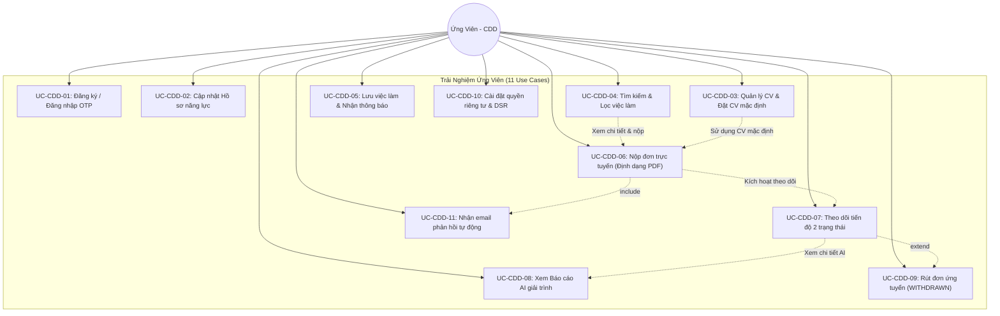
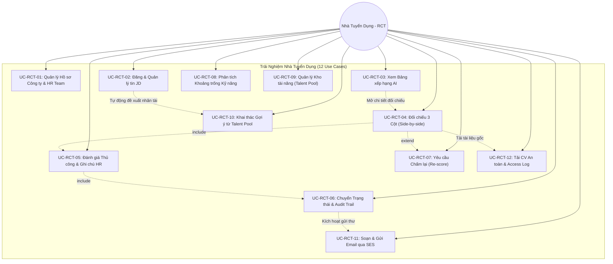
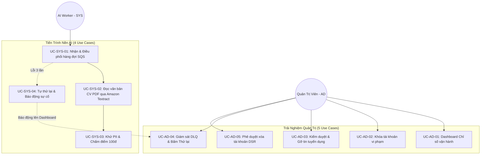

# ĐẶC TẢ TRƯỜNG HỢP SỬ DỤNG (USE CASE SPECIFICATIONS)

# Đề tài: AI CV Screening Portal — Nền Tảng Tuyển Dụng Thông Minh Tích Hợp Generative AI
> **Tài liệu:** Use Case Specifications (Đặc tả trường hợp sử dụng phần mềm)  
> **Mã tài liệu:** `DOC-SW-02-UC`  
> **Phiên bản:** `2.1` · **Ngày ban hành:** 27/10/2026 · **Trạng thái:** Chuẩn hóa Quốc tế (International Standard Baseline)  
> **Tiêu chuẩn áp dụng:** RUP / Cockburn Methodology & ISO/IEC/IEEE 29148 Standard Use Case Specification  
> **Tài liệu tham chiếu:** [01-requirements.md](file:///d:/AWS/workshop/docs/software/01-requirements.md) (SRS v1.0)

---

## 1. Mục đích & Chuẩn mực Đặc tả

Tài liệu này đặc tả chi tiết toàn bộ **32 trường hợp sử dụng (Use Cases)** của hệ thống **AI CV Screening Portal** theo **Cấu trúc Đặc tả Use Case Chuẩn Quốc tế (Cockburn / RUP Methodology & ISO/IEC/IEEE 29148)**, đồng thời duy trì trọng tâm tương tác người dùng trực quan (**Customer-Centric Interaction Flow**).

### Cấu trúc Chuẩn hóa của Mỗi Use Case:
1. **Mã & Tên Use Case:** Định danh duy nhất theo cú pháp `UC-[PHÂN_HỆ]-[STT]`.
2. **Tác nhân chính (Primary Actor):** Chủ thể khởi tạo hoặc trực tiếp thao tác thực hiện mục tiêu.
3. **Tác nhân hỗ trợ (Supporting/Secondary Actors):** Các dịch vụ bên ngoài hoặc tiến trình nền hỗ trợ hoàn thành Use Case (Amazon Cognito, Amazon SES, Amazon S3, Amazon Textract, Amazon Bedrock,...).
4. **Mô tả (Description):** Mô tả chi tiết chức năng, mục đích nghiệp vụ, giá trị mang lại cho người dùng và ngữ cảnh màn hình giao diện tương tác (`SCR-...`).
5. **Sự kiện kích hoạt (Trigger):** Hành động hoặc sự kiện thực tế khởi phát Use Case.
6. **Tiền điều kiện (Preconditions):** Các điều kiện hệ thống bắt buộc phải thỏa mãn trước khi Use Case có thể bắt đầu.
7. **Hậu điều kiện (Postconditions):** Kết quả đạt được của hệ thống sau khi thực hiện (Thành công / Thất bại).
8. **Luồng sự kiện chính (Basic Flow / Main Scenario):** Trình tự tương tác từng bước giữa Tác nhân (`[Người dùng]`) và Hệ thống (`[Hệ thống]`).
9. **Luồng sự kiện rẽ nhánh & Ngoại lệ (Alternative & Exception Flows):** Các tình huống lỗi hoặc nhánh rẽ ngoài luồng chính kèm chỉ dẫn xử lý thân thiện.
10. **Quy tắc nghiệp vụ & Ràng buộc (Business Rules & Constraints):** Ánh xạ trực tiếp tới các mã `BR-...`, `NFR-...`, `FR-...`.

---

## 2. Danh mục Tác nhân (Actors)

| Mã Actor | Tên Tác nhân | Phân loại | Vai trò trong Hệ sinh thái Trải nghiệm |
| :---: | :--- | :---: | :--- |
| **`CDD`** | **Ứng viên (Candidate)** | Tác nhân con người | Người tìm việc; tương tác trực tiếp với cổng thông tin việc làm, tạo hồ sơ năng lực, nộp CV định dạng PDF (`.pdf`), theo dõi trạng thái hồ sơ theo thời gian thực, xem giải trình đánh giá năng lực minh bạch của AI, thực hiện quyền rút đơn và quản lý quyền riêng tư dữ liệu cá nhân (DSR). |
| **`RCT`** | **Nhà tuyển dụng (Recruiter)** | Tác nhân con người | Chuyên viên nhân sự đại diện cho doanh nghiệp (làm việc theo HR Team); đăng tin tuyển dụng, xem bảng xếp hạng ứng viên do AI phân tích, đối chiếu trực quan CV gốc với nhận xét AI (Side-by-side Review), đưa ra quyết định tuyển dụng (Human-in-the-Loop), ghi chú nội bộ có nhật ký kiểm toán và khai thác Kho tài năng (Talent Pool). |
| **`AD`** | **Quản trị viên (Administrator)** | Tác nhân con người | Người vận hành sàn tuyển dụng; theo dõi dashboard chỉ số sức khỏe hệ thống, kiểm duyệt nội dung tin tuyển dụng và tài khoản, theo dõi xử lý các hồ sơ gặp sự cố (DLQ) và phê duyệt các yêu cầu hủy định danh tài khoản người dùng theo luật dữ liệu cá nhân. |
| **`SYS`** | **Tiến trình Xử lý Nền (System AI Worker)** | Tác nhân tự động | Tác nhân hệ thống tự động chạy ngầm; đảm nhiệm việc trích xuất văn bản từ CV, chạy bộ lọc khử thông tin nhạy cảm để đảm bảo chấm điểm không thiên vị, điều phối AI phân tích đối soát với JD, cập nhật kết quả và kích hoạt gửi email thông báo cho người dùng. |

---

## 3. Danh mục 32 Use Cases (1:1 với SRS)

| STT | Mã Use Case | Tên Trường hợp Sử dụng | Actor Chính | Mã FR | Ràng buộc Nghiệp vụ (`BR`) |
| :---: | :---: | :--- | :---: | :---: | :--- |
| **I** | **PHÂN HỆ ỨNG VIÊN (CANDIDATE - CDD): 11 USE CASES** | | | |
| 1 | `UC-CDD-01` | Đăng ký, Xác thực OTP & Đăng nhập tài khoản | `CDD` | `CDD01` | `BR-AUTH-01`, `BR-AUTH-02` |
| 2 | `UC-CDD-02` | Quản lý Hồ sơ Cá nhân & Danh mục Kỹ năng | `CDD` | `CDD02` | `BR-PRIV-01` |
| 3 | `UC-CDD-03` | Quản lý Kho CV Cá nhân & Thiết lập CV Mặc định | `CDD` | `CDD03` | `BR-DOC-01`, `BR-DOC-02` |
| 4 | `UC-CDD-04` | Tìm kiếm & Khám phá Cơ hội Việc làm | `CDD` | `CDD04` | — |
| 5 | `UC-CDD-05` | Lưu Việc làm Yêu thích & Đăng ký Nhận tin Tuyển dụng | `CDD` | `CDD05` | — |
| 6 | `UC-CDD-06` | Nộp Hồ sơ Ứng tuyển Trực tuyến (Định dạng PDF) | `CDD` | `CDD06` | `BR-DOC-01..03`, `BR-PRIV-01` |
| 7 | `UC-CDD-07` | Theo dõi Tiến trình Tuyển dụng & Lịch sử Hồ sơ | `CDD` | `CDD07` | `BR-STATE-01` |
| 8 | `UC-CDD-08` | Xem Báo cáo Đánh giá Năng lực Minh bạch từ AI | `CDD` | `CDD08` | `BR-SCORING-01`, `BR-SCORING-02` |
| 9 | `UC-CDD-09` | Rút Đơn Ứng tuyển Tuyển dụng (`WITHDRAWN`) | `CDD` | `CDD09` | `BR-STATE-01`, `BR-STATE-02` |
| 10 | `UC-CDD-10` | Quản lý Quyền riêng tư, Sự đồng ý & Quyền DSR | `CDD` | `CDD10` | `BR-PRIV-01`, `BR-PRIV-02` |
| 11 | `UC-CDD-11` | Nhận Thông báo Email Tuyển dụng Tự động | `CDD` | `CDD11` | `BR-STATE-03` |
| **II** | **PHÂN HỆ NHÀ TUYỂN DỤNG (RECRUITER - RCT): 12 USE CASES** | | | |
| 12 | `UC-RCT-01` | Quản lý Hồ sơ Công ty & Cộng tác Nhóm HR (Company Profile) | `RCT` | `RCT01` | `BR-AUTH-03` |
| 13 | `UC-RCT-02` | Soạn thảo, Xuất bản & Đóng tin Tuyển dụng (JD) | `RCT` | `RCT02` | `BR-AUTH-03` |
| 14 | `UC-RCT-03` | Xem Bảng Xếp hạng Ứng viên Thông minh theo Điểm AI | `RCT` | `RCT03` | `BR-SCORING-02` |
| 15 | `UC-RCT-04` | Đối chiếu Song song 3 Cột (Side-by-side Review) | `RCT` | `RCT04` | — |
| 16 | `UC-RCT-05` | Đánh giá Thủ công, Ghi chú & Chấm điểm Sao (Human-in-the-Loop) | `RCT` | `RCT05` | `BR-HITL-01` |
| 17 | `UC-RCT-06` | Chuyển Trạng thái Tuyển dụng & Lưu Nhật ký Kiểm toán (Audit Trail) | `RCT` | `RCT06` | `BR-STATE-01`, `BR-HITL-02` |
| 18 | `UC-RCT-07` | Kích hoạt Yêu cầu Chấm lại Hồ sơ (Trigger Re-score) | `RCT` | `RCT07` | `BR-RETRY-01`, `BR-RETRY-02` |
| 19 | `UC-RCT-08` | Xem Báo cáo Phân tích Khoảng trống Kỹ năng (Skill Gap Analytics) | `RCT` | `RCT08` | — |
| 20 | `UC-RCT-09` | Lưu trữ & Quản trị Kho Tài năng (Talent Pool) | `RCT` | `RCT09` | `BR-POOL-01..03` |
| 21 | `UC-RCT-10` | Khai thác Gợi ý Ứng viên từ Kho Tài năng cho Tin mới (Rediscovery) | `RCT` | `RCT10` | `BR-POOL-01..02` |
| 22 | `UC-RCT-11` | Gửi Email Mời Phỏng vấn & Thư Từ chối qua SES | `RCT` | `RCT11` | `BR-STATE-03` |
| 23 | `UC-RCT-12` | Tải File CV An toàn & Nhật ký Kiểm toán Truy cập (Access Log) | `RCT` | `RCT12` | `BR-DOC-03`, `NFR-SEC-05` |
| **III** | **PHÂN HỆ QUẢN TRỊ VIÊN (ADMINISTRATOR - AD): 5 USE CASES** | | | |
| 24 | `UC-AD-01` | Bảng Điều khiển Quản trị Chỉ số Vận hành (Admin Dashboard) | `AD` | `AD01` | — |
| 25 | `UC-AD-02` | Kiểm duyệt & Khóa Tài khoản Người dùng Vi phạm | `AD` | `AD02` | `NFR-SEC-01` |
| 26 | `UC-AD-03` | Kiểm duyệt & Gỡ bỏ Tin Tuyển dụng Vi phạm Tiêu chuẩn | `AD` | `AD03` | — |
| 27 | `UC-AD-04` | Giám sát Sự cố Hàng đợi Lỗi DLQ & Kích hoạt Thử lại (Redrive) | `AD` | `AD04` | `NFR-REL-02`, `NFR-OPS-02` |
| 28 | `UC-AD-05` | Phê duyệt & Thực thi Yêu cầu Hủy định danh DSR (`ANONYMIZED_USER`) | `AD` | `AD05` | `BR-PRIV-02`, `NFR-DATA-01..02` |
| **IV** | **PHÂN HỆ TIẾN TRÌNH NỀN AI (SYSTEM WORKER - SYS): 4 USE CASES** | | | |
| 29 | `UC-SYS-01` | Tiếp nhận & Điều phối Hồ sơ Bất đồng bộ qua Hàng đợi | `SYS` | `SYS01` | `NFR-REL-01`, `NFR-REL-03` |
| 30 | `UC-SYS-02` | Kiểm tra Tính hợp lệ & Trích xuất Văn bản CV PDF qua Amazon Textract | `SYS` | `SYS02` | `BR-DOC-01`, `NFR-COST-01` |
| 31 | `UC-SYS-03` | Khử Dữ liệu Nhạy cảm PII & Chấm điểm Bedrock Rubric 100đ | `SYS` | `SYS03` | `BR-SCORING-01..03`, `NFR-SEC-03..04` |
| 32 | `UC-SYS-04` | Tự phục hồi Khi Quá tải & Cách ly Bản tin Sự cố vào DLQ | `SYS` | `SYS04` | `NFR-REL-02`, `NFR-OPS-02` |

---

## 4. Sơ đồ Use Case Tổng quan & Phân hệ (Mermaid)

### 4.1. Sơ đồ Phân hệ Ứng viên (`CDD` — 11 Use Cases)

---

### 4.2. Sơ đồ Phân hệ Nhà tuyển dụng (`RCT` — 12 Use Cases)

---

### 4.3. Sơ đồ Phân hệ Quản trị (`AD`) & Hệ thống Nền (`SYS`)

---

## 5. Đặc tả Chi tiết Toàn bộ 32 Use Cases (Chuẩn Quốc tế & Trọng tâm Tương tác)

---

### PHÂN HỆ I: ỨNG VIÊN (CANDIDATE - `CDD`)

---

#### 5.1. UC-CDD-01: Đăng ký, Xác thực OTP & Đăng nhập tài khoản
* **Tác nhân chính (Primary Actor):** Ứng viên (`CDD`).
* **Tác nhân hỗ trợ (Supporting Actors):** Amazon Cognito (Dịch vụ xác thực danh tính), Amazon SES (Gửi mã OTP).
* **Mô tả (Description):** Cung cấp giải pháp đăng ký và đăng nhập bảo mật cho người tìm việc thông qua cơ chế mật khẩu mạnh kết hợp mã xác thực OTP 6 số gửi qua email. Tính năng này được thực hiện trên màn hình Đăng ký / Đăng nhập (`SCR-CDD-AUTH`), đảm bảo an toàn tuyệt đối cho tài khoản người dùng, chống tấn công dò quét mật khẩu (brute-force) và duy trì phiên làm việc tiện lợi.
* **Sự kiện kích hoạt (Trigger):** Ứng viên bấm nút **"Đăng ký"** hoặc **"Đăng nhập"** trên thanh điều hướng đầu trang.
* **Tiền điều kiện (Preconditions):** Ứng viên có một hộp thư email hợp lệ đang hoạt động để nhận mã OTP.
* **Hậu điều kiện (Postconditions):**
  * *Thành công:* Tài khoản được kích hoạt, phiên làm việc an toàn (JWT) được lưu trữ và ứng viên được chuyển hướng về Trang chủ Việc làm với trạng thái đã đăng nhập.
  * *Thất bại:* Người dùng vẫn ở lại màn hình xác thực, nhận được thông báo lỗi cụ thể để thử lại.
* **Luồng sự kiện chính (Basic Flow):**
  1. **[Ứng viên]** Bấm nút **"Đăng ký"** trên thanh điều hướng, nhập Email, Họ tên, Số điện thoại và Mật khẩu cá nhân.
  2. **[Hệ thống]** Kiểm tra độ mạnh mật khẩu theo thời gian thực (hiển thị checklist xanh: đủ 8 ký tự, có chữ hoa, chữ thường, số và ký tự đặc biệt theo `BR-AUTH-01`).
  3. **[Ứng viên]** Bấm nút **"Tiếp tục"**.
  4. **[Hệ thống]** Khởi tạo tài khoản tạm trên Amazon Cognito, tự động gửi email chứa mã OTP 6 số ngẫu nhiên qua Amazon SES và mở modal *"Xác thực Email"*.
  5. **[Ứng viên]** Mở hộp thư email cá nhân, lấy mã xác thực 6 số và nhập vào ô OTP trên màn hình.
  6. **[Hệ thống]** Xác thực mã thành công, hiển thị toast thông báo xanh: *"Kích hoạt tài khoản thành công! Đang chuyển hướng..."*, thiết lập phiên làm việc an toàn trong 1 giờ (`BR-AUTH-02`) và chuyển hướng ứng viên vào Trang chủ.
  7. **[Ứng viên]** Nhìn thấy thanh điều hướng đổi sang ảnh đại diện cá nhân và sẵn sàng sử dụng các tính năng ứng viên.
* **Luồng sự kiện rẽ nhánh & Ngoại lệ (Alternative & Exception Flows):**
  * *2a. Mật khẩu không thỏa mãn chính sách bảo mật:* Hệ thống viền đỏ ô mật khẩu, vô hiệu hóa nút "Tiếp tục" và đánh dấu đỏ tiêu chí còn thiếu trong checklist.
  * *4a. Email đã tồn tại trong hệ thống:* Hệ thống hiển thị thông báo lỗi: *"Email này đã được đăng ký tài khoản. Vui lòng đăng nhập hoặc sử dụng chức năng quên mật khẩu."*
  * *5a. Ứng viên không nhận được mã xác thực OTP:* Hệ thống cung cấp nút bấm *"Gửi lại mã OTP (sau 60s)"*. Khi đồng hồ đếm ngược kết thúc, ứng viên bấm nút để hệ thống phát sinh mã mới.
  * *5b. Nhập sai mã OTP hoặc mã đã hết hạn:* Hệ thống rung nhẹ khung nhập mã và hiển thị thông báo đỏ: *"Mã xác thực không chính xác hoặc đã hết hiệu lực. Vui lòng kiểm tra lại."*
  * *6a. Đăng nhập sai quá 5 lần liên tiếp:* Hệ thống khóa tạm thời chức năng đăng nhập của tài khoản trong 15 phút để phòng chống tấn công dò quét mật khẩu.
* **Quy tắc nghiệp vụ & Ràng buộc (Business Rules & Constraints):** `BR-AUTH-01`, `BR-AUTH-02`, `NFR-SEC-01`.

---

#### 5.2. UC-CDD-02: Quản lý Hồ sơ Cá nhân & Danh mục Kỹ năng
* **Tác nhân chính (Primary Actor):** Ứng viên (`CDD`).
* **Tác nhân hỗ trợ (Supporting Actors):** Không có.
* **Mô tả (Description):** Cho phép ứng viên xây dựng và hoàn thiện hồ sơ năng lực số trên màn hình Hồ sơ Cá nhân (`SCR-CDD-PROFILE`), bao gồm chức danh chuyên môn, danh mục kỹ năng (Skills Tags), học vấn, kinh nghiệm làm việc và các liên kết dự án chuyên môn (GitHub, LinkedIn, Portfolio). Hồ sơ hoàn thiện giúp tăng độ nhận diện và làm phong phú dữ liệu đối soát khi ứng tuyển.
* **Sự kiện kích hoạt (Trigger):** Ứng viên bấm vào avatar cá nhân và chọn mục **"Hồ sơ của tôi"**.
* **Tiền điều kiện (Preconditions):** Ứng viên đã đăng nhập tài khoản thành công.
* **Hậu điều kiện (Postconditions):**
  * *Thành công:* Dữ liệu hồ sơ cá nhân được lưu trữ bền vững vào hệ thống; thanh tiến trình hoàn thiện hồ sơ cập nhật tỷ lệ %.
* **Luồng sự kiện chính (Basic Flow):**
  1. **[Ứng viên]** Truy cập vào màn hình Hồ sơ cá nhân.
  2. **[Hệ thống]** Hiển thị form thông tin năng lực cùng thanh đo trực quan: *"Mức độ hoàn thiện hồ sơ: 60%"*.
  3. **[Ứng viên]** Cập nhật Chức danh nghề nghiệp (ví dụ: "Senior Backend Engineer"), gõ và chọn các thẻ kỹ năng (như `Python`, `AWS`, `FastAPI`, `Docker`).
  4. **[Ứng viên]** Bổ sung quá trình học vấn, các dự án tiêu biểu và dán liên kết tài khoản chuyên môn (GitHub, LinkedIn).
  5. **[Ứng viên]** Bấm nút **"Lưu hồ sơ"**.
  6. **[Hệ thống]** Kiểm tra tính hợp lệ dữ liệu, lưu vào cơ sở dữ liệu và hiển thị toast thông báo xanh: *"Cập nhật hồ sơ năng lực thành công!"*, thanh đo nâng lên mức 100%.
* **Luồng sự kiện rẽ nhánh & Ngoại lệ (Alternative & Exception Flows):**
  * *3a. Định dạng liên kết mạng xã hội không hợp lệ:* Hệ thống báo đỏ ô nhập liệu: *"Vui lòng nhập đúng định dạng URL (ví dụ: https://linkedin.com/in/username)"*.
* **Quy tắc nghiệp vụ & Ràng buộc (Business Rules & Constraints):** `CDD02`, `NFR-PERF-02`.

---

#### 5.3. UC-CDD-03: Quản lý Kho CV Cá nhân & Thiết lập CV Mặc định
* **Tác nhân chính (Primary Actor):** Ứng viên (`CDD`).
* **Tác nhân hỗ trợ (Supporting Actors):** Amazon S3 (Kho lưu trữ tài liệu bảo mật).
* **Mô tả (Description):** Cung cấp không gian lưu trữ và quản lý tập trung các phiên bản CV của ứng viên tại màn hình Quản lý CV (`SCR-CDD-CV-LIST`). Ứng viên có thể tải lên nhiều bản CV định dạng chuẩn PDF (`.pdf`), xóa bản cũ và chọn một bản ưng ý nhất làm "CV Mặc định" để phục vụ việc nộp hồ sơ nhanh 1-click.
* **Sự kiện kích hoạt (Trigger):** Ứng viên chuyển sang tab **"Quản lý CV"** trong khu vực hồ sơ cá nhân.
* **Tiền điều kiện (Preconditions):** Ứng viên đã đăng nhập tài khoản; có sẵn tệp CV trên thiết bị.
* **Hậu điều kiện (Postconditions):**
  * *Thành công:* Tệp CV được tải lên S3 an toàn, xuất hiện trong danh sách kèm tùy chọn đặt làm mặc định hoặc xóa bỏ.
* **Luồng sự kiện chính (Basic Flow):**
  1. **[Ứng viên]** Mở mục Quản lý CV, quan sát vùng kéo thả tài liệu (Dropzone) và bảng danh sách CV hiện có.
  2. **[Ứng viên]** Kéo thả hoặc chọn tệp CV mới từ máy tính (định dạng chuẩn `.pdf`, dung lượng <= 5MB theo `BR-DOC-01`).
  3. **[Hệ thống]** Tải tệp lên kho lưu trữ Amazon S3 qua Pre-signed URL an toàn, hiển thị thanh tiến trình 0% -> 100% và bổ sung mục mới vào bảng danh sách.
  4. **[Ứng viên]** Bấm nút gạt **"Đặt làm CV mặc định"** tại dòng tài liệu vừa tải.
  5. **[Hệ thống]** Gắn huy hiệu xanh lá *"Mặc định"* cạnh tệp và hiển thị thông báo: *"Đã thiết lập làm CV mặc định cho các lần nộp đơn sau."*
* **Luồng sự kiện rẽ nhánh & Ngoại lệ (Alternative & Exception Flows):**
  * *2a. Chọn tệp sai định dạng (ví dụ: `.png`, `.zip`, `.exe`):* Vùng kéo thả đổi viền đỏ cảnh báo: *"Chỉ chấp nhận tệp định dạng chuẩn PDF (.pdf). Vui lòng chọn lại."*
  * *2b. Dung lượng tệp vượt quá 5MB:* Hệ thống chặn ngay tại trình duyệt và hiển thị thông báo: *"Kích thước tệp vượt quá giới hạn 5MB cho phép."*
* **Quy tắc nghiệp vụ & Ràng buộc (Business Rules & Constraints):** `BR-DOC-01`.

---

#### 5.4. UC-CDD-04: Tìm kiếm & Khám phá Cơ hội Việc làm
* **Tác nhân chính (Primary Actor):** Ứng viên (`CDD`).
* **Tác nhân hỗ trợ (Supporting Actors):** Không có.
* **Mô tả (Description):** Cho phép người tìm việc tra cứu, lọc và khám phá các vị trí tuyển dụng đang mở tuyển trên màn hình Tìm kiếm Việc làm (`SCR-CDD-JOB-SEARCH`). Người dùng có thể tìm theo từ khóa kỹ năng, vị trí công việc, kết hợp các tiêu chí lọc đa chiều như địa điểm làm việc, hình thức (Remote/Hybrid/Onsite), cấp bậc và dải lương.
* **Sự kiện kích hoạt (Trigger):** Người dùng nhập từ khóa tìm kiếm tại thanh tìm kiếm hoặc truy cập trang Việc làm.
* **Tiền điều kiện (Preconditions):** Không yêu cầu đăng nhập đối với việc tra cứu thông tin việc làm công khai.
* **Hậu điều kiện (Postconditions):**
  * *Thành công:* Danh sách thẻ việc làm (Job Cards) thỏa mãn điều kiện tìm kiếm được hiển thị với độ trễ phản hồi dưới 500ms.
* **Luồng sự kiện chính (Basic Flow):**
  1. **[Ứng viên]** Nhập từ khóa chuyên môn (ví dụ: "Python Developer", "DevOps") vào thanh tìm kiếm lớn.
  2. **[Ứng viên]** Nhấp chọn các tiêu chí lọc nhanh: Địa điểm (Hà Nội, TP.HCM), Hình thức (Remote), Cấp bậc (Senior).
  3. **[Hệ thống]** Truy vấn dữ liệu tức thì và hiển thị danh sách các thẻ việc làm đang mở (`status = OPEN`), bao gồm: Chức danh, Logo doanh nghiệp, Dải lương, Địa điểm và Hạn nộp hồ sơ.
  4. **[Ứng viên]** Nhấp vào một thẻ việc làm để xem toàn văn Bản mô tả công việc (JD), các tiêu chí kỹ năng cốt lõi và chế độ đãi ngộ.
* **Luồng sự kiện rẽ nhánh & Ngoại lệ (Alternative & Exception Flows):**
  * *3a. Không tìm thấy kết quả phù hợp:* Hệ thống hiển thị hình minh họa thân thiện kèm thông điệp: *"Chưa tìm thấy công việc phù hợp với từ khóa này. Hãy thử xóa bộ lọc hoặc tìm với từ khóa chung hơn."*
* **Quy tắc nghiệp vụ & Ràng buộc (Business Rules & Constraints):** `CDD04`, `NFR-PERF-02`.

---

#### 5.5. UC-CDD-05: Lưu Việc làm Yêu thích & Đăng ký Nhận tin Tuyển dụng
* **Tác nhân chính (Primary Actor):** Ứng viên (`CDD`).
* **Tác nhân hỗ trợ (Supporting Actors):** Amazon SES (Gửi thư xác nhận đăng ký nhận tin).
* **Mô tả (Description):** Hỗ trợ ứng viên đánh dấu các tin tuyển dụng tiềm năng vào danh sách quan tâm để xem lại sau tại màn hình Việc làm đã lưu (`SCR-CDD-SAVED-JOBS`), đồng thời đăng ký nhận thông báo email tự động khi có cơ hội nghề nghiệp tương tự xuất hiện trên sàn.
* **Sự kiện kích hoạt (Trigger):** Ứng viên bấm vào biểu tượng Bookmark (trái tim) trên thẻ việc làm hoặc bấm nút "Nhận thông báo việc làm tương tự".
* **Tiền điều kiện (Preconditions):** Ứng viên đã đăng nhập tài khoản.
* **Hậu điều kiện (Postconditions):**
  * *Thành công:* Tin tuyển dụng được đưa vào danh sách yêu thích; tùy chọn nhận tin email được ghi nhận.
* **Luồng sự kiện chính (Basic Flow):**
  1. **[Ứng viên]** Khi duyệt danh sách việc làm, bấm vào biểu tượng Trái tim trên thẻ tin tuyển dụng.
  2. **[Hệ thống]** Đổi màu biểu tượng sang đỏ nổi bật và hiển thị toast thông báo: *"Đã lưu công việc vào danh sách yêu thích."*
  3. **[Ứng viên]** Bấm nút **"Đăng ký nhận tin tương tự"** tại trang chi tiết JD, chọn tần suất nhận thông báo (Hàng ngày hoặc Hàng tuần).
  4. **[Hệ thống]** Ghi nhận cấu hình và kích hoạt Amazon SES gửi email thông báo xác nhận thành công.
* **Luồng sự kiện rẽ nhánh & Ngoại lệ (Alternative & Exception Flows):**
  * *1a. Ứng viên chưa đăng nhập:* Hệ thống hiển thị modal gợi ý đăng nhập nhanh để sử dụng tính năng lưu tin yêu thích.
* **Quy tắc nghiệp vụ & Ràng buộc (Business Rules & Constraints):** `CDD05`.

---

#### 5.6. UC-CDD-06: Nộp Hồ sơ Ứng tuyển Trực tuyến (Định dạng PDF)
* **Tác nhân chính (Primary Actor):** Ứng viên (`CDD`).
* **Tác nhân hỗ trợ (Supporting Actors):** Amazon S3 (Lưu trữ CV), Amazon SQS (Tiếp nhận message điều phối), Amazon SES (Gửi email biên nhận).
* **Mô tả (Description):** Cho phép ứng viên nộp hồ sơ ứng tuyển trực tiếp vào vị trí mong muốn qua Modal Nộp hồ sơ (`SCR-CDD-APPLY-MODAL`). Hệ thống hỗ trợ nộp nhanh bằng CV mặc định có sẵn hoặc tải tệp CV mới định dạng chuẩn PDF (`.pdf`), yêu cầu người dùng xác nhận các điều khoản đồng thuận xử lý dữ liệu bằng AI và lưu trữ Talent Pool trước khi gửi.
* **Sự kiện kích hoạt (Trigger):** Ứng viên bấm nút **"Nộp đơn ứng tuyển ngay"** tại trang chi tiết tin tuyển dụng.
* **Tiền điều kiện (Preconditions):** Ứng viên đã đăng nhập; tin tuyển dụng đang mở tiếp nhận đơn (`status = OPEN`).
* **Hậu điều kiện (Postconditions):**
  * *Thành công:* Đơn ứng tuyển được tạo với trạng thái `status = SUBMITTED`, `aiStatus = PENDING`; tệp CV được lưu trữ an toàn trên S3; bản tin được đẩy vào hàng đợi SQS; email xác nhận được gửi tới ứng viên.
  * *Thất bại:* Giao diện giữ nguyên, hiển thị thông báo lỗi cụ thể để ứng viên điều chỉnh.
* **Luồng sự kiện chính (Basic Flow):**
  1. **[Ứng viên]** Tại trang chi tiết việc làm, bấm nút **"Nộp đơn ứng tuyển ngay"**.
  2. **[Hệ thống]** Kiểm tra tính hợp lệ: xác minh ứng viên chưa có đơn ứng tuyển nào đang trong quá trình xét duyệt cho vị trí này (`BR-DOC-02`). Hệ thống mở Modal nộp đơn chuyên nghiệp.
  3. **[Ứng viên]** Lựa chọn phương thức cung cấp CV:
     - *Lựa chọn A (Nộp nhanh):* Chọn sử dụng **"CV Mặc định"** sẵn có trong hồ sơ.
     - *Lựa chọn B (Tải tệp mới):* Kéo thả hoặc chọn tệp CV từ thiết bị (chỉ chấp nhận định dạng chuẩn `.pdf`, dung lượng <= 5MB theo `BR-DOC-01`).
  4. **[Ứng viên]** Đọc và tích chọn các điều khoản đồng thuận (`BR-PRIV-01`):
     - [x] *"Tôi đồng ý cho hệ thống AI phân tích dữ liệu CV phục vụ vị trí tuyển dụng này (Bắt buộc)."*
     - [x] *"Tôi đồng ý cho doanh nghiệp lưu trữ hồ sơ trong Kho tài năng (Talent Pool) để liên hệ cho các cơ hội nghề nghiệp tương lai (Tùy chọn)."*
  5. **[Ứng viên]** Bấm nút **"Gửi hồ sơ ứng tuyển"**.
  6. **[Hệ thống]** Tải tệp CV lên S3 qua Pre-signed URL (hiển thị thanh tiến trình 0% -> 100%), ghi nhận đơn ứng tuyển vào cơ sở dữ liệu và gửi thông điệp xử lý bất đồng bộ vào hàng đợi Amazon SQS.
  7. **[Hệ thống]** Hiển thị màn hình thành công với icon xanh lá: *"Nộp hồ sơ thành công! AI đang tiến hành phân tích sơ bộ năng lực (ước tính 30-60 giây)."* Đồng thời gửi email biên nhận tới ứng viên (`BR-STATE-03`).
  8. **[Ứng viên]** Bấm nút *"Theo dõi tiến độ đơn"* để chuyển sang màn hình quản lý đơn ứng tuyển.
* **Luồng sự kiện rẽ nhánh & Ngoại lệ (Alternative & Exception Flows):**
  * *2a. Ứng viên đã nộp đơn trước đó cho vị trí này:* Hệ thống chặn mở modal và hiển thị banner cảnh báo: *"Bạn đã có đơn ứng tuyển cho vị trí này đang được xem xét. Vui lòng theo dõi tiến độ tại trang lịch sử."*
  * *3a. Tệp tải lên sai định dạng hoặc vượt quá 5MB:* Hệ thống hiển thị cảnh báo đỏ trực tiếp dưới khung tải tệp, vô hiệu hóa nút nộp đơn.
  * *4a. Chưa tích chọn điều khoản bắt buộc:* Nút "Gửi hồ sơ ứng tuyển" giữ trạng thái vô hiệu hóa kèm dòng nhắc nhở nhỏ màu đỏ.
* **Quy tắc nghiệp vụ & Ràng buộc (Business Rules & Constraints):** `BR-DOC-01..03`, `BR-STATE-01`, `BR-PRIV-01`, `BR-STATE-03`.

---

#### 5.7. UC-CDD-07: Theo dõi Tiến trình Tuyển dụng & Lịch sử Hồ sơ
* **Tác nhân chính (Primary Actor):** Ứng viên (`CDD`).
* **Tác nhân hỗ trợ (Supporting Actors):** Không có.
* **Mô tả (Description):** Cung cấp giao diện bảng theo dõi tiến độ minh bạch cho ứng viên tại trang Quản lý Đơn ứng tuyển (`SCR-CDD-HISTORY`). Tính năng thể hiện cơ chế vòng đời kép độc lập: tiến trình xử lý kỹ thuật của AI (`aiStatus`) và trạng thái xét duyệt nghiệp vụ của Nhà tuyển dụng (`status`), giúp ứng viên nắm bắt chính xác hiện trạng hồ sơ mà không phải chờ đợi trong mơ hồ.
* **Sự kiện kích hoạt (Trigger):** Ứng viên chọn mục **"Đơn ứng tuyển của tôi"** trên thanh điều hướng.
* **Tiền điều kiện (Preconditions):** Ứng viên đã đăng nhập và đã nộp ít nhất một hồ sơ.
* **Hậu điều kiện (Postconditions):**
  * *Thành công:* Danh sách các hồ sơ ứng tuyển hiển thị đầy đủ mốc thời gian và thanh tiến trình trực quan theo thời gian thực.
* **Luồng sự kiện chính (Basic Flow):**
  1. **[Ứng viên]** Truy cập vào trang Quản lý Đơn ứng tuyển.
  2. **[Hệ thống]** Hiển thị danh sách các vị trí đã ứng tuyển dưới dạng bảng trực quan, mỗi dòng thể hiện song song 2 thông số tiến trình (`BR-STATE-01`):
     - **Tiến trình Xử lý AI (`aiStatus`):** Thể hiện qua huy hiệu màu động: `Đang tiếp nhận (PENDING)` -> `Đang trích xuất (EXTRACTING)` -> `Đang chấm điểm (SCORING)` -> `Đã hoàn tất (COMPLETED)`.
     - **Trạng thái Xét duyệt Tuyển dụng (`status`):** Thể hiện quy trình bước: `Đã nộp (SUBMITTED)` -> `Đang xét duyệt (UNDER_REVIEW)` -> `Mời phỏng vấn (INVITED)` / `Chưa phù hợp (REJECTED)` / `Đã rút đơn (WITHDRAWN)`.
  3. **[Ứng viên]** Bấm vào mốc tiến trình để xem dòng thời gian (Timeline) chi tiết (ví dụ: Nộp lúc 09:30, AI chấm xong lúc 09:31, HR xem xét lúc 14:00).
* **Luồng sự kiện rẽ nhánh & Ngoại lệ (Alternative & Exception Flows):**
  * *2a. Chưa có đơn ứng tuyển nào:* Hệ thống hiển thị giao diện trống kèm nút bấm gợi ý: *"Khám phá ngay các việc làm hấp dẫn"*.
* **Quy tắc nghiệp vụ & Ràng buộc (Business Rules & Constraints):** `BR-STATE-01`.

---

#### 5.8. UC-CDD-08: Xem Báo cáo Đánh giá Năng lực Minh bạch từ AI
* **Tác nhân chính (Primary Actor):** Ứng viên (`CDD`).
* **Tác nhân hỗ trợ (Supporting Actors):** Amazon Bedrock (Cung cấp dữ liệu phân tích đã lưu trữ).
* **Mô tả (Description):** Mang lại sự minh bạch tuyệt đối cho ứng viên bằng cách cho phép xem Báo cáo Đánh giá Năng lực chi tiết do AI phân tích tại Modal Báo cáo AI (`SCR-CDD-REPORT-MODAL`). Báo cáo thể hiện điểm số Rubric 100đ, giải trình lý do xếp loại, phân tích điểm sáng năng lực và chỉ ra khoảng trống kỹ năng cần trau dồi so với yêu cầu của thị trường lao động.
* **Sự kiện kích hoạt (Trigger):** Ứng viên bấm nút **"Xem Báo cáo AI"** tại dòng đơn ứng tuyển có `aiStatus = COMPLETED`.
* **Tiền điều kiện (Preconditions):** Đơn ứng tuyển đã hoàn tất quy trình phân tích AI (`aiStatus = COMPLETED`).
* **Hậu điều kiện (Postconditions):**
  * *Thành công:* Giao diện báo cáo trực quan hiển thị đầy đủ điểm số, biểu đồ và các khuyến nghị phát triển bản thân.
* **Luồng sự kiện chính (Basic Flow):**
  1. **[Ứng viên]** Tại bảng danh sách đơn ứng tuyển, bấm nút **"Xem Báo cáo Đánh giá AI"**.
  2. **[Hệ thống]** Mở Modal Báo cáo Năng lực Minh bạch với thiết kế trực quan chuyên nghiệp:
     - **Vòng tròn Điểm tổng quan & Xếp loại:** Thang điểm 100 kèm huy hiệu Match Level: `Strong Match` (>= 80đ - Xanh lá), `Potential Match` (60–79đ - Vàng), `Not Match` (< 60đ - Xám) (`BR-SCORING-02`).
     - **Biểu đồ 4 Trọng số Rubric:** Thanh đo trực quan 4 thành phần: Kỹ năng chuyên môn (40đ), Kinh nghiệm làm việc (30đ), Học vấn & Bằng cấp (15đ), Kỹ năng mềm (15đ) (`BR-SCORING-01`).
     - **Nhận xét Tổng quan:** Đoạn văn súc tích, khách quan tổng hợp từ CV đối chiếu với JD.
     - **Điểm sáng Nổi bật (Strengths):** Danh sách các kỹ năng hoặc kinh nghiệm ấn tượng nhất của ứng viên.
     - **Khoảng trống Cần Cải thiện (Skill Gaps):** Các kỹ năng trong JD mà CV chưa thể hiện rõ, kèm gợi ý lộ trình bồi dưỡng.
  3. **[Ứng viên]** Đọc báo cáo, có thể tải về bản tóm tắt hoặc đóng modal.
* **Quy tắc nghiệp vụ & Ràng buộc (Business Rules & Constraints):** `BR-SCORING-01`, `BR-SCORING-02`.

---

#### 5.9. UC-CDD-09: Rút Đơn Ứng tuyển Tuyển dụng (`WITHDRAWN`)
* **Tác nhân chính (Primary Actor):** Ứng viên (`CDD`).
* **Tác nhân hỗ trợ (Supporting Actors):** Amazon SES (Gửi thư xác nhận rút đơn).
* **Mô tả (Description):** Trao quyền chủ động cho ứng viên rút lại hồ sơ đã nộp thông qua Modal Xác nhận Rút đơn (`SCR-CDD-WITHDRAW-MODAL`) trong trường hợp ứng viên đã tìm được công việc khác hoặc không còn nguyện vọng tiếp tục ứng tuyển. Tính năng giúp doanh nghiệp không lãng phí thời gian xét duyệt các hồ sơ không còn khả dụng.
* **Sự kiện kích hoạt (Trigger):** Ứng viên bấm nút **"Rút đơn ứng tuyển"** tại dòng hồ sơ tương ứng.
* **Tiền điều kiện (Preconditions):** Đơn ứng tuyển đang ở trạng thái sơ khởi `SUBMITTED` hoặc `UNDER_REVIEW` (`BR-STATE-02`).
* **Hậu điều kiện (Postconditions):**
  * *Thành công:* Trạng thái đơn đổi sang `status = WITHDRAWN`, hệ thống dừng xét duyệt, gửi email xác nhận cho ứng viên và cập nhật danh sách phía Nhà tuyển dụng.
* **Luồng sự kiện chính (Basic Flow):**
  1. **[Ứng viên]** Tại bảng theo dõi đơn, tìm hồ sơ muốn rút và bấm nút **"Rút đơn ứng tuyển"**.
  2. **[Hệ thống]** Kiểm tra điều kiện cho phép rút theo quy tắc (`BR-STATE-02`). Hệ thống mở Modal xác nhận: *"Bạn có chắc chắn muốn rút đơn ứng tuyển vị trí này? Thao tác này sẽ dừng toàn bộ quá trình xét tuyển và không thể hoàn tác."* Kèm menu chọn lý do rút.
  3. **[Ứng viên]** Chọn lý do (ví dụ: "Đã nhận được offer khác", "Thay đổi kế hoạch cá nhân") và bấm nút **"Xác nhận rút đơn"**.
  4. **[Hệ thống]** Cập nhật trạng thái đơn thành huy hiệu xám **"Đã rút đơn (WITHDRAWN)"**, gửi email thông báo xác nhận tới ứng viên và cập nhật thông báo tới HR phụ trách.
* **Luồng sự kiện rẽ nhánh & Ngoại lệ (Alternative & Exception Flows):**
  * *2a. Đơn ứng tuyển đã chuyển sang "Mời phỏng vấn (INVITED)":* Hệ thống ẩn nút rút đơn hoặc hiển thị thông báo hướng dẫn: *"Hồ sơ của bạn đã bước vào vòng phỏng vấn chính thức. Vui lòng liên hệ trực tiếp với Nhà tuyển dụng qua email để trao đổi hủy lịch hẹn."*
* **Quy tắc nghiệp vụ & Ràng buộc (Business Rules & Constraints):** `BR-STATE-01`, `BR-STATE-02`.

---

#### 5.10. UC-CDD-10: Quản lý Quyền riêng tư, Sự đồng ý & Quyền DSR
* **Tác nhân chính (Primary Actor):** Ứng viên (`CDD`).
* **Tác nhân hỗ trợ (Supporting Actors):** Amazon Cognito, Amazon S3.
* **Mô tả (Description):** Cung cấp trung tâm kiểm soát dữ liệu cá nhân theo tiêu chuẩn bảo vệ dữ liệu quốc tế (GDPR / DSR - Data Subject Rights) tại màn hình Cài đặt Quyền riêng tư (`SCR-CDD-PRIVACY`). Ứng viên có toàn quyền thu hồi sự đồng ý lưu trữ Talent Pool, tải bản sao dữ liệu cá nhân (Data Portability) hoặc thực thi quyền được lãng quên (Right to be Forgotten - Yêu cầu xóa tài khoản vĩnh viễn).
* **Sự kiện kích hoạt (Trigger):** Ứng viên truy cập vào mục **"Quyền riêng tư & Dữ liệu"** trong trang cài đặt tài khoản.
* **Tiền điều kiện (Preconditions):** Ứng viên đã đăng nhập tài khoản.
* **Hậu điều kiện (Postconditions):**
  * *Thành công:* Lựa chọn thu hồi quyền được lưu trữ; hoặc file dữ liệu JSON được tải về; hoặc quy trình xóa/hủy định danh tài khoản (`ANONYMIZED_USER`) được kích hoạt thành công.
* **Luồng sự kiện chính (Basic Flow):**
  1. **[Ứng viên]** Truy cập màn hình Cài đặt Quyền riêng tư.
  2. **[Ứng viên]** Thao tác tại 3 phân khu chức năng độc lập:
     - **Phân khu 1 (Quản lý Consent):** Bật/tắt công tắc gạt *"Cho phép lưu trữ hồ sơ trong Talent Pool của các doanh nghiệp đã ứng tuyển"* (`BR-PRIV-01`).
     - **Phân khu 2 (Xuất dữ liệu - Data Portability):** Bấm nút *"Tải về bản sao dữ liệu của tôi"*. Hệ thống xuất ngay tệp dữ liệu chuẩn JSON chứa toàn bộ thông tin cá nhân và lịch sử ứng tuyển.
     - **Phân khu 3 (Xóa tài khoản - Right to be Forgotten):** Bấm nút màu đỏ nguy hiểm *"Yêu cầu xóa tài khoản vĩnh viễn"*.
  3. **[Ứng viên]** (Khi chọn xóa tài khoản): Đọc thông báo cảnh báo về việc xóa dữ liệu không thể hoàn tác, nhập mật khẩu hiện tại để xác thực chính chủ và bấm nút *"Xác nhận xóa vĩnh viễn"*.
  4. **[Hệ thống]** Xác thực mật khẩu thành công, lập tức thực thi quy trình hủy định danh bảo vệ dữ liệu (`BR-PRIV-02`): Vô hiệu hóa tài khoản trên Cognito, xóa vĩnh viễn tệp CV trên S3, xóa thông tin cá nhân trong bảng hồ sơ và chuyển đổi định danh lịch sử thành `ANONYMIZED_USER`.
  5. **[Hệ thống]** Đăng xuất người dùng, hiển thị thông báo xanh: *"Tài khoản và dữ liệu cá nhân của bạn đã được xóa hoàn toàn khỏi hệ thống."*
* **Luồng sự kiện rẽ nhánh & Ngoại lệ (Alternative & Exception Flows):**
  * *3a. Nhập sai mật khẩu xác thực:* Hệ thống báo đỏ ô nhập mật khẩu: *"Mật khẩu không chính xác. Không thể thực hiện yêu cầu xóa tài khoản."*
* **Quy tắc nghiệp vụ & Ràng buộc (Business Rules & Constraints):** `BR-PRIV-01`, `BR-PRIV-02`.

---

#### 5.11. UC-CDD-11: Nhận Thông báo Email Tuyển dụng Tự động
* **Tác nhân chính (Primary Actor):** Ứng viên (`CDD`).
* **Tác nhân hỗ trợ (Supporting Actors):** Amazon SES (Dịch vụ chuyển phát email tin cậy).
* **Mô tả (Description):** Đảm bảo ứng viên nhận được các thông tin tuyển dụng quan trọng kịp thời trực tiếp trong hộp thư điện tử cá nhân mà không cần phải thường xuyên đăng nhập website. Hệ thống tự động gửi các email trang trọng, cá nhân hóa khi có sự kiện phát sinh (xác nhận tiếp nhận đơn, thông báo có kết quả chấm AI, thư mời phỏng vấn, thư từ chối hoặc thông báo lưu vào Talent Pool).
* **Sự kiện kích hoạt (Trigger):** Phát sinh sự kiện thay đổi trạng thái tuyển dụng hoặc hoàn tất tác vụ phân tích AI.
* **Tiền điều kiện (Preconditions):** Ứng viên có địa chỉ email hợp lệ gắn liền với đơn ứng tuyển.
* **Hậu điều kiện (Postconditions):**
  * *Thành công:* Email được gửi an toàn qua Amazon SES, hiển thị đúng định dạng và nội dung cá nhân hóa trong hộp thư đến (Inbox) của ứng viên.
* **Luồng sự kiện chính (Basic Flow):**
  1. **[Hệ thống]** Khi sự kiện nghiệp vụ xảy ra (nộp đơn thành công, AI hoàn tất chấm điểm, hoặc Recruiter cập nhật trạng thái), hệ thống tự động biên soạn nội dung email theo mẫu chuẩn hóa (`BR-STATE-03`).
  2. **[Hệ thống]** Kích hoạt Amazon SES gửi email tới địa chỉ hòm thư của ứng viên.
  3. **[Ứng viên]** Mở hòm thư cá nhân, nhận được email có tiêu đề rõ ràng mang tên thương hiệu tuyển dụng (ví dụ: *"Thông báo kết quả sơ loại hồ sơ — Vị trí Backend Engineer tại Công ty ABC"*).
  4. **[Ứng viên]** Mở xem nội dung thư được cá nhân hóa trang trọng (Họ tên, vị trí ứng tuyển, nhận xét tóm tắt, lịch hẹn phỏng vấn nếu có và nút bấm liên kết trực tiếp vào portal).
* **Luồng sự kiện rẽ nhánh & Ngoại lệ (Alternative & Exception Flows):**
  * *2a. Hộp thư ứng viên bị đầy hoặc email không tồn tại (Bounce):* Amazon SES ghi nhận sự kiện bounce vào CloudWatch metrics để quản trị viên giám sát chất lượng gửi thư.
* **Quy tắc nghiệp vụ & Ràng buộc (Business Rules & Constraints):** `BR-STATE-03`.

---

### PHÂN HỆ II: NHÀ TUYỂN DỤNG (RECRUITER - `RCT`)

---

#### 5.12. UC-RCT-01: Quản lý Hồ sơ Công ty & Cộng tác Nhóm HR (Company Profile)
* **Tác nhân chính (Primary Actor):** Nhà tuyển dụng (`RCT`).
* **Tác nhân hỗ trợ (Supporting Actors):** Amazon S3 (Lưu trữ logo), Amazon SES (Gửi thư mời đồng nghiệp).
* **Mô tả (Description):** Cung cấp công cụ xây dựng trang thương hiệu doanh nghiệp và thiết lập cơ chế cộng tác nội bộ giữa các chuyên viên nhân sự tại màn hình Quản lý Công ty (`SCR-RCT-COMPANY`). Nhà tuyển dụng có thể cập nhật thông tin doanh nghiệp (logo, quy mô, mô tả văn hóa) và mời các đồng nghiệp nhân sự tham gia vào Nhóm HR (HR Team) để cùng xem xét, đánh giá hồ sơ và chia sẻ quyền quản lý tin tuyển dụng.
* **Sự kiện kích hoạt (Trigger):** Recruiter chọn mục **"Hồ sơ Công ty"** trên menu điều hướng của nhà tuyển dụng.
* **Tiền điều kiện (Preconditions):** Người dùng đăng nhập bằng tài khoản Recruiter có quyền quản trị doanh nghiệp.
* **Hậu điều kiện (Postconditions):**
  * *Thành công:* Thông tin công ty được cập nhật công khai; thành viên mới được thêm vào HR Team và nhận được email kích hoạt.
* **Luồng sự kiện chính (Basic Flow):**
  1. **[Recruiter]** Mở mục Hồ sơ Công ty, tải lên logo đại diện, cập nhật Tên doanh nghiệp, Website, Trụ sở chính, Quy mô nhân sự và mô tả giới thiệu.
  2. **[Recruiter]** Bấm nút **"Lưu thay đổi"**; hệ thống cập nhật và đồng bộ trang thông tin doanh nghiệp.
  3. **[Recruiter]** Chuyển sang tab **"Nhóm Nhân sự (HR Team)"**, bấm nút **"Mời thành viên mới"**, nhập email của đồng nghiệp HR và phân quyền vai trò.
  4. **[Hệ thống]** Gửi thư mời tham gia tổ chức qua Amazon SES. Khi đồng nghiệp đăng nhập, họ tự động có quyền truy cập chung danh sách việc làm và hồ sơ ứng viên của công ty (`BR-AUTH-03`).
* **Luồng sự kiện rẽ nhánh & Ngoại lệ (Alternative & Exception Flows):**
  * *3a. Email được mời đã thuộc về một tổ chức công ty khác:* Hệ thống thông báo lỗi: *"Người dùng này hiện đã thuộc về một tổ chức doanh nghiệp khác trên hệ thống."*
* **Quy tắc nghiệp vụ & Ràng buộc (Business Rules & Constraints):** `BR-AUTH-03`.

---

#### 5.13. UC-RCT-02: Soạn thảo, Xuất bản & Đóng tin Tuyển dụng (JD)
* **Tác nhân chính (Primary Actor):** Nhà tuyển dụng (`RCT`).
* **Tác nhân hỗ trợ (Supporting Actors):** Không có.
* **Mô tả (Description):** Cung cấp trình biên tập tin tuyển dụng chuyên nghiệp tại màn hình Soạn thảo JD (`SCR-RCT-JOB-EDIT`). Nhà tuyển dụng có thể cấu hình các tiêu chí tuyển dụng rõ ràng (mô tả công việc, kỹ năng bắt buộc, kỹ năng ưu tiên, số năm kinh nghiệm, học vấn) làm căn cứ chuẩn hóa cho AI chấm điểm, đồng thời chủ động xuất bản tin ra thị trường hoặc đóng tin tuyển dụng khi đã tuyển đủ người.
* **Sự kiện kích hoạt (Trigger):** Recruiter bấm nút **"Đăng tin tuyển dụng mới"** hoặc chọn chức năng chỉnh sửa/đóng tin hiện có.
* **Tiền điều kiện (Preconditions):** Recruiter đã đăng nhập và thuộc về một tổ chức doanh nghiệp hợp lệ.
* **Hậu điều kiện (Postconditions):**
  * *Thành công:* Tin tuyển dụng chuyển sang trạng thái `OPEN` (hoặc `CLOSED` khi đóng tin), hiển thị đồng bộ trên sàn việc làm.
* **Luồng sự kiện chính (Basic Flow):**
  1. **[Recruiter]** Bấm nút **"Đăng tin tuyển dụng mới"**.
  2. **[Recruiter]** Điền thông tin vào các trường hướng dẫn:
     - Chức danh công việc, Cấp bậc, Địa điểm, Khoảng lương dự kiến.
     - Toàn văn bản mô tả trách nhiệm công việc (JD).
     - Danh mục **Kỹ năng bắt buộc (Required Skills)** và **Kỹ năng ưu tiên (Nice-to-have)**.
     - Số năm kinh nghiệm tối thiểu, trình độ học vấn và Hạn nộp đơn.
  3. **[Recruiter]** Bấm nút **"Xem trước (Preview)"** để kiểm tra trải nghiệm hiển thị từ phía ứng viên.
  4. **[Recruiter]** Bấm nút **"Xuất bản tin tuyển dụng"**.
  5. **[Hệ thống]** Chuyển trạng thái tin sang `OPEN`, lập tức đưa tin lên sàn việc làm để ứng viên bắt đầu nộp đơn.
  6. **[Recruiter]** (Khi hoàn thành đợt tuyển): Bấm nút **"Đóng tin tuyển dụng"**; hệ thống chuyển tin sang `CLOSED` để dừng nhận hồ sơ mới nhưng vẫn bảo lưu dữ liệu ứng viên đã nộp.
* **Luồng sự kiện rẽ nhánh & Ngoại lệ (Alternative & Exception Flows):**
  * *2a. Để trống các kỹ năng cốt lõi:* Hệ thống viền đỏ ô nhập liệu và hiển thị cảnh báo: *"Vui lòng nhập ít nhất 1 kỹ năng bắt buộc để làm căn cứ chấm điểm cho AI."*
* **Quy tắc nghiệp vụ & Ràng buộc (Business Rules & Constraints):** `BR-AUTH-03`.

---

#### 5.14. UC-RCT-03: Xem Bảng Xếp hạng Ứng viên Thông minh theo Điểm AI
* **Tác nhân chính (Primary Actor):** Nhà tuyển dụng (`RCT`).
* **Tác nhân hỗ trợ (Supporting Actors):** Không có.
* **Mô tả (Description):** Cung cấp giao diện bảng tổng hợp danh sách ứng viên thông minh tại màn hình Quản lý Hồ sơ Ứng viên (`SCR-RCT-RANKING`). Hệ thống tự động sắp xếp các hồ sơ theo thứ tự điểm AI từ cao nhất (100đ) xuống thấp nhất, gắn mã màu trực quan theo 3 mức độ phù hợp (Strong / Potential / Not Match) và cung cấp bộ lọc nhanh giúp HR sàng lọc hàng trăm CV trong vài giây mà không bỏ sót ứng viên tiềm năng.
* **Sự kiện kích hoạt (Trigger):** Recruiter chọn một tin tuyển dụng và bấm vào mục **"Danh sách ứng viên"**.
* **Tiền điều kiện (Preconditions):** Tin tuyển dụng đã có ứng viên nộp và AI đã hoàn tất chấm điểm (`aiStatus = COMPLETED`).
* **Hậu điều kiện (Postconditions):**
  * *Thành công:* Danh sách ứng viên hiển thị thứ tự điểm số giảm dần kèm các huy hiệu phân loại và bộ lọc nhanh.
* **Luồng sự kiện chính (Basic Flow):**
  1. **[Recruiter]** Chọn một tin tuyển dụng đang mở và mở danh sách hồ sơ đã nộp.
  2. **[Hệ thống]** Hiển thị bảng danh sách ứng viên được tự động xếp hạng theo điểm tổng kết AI giảm dần từ 100 điểm.
  3. **[Recruiter]** Nhận diện nhanh ứng viên qua các huy hiệu màu sắc trực quan (`BR-SCORING-02`):
     - **Strong Match (>= 80đ - Xanh lá):** Nhóm ứng viên xuất sắc, đáp ứng vượt trội tiêu chí JD.
     - **Potential Match (60–79đ - Vàng):** Nhóm ứng viên tiềm năng, đáp ứng phần lớn kỹ năng bắt buộc.
     - **Not Match (< 60đ - Xám):** Nhóm ứng viên chưa phù hợp với các tiêu chí cốt lõi.
  4. **[Recruiter]** Nhấp chọn tab bộ lọc nhanh (ví dụ: bấm chọn *"Strong Match"* để chỉ tập trung phỏng vấn nhóm ứng viên top đầu) hoặc gõ từ khóa tìm kiếm theo kỹ năng chuyên môn.
* **Quy tắc nghiệp vụ & Ràng buộc (Business Rules & Constraints):** `BR-SCORING-01`, `BR-SCORING-02`.

---

#### 5.15. UC-RCT-04: Đối chiếu Song song 3 Cột (Side-by-side Review)
* **Tác nhân chính (Primary Actor):** Nhà tuyển dụng (`RCT`).
* **Tác nhân hỗ trợ (Supporting Actors):** Không có.
* **Mô tả (Description):** Cung cấp không gian làm việc chuyên sâu cho chuyên viên tuyển dụng tại màn hình Đối chiếu Song song 3 Cột (`SCR-RCT-SIDEBYSIDE`). Màn hình tích hợp toàn bộ thông tin cần thiết vào một giao diện duy nhất: hiển thị song song tệp CV gốc định dạng PDF, báo cáo phân tích chi tiết của AI và khu vực nhập đánh giá của con người, loại bỏ hoàn toàn việc phải chuyển đổi qua lại giữa nhiều tab trình duyệt.
* **Sự kiện kích hoạt (Trigger):** Recruiter nhấp vào tên một ứng viên từ bảng xếp hạng.
* **Tiền điều kiện (Preconditions):** Recruiter đang xem danh sách ứng viên của tin tuyển dụng thuộc quyền quản lý của công ty mình.
* **Hậu điều kiện (Postconditions):**
  * *Thành công:* Giao diện 3 cột mở ra toàn màn hình, hỗ trợ cuộn độc lập và đối soát trực tiếp giữa CV gốc và nhận xét AI.
* **Luồng sự kiện chính (Basic Flow):**
  1. **[Recruiter]** Nhấp vào tên một ứng viên trong danh sách xếp hạng.
  2. **[Hệ thống]** Mở giao diện làm việc **3 Cột song song chuyên nghiệp**:
     - **Cột 1 (Bên trái — Tài liệu CV gốc):** Trình xem PDF trực tiếp hiển thị tệp CV PDF gốc của ứng viên.
     - **Cột 2 (Ở giữa — Báo cáo Phân tích AI):** Hiển thị chi tiết bảng điểm 4 phần Rubric 100đ, đoạn tóm tắt kinh nghiệm, danh sách điểm sáng đối chiếu JD và các khoảng trống kỹ năng.
     - **Cột 3 (Bên phải — Bảng Đánh giá & Ra Quyết định):** Khu vực tương tác dành riêng cho chuyên viên nhân sự thao tác đánh giá con người.
  3. **[Recruiter]** Đọc nội dung CV ở cột trái, đối soát với các luận điểm trích dẫn ở cột giữa để có cái nhìn toàn diện, khách quan về ứng viên.
* **Quy tắc nghiệp vụ & Ràng buộc (Business Rules & Constraints):** `RCT04`.

---

#### 5.16. UC-RCT-05: Đánh giá Thủ công, Ghi chú & Chấm điểm Sao (Human-in-the-Loop)
* **Tác nhân chính (Primary Actor):** Nhà tuyển dụng (`RCT`).
* **Tác nhân hỗ trợ (Supporting Actors):** Không có.
* **Mô tả (Description):** Hiện thực hóa nguyên lý "Con người giữ quyền quyết định cuối cùng" (Human-in-the-Loop) tại khu vực Đánh giá Thủ công (`SCR-RCT-EVALUATION` - Cột 3 màn hình Side-by-side). Nhà tuyển dụng có thể chấm điểm sao chuyên môn (1-5 sao), ghi chép các nhận xét nội bộ và chia sẻ quan điểm đánh giá với các thành viên khác trong HR Team để cùng hội ý trước khi đưa ra quyết định tuyển dụng.
* **Sự kiện kích hoạt (Trigger):** Recruiter nhấp chọn số sao hoặc nhập văn bản vào ô ghi chú nội bộ.
* **Tiền điều kiện (Preconditions):** Recruiter đang mở màn hình xem chi tiết hồ sơ ứng viên.
* **Hậu điều kiện (Postconditions):**
  * *Thành công:* Điểm sao và ghi chú được lưu vào hệ thống, gắn liền với định danh của Recruiter và hiển thị tức thì trong dòng lịch sử đánh giá nội bộ.
* **Luồng sự kiện chính (Basic Flow):**
  1. **[Recruiter]** Tại Cột 3 màn hình đối chiếu, nhấp chọn số sao đánh giá chuyên môn từ 1 đến 5 sao (`BR-HITL-01`).
  2. **[Recruiter]** Nhập nội dung nhận xét vào ô ghi chú nội bộ (ví dụ: *"Kinh nghiệm thiết kế hệ thống phân tán rất tốt, từng giải quyết bài toán tải lớn, cần phỏng vấn thêm về kỹ năng giao tiếp tiếng Anh"*).
  3. **[Recruiter]** Bấm nút **"Lưu nhận xét & Đánh giá"**.
  4. **[Hệ thống]** Lưu trữ dữ liệu và hiển thị ghi chú mới vào dòng lịch sử đánh giá kèm avatar, họ tên chuyên viên HR và mốc thời gian chính xác để cả nhóm cùng theo dõi.
* **Quy tắc nghiệp vụ & Ràng buộc (Business Rules & Constraints):** `BR-HITL-01`.

---

#### 5.17. UC-RCT-06: Chuyển Trạng thái Tuyển dụng & Lưu Nhật ký Kiểm toán (Audit Trail)
* **Tác nhân chính (Primary Actor):** Nhà tuyển dụng (`RCT`).
* **Tác nhân hỗ trợ (Supporting Actors):** Amazon SES (Gửi thông báo khi chuyển trạng thái).
* **Mô tả (Description):** Cho phép nhà tuyển dụng đưa ra quyết định tuyển dụng chính thức (mời phỏng vấn hoặc từ chối) tại menu Chuyển trạng thái (`SCR-RCT-STATUS-CHANGE`). Hệ thống tự động ghi nhận một dòng nhật ký kiểm toán bất biến (**Audit Trail**) không thể sửa/xóa, lưu vết chính xác ai đã chuyển trạng thái, chuyển lúc nào và lý do là gì nhằm đảm bảo tính trách nhiệm và minh bạch trong quy trình nhân sự.
* **Sự kiện kích hoạt (Trigger):** Recruiter lựa chọn trạng thái mới từ menu thả xuống.
* **Tiền điều kiện (Preconditions):** Recruiter có thẩm quyền tuyển dụng đối với tin tuyển dụng của công ty mình.
* **Hậu điều kiện (Postconditions):**
  * *Thành công:* Trạng thái hồ sơ được cập nhật; một dòng Audit Trail bất biến được ghi nhận; tùy chọn gửi email tới ứng viên được kích hoạt.
* **Luồng sự kiện chính (Basic Flow):**
  1. **[Recruiter]** Tại bảng điều khiển đánh giá, nhấp vào menu thả xuống **"Trạng thái tuyển dụng"**.
  2. **[Recruiter]** Chọn trạng thái mới mong muốn: `Mời phỏng vấn (INVITED)` hoặc `Chưa phù hợp (REJECTED)`.
  3. **[Hệ thống]** Hiển thị hộp thoại xác nhận kèm tùy chọn tự động mở modal soạn email gửi tới ứng viên.
  4. **[Recruiter]** Bấm nút **"Xác nhận cập nhật"**.
  5. **[Hệ thống]** Kiểm tra ma trận chuyển đổi hợp lệ (`BR-STATE-01`) và cập nhật trạng thái mới cho hồ sơ.
  6. **[Hệ thống]** Tự động ghi nhận một dòng nhật ký kiểm toán bất biến (**Audit Trail - `BR-HITL-02`**) hiển thị công khai trong hồ sơ: *"HR Nguyễn Văn A đã chuyển trạng thái từ 'Đang xét duyệt' sang 'Mời phỏng vấn' vào lúc 15:30 ngày 27/10/2026."*
* **Luồng sự kiện rẽ nhánh & Ngoại lệ (Alternative & Exception Flows):**
  * *5a. Chuyển trạng thái trái quy tắc vòng đời (ví dụ: từ WITHDRAWN sang INVITED):* Hệ thống chặn thao tác và cảnh báo: *"Không thể chuyển trạng thái đối với hồ sơ đã rút đơn."*
* **Quy tắc nghiệp vụ & Ràng buộc (Business Rules & Constraints):** `BR-STATE-01`, `BR-HITL-02`.

---

#### 5.18. UC-RCT-07: Kích hoạt Yêu cầu Chấm lại Hồ sơ (Trigger Re-score)
* **Tác nhân chính (Primary Actor):** Nhà tuyển dụng (`RCT`).
* **Tác nhân hỗ trợ (Supporting Actors):** Amazon SQS, Amazon Bedrock.
* **Mô tả (Description):** Cung cấp nút bấm yêu cầu AI phân tích và chấm điểm lại hồ sơ tại màn hình Chi tiết Ứng viên (`SCR-RCT-RESCORE-BTN`). Tính năng hữu ích khi nhà tuyển dụng vừa cập nhật lại các yêu cầu kỹ năng trong JD hoặc khi muốn mô hình AI đánh giá lại theo góc nhìn mới. Để chống lạm dụng và bảo vệ chi phí, hệ thống áp dụng cơ chế giới hạn tần suất tối đa 3 lần/giờ cho mỗi hồ sơ.
* **Sự kiện kích hoạt (Trigger):** Recruiter bấm nút **"Chấm lại bằng AI (Re-score)"**.
* **Tiền điều kiện (Preconditions):** Hồ sơ đã từng có kết quả chấm AI trước đó; chưa vượt quá giới hạn 3 lần chấm lại trong vòng 1 giờ gần nhất (`BR-RETRY-02`).
* **Hậu điều kiện (Postconditions):**
  * *Thành công:* Trạng thái chuyển sang `aiStatus = PENDING`, thông điệp được gửi vào SQS và kết quả chấm mới được cập nhật trên màn hình sau 30-60 giây.
  * *Thất bại:* Nút bấm bị vô hiệu hóa kèm thông báo thời gian chờ còn lại.
* **Luồng sự kiện chính (Basic Flow):**
  1. **[Recruiter]** Bấm vào nút **"Chấm lại bằng AI (Re-score)"** trên màn hình chi tiết hồ sơ.
  2. **[Hệ thống]** Kiểm tra lịch sử tần suất chấm lại: xác minh hồ sơ chưa bị kích hoạt quá 3 lần trong vòng 60 phút qua (`BR-RETRY-02`).
  3. **[Hệ thống]** Cập nhật huy hiệu AI sang trạng thái chuyển động xoay tròn: *"AI đang tiến hành phân tích lại hồ sơ..."*.
  4. **[Hệ thống]** Sau khi hoàn tất phân tích, tự động làm mới giao diện bảng điểm và nhận xét AI trên màn hình, gắn nhãn thời gian: *"Vừa chấm lại lúc 15:45"*.
* **Luồng sự kiện rẽ nhánh & Ngoại lệ (Alternative & Exception Flows):**
  * *2a. Kích hoạt vượt quá 3 lần trong 1 giờ:* Hệ thống khóa nút bấm và hiển thị thông báo thân thiện: *"Bạn đã yêu cầu chấm lại 3 lần trong 1 giờ qua. Vui lòng thử lại sau 20 phút nữa để đảm bảo tài nguyên hệ thống."*
* **Quy tắc nghiệp vụ & Ràng buộc (Business Rules & Constraints):** `BR-RETRY-01`, `BR-RETRY-02`.

---

#### 5.19. UC-RCT-08: Xem Báo cáo Phân tích Khoảng trống Kỹ năng (Skill Gap Analytics)
* **Tác nhân chính (Primary Actor):** Nhà tuyển dụng (`RCT`).
* **Tác nhân hỗ trợ (Supporting Actors):** Không có.
* **Mô tả (Description):** Cung cấp bức tranh phân tích năng lực toàn cảnh của tất cả các ứng viên đã nộp đơn cho một vị trí tại tab Báo cáo Kỹ năng (`SCR-RCT-SKILLGAP`). Hệ thống tự động tổng hợp dữ liệu, trực quan hóa tỷ lệ ứng viên sở hữu từng kỹ năng trong JD, chỉ ra các kỹ năng đang bị thiếu hụt trầm trọng và biểu đồ phân bổ phổ điểm giúp doanh nghiệp điều chỉnh kịp thời chiến lược tuyển dụng.
* **Sự kiện kích hoạt (Trigger):** Recruiter chọn tab **"Phân tích Kỹ năng (Skill Gap)"** trong trang quản lý tin tuyển dụng.
* **Tiền điều kiện (Preconditions):** Tin tuyển dụng có ứng viên đã được AI phân tích hoàn tất.
* **Hậu điều kiện (Postconditions):**
  * *Thành công:* Các biểu đồ đồ họa phân tích năng lực trực quan được hiển thị đầy đủ.
* **Luồng sự kiện chính (Basic Flow):**
  1. **[Recruiter]** Chọn tab Phân tích Kỹ năng tại tin tuyển dụng.
  2. **[Hệ thống]** Tổng hợp dữ liệu từ toàn bộ ứng viên và hiển thị các biểu đồ trực quan:
     - **Biểu đồ Kỹ năng Phổ biến (Top Skills):** Thể hiện tỷ lệ phần trăm ứng viên đáp ứng (ví dụ: 90% có kỹ năng Git, 85% có Docker).
     - **Biểu đồ Khoảng trống Thiếu hụt (Key Skill Gaps):** Cảnh báo các kỹ năng bắt buộc trong JD nhưng tỷ lệ ứng viên đáp ứng rất thấp (ví dụ: chỉ 15% ứng viên có kinh nghiệm với Kubernetes).
     - **Biểu đồ Phân bổ Phổ điểm:** Biểu đồ cột thể hiện mật độ tập trung điểm số của nguồn ứng viên.
  3. **[Recruiter]** Sử dụng thông tin này để hội ý với Tech Lead nhằm cân nhắc hạ bớt yêu cầu kỹ năng hiếm hoặc lên kế hoạch đào tạo sau tuyển dụng.
* **Quy tắc nghiệp vụ & Ràng buộc (Business Rules & Constraints):** `RCT08`.

---

#### 5.20. UC-RCT-09: Lưu trữ & Quản trị Kho Tài năng (Talent Pool Management)
* **Tác nhân chính (Primary Actor):** Nhà tuyển dụng (`RCT`).
* **Tác nhân hỗ trợ (Supporting Actors):** Amazon SES (Gửi thư thông báo lưu kho tài năng).
* **Mô tả (Description):** Cho phép doanh nghiệp lưu giữ các ứng viên tiềm năng (nhưng chưa tuyển dụng ngay ở đợt hiện tại) vào Kho Tài năng chung của công ty tại màn hình Talent Pool (`SCR-RCT-POOL-LIST`). Tính năng giúp xây dựng nguồn nhân lực dự phòng dài hạn, tiết kiệm chi phí đăng tin và tuyển dụng cho các đợt tiếp theo với thời hạn lưu trữ chuẩn hóa 12 tháng.
* **Sự kiện kích hoạt (Trigger):** Recruiter bấm nút **"Lưu vào Talent Pool"** tại hồ sơ ứng viên.
* **Tiền điều kiện (Preconditions):** Ứng viên có điểm đánh giá AI từ loại Tiềm năng trở lên (>= 60đ theo `BR-POOL-01`); Ứng viên đã tích chọn đồng thuận lưu Talent Pool khi nộp đơn (`BR-POOL-03`).
* **Hậu điều kiện (Postconditions):**
  * *Thành công:* Hồ sơ được đưa vào danh mục Talent Pool của doanh nghiệp với thời hạn lưu 12 tháng (`BR-POOL-02`); email trân trọng được gửi tới ứng viên.
* **Luồng sự kiện chính (Basic Flow):**
  1. **[Recruiter]** Khi quyết định từ chối một ứng viên tiềm năng do vị trí đã hết chỉ tiêu tuyển, bấm nút **"Lưu vào Talent Pool"**.
  2. **[Hệ thống]** Kiểm tra điều kiện thỏa mãn: xác minh điểm AI >= 60 và ứng viên đã cấp quyền lưu trữ (`BR-POOL-01..03`).
  3. **[Hệ thống]** Hiển thị toast thông báo xanh: *"Đã lưu ứng viên vào Kho tài năng của công ty (thời hạn 12 tháng)."* Đồng thời kích hoạt Amazon SES gửi email thông báo trân trọng tới ứng viên.
  4. **[Recruiter]** Truy cập vào tab **"Kho tài năng"** chung của công ty để tra cứu và tìm kiếm lại ứng viên bất kỳ lúc nào bằng bộ lọc kỹ năng.
* **Luồng sự kiện rẽ nhánh & Ngoại lệ (Alternative & Exception Flows):**
  * *2a. Ứng viên không đồng ý lưu Talent Pool khi nộp đơn:* Hệ thống hiển thị thông báo từ chối: *"Ứng viên này không cấp quyền lưu trữ hồ sơ ngoài vị trí ứng tuyển hiện tại theo chính sách quyền riêng tư."* Nút lưu Talent Pool bị vô hiệu hóa.
* **Quy tắc nghiệp vụ & Ràng buộc (Business Rules & Constraints):** `BR-POOL-01..03`.

---

#### 5.21. UC-RCT-10: Khai thác Gợi ý Ứng viên từ Kho Tài năng cho Tin mới (Rediscovery)
* **Tác nhân chính (Primary Actor):** Nhà tuyển dụng (`RCT`).
* **Tác nhân hỗ trợ (Supporting Actors):** Amazon SES (Gửi thư mời ứng tuyển lại).
* **Mô tả (Description):** Tự động phát hiện và đề xuất các ứng viên tiềm năng có sẵn trong Kho Tài năng (Talent Pool) của công ty phù hợp với tin tuyển dụng mới vừa xuất bản tại Widget Gợi ý Nhân tài (`SCR-RCT-REDISCOVERY`). Giúp doanh nghiệp tái khai thác nguồn tài năng cũ một cách thông minh, có ngay ứng viên chất lượng chỉ với 1 cú click mời ứng tuyển lại mà không mất chi phí quảng bá.
* **Sự kiện kích hoạt (Trigger):** Recruiter tạo mới hoặc mở xem một tin tuyển dụng đang mở tiếp nhận hồ sơ.
* **Tiền điều kiện (Preconditions):** Trong Talent Pool của công ty có sẵn các hồ sơ còn hạn lưu trữ (dưới 12 tháng); tin tuyển dụng mới đang ở trạng thái `OPEN`.
* **Hậu điều kiện (Postconditions):**
  * *Thành công:* Danh sách top ứng viên tiềm năng từ kho cũ được hiển thị kèm tỷ lệ tương thích và nút gửi thư mời ứng tuyển lại.
* **Luồng sự kiện chính (Basic Flow):**
  1. **[Recruiter]** Mở một tin tuyển dụng mới vừa xuất bản.
  2. **[Hệ thống]** Tự động so sánh yêu cầu của JD mới với các hồ sơ trong Talent Pool và hiển thị khung nổi bật: **"AI Đề xuất: 3 Ứng viên tiềm năng từ Kho tài năng của bạn"**.
  3. **[Recruiter]** Xem danh sách đề xuất hiển thị sẵn tên ứng viên, điểm số tương thích và lý do gợi ý (ví dụ: *"Ứng viên A từng đạt 85 điểm cho vị trí Frontend cũ, rất khớp với các kỹ năng React/TypeScript của tin này"*).
  4. **[Recruiter]** Bấm nút **"Mời ứng tuyển lại"**; hệ thống mở modal soạn sẵn thư mời gửi tới email ứng viên chỉ với 1 thao tác xác nhận.
* **Quy tắc nghiệp vụ & Ràng buộc (Business Rules & Constraints):** `BR-POOL-01`, `BR-POOL-02`.

---

#### 5.22. UC-RCT-11: Gửi Email Mời Phỏng vấn & Thư Từ chối qua SES
* **Tác nhân chính (Primary Actor):** Nhà tuyển dụng (`RCT`).
* **Tác nhân hỗ trợ (Supporting Actors):** Amazon SES (Dịch vụ chuyển phát email tin cậy).
* **Mô tả (Description):** Cung cấp công cụ soạn thảo và gửi thư tuyển dụng chuyên nghiệp tới ứng viên qua Modal Soạn Email (`SCR-RCT-EMAIL-MODAL`). Nhà tuyển dụng có thể sử dụng các mẫu thư chuẩn hóa theo thương hiệu doanh nghiệp (thư mời phỏng vấn, thư cảm ơn và từ chối lịch sự), chỉnh sửa ngày giờ phỏng vấn và gửi trực tiếp qua hạ tầng chuyển phát Amazon SES.
* **Sự kiện kích hoạt (Trigger):** Recruiter chuyển trạng thái hồ sơ sang `INVITED` hoặc `REJECTED`, hoặc bấm nút "Gửi email" trực tiếp.
* **Tiền điều kiện (Preconditions):** Hồ sơ ứng viên có địa chỉ email hợp lệ; Recruiter có thẩm quyền liên hệ ứng viên.
* **Hậu điều kiện (Postconditions):**
  * *Thành công:* Email được gửi thành công tới hòm thư của ứng viên qua Amazon SES; lịch sử gửi email được ghi nhận trong hồ sơ.
* **Luồng sự kiện chính (Basic Flow):**
  1. **[Recruiter]** Khi chuyển trạng thái ứng viên sang `INVITED` (hoặc `REJECTED`), hệ thống tự động mở Modal soạn email.
  2. **[Hệ thống]** Nạp sẵn mẫu thư chuẩn hóa trang trọng theo nhận diện thương hiệu của công ty.
  3. **[Recruiter]** (Nếu là thư mời phỏng vấn): Điền thời gian phỏng vấn, liên kết phòng họp trực tuyến (Google Meet/Teams) và tên người phỏng vấn.
  4. **[Recruiter]** Bấm nút **"Gửi Thư Phỏng Vấn"**.
  5. **[Hệ thống]** Kích hoạt Amazon SES gửi email và hiển thị thông báo thành công: *"Email mời phỏng vấn đã được gửi thành công tới ungvien@email.com."*
* **Quy tắc nghiệp vụ & Ràng buộc (Business Rules & Constraints):** `BR-STATE-03`.

---

#### 5.23. UC-RCT-12: Tải File CV An toàn & Nhật ký Kiểm toán Truy cập (Access Log)
* **Tác nhân chính (Primary Actor):** Nhà tuyển dụng (`RCT`).
* **Tác nhân hỗ trợ (Supporting Actors):** Amazon S3 (Sinh Pre-signed URL bảo mật tạm thời).
* **Mô tả (Description):** Cung cấp cơ chế tải tệp CV gốc (`.pdf`) của ứng viên về máy tính nội bộ thông qua liên kết bảo mật tạm thời tại màn hình Đánh giá (`SCR-RCT-AUDIT-LOG`). Mỗi lượt tải tệp đều được hệ thống tự động ghi nhật ký kiểm toán truy cập (**Access Log**) lưu vết Recruiter nào đã tải, vào thời điểm nào và từ IP nào nhằm đảm bảo an ninh thông tin và ngăn ngừa rò rỉ dữ liệu cá nhân.
* **Sự kiện kích hoạt (Trigger):** Recruiter bấm nút **"Tải CV gốc (.pdf)"**.
* **Tiền điều kiện (Preconditions):** Recruiter thuộc tổ chức công ty sở hữu tin tuyển dụng (`BR-AUTH-03`).
* **Hậu điều kiện (Postconditions):**
  * *Thành công:* Tệp CV được tải về thiết bị qua link tạm thời (tự hủy sau 5 phút theo `BR-DOC-03`); một dòng nhật ký truy cập tải file được lưu lại.
* **Luồng sự kiện chính (Basic Flow):**
  1. **[Recruiter]** Tại màn hình đối chiếu hồ sơ, bấm nút **"Tải CV gốc (.pdf)"**.
  2. **[Hệ thống]** Kiểm tra quyền truy cập hợp lệ, sinh liên kết tải bảo mật tạm thời Pre-signed URL từ Amazon S3 có hiệu lực trong đúng 5 phút (`BR-DOC-03`).
  3. **[Hệ thống]** Tự động ghi lại một dòng nhật ký kiểm toán truy cập tải tệp (**Access Audit Log** theo `NFR-SEC-05`), bao gồm: Recruiter ID, Application ID, Thời điểm chính xác và Địa chỉ IP yêu cầu.
  4. **[Recruiter]** Trình duyệt tự động tải tệp tài liệu an toàn về máy tính.
* **Quy tắc nghiệp vụ & Ràng buộc (Business Rules & Constraints):** `BR-DOC-03`, `NFR-SEC-05`.

---

### PHÂN HỆ III: QUẢN TRỊ VIÊN (ADMINISTRATOR - `AD`)

---

#### 5.24. UC-AD-01: Bảng Điều khiển Quản trị Chỉ số Vận hành (Admin Dashboard)
* **Tác nhân chính (Primary Actor):** Quản trị viên (`AD`).
* **Tác nhân hỗ trợ (Supporting Actors):** Amazon CloudWatch (Thu thập số liệu giám sát), AWS Cost Explorer.
* **Mô tả (Description):** Cung cấp bức tranh toàn cảnh về sức khỏe và hiệu suất vận hành của nền tảng tại màn hình Admin Dashboard (`SCR-AD-DASHBOARD`). Quản trị viên có thể giám sát số lượng tài khoản, lượng tin tuyển dụng, tổng số CV tiếp nhận, tỷ lệ xử lý AI thành công và theo dõi chi phí đám mây AWS phát sinh thực tế so với ngưỡng ngân sách mục tiêu (< $2.00/tháng).
* **Sự kiện kích hoạt (Trigger):** Quản trị viên đăng nhập vào cổng quản trị hệ thống.
* **Tiền điều kiện (Preconditions):** Đăng nhập bằng tài khoản có đặc quyền Quản trị viên (`Admin`).
* **Hậu điều kiện (Postconditions):**
  * *Thành công:* Toàn bộ các thẻ đo lường KPI và biểu đồ chỉ số vận hành được hiển thị với dữ liệu cập nhật theo thời gian thực.
* **Luồng sự kiện chính (Basic Flow):**
  1. **[Admin]** Đăng nhập vào trang quản trị hệ thống.
  2. **[Hệ thống]** Tải và hiển thị màn hình Dashboard toàn cảnh với các thẻ KPI trọng tâm:
     - Số lượng tài khoản Ứng viên, Nhà tuyển dụng và Doanh nghiệp đang hoạt động.
     - Số tin tuyển dụng đang mở và tổng số lượng hồ sơ CV đã tiếp nhận trong tháng.
     - Tỷ lệ xử lý AI thành công (ví dụ: 99.8%) và thời gian phản hồi trung bình (ví dụ: 42 giây/CV theo `NFR-PERF-01`).
     - Ước tính chi phí AWS phát sinh thực tế trong tháng (đối chiếu ngân sách < $2.00 theo `NFR-COST-01`).
  3. **[Admin]** Theo dõi các biểu đồ để kịp thời phát hiện các biến động tải bất thường hoặc nguy cơ vượt ngưỡng ngân sách.
* **Quy tắc nghiệp vụ & Ràng buộc (Business Rules & Constraints):** `AD01`, `NFR-COST-01`, `NFR-PERF-01`.

---

#### 5.25. UC-AD-02: Kiểm duyệt & Khóa Tài khoản Người dùng Vi phạm
* **Tác nhân chính (Primary Actor):** Quản trị viên (`AD`).
* **Tác nhân hỗ trợ (Supporting Actors):** Amazon Cognito, Amazon SES.
* **Mô tả (Description):** Cung cấp công cụ kiểm duyệt và xử lý vi phạm tài khoản tại màn hình Quản lý Người dùng (`SCR-AD-USERS`). Quản trị viên có quyền vô hiệu hóa (khóa) các tài khoản có hành vi gian lận, spam tin tuyển dụng giả mạo, hoặc cố tình tải lên các tệp CV độc hại chứa mã tấn công Prompt Injection nhằm bảo vệ an toàn cho toàn bộ hệ sinh thái.
* **Sự kiện kích hoạt (Trigger):** Admin bấm nút **"Khóa tài khoản (Disable User)"** tại dòng tài khoản vi phạm.
* **Tiền điều kiện (Preconditions):** Admin đang ở trang quản lý tài khoản người dùng; tài khoản mục tiêu đang ở trạng thái hoạt động.
* **Hậu điều kiện (Postconditions):**
  * *Thành công:* Tài khoản bị vô hiệu hóa ngay lập tức trên Cognito; phiên làm việc hiện tại bị ngắt; email thông báo lý do khóa được gửi tới người dùng.
* **Luồng sự kiện chính (Basic Flow):**
  1. **[Admin]** Xem danh sách người dùng, sử dụng thanh tìm kiếm để lọc tài khoản bị báo cáo vi phạm hoặc có cảnh báo an ninh.
  2. **[Admin]** Mở xem chi tiết lịch sử hoạt động của tài khoản (lượng đơn nộp bất thường, cảnh báo từ bộ lọc an ninh).
  3. **[Admin]** Bấm nút **"Khóa tài khoản (Disable User)"**, nhập lý do vi phạm cụ thể.
  4. **[Hệ thống]** Vô hiệu hóa tài khoản trên Amazon Cognito, thu hồi toàn bộ token đăng nhập hiện hành, chặn mọi thao tác tiếp theo và gửi email thông báo lý do khóa tới chủ tài khoản.
* **Quy tắc nghiệp vụ & Ràng buộc (Business Rules & Constraints):** `AD02`, `NFR-SEC-01`.

---

#### 5.26. UC-AD-03: Kiểm duyệt & Gỡ bỏ Tin Tuyển dụng Vi phạm Tiêu chuẩn
* **Tác nhân chính (Primary Actor):** Quản trị viên (`AD`).
* **Tác nhân hỗ trợ (Supporting Actors):** Amazon SES.
* **Mô tả (Description):** Cung cấp công cụ kiểm duyệt nội dung tin tuyển dụng trên toàn sàn tại màn hình Quản lý Tin Việc làm (`SCR-AD-JOBS`). Cho phép Quản trị viên khóa và gỡ bỏ các tin tuyển dụng có dấu hiệu lừa đảo, đa cấp, yêu cầu đóng phí tuyển dụng trái pháp luật hoặc vi phạm thuần phong mỹ tục nhằm bảo vệ quyền lợi chính đáng của ứng viên tìm việc.
* **Sự kiện kích hoạt (Trigger):** Admin bấm nút **"Khóa tin tuyển dụng"** tại tin JD bị khiếu nại.
* **Tiền điều kiện (Preconditions):** Admin có quyền kiểm duyệt nội dung; tin tuyển dụng mục tiêu đang ở trạng thái `OPEN`.
* **Hậu điều kiện (Postconditions):**
  * *Thành công:* Trạng thái tin chuyển sang `LOCKED`, lập tức biến mất khỏi kết quả tìm kiếm của ứng viên; email thông báo nhắc nhở được gửi tới doanh nghiệp đăng tin.
* **Luồng sự kiện chính (Basic Flow):**
  1. **[Admin]** Rà soát danh mục các tin việc làm mới xuất bản hoặc các tin nhận được lượt khiếu nại cao từ cộng đồng.
  2. **[Admin]** Mở xem nội dung chi tiết của tin JD, xác định nội dung vi phạm tiêu chuẩn cộng đồng.
  3. **[Admin]** Bấm nút **"Khóa tin tuyển dụng"**, nhập lý do vi phạm (ví dụ: *"Tin tuyển dụng yêu cầu ứng viên nộp phí đặt cọc sai quy định pháp luật"*).
  4. **[Hệ thống]** Chuyển trạng thái tin sang `LOCKED`, lập tức ẩn tin khỏi giao diện tìm kiếm của ứng viên và gửi email thông báo nhắc nhở tới nhà tuyển dụng sở hữu tin.
* **Quy tắc nghiệp vụ & Ràng buộc (Business Rules & Constraints):** `AD03`.

---

#### 5.27. UC-AD-04: Giám sát Sự cố Hàng đợi Lỗi DLQ & Kích hoạt Thử lại (Redrive)
* **Tác nhân chính (Primary Actor):** Quản trị viên (`AD`).
* **Tác nhân hỗ trợ (Supporting Actors):** Amazon SQS (Dead-Letter Queue & Redrive API), Amazon CloudWatch Alarms.
* **Mô tả (Description):** Cung cấp giao diện giám sát và khắc phục sự cố xử lý ngầm tại màn hình Giám sát Hàng đợi Lỗi DLQ (`SCR-AD-DLQ`). Khi các tác vụ phân tích AI gặp sự cố gián đoạn mạng hoặc nhà cung cấp AWS Bedrock bị quá tải tạm thời (Throttling) quá 3 lần, các bản tin được cách ly an toàn vào DLQ. Quản trị viên có thể xem mã lỗi chi tiết và bấm nút kích hoạt xử lý lại hàng loạt (DLQ Redrive) mà không làm mất đơn của ứng viên.
* **Sự kiện kích hoạt (Trigger):** Quản trị viên nhận được cảnh báo CloudWatch Alarm hoặc chủ động mở tab Giám sát DLQ.
* **Tiền điều kiện (Preconditions):** Hàng đợi Dead-Letter Queue đang chứa ít nhất một bản tin sự cố.
* **Hậu điều kiện (Postconditions):**
  * *Thành công:* Các bản tin trong DLQ được đẩy ngược trở lại hàng đợi chính (Main SQS Queue) để tiếp tục quy trình phân tích tự động.
* **Luồng sự kiện chính (Basic Flow):**
  1. **[Admin]** Nhận thông báo cảnh báo đỏ trên Dashboard: *"Có 3 hồ sơ gặp sự cố chuyển vào Hàng đợi lỗi DLQ"*.
  2. **[Admin]** Mở tab **"Giám sát DLQ"**, kiểm tra danh sách bản tin sự cố và xem chi tiết mã lỗi (ví dụ mã lỗi: `Bedrock ThrottlingException` do quá tải lưu lượng tạm thời).
  3. **[Admin]** Bấm nút **"Thử lại hàng loạt (Redrive DLQ)"**.
  4. **[Hệ thống]** Gọi SQS Redrive API đẩy 3 bản tin trở lại hàng đợi chính để Lambda AI Worker xử lý lại từ đầu, hiển thị toast thông báo xanh: *"Đã kích hoạt thử lại thành công cho 3 hồ sơ."*
* **Quy tắc nghiệp vụ & Ràng buộc (Business Rules & Constraints):** `NFR-REL-02`, `NFR-OPS-02`.

---

#### 5.28. UC-AD-05: Phê duyệt & Thực thi Yêu cầu Hủy định danh DSR (`ANONYMIZED_USER`)
* **Tác nhân chính (Primary Actor):** Quản trị viên (`AD`).
* **Tác nhân hỗ trợ (Supporting Actors):** Amazon Cognito, Amazon S3.
* **Mô tả (Description):** Cung cấp công cụ giám sát và phê duyệt thực thi các yêu cầu xóa tài khoản/dữ liệu cá nhân (DSR) tại màn hình Tuân thủ Quyền riêng tư (`SCR-AD-DSR`). Quy trình đảm bảo tuân thủ nghiêm ngặt quyền được lãng quên bằng cách xóa sạch thông tin định danh và file CV gốc, đồng thời bảo toàn tính toàn vẹn số liệu thống kê lịch sử của doanh nghiệp bằng cách ẩn danh hóa người dùng thành `ANONYMIZED_USER`.
* **Sự kiện kích hoạt (Trigger):** Admin bấm nút **"Thực thi Hủy định danh (Execute Anonymization)"** trên một yêu cầu DSR hợp lệ.
* **Tiền điều kiện (Preconditions):** Yêu cầu xóa tài khoản đã được người dùng xác thực mật khẩu chính chủ từ phía ứng viên (`UC-CDD-10`).
* **Hậu điều kiện (Postconditions):**
  * *Thành công:* Toàn bộ dữ liệu PII bị xóa vĩnh viễn; tài khoản Cognito bị hủy; các bản ghi lịch sử chuyển thành `ANONYMIZED_USER`.
* **Luồng sự kiện chính (Basic Flow):**
  1. **[Admin]** Mở tab **"Yêu cầu DSR"**, kiểm tra danh sách các đơn yêu cầu hủy tài khoản đã được ứng viên gửi lên.
  2. **[Admin]** Bấm nút **"Thực thi Hủy định danh (Execute Anonymization)"**.
  3. **[Hệ thống]** Chạy quy trình thanh lọc dữ liệu bảo vệ quyền riêng tư (`BR-PRIV-02`):
     - Xóa vĩnh viễn tài khoản người dùng trên Amazon Cognito.
     - Xóa vĩnh viễn toàn bộ các tệp CV gốc trên kho lưu trữ Amazon S3.
     - Xóa dữ liệu hồ sơ cá nhân trong cơ sở dữ liệu.
     - Tại các đơn ứng tuyển cũ trong lịch sử của doanh nghiệp: Chuyển tên ứng viên thành `ANONYMIZED_USER`, xóa toàn bộ Số điện thoại, Email và Địa chỉ liên hệ.
  4. **[Hệ thống]** Hiển thị huy hiệu xanh: *"Đã hoàn tất thanh lọc dữ liệu tuân thủ DSR."*
* **Quy tắc nghiệp vụ & Ràng buộc (Business Rules & Constraints):** `BR-PRIV-02`, `NFR-DATA-01..02`.

---

### PHÂN HỆ IV: TIẾN TRÌNH NỀN AI (SYSTEM WORKER - `SYS`)

---

#### 5.29. UC-SYS-01: Tiếp nhận & Điều phối Hồ sơ Bất đồng bộ qua Hàng đợi
* **Tác nhân chính (Primary Actor):** Tiến trình Nền AI Worker (`SYS`).
* **Tác nhân hỗ trợ (Supporting Actors):** Amazon SQS (Main Processing Queue), AWS Lambda.
* **Mô tả (Description):** Đảm nhiệm vai trò tầng đệm tiếp nhận và điều phối các hồ sơ ứng tuyển mới nộp một cách bất đồng bộ thông qua hàng đợi Amazon SQS. Tính năng đảm bảo kiến trúc hệ thống luôn ổn định, có khả năng giãn tải (Decoupling) linh hoạt khi có lượng lớn ứng viên nộp đơn đồng thời, đồng thời áp dụng cơ chế Idempotency dựa trên `ApplicationId` để ngăn ngừa tuyệt đối việc xử lý trùng lặp.
* **Sự kiện kích hoạt (Trigger):** Bản tin sự kiện nộp hồ sơ mới được đẩy vào hàng đợi Amazon SQS từ API ứng tuyển.
* **Tiền điều kiện (Preconditions):** Tệp CV đã được tải lên S3 an toàn và bản ghi đơn ứng tuyển đã được tạo với `aiStatus = PENDING`.
* **Hậu điều kiện (Postconditions):**
  * *Thành công:* Message được Lambda tiếp nhận an toàn; trạng thái hiển thị trên giao diện của ứng viên chuyển sang `aiStatus = EXTRACTING`.
* **Luồng sự kiện chính (Basic Flow):**
  1. **[Hệ thống Nền]** Hàng đợi Amazon SQS nhận bản tin sự kiện khi có CV mới nộp, kích hoạt hàm xử lý ngầm AWS Lambda AI Worker.
  2. **[Hệ thống Nền]** Worker kiểm tra mã hồ sơ (`ApplicationId`) để đảm bảo tính duy nhất (cơ chế Idempotency - không xử lý trùng lặp theo `NFR-REL-03`).
  3. **[Hệ thống Nền]** Cập nhật trạng thái hiển thị theo thời gian thực tới giao diện của ứng viên: `aiStatus = EXTRACTING` (*"Đang đọc nội dung tài liệu CV..."*).
* **Quy tắc nghiệp vụ & Ràng buộc (Business Rules & Constraints):** `NFR-REL-01`, `NFR-REL-03`.

---

#### 5.30. UC-SYS-02: Kiểm tra Tính hợp lệ & Trích xuất Văn bản CV PDF qua Amazon Textract
* **Tác nhân chính (Primary Actor):** Tiến trình Nền AI Worker (`SYS`).
* **Tác nhân hỗ trợ (Supporting Actors):** Amazon Textract (`DetectDocumentText` API).
* **Mô tả (Description):** Kiểm tra chữ ký đầu tệp Magic Bytes (`%PDF-`) của tài liệu CV trên Amazon S3 và thực hiện trích xuất toàn bộ nội dung văn bản thô 100% Cloud-Native thông qua dịch vụ **Amazon Textract**. Hệ thống bảo toàn cấu trúc dòng chữ, nhiều cột và bảng biểu từ tệp `.pdf`, đồng thời lưu bộ nhớ đệm `sanitizedTextCache` để tiết kiệm chi phí OCR nếu có yêu cầu chấm điểm lại (Re-score).
* **Sự kiện kích hoạt (Trigger):** Tiến trình nền bắt đầu xử lý tệp CV từ S3.
* **Tiền điều kiện (Preconditions):** Tệp CV hợp lệ nằm trên kho lưu trữ Amazon S3.
* **Hậu điều kiện (Postconditions):**
  * *Thành công:* Toàn bộ nội dung chữ thô của CV được trích xuất đầy đủ và làm sạch, chuẩn bị đưa vào bộ lọc khử định kiến.
* **Luồng sự kiện chính (Basic Flow):**
  1. **[Hệ thống Nền]** Tải tệp CV từ S3 và kiểm tra tính hợp lệ của tệp PDF (chữ ký Magic Bytes `%PDF-`):
     - **Hợp lệ (`.pdf`):** Gọi API Amazon Textract `DetectDocumentText` qua AWS PrivateLink để trích xuất văn bản từng dòng và các khối chữ.
     - **Tối ưu chi phí (`NFR-COST-01`):** Lưu kết quả trích xuất đã làm sạch vào bộ nhớ đệm `sanitizedTextCache` để tái sử dụng khi Re-score mà không cần gọi lại Textract.
  2. **[Hệ thống Nền]** Chuẩn hóa toàn bộ nội dung thành chuỗi văn bản sạch, loại bỏ các ký tự điều khiển rác sẵn sàng cho bước khử định kiến PII.
* **Quy tắc nghiệp vụ & Ràng buộc (Business Rules & Constraints):** `BR-DOC-01`, `NFR-COST-01`.

---

#### 5.31. UC-SYS-03: Khử Dữ liệu Nhạy cảm PII & Chấm điểm Bedrock Rubric 100đ
* **Tác nhân chính (Primary Actor):** Tiến trình Nền AI Worker (`SYS`).
* **Tác nhân hỗ trợ (Supporting Actors):** Amazon Bedrock (Anthropic Claude 3 Haiku), Amazon SES (Gửi thông báo kết quả).
* **Mô tả (Description):** Thực hiện quy trình sàng lọc không thiên vị cốt lõi của nền tảng. Hệ thống chủ động loại bỏ hoàn toàn các thông tin nhân khẩu học nhạy cảm (Họ tên, tuổi, giới tính, số điện thoại, email, địa chỉ nhà) khỏi văn bản CV trước khi gửi tới mô hình Generative AI **Anthropic Claude 3 Haiku trên Amazon Bedrock**. AI tiến hành đối soát khách quan với tiêu chí JD và trả về kết quả JSON có cấu trúc theo Rubric 100 điểm chuẩn hóa.
* **Sự kiện kích hoạt (Trigger):** Hoàn tất bước trích xuất văn bản thô từ CV.
* **Tiền điều kiện (Preconditions):** Đã có chuỗi văn bản CV sạch và nội dung tiêu chuẩn của JD.
* **Hậu điều kiện (Postconditions):**
  * *Thành công:* Điểm số 100đ, 4 trọng số Rubric, đoạn tóm tắt, điểm sáng và khoảng trống kỹ năng được lưu vào cơ sở dữ liệu; cập nhật `aiStatus = COMPLETED`; email thông báo gửi tới ứng viên.
* **Luồng sự kiện chính (Basic Flow):**
  1. **[Hệ thống Nền]** Đưa văn bản qua bộ lọc khử định kiến PII (`NFR-SEC-03`): Thay thế Họ tên bằng `[CANDIDATE_NAME]`, xóa số điện thoại, email, địa chỉ cư trú, ngày sinh và đại từ nhân xưng giới tính.
  2. **[Hệ thống Nền]** Cập nhật trạng thái hiển thị tới ứng viên: `aiStatus = SCORING` (*"AI đang đối soát năng lực với tiêu chí JD..."*).
  3. **[Hệ thống Nền]** Gửi văn bản đã khử PII kèm prompt chuẩn hóa tới **Amazon Bedrock (Claude 3 Haiku)**, yêu cầu chấm điểm theo **Rubric 100 điểm chuẩn hóa** (`BR-SCORING-01`): Kỹ năng (40đ), Kinh nghiệm (30đ), Học vấn (15đ), Kỹ năng mềm (15đ).
  4. **[Hệ thống Nền]** Nhận phản hồi JSON có cấu trúc từ Bedrock, lưu điểm số, xếp loại Match Level, điểm mạnh và khoảng trống kỹ năng vào hệ thống.
  5. **[Hệ thống Nền]** Cập nhật trạng thái `aiStatus = COMPLETED` và kích hoạt Amazon SES gửi email thông báo kết quả sơ loại đã sẵn sàng tới ứng viên (`CDD11`, `BR-STATE-03`).
* **Quy tắc nghiệp vụ & Ràng buộc (Business Rules & Constraints):** `BR-SCORING-01..03`, `NFR-SEC-03..04`, `NFR-PERF-01` (Thời gian xử lý toàn trình < 60 giây).

---

#### 5.32. UC-SYS-04: Tự phục hồi Khi Quá tải & Cách ly Bản tin Sự cố vào DLQ
* **Tác nhân chính (Primary Actor):** Tiến trình Nền AI Worker (`SYS`).
* **Tác nhân hỗ trợ (Supporting Actors):** Amazon SQS (Dead-Letter Queue), Amazon CloudWatch Alarms.
* **Mô tả (Description):** Cung cấp cơ chế tự phục hồi lỗi (Fault Tolerance & Resilience) khi tiến trình gọi mô hình AI Bedrock gặp sự cố mạng hoặc quá tải lưu lượng tạm thời. Hệ thống tự động lưu giữ bản tin và thử lại tối đa 3 lần với thuật toán giãn thời gian (Exponential Backoff). Nếu vẫn thất bại sau 3 lần, bản tin được cách ly an toàn vào Dead-Letter Queue (DLQ) để bảo vệ toàn vẹn dữ liệu và phát cảnh báo tới Quản trị viên.
* **Sự kiện kích hoạt (Trigger):** Quá trình gọi API Bedrock trả về mã lỗi mạng hoặc lỗi quá tải (`ThrottlingException`).
* **Tiền điều kiện (Preconditions):** Có sự cố phát sinh trong quá trình phân tích CV.
* **Hậu điều kiện (Postconditions):**
  * *Thành công (sau thử lại):* Hồ sơ được chấm điểm thành công ở lần thử lại tiếp theo.
  * *Cách ly thất bại:* Sau 3 lần thất bại, bản tin được chuyển vào DLQ; phát cảnh báo CloudWatch Alarm; hiển thị trạng thái `aiStatus = FAILED` kèm thông báo thân thiện cho ứng viên.
* **Luồng sự kiện chính (Basic Flow):**
  1. **[Hệ thống Nền]** Khi phát hiện lỗi quá tải từ nhà cung cấp dịch vụ AI, hệ thống tự động giữ lại bản tin trong hàng đợi và giãn thời gian thử lại sau vài giây.
  2. **[Hệ thống Nền]** Tự động thử lại tối đa 3 lần (`maxReceiveCount = 3` theo `NFR-REL-02`).
  3. **[Hệ thống Nền]** Nếu sau 3 lần vẫn không thành công: Tự động di chuyển bản tin vào **Dead-Letter Queue (DLQ)** để cách ly an toàn, đồng thời kích hoạt cảnh báo CloudWatch Alarm gửi tới Quản trị viên (`NFR-OPS-02`).
  4. **[Hệ thống Nền]** Cập nhật trạng thái hiển thị minh bạch cho người dùng: `aiStatus = FAILED` kèm thông điệp: *"Hệ thống AI đang quá tải tạm thời. Hồ sơ của bạn đã được bảo lưu an toàn và sẽ được tự động xử lý lại sớm nhất."*
* **Quy tắc nghiệp vụ & Ràng buộc (Business Rules & Constraints):** `NFR-REL-02`, `NFR-OPS-02`.

---

## 6. Ma trận Ánh xạ Màn hình Giao diện & Trải nghiệm (UI/UX Mapping)

| Nhóm Actor | Mã Use Case | Mã Màn hình Giao diện | Thành phần Trải nghiệm Giao diện Trọng tâm |
| :---: | :---: | :--- | :--- |
| **`CDD`** | `UC-CDD-01` | `SCR-CDD-AUTH` | Form Đăng ký/Đăng nhập, Checklist mật khẩu thời gian thực, Modal nhập OTP 6 số đếm ngược 60s. |
| **`CDD`** | `UC-CDD-02` | `SCR-CDD-PROFILE` | Form hồ sơ cá nhân, Thanh tiến trình hoàn thiện %, Tag kỹ năng chọn nhanh, Link mạng xã hội. |
| **`CDD`** | `UC-CDD-03` | `SCR-CDD-CV-LIST` | Vùng kéo thả Dropzone (`.pdf` <= 5MB), Nút gạt bật "CV Mặc định", Huy hiệu trạng thái CV. |
| **`CDD`** | `UC-CDD-04` | `SCR-CDD-JOB-SEARCH` | Thanh tìm kiếm lớn, Chip lọc nhanh (Cấp bậc, Địa điểm, Lương), Thẻ tin việc làm (Job Card). |
| **`CDD`** | `UC-CDD-05` | `SCR-CDD-SAVED-JOBS` | Danh sách việc làm đã lưu (Bookmark hình trái tim), Form đăng ký email Job Alerts. |
| **`CDD`** | `UC-CDD-06` | `SCR-CDD-APPLY-MODAL` | Modal nộp đơn: Nút nộp bằng CV mặc định / Kéo thả CV mới, Thanh tiến trình upload %, Checkbox đồng ý AI. |
| **`CDD`** | `UC-CDD-07` | `SCR-CDD-HISTORY` | Bảng việc làm đã nộp: 2 thanh tiến trình trực quan (`status` ATS và `aiStatus` xử lý ngầm). |
| **`CDD`** | `UC-CDD-08` | `SCR-CDD-REPORT-MODAL` | Modal Báo cáo AI: Vòng tròn điểm 100đ, Huy hiệu Match Level, 4 thanh đo Rubric, Điểm sáng & Kỹ năng thiếu. |
| **`CDD`** | `UC-CDD-09` | `SCR-CDD-WITHDRAW-MODAL`| Modal xác nhận rút đơn, Dropdown chọn lý do rút, Badge xám "Đã rút đơn (WITHDRAWN)". |
| **`CDD`** | `UC-CDD-10` | `SCR-CDD-PRIVACY` | Trang Quyền riêng tư: Switch bật/tắt Talent Pool, Nút tải file JSON dữ liệu, Nút đỏ "Xóa tài khoản". |
| **`CDD`** | `UC-CDD-11` | *Email Client* | Nhận thư cá nhân hóa tự động từ Amazon SES (Thư xác nhận, Báo kết quả, Thư mời phỏng vấn). |
| **`RCT`** | `UC-RCT-01` | `SCR-RCT-COMPANY` | Trang hồ sơ công ty: Logo, Giới thiệu, Tab Nhóm nhân sự (HR Team), Nút mời đồng nghiệp qua email. |
| **`RCT`** | `UC-RCT-02` | `SCR-RCT-JOB-EDIT` | Trình soạn thảo JD: Yêu cầu bắt buộc/ưu tiên, Nút Xem trước (Preview), Nút Xuất bản và Đóng tin. |
| **`RCT`** | `UC-RCT-03` | `SCR-RCT-RANKING` | Bảng xếp hạng ứng viên theo điểm số AI, Bộ lọc nhanh Match Level (Xanh lá / Vàng / Xám). |
| **`RCT`** | `UC-RCT-04` | `SCR-RCT-SIDEBYSIDE` | Màn hình đối chiếu 3 Cột: Cột 1 xem CV gốc định dạng PDF, Cột 2 xem Báo cáo AI, Cột 3 bảng nhập đánh giá. |
| **`RCT`** | `UC-RCT-05` | `SCR-RCT-EVALUATION` | Bảng đánh giá con người: Chấm sao (1-5 sao), Ô ghi chú nội bộ, Dòng thời gian lịch sử đánh giá HR. |
| **`RCT`** | `UC-RCT-06` | `SCR-RCT-STATUS-CHANGE`| Dropdown chuyển trạng thái tuyển dụng (`INVITED`/`REJECTED`), Nhật ký Audit Trail bất biến. |
| **`RCT`** | `UC-RCT-07` | `SCR-RCT-RESCORE-BTN` | Nút "Chấm lại bằng AI", Icon xoay chuyển động đang phân tích, Cảnh báo giới hạn 3 lần/giờ. |
| **`RCT`** | `UC-RCT-08` | `SCR-RCT-SKILLGAP` | Dashboard biểu đồ cột: Tỷ lệ ứng viên đạt từng kỹ năng, Cột cảnh báo kỹ năng thiếu hụt nhất. |
| **`RCT`** | `UC-RCT-09` | `SCR-RCT-POOL-LIST` | Nút "Lưu vào Talent Pool", Danh mục kho nhân tài có thanh tìm kiếm kỹ năng, Hạn lưu 12 tháng. |
| **`RCT`** | `UC-RCT-10` | `SCR-RCT-REDISCOVERY` | Widget "AI Đề xuất nhân tài từ Talent Pool" hiển thị tỷ lệ tương thích, Nút "Mời ứng tuyển lại" 1-click. |
| **`RCT`** | `UC-RCT-11` | `SCR-RCT-EMAIL-MODAL` | Modal soạn thư mời phỏng vấn: Mẫu thư chuẩn hóa, Ô nhập lịch phỏng vấn, Nút gửi thư qua SES. |
| **`RCT`** | `UC-RCT-12` | `SCR-RCT-AUDIT-LOG` | Nút tải file CV gốc an toàn, Bảng nhật ký kiểm toán truy cập tải file (Access Log) bảo vệ dữ liệu. |
| **`AD`** | `UC-AD-01` | `SCR-AD-DASHBOARD` | Dashboard toàn cảnh: Thẻ KPI số lượng người dùng, tin JD, tỷ lệ AI thành công, chi phí tháng. |
| **`AD`** | `UC-AD-02` | `SCR-AD-USERS` | Danh sách tài khoản người dùng, Ô tìm kiếm email/tên, Nút "Khóa tài khoản" vi phạm. |
| **`AD`** | `UC-AD-03` | `SCR-AD-JOBS` | Bảng quản lý tin tuyển dụng toàn sàn, Nút "Khóa tin" có nội dung vi phạm tiêu chuẩn. |
| **`AD`** | `UC-AD-04` | `SCR-AD-DLQ` | Bảng theo dõi các hồ sơ gặp sự cố, Xem mã lỗi, Nút "Thử lại hàng loạt (Redrive DLQ)". |
| **`AD`** | `UC-AD-05` | `SCR-AD-DSR` | Danh sách yêu cầu xóa tài khoản, Nút "Thực thi Hủy định danh (Execute Anonymization)". |
| **`SYS`** | `UC-SYS-01..04`| *Backend Services* | Không có UI người dùng; hiển thị trạng thái chuyển động và nhật ký vận hành ra giao diện web. |

---

## 7. Kết luận & Kế hoạch Tiếp theo

Tài liệu **Đặc tả Trường hợp Sử dụng (`02-use-cases.md`) v2.1** đã được nâng cấp toàn diện theo **Tiêu chuẩn Đặc tả Quốc tế (RUP / Cockburn Methodology & ISO/IEC/IEEE 29148)**. Mỗi Use Case đều có cấu trúc nhất quán, tường minh:
- Xác định rõ **Tác nhân chính (Primary Actor)** và **Tác nhân hỗ trợ (Supporting Actors)**.
- Mục **Mô tả (Description)** làm rõ chức năng nghiệp vụ, mục tiêu và ngữ cảnh màn hình tương tác (`SCR-...`).
- Xác định rõ **Sự kiện kích hoạt (Trigger)**, **Tiền điều kiện (Preconditions)** và **Hậu điều kiện (Postconditions)**.
- **Luồng sự kiện chính (Basic Flow)** trình bày đối thoại tương tác trực quan giữa Tác nhân và Hệ thống.
- **Luồng sự kiện rẽ nhánh & Ngoại lệ (Alternative & Exception Flows)** đánh số chuẩn tắc khoa học.
- Ràng buộc chặt chẽ với các quy tắc nghiệp vụ (`BR`) và yêu cầu phi chức năng (`NFR`).

Tài liệu này là cơ sở vững chắc để tiếp tục triển khai các tài liệu kỹ thuật tiếp theo trong **Phase 0**:
- **Phase 0 — Ngày 2 (28/10):** Chốt Tech Stack chi tiết và chuẩn bị bộ dữ liệu mẫu trong `samples/`.
- **Phase 0 — Ngày 3 (29/10):** Thiết kế Sơ đồ Kiến trúc Hệ thống ([03-architecture.md](file:///d:/AWS/workshop/docs/software/03-architecture.md)).
- **Phase 0 — Ngày 4 (30/10):** Thiết kế CSDL DynamoDB, Đặc tả API RESTful & Thiết kế giao diện UI/UX ([03-database-design.md](file:///d:/AWS/workshop/docs/software/03-database-design.md), [04-api-spec.md](file:///d:/AWS/workshop/docs/software/04-api-spec.md), [07-ui-ux-design.md](file:///d:/AWS/workshop/docs/software/07-ui-ux-design.md)).
- **Phase 0 — Ngày 5 (31/10):** Dự toán chi phí AWS Calculator, Thiết kế Prompt Bedrock và Kế hoạch Kiểm thử ([06-test-plan.md](file:///d:/AWS/workshop/docs/software/06-test-plan.md)).
