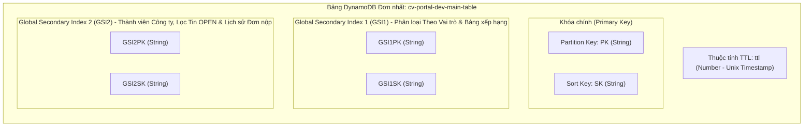
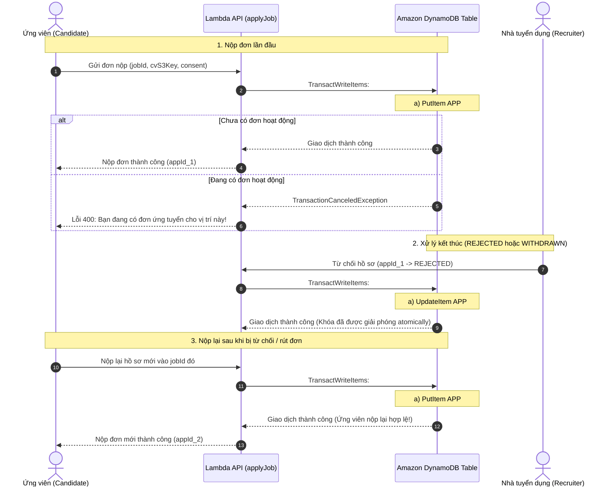

# THIẾT KẾ CƠ SỞ DỮ LIỆU (DATABASE ARCHITECTURE SPECIFICATION)

# Hệ thống: AI CV Screening Portal
> **Tài liệu:** Thiết kế Cơ sở Dữ liệu NoSQL DynamoDB Single-Table Design  
> **Mã tài liệu:** `DOC-SW-03-DB`  
> **Phiên bản:** `2.1` (Hoàn thiện toàn diện sau rà soát đợt 2) · **Ngày ban hành:** 28/10/2026 · **Trạng thái:** Đã phê duyệt chính thức  
> **Kiến trúc áp dụng:** Amazon DynamoDB On-Demand (Single-Table Design Pattern)  
> **Tài liệu đối chiếu:** [01-requirements.md](./01-requirements.md) (SRS v1.0), [02-use-cases.md](./02-use-cases.md) (Use Cases v2.1), [review-uc-database-v2.md](./review-uc-database-v2.md)

---

## 1. Tổng quan & Các Quyết định Kiến trúc Cốt lõi

### 1.1. Bối cảnh & Mục tiêu Kỹ thuật
Hệ thống **AI CV Screening Portal** vận hành theo mô hình **AWS Serverless** hoàn chỉnh. Cơ sở dữ liệu nghiệp vụ chính được thiết kế trên **Amazon DynamoDB** nhằm đảm bảo:
1. **Độ trễ mili-giây đơn vị (Single-digit Millisecond Latency):** Phản hồi tức thì cho ứng viên nộp hồ sơ và nhà tuyển dụng duyệt bảng xếp hạng ứng viên.
2. **Khả năng tự động co giãn không cần quản lý máy chủ (Zero-server Scaling):** Chịu tải đột biến khi mở các đợt tuyển dụng lớn.
3. **Chi phí tối ưu Pay-as-you-go:** Chế độ **On-Demand Capacity**, chi phí bằng 0 USD khi không có request.
4. **Quy chuẩn Định danh Thuộc tính (CamelCase Convention):** Toàn bộ thuộc tính lưu trữ trong DynamoDB, các DTOs giao tiếp API và Use Cases đều thống nhất theo chuẩn `camelCase` (ví dụ: `status`, `aiStatus`, `candidateId`, `jobId`, `submittedAt`).

---

### 1.2. Chiến lược Single-Table Design & Giới hạn 2 GSIs



#### Nguyên tắc cốt lõi:
* **Tách rời dữ liệu nhị phân (Binary Offloading):** File CV gốc định dạng PDF (`.pdf`) và avatar lưu trữ trên **Amazon S3**; DynamoDB chỉ lưu đường dẫn S3 Key (`s3Key`), dung lượng (`fileSize`), mã băm toàn vẹn (`fileHash`) và văn bản bóc tách phục vụ AI.
* **Nguồn xác thực Email Authoritative:** **Amazon Cognito User Pool** là nguồn xác thực chính thức và quản lý tính duy nhất của email người dùng. Để bảo đảm kiểm tra email nhanh và toàn vẹn trong DynamoDB, hệ thống sử dụng thêm item phụ tra cứu email (`PK = EMAIL#<email>`, `SK = USER#<userId>`).
* **Hai chỉ số toàn cục (GSI Minimalist):**
  * **`GSI1` (Phân loại & Bảng xếp hạng):**
    * Tra cứu người dùng theo vai trò: `GSI1PK = ROLE#<role>` (`ROLE#CANDIDATE`, `ROLE#RECRUITER`, `ROLE#ADMIN`), `GSI1SK = CREATED#<isoDate>` (hỗ trợ `AP05` cho tất cả vai trò).
    * Danh mục công ty: `GSI1PK = COMPANIES`, `GSI1SK = NAME#<companyName>`.
    * Danh mục tin theo công ty: `GSI1PK = COMPANY#<companyId>`, `GSI1SK = JOB#<status>#<createdAt>`.
    * Bảng xếp hạng ứng viên theo điểm số AI đệm: `GSI1PK = JOB#<jobId>`, `GSI1SK = SCORE#<padScore>#<appId>` (hỗ trợ `AP23`).
    * Kho tài năng: `GSI1PK = POOL#<companyId>`, `GSI1SK = SCORE#<padScore>#<candidateId>`.
  * **`GSI2` (Thành viên Công ty, Tìm việc làm & Lịch sử Đơn nộp):**
    * Thành viên Recruiter trong HR Team công ty: `GSI2PK = COMPANY#<companyId>`, `GSI2SK = MEMBER#<userId>` (hỗ trợ `AP04`).
    * Tìm kiếm việc làm đang mở mới nhất: `GSI2PK = JOBS#STATUS#OPEN`, `GSI2SK = CREATED#<isoDate>` (hỗ trợ `AP11`).
    * Lịch sử đơn ứng tuyển của Ứng viên: `GSI2PK = USER#<candidateId>`, `GSI2SK = APP#<submittedAt>` (hỗ trợ `AP24`).

---

## 2. Ma trận Thực thể & Định dạng Khóa (Entity Schema Matrix)

| Thực thể | Mô tả nghiệp vụ | Định dạng PK | Định dạng SK | Định dạng GSI1PK | Định dạng GSI1SK | Định dạng GSI2PK | Định dạng GSI2SK | TTL |
| :--- | :--- | :--- | :--- | :--- | :--- | :--- | :--- | :---: |
| **User (Candidate)** | Hồ sơ tài khoản ứng viên | `USER#<userId>` | `PROFILE` | `ROLE#CANDIDATE` | `CREATED#<isoDate>` | — | — | ❌ |
| **User (Recruiter)** | Chuyên viên nhân sự | `USER#<userId>` | `PROFILE` | `ROLE#RECRUITER` | `CREATED#<isoDate>` | `COMPANY#<companyId>` | `MEMBER#<userId>` | ❌ |
| **User (Admin)** | Quản trị viên sàn | `USER#<userId>` | `PROFILE` | `ROLE#ADMIN` | `CREATED#<isoDate>` | — | — | ❌ |
| **Email Lookup** | Khóa tra cứu email duy nhất | `EMAIL#<email>` | `USER#<userId>` | — | — | — | — | ❌ |
| **Company** | Hồ sơ doanh nghiệp tuyển dụng | `COMPANY#<companyId>` | `METADATA` | `COMPANIES` | `NAME#<companyName>` | `STATUS#<status>` | `CREATED#<isoDate>` | ❌ |
| **Job (JD)** | Tin tuyển dụng việc làm | `JOB#<jobId>` | `METADATA` | `COMPANY#<companyId>` | `JOB#<status>#<createdAt>` | `JOBS#STATUS#<status>` | `CREATED#<isoDate>` | ❌ |
| **Job Moderation** | Nhật ký kiểm duyệt tin của Admin | `JOB#<jobId>` | `MODERATION#<isoDate>#<adminId>` | — | — | — | — | ❌ |
| **Candidate CV** | Kho CV cá nhân tải sẵn | `USER#<candidateId>` | `CV#<cvId>` | `USER#<candidateId>` | `CV#DEFAULT#<isDefault>` | — | — | ❌ |
| **Favorite Job** | Việc làm ứng viên đã lưu | `USER#<candidateId>` | `FAVORITE#<jobId>` | — | — | — | — | ❌ |
| **Job Alert** | Đăng ký thông báo nhận tin việc làm | `USER#<candidateId>` | `ALERT#<alertId>` | — | — | — | — | ❌ |
| **Application** | Đơn nộp & Kết quả phân tích AI hiện hành | `APP#<applicationId>` | `METADATA` | `JOB#<jobId>` | `SCORE#<padScore>#<appId>` | `USER#<candidateId>` | `APP#<submittedAt>` | ❌ |
| **AI Eval Version** | Lịch sử phiên bản chấm điểm AI (Versioned) | `APP#<applicationId>` | `EVAL#v<padVersion>` | — | — | — | — | ❌ |
| **Active App Lock** | Khóa chống nộp trùng lặp có vòng đời | `USER#<candidateId>` | `ACTIVE_APP#<jobId>` | — | — | — | — | ❌ |
| **Application Review** | Đánh giá độc lập của HR Team | `APP#<applicationId>` | `REVIEW#<reviewerId>` | — | — | — | — | ❌ |
| **AuditTrail** | Nhật ký kiểm toán can thiệp đơn nộp | `APP#<applicationId>` | `AUDIT#<isoDate>#<auditId>` | `ACTOR#<actorId>` | `AUDIT#<isoDate>` | — | — | ❌ |
| **CV Access Log** | Nhật ký cấp quyền xem/tải CV gốc | `APP#<applicationId>` | `ACCESS_LOG#<isoDate>#<logId>` | — | — | — | — | ✅ (180d) |
| **TalentPool** | Ứng viên lưu vào kho tài năng | `COMPANY#<companyId>` | `POOL#<candidateId>` | `POOL#<companyId>` | `SCORE#<padScore>#<cdd>` | `USER#<candidateId>` | `COMPANY#<companyId>` | ❌ |
| **ConsentLog** | Lịch sử đồng thuận xử lý dữ liệu | `USER#<candidateId>` | `CONSENT#<isoDate>#<purpose>` | — | — | — | — | ✅ (90d) |
| **Upload Session** | Phiên Presigned URL tạm thời | `UPLOAD#<token>` | `SESSION` | — | — | — | — | ✅ (15m) |
| **Rescore RateLimit** | Bộ đếm tần suất gọi AI chấm điểm lại | `RATELIMIT#<applicationId>` | `RESCORE#<hourSlot>` | — | — | — | — | ✅ (1h) |
| **Company AI Quota** | Hạn mức xử lý AI theo ngày của Công ty | `COMPANY#<companyId>` | `AI_QUOTA#<yyyy-mm-dd>` | — | — | — | — | ✅ (7d) |
| **Notification Log** | Theo dõi gửi email SES & Idempotency | `NOTIF#<idempotencyKey>` | `EMAIL` | — | — | — | — | ✅ (30d) |

---

## 3. Đồng bộ Vòng đời Trạng thái Kép (Dual Status Lifecycle)

Hệ thống tuân thủ nghiêm ngặt quy định tại Mục 6 của SRS v1.0 ([01-requirements.md](./01-requirements.md)) và các Use Cases ([02-use-cases.md](./02-use-cases.md)), tách biệt giữa **Trạng thái Tuyển dụng Nghiệp vụ (`status`)** và **Tiến trình Xử lý Kỹ thuật AI (`aiStatus`)**:

```text
Bản ghi Application trên DynamoDB:
├── status:   [ SUBMITTED | UNDER_REVIEW | INVITED | ACCEPTED | REJECTED | WITHDRAWN ] (Nghiệp vụ ATS)
└── aiStatus: [ PENDING | EXTRACTING | SCORING | COMPLETED | FAILED ]                  (Pipeline AI)
```

### 3.1. Sơ đồ Máy Trạng thái (State Machine)


### 3.2. Ma trận Chuyển đổi Trạng thái Hợp lệ & Điều kiện DynamoDB

| Trạng thái hiện tại | Thao tác tác động | Tác nhân | Điều kiện kiểm tra (`ConditionExpression`) | Trạng thái mới |
| :--- | :--- | :---: | :--- | :--- |
| `SUBMITTED` | Recruiter mở xem chi tiết đơn | `RCT` | `attribute_exists(PK) AND #status = :submitted` | `UNDER_REVIEW` |
| `UNDER_REVIEW` | Gửi thư mời phỏng vấn | `RCT` | `attribute_exists(PK) AND #status = :underReview` | `INVITED` |
| `UNDER_REVIEW` | Từ chối hồ sơ chưa đạt | `RCT` | `attribute_exists(PK) AND #status = :underReview` | `REJECTED` |
| `INVITED` | Đánh giá trúng tuyển | `RCT` | `attribute_exists(PK) AND #status = :invited` | `ACCEPTED` |
| `INVITED` | Đánh giá không đạt sau phỏng vấn | `RCT` | `attribute_exists(PK) AND #status = :invited` | `REJECTED` |
| `SUBMITTED` hoặc `UNDER_REVIEW` | Ứng viên tự rút đơn | `CDD` | `attribute_exists(PK) AND #candidateId = :userId AND #status IN (:sub, :rev)` | `WITHDRAWN` |
| `PENDING` | Worker bắt đầu bóc tách văn bản | `SYS` | `attribute_exists(PK) AND #aiStatus = :pending` | `EXTRACTING` |
| `EXTRACTING` | Bắt đầu gọi Bedrock chấm điểm | `SYS` | `attribute_exists(PK) AND #aiStatus = :extracting` | `SCORING` |
| `SCORING` | Lưu điểm Rubric thành công | `SYS` | `attribute_exists(PK) AND #aiStatus = :scoring` | `COMPLETED` |
| `EXTRACTING` / `SCORING` | Xử lý thất bại đẩy vào DLQ | `SYS` | `attribute_exists(PK) AND #aiStatus IN (:ext, :sco)` | `FAILED` |
| `COMPLETED` / `FAILED` | Kích hoạt Re-score hợp lệ | `RCT` | `attribute_exists(PK) AND #aiStatus IN (:comp, :fail)` | `PENDING` |

---

## 4. Vòng đời Khóa Chống Nộp Trùng & Chính sách Nộp lại Hợp lệ

Theo quy định tại `BR-DOC-02` ([01-requirements.md](./01-requirements.md)), mỗi ứng viên chỉ được phép có **tối đa 1 đơn ứng tuyển đang hoạt động** cho mỗi vị trí tuyển dụng. Đơn ứng tuyển được định nghĩa là "đang hoạt động" khi `status` thuộc nhóm `{SUBMITTED, UNDER_REVIEW, INVITED}`. Ứng viên **được phép nộp lại** khi đơn trước đó đã chuyển sang trạng thái kết thúc `{REJECTED, WITHDRAWN}`.

### 4.1. Cơ chế Khóa Hoạt động (Active Application Lock)
* **Khóa chính:** `PK = USER#<candidateId>`, `SK = ACTIVE_APP#<jobId>`.
* **Thuộc tính:** `applicationId`, `status`, `appliedAt`.



---

## 5. Mô hình Đánh giá Đồng đội của HR Team (Multi-Reviewer Architecture)

Theo yêu cầu của **UC-RCT-05** ([02-use-cases.md](./02-use-cases.md)), một hồ sơ ứng viên có thể được nhiều thành viên tuyển dụng hoặc Tech Lead cùng đánh giá, chấm điểm sao và ghi chú.

### 5.1. Tách biệt Review Item độc lập
Mỗi đánh giá của một chuyên viên nhân sự được lưu thành một item riêng biệt:
* **Khóa chính:** `PK = APP#<applicationId>`, `SK = REVIEW#<reviewerId>`.
* **Thuộc tính:**
  * `reviewId`: Mã đánh giá duy nhất.
  * `applicationId`, `jobId`, `companyId`.
  * `reviewerId`, `reviewerName`, `reviewerEmail`.
  * `rating`: Đánh giá định lượng từ 1 đến 5 sao.
  * `manualNotes`: Ghi chú nhận xét chuyên môn.
  * `recommendation`: Đề xuất nhân sự (`INVITE`, `REJECT`, `NEUTRAL`).
  * `createdAt`, `updatedAt`, `version`.

### 5.2. Đồng bộ Dữ liệu Tổng hợp trên Application
Bản ghi Application chính (`PK = APP#<applicationId>`, `SK = METADATA`) duy trì các trường số liệu tổng hợp được cập nhật tự động khi có đánh giá mới:
* `reviewCount`: Tổng số lượng thành viên đã đánh giá (Atomic Counter).
* `avgRating`: Điểm đánh giá trung bình của HR Team (Ví dụ: `4.2`).
* `latestReviewedAt`: Mốc thời gian đánh giá gần nhất.

---

## 6. Chính sách DSR Toàn diện & Quy trình Khử Định danh (Anonymization Pipeline)

Theo quy định tại `BR-PRIV-02` ([01-requirements.md](./01-requirements.md)) và **UC-AD-05** ([02-use-cases.md](./02-use-cases.md)), khi Ứng viên yêu cầu xóa tài khoản (Right to be Forgotten):

### 6.1. Quy trình Xóa & Khử Định danh Triệt để (Lineage Matrix)

| Vị trí lưu trữ dữ liệu | Đối tượng dữ liệu | Hành động xử lý DSR | Cơ sở pháp lý & Kỹ thuật |
| :--- | :--- | :--- | :--- |
| **Amazon S3** | File CV gốc định dạng PDF (`.pdf`) | **Xóa vật lý vĩnh viễn** (`s3.deleteObjects`) kể cả các version | Triệt tiêu bản sao tài liệu cá nhân gốc. |
| **DynamoDB User** | `PK = USER#<id>`, `SK = PROFILE` | **Khử định danh hoàn toàn:** Đặt `candidateId = "ANONYMIZED_USER"`, `fullName = "ANONYMIZED_USER"`, xóa hẳn trường `email` (không lưu hash email để chống dò từ điển), xóa `phone`, `bio`, `links`. Đổi `status = "ANONYMIZED"`. | Vô hiệu hóa tài khoản, triệt tiêu mọi liên kết cá nhân. |
| **DynamoDB Email Lookup** | `PK = EMAIL#<email>`, `SK = USER#<id>` | **Xóa bản ghi** (`DeleteItem`) | Giải phóng email, không lưu trữ PII tra cứu. |
| **DynamoDB CV Items** | `PK = USER#<id>`, `SK = CV#<cvId>` | **Xóa toàn bộ bản ghi** (`DeleteItem`) | Xóa danh mục CV cá nhân. |
| **DynamoDB Application** | `PK = APP#<id>`, `SK = METADATA` | **Khử định danh & Làm sạch Output AI:**<br>1. Thay `candidateId = "ANONYMIZED_USER"`, `candidateName = "ANONYMIZED_USER"`.<br>2. Xóa `candidateEmail = null`, `coverLetter = null`, `cv.s3Key = null`, `extractedText = null`.<br>3. **Làm sạch văn bản AI:** Xóa `executiveSummary = null`, `keyStrengths = []`, `areasForImprovement = []`, `suggestedInterviewQuestions = []` để tránh lộ thông tin do LLM trích xuất lại.<br>4. **Bảo tồn chỉ số định lượng:** Giữ lại `totalScore`, `matchLevel`, `criteriaScores`, `jobId`, `status`. | Đáp ứng nghĩa vụ kiểm toán báo cáo tuyển dụng của doanh nghiệp mà không để lộ PII. |
| **DynamoDB Active Lock** | `PK = USER#<id>`, `SK = ACTIVE_APP#<jobId>` | **Xóa bản ghi** (`DeleteItem`) | Tránh lưu vết khóa treo. |
| **DynamoDB TalentPool** | `PK = COMPANY#<comp>`, `SK = POOL#<id>` | **Xóa vật lý vĩnh viễn** (`DeleteItem`) | Thu hồi quyền lưu trữ trong kho nhân tài. |
| **DynamoDB Favorites/Alerts**| `FAVORITE#<jobId>`, `ALERT#<alertId>` | **Xóa toàn bộ bản ghi** (`DeleteItem`) | Hủy đăng ký nhận tin và danh sách quan tâm. |
| **DynamoDB AuditTrail** | `PK = APP#<id>`, `SK = AUDIT#...` | **Giữ nguyên:** Chỉ ghi nhận thao tác của Recruiter, không lưu PII của ứng viên. | Nghĩa vụ kiểm toán nội bộ bất biến. |
| **DynamoDB ConsentLog** | `PK = USER#<id>`, `SK = CONSENT#...` | **Ghi nhận sự kiện `REVOKED_ALL`:** `purpose = "ACCOUNT_DELETION"`, `status = "REVOKED_ALL"`, gán `ttl = 90 ngày` (tự động thu hồi sau thời hạn pháp lý). | Bằng chứng kiểm toán tuân thủ DSR. |

### 6.2. Điều phối Tiến trình DSR Bất đồng bộ (Asynchronous DSR Pipeline)
Do số lượng bản ghi liên quan có thể vượt quá giới hạn 100 items của `TransactWriteItems`, quy trình DSR được thiết kế vận hành qua **Step Functions / Lambda Worker điều phối tuần tự**:
1. **Khởi tạo:** Tiếp nhận yêu cầu, cập nhật trạng thái `dsrStatus = "PROCESSING"`.
2. **Batch 1 (S3 Cleanup):** Xóa toàn bộ file CV trong prefix `applications/` và `cvs/` của ứng viên trên S3.
3. **Batch 2 (User Sub-items):** Quét và xóa các item thuộc `USER#<candidateId>` (`CV#...`, `FAVORITE#...`, `ALERT#...`, `ACTIVE_APP#...`).
4. **Batch 3 (TalentPool & External References):** Xóa bản ghi trong TalentPool của tất cả các công ty liên quan.
5. **Batch 4 (Applications Sanitization):** Quét danh sách đơn nộp của ứng viên qua `GSI2`, cập nhật khử định danh và làm sạch output AI trên từng `Application`.
6. **Batch 5 (User Profile & Email Cleanup):** Xóa item `EMAIL#<email>`, khử định danh `USER#<id> / PROFILE`.
7. **Hoàn tất:** Ghi nhận sự kiện `REVOKED_ALL` vào `ConsentLog` (kèm TTL 90 ngày) và cập nhật `dsrStatus = "COMPLETED"`. Quy trình có gắn `idempotencyKey` và cơ chế retry có kiểm soát.

---

## 7. Nhật ký Truy cập CV & Kiểm duyệt Tin Tuyển dụng

### 7.1. Nhật ký Cấp quyền Truy cập CV (CV Access Log & S3 Correlation)
Đáp ứng tiêu chuẩn **NFR-SEC-05** và **UC-RCT-12** ([02-use-cases.md](./02-use-cases.md)):
* Khi Recruiter yêu cầu mở hoặc tải CV gốc, hệ thống tạo S3 Presigned URL có thời hạn hiệu lực **5 phút** (`BR-DOC-03`) và ghi nhận vào DynamoDB:
  * `PK = APP#<applicationId>`, `SK = ACCESS_LOG#<isoTimestamp>#<logId>`.
  * Thuộc tính: `logId`, `applicationId`, `jobId`, `companyId`, `actorId`, `actorEmail`, `action = "PRESIGNED_URL_ISSUED"`, `grantId`, `purpose = "APPLICANT_SCREENING"`, `ipAddress`, `userAgent`, `timestamp`, `ttl` (180 ngày).
* **Đối soát với truy cập S3 thực tế:** Trong Presigned URL có nhúng tham số `grantId` / `traceId`. Khi trình duyệt gọi trực tiếp tới Amazon S3 để tải file, log truy cập S3 (**S3 Server Access Logging / CloudTrail Data Events**) sẽ ghi nhận mã `grantId` tương ứng, cho phép kiểm toán viên đối soát chính xác giữa thời điểm cấp URL và thời điểm tải file thực tế.
* Tuyệt đối **không lưu trữ URL presigned đã ký** hay chữ ký bảo mật vào log.

### 7.2. Kiểm duyệt Tin Tuyển dụng (Job Moderation)
Phục vụ chức năng giám sát của Quản trị viên sàn Tuyển dụng (**UC-AD-03**):
* Bản ghi Job chính bổ sung các trường kiểm duyệt:
  * `moderationStatus`: `APPROVED` | `FLAGGED` | `LOCKED`.
  * `moderationReason`: Lý do khóa hoặc cảnh báo vi phạm.
  * `moderatedBy`: Admin ID xử lý.
  * `moderatedAt`: Mốc thời gian xử lý.
* Bản ghi lịch sử kiểm duyệt:
  * `PK = JOB#<jobId>`, `SK = MODERATION#<isoTimestamp>#<adminId>`.
  * Thuộc tính: `adminId`, `adminEmail`, `action` (`LOCK`, `UNLOCK`, `APPROVE`, `FLAG`), `reason`, `timestamp`.

---

## 8. Danh mục 34 Mẫu Truy cập (Access Patterns - AP01 → AP34)

| Mã AP | Tên Mẫu Truy Cập Nghiệp Vụ | Tác Nhân | Thao Tác | Target Index | Cú Pháp Query / Key Expression |
| :---: | :--- | :---: | :---: | :---: | :--- |
| **AP01** | Lấy thông tin tài khoản người dùng theo `userId` | `ALL` | `GetItem` | Bảng chính | `PK = USER#<userId>` AND `SK = PROFILE` |
| **AP02** | Tra cứu tài khoản theo `email` (Authoritative Cognito & DDB Lookup) | `SYS, AD` | `GetItem` | Bảng chính | `PK = EMAIL#<email>` AND begins_with(`SK`, `USER#`) |
| **AP03** | Tạo mới hoặc cập nhật thông tin hồ sơ cá nhân | `CDD, RCT` | `Put/Update` | Bảng chính | `PK = USER#<userId>` AND `SK = PROFILE` |
| **AP04** | Liệt kê toàn bộ chuyên viên nhân sự trong một Công ty | `RCT, AD` | `Query` | `GSI2` | `GSI2PK = COMPANY#<companyId>` AND begins_with(`GSI2SK`, `MEMBER#`) |
| **AP05** | Liệt kê tài khoản người dùng theo vai trò kiểm tra (`ROLE#...`) | `AD` | `Query` | `GSI1` | `GSI1PK = ROLE#<role>` (Hoạt động cho CANDIDATE, RECRUITER, ADMIN) |
| **AP06** | Lấy thông tin hồ sơ doanh nghiệp theo `companyId` | `ALL` | `GetItem` | Bảng chính | `PK = COMPANY#<companyId>` AND `SK = METADATA` |
| **AP07** | Tạo mới hoặc cập nhật hồ sơ doanh nghiệp | `RCT, AD` | `Put/Update` | Bảng chính | `PK = COMPANY#<companyId>` AND `SK = METADATA` |
| **AP08** | Liệt kê danh sách doanh nghiệp đã xác thực trên sàn | `ALL` | `Query` | `GSI1` | `GSI1PK = COMPANIES` |
| **AP09** | Lấy thông tin chi tiết tin tuyển dụng theo `jobId` | `ALL` | `GetItem` | Bảng chính | `PK = JOB#<jobId>` AND `SK = METADATA` |
| **AP10** | Lấy toàn bộ tin tuyển dụng của một công ty (cả tin đóng) | `RCT, AD` | `Query` | `GSI1` | `GSI1PK = COMPANY#<companyId>` AND begins_with(`GSI1SK`, `JOB#`) |
| **AP11** | Tìm kiếm tin tuyển dụng đang mở (`OPEN`) mới nhất (Phân trang & Lọc) | `CDD, ALL` | `Query` | `GSI2` | `GSI2PK = JOBS#STATUS#OPEN` (ScanIndexForward: false, kèm FilterExpression) |
| **AP12** | Tạo mới / Cập nhật / Đóng tin tuyển dụng | `RCT` | `Put/Update` | Bảng chính | `PK = JOB#<jobId>` AND `SK = METADATA` |
| **AP13** | Quản trị viên khóa hoặc phê duyệt tin tuyển dụng | `AD` | `UpdateItem` | Bảng chính | `PK = JOB#<jobId>` AND `SK = METADATA` (kèm ghi item `MODERATION#...`) |
| **AP14** | Liệt kê danh mục việc làm yêu thích của Ứng viên | `CDD` | `Query` | Bảng chính | `PK = USER#<candidateId>` AND begins_with(`SK`, `FAVORITE#`) |
| **AP15** | Thêm mới hoặc xóa việc làm khỏi danh sách yêu thích | `CDD` | `Put/Delete` | Bảng chính | `PK = USER#<candidateId>` AND `SK = FAVORITE#<jobId>` |
| **AP16** | Quản lý cấu hình đăng ký thông báo việc làm (Job Alert) | `CDD` | `Put/Query` | Bảng chính | `PK = USER#<candidateId>` AND begins_with(`SK`, `ALERT#`) |
| **AP17** | Lấy toàn bộ danh sách CV cá nhân tải sẵn của Ứng viên | `CDD` | `Query` | Bảng chính | `PK = USER#<candidateId>` AND begins_with(`SK`, `CV#`) |
| **AP18** | Tải lên CV mới hoặc xóa CV cá nhân | `CDD` | `Put/Delete` | Bảng chính | `PK = USER#<candidateId>` AND `SK = CV#<cvId>` |
| **AP19** | Thiết lập một CV làm mặc định (Transaction hủy bản cũ) | `CDD` | `TransactWrite` | Bảng chính | Cập nhật `defaultCvId` trên `PROFILE` & toggle `isDefault` |
| **AP20** | Kiểm tra ứng viên có đơn nộp đang hoạt động hay không | `CDD, SYS` | `GetItem` | Bảng chính | `PK = USER#<candidateId>` AND `SK = ACTIVE_APP#<jobId>` |
| **AP21** | Nộp đơn ứng tuyển mới (Atomic Transaction kèm tạo Lock) | `CDD` | `TransactWrite` | Bảng chính | Put `APP#<id>` VÀ Put `ACTIVE_APP#<jobId>` (`attribute_not_exists(PK)`) |
| **AP22** | Xem chi tiết 1 đơn ứng tuyển kèm kết quả phân tích AI | `CDD, RCT` | `GetItem` | Bảng chính | `PK = APP#<applicationId>` AND `SK = METADATA` |
| **AP23** | Bảng xếp hạng ứng viên theo điểm AI giảm dần của 1 JD | `RCT` | `Query` | `GSI1` | `GSI1PK = JOB#<jobId>` AND begins_with(`GSI1SK`, `SCORE#`) (ScanIndexForward: false) |
| **AP24** | Tra cứu toàn bộ các đơn nộp của 1 Ứng viên theo thời gian | `CDD` | `Query` | `GSI2` | `GSI2PK = USER#<candidateId>` AND begins_with(`GSI2SK`, `APP#`) (ScanIndexForward: false) |
| **AP25** | Rút đơn hoặc chuyển trạng thái kết thúc (Atomic mở Lock)| `CDD, RCT` | `TransactWrite` | Bảng chính | Update `APP#<id>` SET `status = REJECTED/WITHDRAWN` VÀ Delete `ACTIVE_APP#<jobId>` |
| **AP26** | Thêm hoặc cập nhật đánh giá của thành viên HR Team | `RCT` | `Put/Update` | Bảng chính | `PK = APP#<applicationId>` AND `SK = REVIEW#<reviewerId>` |
| **AP27** | Lấy toàn bộ danh sách đánh giá của các thành viên HR Team | `RCT` | `Query` | Bảng chính | `PK = APP#<applicationId>` AND begins_with(`SK`, `REVIEW#`) |
| **AP28** | Ghi nhận sự kiện kiểm toán can thiệp đơn nộp bất biến | `RCT, SYS` | `PutItem` | Bảng chính | `PK = APP#<applicationId>` AND `SK = AUDIT#<isoDate>#<auditId>` |
| **AP29** | Ghi nhận nhật ký cấp URL xem/tải CV (Access Audit Log) | `RCT, AD` | `Put/Query` | Bảng chính | `PK = APP#<applicationId>` AND begins_with(`SK`, `ACCESS_LOG#`) |
| **AP30** | Khai thác Kho tài năng: Lưu ứng viên & Lấy danh sách | `RCT` | `Put/Query` | `GSI1` | `GSI1PK = POOL#<companyId>` AND begins_with(`GSI1SK`, `SCORE#`) |
| **AP31** | Ghi nhận sự đồng thuận / thu hồi dữ liệu (Consent Log) | `CDD` | `Put/Query` | Bảng chính | `PK = USER#<candidateId>` AND begins_with(`SK`, `CONSENT#`) |
| **AP32** | Quản lý phiên Presigned URL tải file tạm thời | `SYS` | `Put/Get` | Bảng chính | `PK = UPLOAD#<token>`, `SK = SESSION` (Code check `expiresAt` & TTL 15m) |
| **AP33** | Bộ đếm tần suất Re-score AI (Rate-limit Atomic Counter) | `RCT, SYS` | `UpdateItem` | Bảng chính | `PK = RATELIMIT#<appId>`, `SK = RESCORE#<hourSlot>` (ADD count & condition < 3) |
| **AP34** | Nhật ký thông báo email SES & Kiểm tra trùng lặp | `SYS` | `Put/Get` | Bảng chính | `PK = NOTIF#<idempotencyKey>`, `SK = EMAIL` (Idempotent check & TTL 30d) |
| **AP35** | Lưu & Tra cứu lịch sử các phiên bản chấm điểm AI | `RCT, SYS` | `Put/Query` | Bảng chính | `PK = APP#<applicationId>` AND begins_with(`SK`, `EVAL#v`) |
| **AP36** | Kiểm tra & Tăng hạn mức xử lý AI theo ngày của Công ty | `SYS` | `UpdateItem` | Bảng chính | `PK = COMPANY#<companyId>`, `SK = AI_QUOTA#<yyyy-mm-dd>` (ADD usedCount & condition <= dailyLimit) |

---

### 8.1. Đặc tả Chi tiết Cơ chế Tìm kiếm Tin tuyển dụng (`AP11`)

* **Mục tiêu:** Hỗ trợ ứng viên duyệt và lọc việc làm đang mở theo thời gian thực trên Cổng thông tin (**UC-CDD-04**).
* **Chỉ số truy vấn:** `GSI2` với `GSI2PK = JOBS#STATUS#OPEN`.
* **Sắp xếp mặc định:** `ScanIndexForward = false` để trả về các tin tạo mới nhất dựa trên `GSI2SK = CREATED#<isoDate>`.
* **Các bộ lọc có cấu trúc hỗ trợ qua `FilterExpression`:**
  * Lọc theo phòng ban/ngành: `#department = :dept`
  * Lọc theo hình thức làm việc: `#workplaceType = :workplace` (`REMOTE`, `HYBRID`, `ON_SITE`)
  * Lọc theo loại hợp đồng: `#employmentType = :type` (`FULL_TIME`, `PART_TIME`, `INTERNSHIP`)
  * Lọc theo khoảng lương: `#salary.#min >= :minSalary AND #salary.#max <= :maxSalary`
  * Lọc theo địa điểm: `contains(#location, :loc)`
  * Lọc theo kỹ năng yêu cầu: `contains(#skillsRequired, :skill)`
* **Phân trang (Pagination):**
  * Kích thước trang cố định: `Limit = 20`.
  * Cơ chế phân trang không trạng thái (Stateless Cursor): API nhận `cursor` (chính là `LastEvaluatedKey` mã hóa Base64) và truyền vào `ExclusiveStartKey` của DynamoDB SDK.
* **Ranh giới kiến trúc & Giới hạn vận hành:**
  * Trong giai đoạn MVP, giải pháp `GSI2 + FilterExpression` đáp ứng toàn bộ các bộ lọc thuộc tính có cấu trúc với chi phí thấp và không phát sinh máy chủ duy trì.
  * Giới hạn: `FilterExpression` lọc sau khi đọc partition; không hỗ trợ tìm kiếm toàn văn mờ (Fuzzy Full-text Search) hay tìm kiếm theo lỗi chính tả.
  * Lộ trình mở rộng (Post-MVP): Chuyển luồng dữ liệu qua **DynamoDB Streams $\rightarrow$ Amazon OpenSearch Service** để cung cấp công cụ tìm kiếm ngữ nghĩa và gợi ý từ khóa tự động.

---

## 9. Ma trận Truy xuất Nguồn gốc 32 Use Cases tới Access Patterns và Dịch vụ AWS

Bảng ma trận ánh xạ chính xác 100% từng Use Case với nghiệp vụ tương ứng:

| Mã Use Case | Tên Use Case | Phân Hệ | Thao Tác DB / Dịch Vụ AWS Áp Dụng | Mã AP / Dịch Vụ | Target Key / Index |
| :--- | :--- | :---: | :--- | :---: | :--- |
| **UC-CDD-01** | Đăng ký, Xác thực OTP & Đăng nhập | Auth | Cognito User Pool, Put User & EmailLookup | **AP01, AP02, AP03** | `USER#<id>`, `EMAIL#<email>` |
| **UC-CDD-02** | Cập nhật Hồ sơ năng lực cá nhân | Profile | UpdateItem User Profile | **AP03** | `USER#<id> / PROFILE` |
| **UC-CDD-03** | Quản lý Kho CV & Thiết lập CV Mặc định | CV Storage | Put/Delete CV, TransactWrite default toggle | **AP17, AP18, AP19** | `USER#<id> / CV#<id>` |
| **UC-CDD-04** | Tìm kiếm & Khám phá cơ hội việc làm | Jobs | Query GSI2 JOBS#STATUS#OPEN with Filters | **AP11** | `GSI2: JOBS#STATUS#OPEN` |
| **UC-CDD-05** | Lưu việc làm yêu thích & Đăng ký tin | Saved Jobs | Put/Delete Favorite, Put Job Alert | **AP14, AP15, AP16** | `USER#<id> / FAVORITE#...` |
| **UC-CDD-06** | Nộp hồ sơ ứng tuyển trực tuyến | Apply | TransactWrite (App + ActiveLock + Consent) | **AP20, AP21, AP31, AP32** | `APP#<id>`, `ACTIVE_APP#<id>` |
| **UC-CDD-07** | Theo dõi tiến trình tuyển dụng kép | Tracker | Query applications by candidate via GSI2 | **AP24** | `GSI2: USER#<candidateId>` |
| **UC-CDD-08** | Xem báo cáo đánh giá AI minh bạch | Evaluation | GetItem Application metadata | **AP22** | `APP#<id> / METADATA` |
| **UC-CDD-09** | Rút đơn ứng tuyển tuyển dụng | Withdraw | TransactWrite (status=WITHDRAWN + Del Lock)| **AP25** | `APP#<id>`, `ACTIVE_APP#<id>` |
| **UC-CDD-10** | Quản lý quyền riêng tư & Quyền DSR | Privacy | Asynchronous DSR Anonymization Pipeline | **AP03, AP31** | User Profile, S3, CV, Consent |
| **UC-CDD-11** | Nhận email thông báo tuyển dụng tự động | Notification| Put Notification Log & Amazon SES Event | **AP34** | `NOTIF#<idempotencyKey>` |
| **UC-RCT-01** | Quản lý Hồ sơ Công ty & HR Team | HR Team | Put Company & User (Query Team via GSI2) | **AP03, AP04, AP06, AP07**| `COMPANY#<id>`, `GSI2: MEMBER#<id>`|
| **UC-RCT-02** | Soạn thảo, Xuất bản & Đóng tin JD | Job Posting | Put/Update Job metadata with Rubric | **AP09, AP10, AP12** | `JOB#<id> / METADATA` |
| **UC-RCT-03** | Xem Bảng xếp hạng ứng viên theo điểm AI| Leaderboard | Query Applications sorted by score via GSI1| **AP23** | `GSI1: JOB#<jobId>` |
| **UC-RCT-04** | Đối chiếu Song song 3 Cột (Side-by-side)| HITL View | GetItem App metadata + Presigned S3 CV | **AP22, AP29** | `APP#<id> / METADATA` + S3 |
| **UC-RCT-05** | Đánh giá Thủ công, Ghi chú & Chấm sao | Multi-Review| Put/Query Application Reviews (Multi-HR) | **AP26, AP27** | `APP#<id> / REVIEW#<revId>` |
| **UC-RCT-06** | Chuyển Trạng thái & Ghi Audit Trail | ATS Action | TransactWrite Status Change & Audit Trail | **AP25, AP28** | `APP#<id> / AUDIT#...` |
| **UC-RCT-07** | Kích hoạt Yêu cầu Chấm lại (Re-score) | AI Control | Update aiStatus=PENDING with RateLimit check | **AP22, AP33** | `RATELIMIT#<applicationId>` |
| **UC-RCT-08** | Báo cáo Phân tích Skill Gap theo JD | Analytics | Aggregate query on Job Applications | **AP23** | `GSI1: JOB#<jobId>` |
| **UC-RCT-09** | Lưu trữ & Quản trị Kho Tài năng | Talent Pool | PutItem TalentPool record | **AP30** | `COMPANY#<id> / POOL#<cdd>` |
| **UC-RCT-10** | Khai thác Gợi ý Ứng viên (Rediscovery) | Talent Pool | Query TalentPool by Score & matching skills| **AP30** | `GSI1: POOL#<companyId>` |
| **UC-RCT-11** | Gửi Email Tuyển dụng qua Amazon SES | Notification| Put Notification Log & Amazon SES | **AP34** | `NOTIF#<idempotencyKey>` |
| **UC-RCT-12** | Tải CV An toàn & Nhật ký Kiểm toán | Audit & Sec | Put Presigned Issue Log & S3 Data Events | **AP28, AP29** | `APP#<id> / ACCESS_LOG#...` |
| **UC-AD-01** | Dashboard Quản trị Chỉ số Vận hành | Operations | Query CloudWatch Metrics & DynamoDB aggregates| **AP05, AP08** | `GSI1: COMPANIES, ROLE#...` |
| **UC-AD-02** | Khóa Tài khoản Người dùng Vi phạm | Moderation | UpdateItem User status = SUSPENDED | **AP01, AP03** | `USER#<id> / PROFILE` |
| **UC-AD-03** | Kiểm duyệt & Gỡ bỏ Tin Tuyển dụng | Moderation | Update Job moderationStatus & Moderation Log| **AP12, AP13** | `JOB#<id> / MODERATION#...` |
| **UC-AD-04** | Giám sát Sự cố Hàng đợi Lỗi DLQ | Resilience | Amazon SQS DLQ Redrive & CloudWatch Alarm | SQS / CloudWatch | AWS SQS DLQ Queue |
| **UC-AD-05** | Phê duyệt & Thực thi Yêu cầu DSR | Compliance | Orchestrate DSR Anonymization Pipeline | **AP03, AP31** | User Profile, S3, Consent |
| **UC-SYS-01** | Tiếp nhận & Điều phối Hồ sơ Bất đồng bộ | Worker SQS | SQS Message Consumer Lambda Trigger | Amazon SQS | SQS Event Source Mapping |
| **UC-SYS-02** | Trích xuất Văn bản CV PDF qua Textract | Worker Extract| S3 GetObject -> Amazon Textract -> Update DDB| **AP22** | `APP#<id>` SET aiStatus=EXTRACTING|
| **UC-SYS-03** | Khử PII & Chấm điểm Bedrock Rubric | Worker Bedrock| In-memory Regex PII Masking -> Bedrock Haiku | **AP22** | `APP#<id>` SET aiStatus=COMPLETED |
| **UC-SYS-04** | Tự phục hồi Khi Quá tải & Cách ly DLQ | Resilience | Exponential Backoff Retry -> Send to SQS DLQ | SQS DLQ / AP22 | `APP#<id>` SET aiStatus=FAILED |

---

## 10. Đặc tả Chi tiết Cấu trúc Dữ liệu JSON Mẫu (Data Schemas)

### 10.1. Đơn Ứng tuyển Chuẩn hóa (`Application`)

```json
{
  "PK": "APP#app_01J9XAK4M6P8Q0R2T4V6W8Y0Z2",
  "SK": "METADATA",
  "GSI1PK": "JOB#job_01J9X9K2M3N4P5R6T7V8W9Y0Z1",
  "GSI1SK": "SCORE#082#app_01J9XAK4M6P8Q0R2T4V6W8Y0Z2",
  "GSI2PK": "USER#usr_cdd_01J9X8P3M4R7T2W1V0K5N6Y8QZ",
  "GSI2SK": "APP#2026-10-28T10:15:30.000Z",
  "entityType": "APPLICATION",
  "applicationId": "app_01J9XAK4M6P8Q0R2T4V6W8Y0Z2",
  "jobId": "job_01J9X9K2M3N4P5R6T7V8W9Y0Z1",
  "companyId": "comp_01J9X8A1B2C3D4E5F6G7H8J9K0",
  "candidateId": "usr_cdd_01J9X8P3M4R7T2W1V0K5N6Y8QZ",
  "candidateName": "Nguyễn Văn A",
  "candidateEmail": "nguyen.van.a@example.com",
  "jobTitle": "Senior Backend Node.js / TypeScript Engineer",
  "cv": {
    "s3Bucket": "cvscreen-dev-cv-storage-901234",
    "s3Key": "applications/job_01J9X9K2/app_01J9XAK4.pdf",
    "fileName": "NguyenVanA_Backend_CV.pdf",
    "fileSize": 184520,
    "fileType": "PDF",
    "uploadedAt": "2026-10-28T10:15:00.000Z"
  },
  "coverLetter": "Tôi rất hứng thú với vị trí Senior Backend và tin rằng kinh nghiệm AWS Serverless của mình sẽ đóng góp lớn cho dự án.",
  "status": "SUBMITTED",
  "aiStatus": "COMPLETED",
  "aiEvaluation": {
    "totalScore": 82,
    "matchLevel": "STRONG_MATCH",
    "criteriaScores": {
      "technicalSkills": { "score": 32, "maxScore": 40, "analysis": "Nắm vững Node.js và AWS DynamoDB/Lambda. Thiếu TypeScript nâng cao." },
      "workExperience": { "score": 26, "maxScore": 30, "analysis": "Hơn 3 năm xây dựng hệ thống phân tán chịu tải cao." },
      "educationCertifications": { "score": 12, "maxScore": 15, "analysis": "Cử nhân CNTT Đại học Bách Khoa. Chưa có AWS Certified Solutions Architect." },
      "softSkillsPresentation": { "score": 12, "maxScore": 15, "analysis": "Trình bày cấu trúc sáng rõ, rõ ràng theo từng dự án." }
    },
    "keyStrengths": [
      "Kinh nghiệm thực chiến với kiến trúc AWS Serverless (Lambda, DynamoDB, SQS)",
      "Nắm vững chuẩn RESTful API Design và Single-Table NoSQL Design"
    ],
    "areasForImprovement": [
      "Kinh nghiệm TypeScript tĩnh còn ít dự án thực tế chứng minh",
      "Cần bổ sung chứng chỉ chuyên môn AWS"
    ],
    "executiveSummary": "Ứng viên có nền tảng xuất sắc về Node.js Backend và hệ thống AWS Serverless. Hoàn toàn phù hợp để phỏng vấn vòng chuyên môn.",
    "suggestedInterviewQuestions": [
      "Bạn hãy giải thích cơ chế xử lý Cold-start của AWS Lambda khi viết bằng Node.js?",
      "Làm thế nào bạn thiết kế phân tán Partition Key để chống Hot Partition trong DynamoDB?"
    ],
    "evaluatedAt": "2026-10-28T10:16:15.000Z",
    "modelUsed": "anthropic.claude-3-haiku-20240307-v1:0"
  },
  "reviewCount": 2,
  "avgRating": 4.5,
  "reScoreCount": 0,
  "submittedAt": "2026-10-28T10:15:30.000Z",
  "updatedAt": "2026-10-28T11:00:00.000Z",
  "version": 1
}
```

---

### 10.2. Bản ghi Đánh giá của HR Team (`ApplicationReview`)

```json
{
  "PK": "APP#app_01J9XAK4M6P8Q0R2T4V6W8Y0Z2",
  "SK": "REVIEW#usr_rct_01J9X9B3N5M7K8L2P4Q6R8S0T2",
  "entityType": "APPLICATION_REVIEW",
  "reviewId": "rev_01J9XBP3N4M6",
  "applicationId": "app_01J9XAK4M6P8Q0R2T4V6W8Y0Z2",
  "jobId": "job_01J9X9K2M3N4P5R6T7V8W9Y0Z1",
  "companyId": "comp_01J9X8A1B2C3D4E5F6G7H8J9K0",
  "reviewerId": "usr_rct_01J9X9B3N5M7K8L2P4Q6R8S0T2",
  "reviewerName": "Trần Thị Mai (Tech Lead)",
  "reviewerEmail": "mai.tran@fptsoftware.com",
  "rating": 5,
  "manualNotes": "CV rất phù hợp với dự án Serverless đang triển khai. Đề xuất mời phỏng vấn kỹ thuật vòng 1.",
  "recommendation": "INVITE",
  "createdAt": "2026-10-28T11:00:00.000Z",
  "updatedAt": "2026-10-28T11:00:00.000Z",
  "version": 1
}
```

---

### 10.3. Khóa Kháng Trùng Đơn Có Vòng Đời (`ActiveAppLock`)

```json
{
  "PK": "USER#usr_cdd_01J9X8P3M4R7T2W1V0K5N6Y8QZ",
  "SK": "ACTIVE_APP#job_01J9X9K2M3N4P5R6T7V8W9Y0Z1",
  "entityType": "ACTIVE_APP_LOCK",
  "candidateId": "usr_cdd_01J9X8P3M4R7T2W1V0K5N6Y8QZ",
  "jobId": "job_01J9X9K2M3N4P5R6T7V8W9Y0Z1",
  "applicationId": "app_01J9XAK4M6P8Q0R2T4V6W8Y0Z2",
  "status": "SUBMITTED",
  "appliedAt": "2026-10-28T10:15:30.000Z"
}
```

---

### 10.4. Khóa Tra cứu Email Duy nhất (`EmailLookup`)

```json
{
  "PK": "EMAIL#nguyen.van.a@example.com",
  "SK": "USER#usr_cdd_01J9X8P3M4R7T2W1V0K5N6Y8QZ",
  "entityType": "EMAIL_LOOKUP",
  "email": "nguyen.van.a@example.com",
  "userId": "usr_cdd_01J9X8P3M4R7T2W1V0K5N6Y8QZ",
  "role": "CANDIDATE",
  "createdAt": "2026-10-28T08:30:00.000Z"
}
```

---

### 10.5. Việc làm Yêu thích (`FavoriteJob`) & Đăng ký Tin (`JobAlert`)

```json
{
  "PK": "USER#usr_cdd_01J9X8P3M4R7T2W1V0K5N6Y8QZ",
  "SK": "FAVORITE#job_01J9X9K2M3N4P5R6T7V8W9Y0Z1",
  "entityType": "FAVORITE_JOB",
  "candidateId": "usr_cdd_01J9X8P3M4R7T2W1V0K5N6Y8QZ",
  "jobId": "job_01J9X9K2M3N4P5R6T7V8W9Y0Z1",
  "jobTitle": "Senior Backend Node.js / TypeScript Engineer",
  "companyName": "FPT Software",
  "location": "TP. Hồ Chí Minh",
  "salaryText": "1500 - 2500 USD",
  "savedAt": "2026-10-28T09:15:00.000Z"
}
```

```json
{
  "PK": "USER#usr_cdd_01J9X8P3M4R7T2W1V0K5N6Y8QZ",
  "SK": "ALERT#alt_01J9X9L2K4M6",
  "entityType": "JOB_ALERT",
  "alertId": "alt_01J9X9L2K4M6",
  "candidateId": "usr_cdd_01J9X8P3M4R7T2W1V0K5N6Y8QZ",
  "keywords": "AWS Serverless Node.js",
  "department": "Cloud & AI",
  "frequency": "DAILY",
  "status": "ACTIVE",
  "createdAt": "2026-10-28T09:20:00.000Z"
}
```

---

### 10.6. Kiểm duyệt Tin Tuyển dụng (`JobModeration`)

```json
{
  "PK": "JOB#job_01J9X9K2M3N4P5R6T7V8W9Y0Z1",
  "SK": "MODERATION#2026-10-28T14:00:00.000Z#usr_ad_superadmin_01",
  "entityType": "JOB_MODERATION",
  "jobId": "job_01J9X9K2M3N4P5R6T7V8W9Y0Z1",
  "adminId": "usr_ad_superadmin_01",
  "adminEmail": "admin@cvportal.io",
  "action": "APPROVE",
  "reason": "Tin tuyển dụng đáp ứng đầy đủ tiêu chuẩn thông tin mức lương và mô tả công việc.",
  "timestamp": "2026-10-28T14:00:00.000Z"
}
```

---

### 10.7. Bộ đếm Giới hạn Re-score (`RescoreRateLimit`) & Nhật ký Email (`NotificationLog`)

```json
{
  "PK": "RATELIMIT#app_01J9XAK4M6P8Q0R2T4V6W8Y0Z2",
  "SK": "RESCORE#2026-10-28T16",
  "entityType": "RESCORE_RATELIMIT",
  "applicationId": "app_01J9XAK4M6P8Q0R2T4V6W8Y0Z2",
  "hourSlot": "2026-10-28T16",
  "rescoreCount": 1,
  "lastRequestedAt": "2026-10-28T16:05:00.000Z",
  "ttl": 1793179200
}
```

```json
{
  "PK": "NOTIF#idemp_cdd_apply_app01J9XAK4",
  "SK": "EMAIL",
  "entityType": "NOTIFICATION_LOG",
  "idempotencyKey": "idemp_cdd_apply_app01J9XAK4",
  "recipientEmail": "nguyen.van.a@example.com",
  "templateType": "APPLICATION_CONFIRMATION",
  "status": "SENT",
  "sesMessageId": "0100018f-7c42-9981-a1b2-c3d4e5f60000-000000",
  "sentAt": "2026-10-28T10:15:35.000Z",
  "retryCount": 0,
  "ttl": 1795767335
}
```

---

## 11. Mã Nguồn Mẫu Khai báo Hạ tầng (AWS CDK v2 TypeScript)

Mã nguồn CDK TypeScript chính thức định nghĩa bảng DynamoDB Single-Table với 2 GSIs và TTL tại `infra/lib/storage-stack.ts`:

```typescript
import * as cdk from 'aws-cdk-lib';
import { Construct } from 'constructs';
import * as dynamodb from 'aws-cdk-lib/aws-dynamodb';

export interface StorageStackProps extends cdk.StackProps {
  stage: string;
}

export class StorageStack extends cdk.Stack {
  public readonly mainTable: dynamodb.TableV2;

  constructor(scope: Construct, id: string, props: StorageStackProps) {
    super(scope, id, props);

    // Bảng DynamoDB Single-Table chính
    this.mainTable = new dynamodb.TableV2(this, 'MainTable', {
      tableName: `cv-portal-${props.stage}-main-table`,
      partitionKey: { name: 'PK', type: dynamodb.AttributeType.STRING },
      sortKey: { name: 'SK', type: dynamodb.AttributeType.STRING },
      billing: dynamodb.Billing.onDemand(),
      timeToLiveAttribute: 'ttl',
      pointInTimeRecovery: props.stage === 'prod',
      removalPolicy: props.stage === 'prod' 
        ? cdk.RemovalPolicy.RETAIN 
        : cdk.RemovalPolicy.DESTROY,
      globalSecondaryIndexes: [
        {
          indexName: 'GSI1',
          partitionKey: { name: 'GSI1PK', type: dynamodb.AttributeType.STRING },
          sortKey: { name: 'GSI1SK', type: dynamodb.AttributeType.STRING },
          projectionType: dynamodb.ProjectionType.ALL,
        },
        {
          indexName: 'GSI2',
          partitionKey: { name: 'GSI2PK', type: dynamodb.AttributeType.STRING },
          sortKey: { name: 'GSI2SK', type: dynamodb.AttributeType.STRING },
          projectionType: dynamodb.ProjectionType.ALL,
        },
      ],
    });

    // Gắn tag quản trị chi phí & bảo mật
    cdk.Tags.of(this.mainTable).add('Project', 'AI-CV-Screening-Portal');
    cdk.Tags.of(this.mainTable).add('Environment', props.stage);
    cdk.Tags.of(this.mainTable).add('ManagedBy', 'AWS-CDK');
  }
}
```

---

## 12. Định nghĩa Hoàn thành & Kiểm chứng (Definition of Done)

- [x] **Đồng bộ Ma trận Traceability:** Khớp chính xác 100% tên và phạm vi của 32 Use Cases với các thao tác Database và dịch vụ AWS tương ứng (sửa toàn bộ các dòng `UC-RCT-03..05` và `UC-SYS-01..04`).
- [x] **DSR Triệt tiêu Định danh Liên kết:** Thay thế `candidateId` thành `"ANONYMIZED_USER"`, xóa email khỏi User Profile (không giữ hash dictionary), làm sạch toàn bộ output văn bản của AI (`executiveSummary`, `strengths`, `weaknesses`, `questions`), và thiết kế quy trình DSR Asynchronous Pipeline theo batch có kiểm soát.
- [x] **Đồng bộ Định danh `aiStatus`:** Sử dụng duy nhất `aiStatus` (camelCase) xuyên suốt toàn bộ Use Cases, Database Schema và DTOs.
- [x] **Đặc tả Chi tiết `AP11`:** Xác định rõ các trường bộ lọc có cấu trúc, giới hạn phân trang `Limit = 20` với `ExclusiveStartKey`, và nêu rõ ranh giới kiến trúc giữa DynamoDB FilterExpression và OpenSearch full-text search.
- [x] **Giải quyết Xung đột `AP04` và `AP05`:** Sử dụng `GSI1` cho phân loại toàn bộ người dùng theo vai trò (`ROLE#CANDIDATE`, `ROLE#RECRUITER`, `ROLE#ADMIN`), và chuyển `AP04` (thành viên công ty) sang `GSI2` (`COMPANY#<id> / MEMBER#<userId>`).
- [x] **Tách rời & Bảo đảm Hành vi TTL (`AP32`, `AP33`, `AP34`):** Phân tách độc lập Upload Session, Rescore Rate Limit (Atomic Counter với Condition), và Notification Idempotency Log.
- [x] **Nhật ký Truy cập CV & Tương quan S3:** Làm rõ sự kiện DynamoDB là cấp Presigned URL có hạn 5 phút (`grantId`), kết hợp S3 Server Access Logging xác nhận việc tải file thực tế.
- [x] **Bổ sung Đầy đủ JSON Schemas:** Cung cấp mẫu JSON hoàn chỉnh cho toàn bộ các thực thể phụ trợ mới (`EmailLookup`, `ActiveAppLock`, `FavoriteJob`, `JobAlert`, `JobModeration`, `RescoreRateLimit`, `NotificationLog`).
