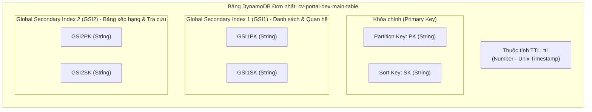
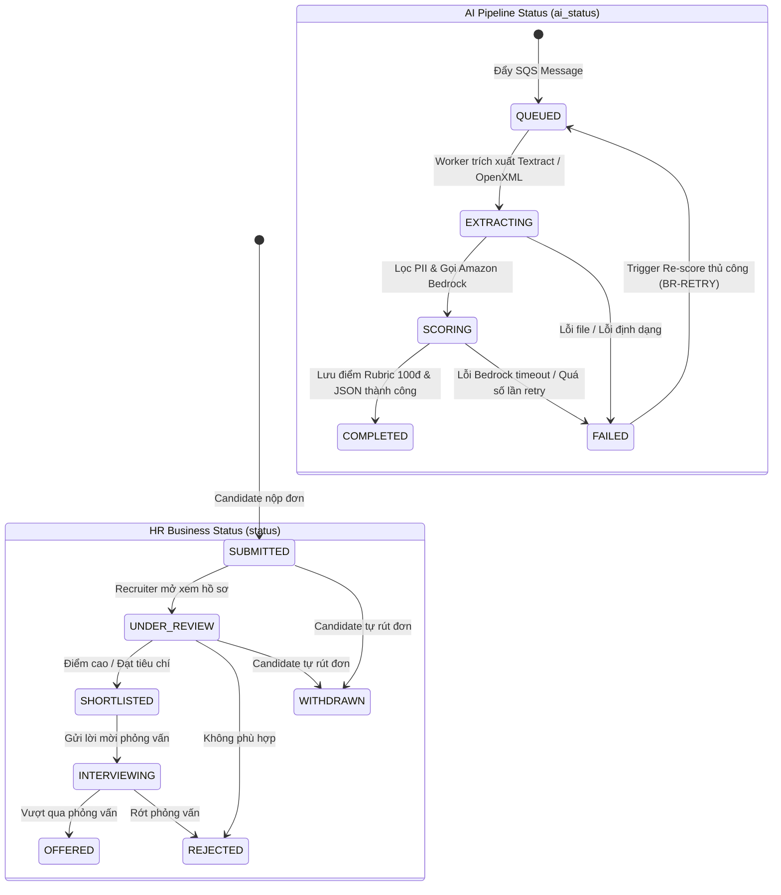
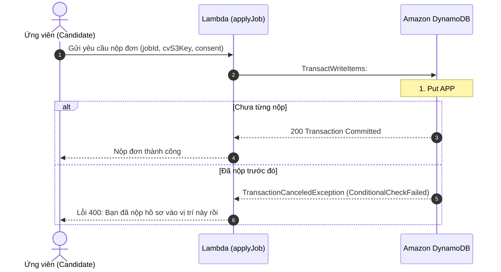

# THIẾT KẾ CƠ SỞ DỮ LIỆU (DATABASE ARCHITECTURE SPECIFICATION)

# Hệ thống: AI CV Screening Portal
> **Tài liệu:** Thiết kế Cơ sở Dữ liệu NoSQL DynamoDB Single-Table Design  
> **Mã tài liệu:** `DOC-SW-03-DB`  
> **Phiên bản:** `1.0` · **Ngày ban hành:** 28/10/2026 · **Trạng thái:** Đã phê duyệt (Approved Baseline)  
> **Kiến trúc áp dụng:** Amazon DynamoDB On-Demand (Single-Table Design Pattern)  
> **Tài liệu tham chiếu:** [01-requirements.md](file:///d:/AWS/workshop/docs/software/01-requirements.md) (SRS v1.0), [02-use-cases.md](file:///d:/AWS/workshop/docs/software/02-use-cases.md) (Use Cases v2.1), [tech-stack.md](file:///d:/AWS/workshop/docs/architecture/tech-stack.md)

---

## 1. Tổng quan & Quyết định Kiến trúc

### 1.1. Bối cảnh & Động lực Lựa chọn
Hệ thống **AI CV Screening Portal** vận hành 100% theo kiến trúc **AWS Serverless**. Cơ sở dữ liệu chính cần đáp ứng các tiêu chí khắt khe:
1. **Độ trễ cực thấp (Single-digit Millisecond Latency):** Phản hồi tức thì cho ứng viên nộp đơn và nhà tuyển dụng rà soát bảng xếp hạng.
2. **Tự động co giãn (Zero-server Auto Scaling):** Xử lý nhẹ nhàng các đợt tăng đột biến lưu lượng (Spikes) khi mở các đợt tuyển dụng lớn mà không cần cấu hình cụm máy chủ trước.
3. **Tối ưu chi phí nhàn rỗi (True Pay-as-you-go):** Sử dụng chế độ **On-Demand Capacity**, chi phí bằng 0 USD khi không có truy vấn phát sinh.
4. **Toàn vẹn & Bảo mật dữ liệu:** Hỗ trợ mã hóa tại chỗ (At-Rest Encryption bằng KMS/AWS-managed key), phân quyền truy cập chi tiết đến từng trường dữ liệu qua IAM và tích hợp cơ chế tự động dọn rác qua **Time-to-Live (TTL)**.

Do đó, **Amazon DynamoDB** được lựa chọn làm giải pháp cơ sở dữ liệu cốt lõi duy nhất cho toàn bộ tầng nghiệp vụ ứng dụng.

---

### 1.2. Chiến lược Single-Table Design
Thay vì tạo nhiều bảng riêng lẻ theo mô hình quan hệ truyền thống (Relational RDBMS) gây tốn kém chi phí, tăng độ phức tạp kết nối và không thể thực hiện phép `JOIN` trong NoSQL, dự án áp dụng chuẩn thiết kế **Single-Table Design** do chuyên gia Rick Houlihan (AWS Principal Evangelist) khởi xướng.



#### Nguyên tắc cốt lõi:
* **Một bảng duy nhất (`cv-portal-dev-main-table`):** Lưu trữ toàn bộ 8 thực thể nghiệp vụ (`Company`, `User`, `Job`, `Application`, `CandidateCV`, `AuditTrail`, `TalentPool`, `ConsentLog`) và các bản ghi tạm thời có hạn dùng.
* **Định danh khóa tổng quát (Overloaded Keys):** Khóa chính được đặt tên trừu tượng `PK` và `SK`. Các giá trị khóa được chuẩn hóa kèm tiền tố kiểu thực thể phân tách bằng dấu thăng (`#`), ví dụ `USER#usr_123`, `JOB#job_456`, `APP#app_789`.
* **Giới hạn số lượng Index (GSI Minimalist):** Chỉ sử dụng đúng **2 Global Secondary Indexes (`GSI1`, `GSI2`)** có phép chiếu `ALL` để đáp ứng toàn bộ 26 mẫu truy vấn (Access Patterns), hạn chế tối đa chi phí lưu trữ và ghi nhân đôi.
* **Tách rời tài liệu nhị phân (Binary Offloading):** File CV gốc (PDF/DOCX) và avatar công ty lưu trữ trực tiếp trên **Amazon S3**; DynamoDB chỉ lưu đường dẫn S3 Key (`cvS3Key`), mã hash toàn vẹn (`cvFileHash`) và nội dung văn bản thuần bóc tách được (`cvExtractedText`).

---

## 2. Ma trận Thực thể & Định dạng Khóa (Entity Schema Matrix)

| Thực thể | Mô tả nghiệp vụ | Định dạng PK | Định dạng SK | Định dạng GSI1PK | Định dạng GSI1SK | Định dạng GSI2PK | Định dạng GSI2SK | TTL |
| :--- | :--- | :--- | :--- | :--- | :--- | :--- | :--- | :---: |
| **User (Candidate)** | Hồ sơ tài khoản ứng viên | `USER#<userId>` | `PROFILE` | `EMAIL#<email>` | `USER#<userId>` | `ROLE#CANDIDATE` | `CREATED#<isoDate>` | ❌ |
| **User (Recruiter)** | Chuyên viên tuyển dụng | `USER#<userId>` | `PROFILE` | `COMPANY#<companyId>` | `MEMBER#<userId>` | `ROLE#RECRUITER` | `CREATED#<isoDate>` | ❌ |
| **User (Admin)** | Quản trị viên sàn | `USER#<userId>` | `PROFILE` | `EMAIL#<email>` | `USER#<userId>` | `ROLE#ADMIN` | `CREATED#<isoDate>` | ❌ |
| **Company** | Hồ sơ pháp nhân công ty | `COMPANY#<companyId>` | `METADATA` | `COMPANIES` | `NAME#<companyName>` | `STATUS#<status>` | `CREATED#<isoDate>` | ❌ |
| **Job (JD)** | Tin tuyển dụng việc làm | `JOB#<jobId>` | `METADATA` | `COMPANY#<companyId>` | `JOB#<status>#<created>` | `JOBS#STATUS#<status>` | `CREATED#<isoDate>` | ❌ |
| **Candidate CV** | Kho CV cá nhân tải sẵn | `USER#<candidateId>` | `CV#<cvId>` | `USER#<candidateId>` | `CV#DEFAULT#<isDef>` | — | — | ❌ |
| **Application** | Đơn nộp & Kết quả AI | `APP#<applicationId>` | `METADATA` | `JOB#<jobId>` | `SCORE#<padScore>#<appId>` | `USER#<candidateId>` | `APP#<submittedAt>` | ❌ |
| **Application Dup Check** | Khóa chống nộp trùng đơn | `USER#<candidateId>` | `APPLIED_JOB#<jobId>` | — | — | — | — | ❌ |
| **AuditTrail** | Nhật ký kiểm toán Recruiter | `APP#<applicationId>` | `AUDIT#<timestamp>#<id>` | `ACTOR#<recruiterId>` | `AUDIT#<timestamp>` | — | — | ❌ |
| **TalentPool** | Ứng viên lưu vào kho tài năng | `COMPANY#<companyId>` | `POOL#<candidateId>` | `POOL#<companyId>` | `SCORE#<padScore>#<cdd>` | `USER#<candidateId>` | `COMPANY#<companyId>` | ❌ |
| **ConsentLog** | Lịch sử đồng ý xử lý dữ liệu | `USER#<userId>` | `CONSENT#<timestamp>` | `USER#<userId>` | `PURPOSE#<purpose>` | — | — | ❌ |
| **Upload Session** | Phiên Presigned URL tạm | `UPLOAD#<token>` | `SESSION` | — | — | — | — | ✅ |
| **RateLimit Rescore** | Khóa giới hạn tần suất re-score | `RATELIMIT#<appId>` | `ACTION#RESCORE` | — | — | — | — | ✅ |

> [!NOTE]
> * **Chuẩn hóa điểm số đệm (Padded Score):** Thuộc tính `SCORE#<padScore>` sử dụng định dạng 3 chữ số nghịch đảo (ví dụ: điểm 95đ lưu thành `SCORE#095#app_123`). Khi sắp xếp giảm dần (`ScanIndexForward = false`), các ứng viên có điểm số cao nhất luôn nằm ở đầu danh sách truy vấn.
> * **Thuộc tính TTL (`ttl`):** Kiểu số `Number` (Unix Epoch Timestamp tính bằng giây). DynamoDB tự động thu hồi tài nguyên sau khi quá hạn mà không tốn phí Write Request Units.

---

## 3. Danh mục 26 Mẫu Truy cập (Access Patterns - AP)

Dưới đây là bảng phân tích toàn bộ 26 Access Patterns phục vụ cho 32 Use Cases đã được chuẩn hóa tại [02-use-cases.md](file:///d:/AWS/workshop/docs/software/02-use-cases.md).

### 3.1. Phân hệ Tài khoản & Xác thực (Auth & Profile - AP01 → AP05)

| Mã AP | Mô tả nghiệp vụ | Tác nhân | Thao tác | Index mục tiêu | Key Expression & Điều kiện |
| :---: | :--- | :---: | :---: | :---: | :--- |
| **AP01** | Lấy thông tin tài khoản người dùng theo `userId` | `CDD, RCT, AD` | `GetItem` | Bảng chính | `PK = USER#<userId>` AND `SK = PROFILE` |
| **AP02** | Tra cứu tài khoản theo `email` (kiểm tra tồn tại) | `SYS, AD` | `Query` | `GSI1` | `GSI1PK = EMAIL#<email>` AND `GSI1SK = USER#<userId>` |
| **AP03** | Tạo mới hoặc cập nhật hồ sơ cá nhân | `CDD, RCT` | `Put/Update` | Bảng chính | `PK = USER#<userId>` AND `SK = PROFILE` |
| **AP04** | Lấy danh sách thành viên Recruiter trong 1 Company | `RCT, AD` | `Query` | `GSI1` | `GSI1PK = COMPANY#<companyId>` AND begins_with(`GSI1SK`, `MEMBER#`) |
| **AP05** | Lấy danh sách người dùng theo vai trò (Admin kiểm tra) | `AD` | `Query` | `GSI2` | `GSI2PK = ROLE#<role>` |

### 3.2. Phân hệ Doanh nghiệp & Hồ sơ Công ty (Company - AP06 → AP08)

| Mã AP | Mô tả nghiệp vụ | Tác nhân | Thao tác | Index mục tiêu | Key Expression & Điều kiện |
| :---: | :--- | :---: | :---: | :---: | :--- |
| **AP06** | Lấy thông tin chi tiết hồ sơ công ty theo `companyId` | `ALL` | `GetItem` | Bảng chính | `PK = COMPANY#<companyId>` AND `SK = METADATA` |
| **AP07** | Tạo mới hoặc chỉnh sửa hồ sơ công ty | `RCT, AD` | `Put/Update` | Bảng chính | `PK = COMPANY#<companyId>` AND `SK = METADATA` |
| **AP08** | Lấy danh sách công ty đã xác thực trên sàn tuyển dụng | `ALL` | `Query` | `GSI1` | `GSI1PK = COMPANIES` |

### 3.3. Phân hệ Quản lý Tin Tuyển dụng (Jobs - AP09 → AP12)

| Mã AP | Mô tả nghiệp vụ | Tác nhân | Thao tác | Index mục tiêu | Key Expression & Điều kiện |
| :---: | :--- | :---: | :---: | :---: | :--- |
| **AP09** | Lấy chi tiết tin tuyển dụng theo `jobId` | `ALL` | `GetItem` | Bảng chính | `PK = JOB#<jobId>` AND `SK = METADATA` |
| **AP10** | Lấy toàn bộ tin tuyển dụng của một công ty (kể cả tin đóng) | `RCT, AD` | `Query` | `GSI1` | `GSI1PK = COMPANY#<companyId>` AND begins_with(`GSI1SK`, `JOB#`) |
| **AP11** | Lấy danh sách tin tuyển dụng đang mở (`OPEN`) mới nhất | `CDD, ALL` | `Query` | `GSI2` | `GSI2PK = JOBS#STATUS#OPEN` (ScanIndexForward: false) |
| **AP12** | Tạo mới / Cập nhật / Đóng tin tuyển dụng | `RCT` | `Put/Update` | Bảng chính | `PK = JOB#<jobId>` AND `SK = METADATA` |

### 3.4. Phân hệ Kho CV Cá nhân (Candidate CVs - AP13 → AP15)

| Mã AP | Mô tả nghiệp vụ | Tác nhân | Thao tác | Index mục tiêu | Key Expression & Điều kiện |
| :---: | :--- | :---: | :---: | :---: | :--- |
| **AP13** | Lấy toàn bộ danh sách CV cá nhân đã lưu của Ứng viên | `CDD` | `Query` | Bảng chính | `PK = USER#<candidateId>` AND begins_with(`SK`, `CV#`) |
| **AP14** | Thêm mới 1 bản CV hoặc xóa CV đã lưu | `CDD` | `Put/Delete` | Bảng chính | `PK = USER#<candidateId>` AND `SK = CV#<cvId>` |
| **AP15** | Đặt 1 bản CV làm mặc định (Transaction hủy bản cũ + set bản mới) | `CDD` | `TransactWrite` | Bảng chính | `PK = USER#<candidateId>` AND `SK = CV#<cvId>` |

### 3.5. Phân hệ Nộp hồ sơ & Pipeline AI Sàng lọc (Applications - AP16 → AP21)

| Mã AP | Mô tả nghiệp vụ | Tác nhân | Thao tác | Index mục tiêu | Key Expression & Điều kiện |
| :---: | :--- | :---: | :---: | :---: | :--- |
| **AP16** | Kiểm tra ứng viên đã nộp đơn vào vị trí này chưa (Chống trùng) | `CDD, SYS` | `GetItem` | Bảng chính | `PK = USER#<candidateId>` AND `SK = APPLIED_JOB#<jobId>` |
| **AP17** | Tạo mới đơn ứng tuyển (Kèm bản ghi kiểm tra trùng lặp) | `CDD` | `TransactWrite` | Bảng chính | Put `APP#<appId>` VÀ Put `USER#<cddId>` / `APPLIED_JOB#<jobId>` |
| **AP18** | Xem chi tiết 1 đơn ứng tuyển (kèm điểm số AI, ghi chú, rubric) | `CDD, RCT` | `GetItem` | Bảng chính | `PK = APP#<applicationId>` AND `SK = METADATA` |
| **AP19** | Bảng xếp hạng ứng viên theo điểm AI giảm dần của 1 JD | `RCT` | `Query` | `GSI1` | `GSI1PK = JOB#<jobId>` AND begins_with(`GSI1SK`, `SCORE#`) (ScanIndexForward: false) |
| **AP20** | Xem danh sách toàn bộ các đơn nộp của 1 Ứng viên theo thời gian | `CDD` | `Query` | `GSI2` | `GSI2PK = USER#<candidateId>` AND begins_with(`GSI2SK`, `APP#`) (ScanIndexForward: false) |
| **AP21** | Ứng viên rút đơn (`WITHDRAWN`) hoặc Nhà tuyển dụng đổi trạng thái | `CDD, RCT` | `UpdateItem` | Bảng chính | `PK = APP#<applicationId>` AND `SK = METADATA` (kèm ConditionExpression) |

### 3.6. Phân hệ Kiểm toán & Human-in-the-Loop (Audit Trail - AP22 → AP23)

| Mã AP | Mô tả nghiệp vụ | Tác nhân | Thao tác | Index mục tiêu | Key Expression & Điều kiện |
| :---: | :--- | :---: | :---: | :---: | :--- |
| **AP22** | Lấy toàn bộ lịch sử can thiệp/ghi chú của đơn nộp theo thời gian | `RCT, AD` | `Query` | Bảng chính | `PK = APP#<applicationId>` AND begins_with(`SK`, `AUDIT#`) |
| **AP23** | Ghi nhận 1 hành động kiểm toán bất biến (Immutable Insert) | `RCT, SYS` | `PutItem` | Bảng chính | `PK = APP#<applicationId>` AND `SK = AUDIT#<isoTimestamp>#<auditId>` |

### 3.7. Phân hệ Kho Tài năng & Gợi ý (Talent Pool - AP24 → AP25)

| Mã AP | Mô tả nghiệp vụ | Tác nhân | Thao tác | Index mục tiêu | Key Expression & Điều kiện |
| :---: | :--- | :---: | :---: | :---: | :--- |
| **AP24** | Lấy danh sách ứng viên trong Kho tài năng công ty (xếp theo điểm) | `RCT` | `Query` | `GSI1` | `GSI1PK = POOL#<companyId>` AND begins_with(`GSI1SK`, `SCORE#`) |
| **AP25** | Thêm ứng viên tiềm năng vào Kho tài năng hoặc xóa khỏi kho | `RCT` | `Put/Delete` | Bảng chính | `PK = COMPANY#<companyId>` AND `SK = POOL#<candidateId>` |

### 3.8. Phân hệ Quyền riêng tư & Quản lý Phiên TTL (Privacy & Sessions - AP26)

| Mã AP | Mô tả nghiệp vụ | Tác nhân | Thao tác | Index mục tiêu | Key Expression & Điều kiện |
| :---: | :--- | :---: | :---: | :---: | :--- |
| **AP26** | Ghi/đọc phiên upload Presigned URL hoặc Rate-limit Token (Tự xóa qua TTL) | `SYS` | `Put/Get` | Bảng chính | `PK = UPLOAD#<token>` / `RATELIMIT#<appId>` AND `SK = SESSION` |

---

## 4. Đặc tả Chi tiết Thuộc tính & Cấu trúc Dữ liệu JSON (Data Schemas)

### 4.1. Thực thể Người dùng (`User`)

```json
{
  "PK": "USER#usr_cdd_01J9X8P3M4R7T2W1V0K5N6Y8QZ",
  "SK": "PROFILE",
  "GSI1PK": "EMAIL#nguyen.van.a@example.com",
  "GSI1SK": "USER#usr_cdd_01J9X8P3M4R7T2W1V0K5N6Y8QZ",
  "GSI2PK": "ROLE#CANDIDATE",
  "GSI2SK": "CREATED#2026-10-28T08:30:00.000Z",
  "entityType": "USER",
  "userId": "usr_cdd_01J9X8P3M4R7T2W1V0K5N6Y8QZ",
  "cognitoSub": "550e8400-e29b-41d4-a716-446655440000",
  "email": "nguyen.van.a@example.com",
  "role": "CANDIDATE",
  "fullName": "Nguyễn Văn A",
  "phone": "+84901234567",
  "bio": "Full-stack Web Developer với 3 năm kinh nghiệm React và Node.js",
  "links": {
    "linkedIn": "https://linkedin.com/in/nguyenvana",
    "github": "https://github.com/nguyenvana",
    "portfolio": "https://nguyenvana.dev"
  },
  "defaultCvId": "cv_01J9X8W2N1B4V6C8D0F2G4H6J8",
  "status": "ACTIVE",
  "privacyConsent": {
    "aiScreening": true,
    "talentPool": true,
    "consentDate": "2026-10-28T08:30:00.000Z"
  },
  "createdAt": "2026-10-28T08:30:00.000Z",
  "updatedAt": "2026-10-28T08:30:00.000Z",
  "version": 1
}
```

*Trường hợp Recruiter thuộc Công ty:*
* `role`: `"RECRUITER"`
* `companyId`: `"comp_fpt_software_01"`
* `companyRole`: `"OWNER"` hoặc `"MEMBER"`
* `GSI1PK`: `"COMPANY#comp_fpt_software_01"`
* `GSI1SK`: `"MEMBER#usr_rct_01J9X9..."`

---

### 4.2. Thực thể Hồ sơ Công ty (`Company`)

```json
{
  "PK": "COMPANY#comp_01J9X8A1B2C3D4E5F6G7H8J9K0",
  "SK": "METADATA",
  "GSI1PK": "COMPANIES",
  "GSI1SK": "NAME#FPT SOFTWARE",
  "GSI2PK": "STATUS#VERIFIED",
  "GSI2SK": "CREATED#2026-10-27T00:00:00.000Z",
  "entityType": "COMPANY",
  "companyId": "comp_01J9X8A1B2C3D4E5F6G7H8J9K0",
  "name": "FPT Software",
  "taxId": "0101778162",
  "industry": "Information Technology",
  "companySize": "10000+ nhân viên",
  "website": "https://fptsoftware.com",
  "logoUrl": "https://cvscreen-dev-assets.s3.amazonaws.com/logos/fpt-software.png",
  "description": "Tập đoàn công nghệ hàng đầu khu vực chuyên cung cấp dịch vụ chuyển đổi số.",
  "address": {
    "city": "Hồ Chí Minh",
    "country": "Vietnam",
    "line": "Khu Công Nghệ Cao, TP. Thủ Đức"
  },
  "verified": true,
  "verifiedAt": "2026-10-27T09:00:00.000Z",
  "verifiedBy": "usr_ad_superadmin_01",
  "activeJobCount": 5,
  "createdAt": "2026-10-27T00:00:00.000Z",
  "updatedAt": "2026-10-28T09:00:00.000Z",
  "version": 2
}
```

---

### 4.3. Thực thể Tin Tuyển dụng (`Job`)

```json
{
  "PK": "JOB#job_01J9X9K2M3N4P5R6T7V8W9Y0Z1",
  "SK": "METADATA",
  "GSI1PK": "COMPANY#comp_01J9X8A1B2C3D4E5F6G7H8J9K0",
  "GSI1SK": "JOB#OPEN#2026-10-28T09:00:00.000Z",
  "GSI2PK": "JOBS#STATUS#OPEN",
  "GSI2SK": "CREATED#2026-10-28T09:00:00.000Z",
  "entityType": "JOB",
  "jobId": "job_01J9X9K2M3N4P5R6T7V8W9Y0Z1",
  "companyId": "comp_01J9X8A1B2C3D4E5F6G7H8J9K0",
  "companyName": "FPT Software",
  "title": "Senior Backend Node.js / TypeScript Engineer",
  "department": "Cloud & AI Innovation Center",
  "employmentType": "FULL_TIME",
  "workplaceType": "HYBRID",
  "location": "TP. Hồ Chí Minh",
  "salary": {
    "min": 1500,
    "max": 2500,
    "currency": "USD",
    "isNegotiable": false
  },
  "experienceLevel": "SENIOR",
  "skillsRequired": [
    "Node.js",
    "TypeScript",
    "AWS",
    "DynamoDB",
    "Serverless",
    "Docker"
  ],
  "description": "Tham gia thiết kế và hiện thực hóa các ứng dụng Cloud Serverless quy mô lớn...",
  "requirements": "- Tối thiểu 3 năm kinh nghiệm Node.js backend\n- Thành thạo TypeScript\n- Có kinh nghiệm với AWS (Lambda, DynamoDB, SQS)",
  "benefits": "- Môi trường quốc tế\n- Chế độ đãi ngộ cạnh tranh\n- Bảo hiểm sức khỏe cao cấp",
  "rubricWeights": {
    "skills": 40,
    "experience": 30,
    "education": 15,
    "presentation": 15
  },
  "status": "OPEN",
  "applicationCount": 14,
  "deadline": "2026-12-15T23:59:59.000Z",
  "createdBy": "usr_rct_01J9X9B3N5M7K8L2P4Q6R8S0T2",
  "createdAt": "2026-10-28T09:00:00.000Z",
  "updatedAt": "2026-10-28T09:00:00.000Z",
  "version": 1
}
```

---

### 4.4. Thực thể Đơn Ứng tuyển & Kết quả AI (`Application`)

Đây là thực thể trung tâm của hệ thống, quản lý cơ chế **Trạng thái kép (Dual Status)** và chứa dữ liệu phân tích chi tiết của Amazon Bedrock.

```json
{
  "PK": "APP#app_01J9XAK4M6P8Q0R2T4V6W8Y0Z2",
  "SK": "METADATA",
  "GSI1PK": "JOB#job_01J9X9K2M3N4P5R6T7V8W9Y0Z1",
  "GSI1SK": "SCORE#082#app_01J9XAK4M6P8Q0R2T4V6W8Y0Z2",
  "GSI2PK": "USER#usr_cdd_01J9X8P3M4R7T2W1V0K5N6Y8QZ",
  "GSI2SK": "APP#2026-10-28T10:15:30.000Z",
  "entityType": "APPLICATION",
  "applicationId": "app_01J9XAK4M6P8Q0R2T4V6W8Y0Z2",
  "jobId": "job_01J9X9K2M3N4P5R6T7V8W9Y0Z1",
  "companyId": "comp_01J9X8A1B2C3D4E5F6G7H8J9K0",
  "candidateId": "usr_cdd_01J9X8P3M4R7T2W1V0K5N6Y8QZ",
  "candidateName": "Nguyễn Văn A",
  "candidateEmail": "nguyen.van.a@example.com",
  "jobTitle": "Senior Backend Node.js / TypeScript Engineer",
  "cv": {
    "s3Bucket": "cvscreen-dev-cv-storage-901234",
    "s3Key": "applications/job_01J9X9K2/app_01J9XAK4.pdf",
    "fileName": "NguyenVanA_Backend_CV.pdf",
    "fileSize": 184520,
    "fileType": "PDF",
    "uploadedAt": "2026-10-28T10:15:00.000Z"
  },
  "coverLetter": "Tôi rất hứng thú với vị trí Senior Backend và tin rằng kinh nghiệm AWS Serverless của mình sẽ đóng góp lớn cho dự án.",
  "status": "SUBMITTED",
  "aiStatus": "COMPLETED",
  "aiEvaluation": {
    "totalScore": 82,
    "scores": {
      "skills": 32,
      "skillsMax": 40,
      "experience": 26,
      "experienceMax": 30,
      "education": 12,
      "educationMax": 15,
      "presentation": 12,
      "presentationMax": 15
    },
    "summary": "Ứng viên có nền tảng vững chắc về Node.js, Express và AWS Lambda/DynamoDB với hơn 3 năm làm việc thực tế. Có khoảng trống kỹ năng về TypeScript ở mức chuyên sâu và Docker nâng cao.",
    "strengths": [
      "Có kinh nghiệm thực chiến với AWS Serverless (Lambda, DynamoDB, SQS)",
      "Nắm vững kiến trúc Microservices và RESTful API Design",
      "Kinh nghiệm tối ưu hóa hiệu năng cơ sở dữ liệu NoSQL"
    ],
    "weaknesses": [
      "Hồ sơ chủ yếu viết bằng JavaScript thuần, kinh nghiệm với TypeScript tĩnh còn ít dự án chứng minh",
      "Chưa có chứng chỉ chính thức của AWS"
    ],
    "matchingSkills": [
      "Node.js",
      "AWS",
      "DynamoDB",
      "Serverless"
    ],
    "skillGaps": [
      "TypeScript",
      "Docker"
    ],
    "evaluatedAt": "2026-10-28T10:16:15.000Z",
    "modelUsed": "anthropic.claude-3-haiku-20240307-v1:0",
    "tokenUsage": {
      "inputTokens": 1420,
      "outputTokens": 380
    }
  },
  "recruiterReview": {
    "rating": 4,
    "manualNotes": "Ứng viên tiềm năng tốt. Cần chuẩn bị bài test TypeScript chuyên sâu khi phỏng vấn vòng 1.",
    "reviewedBy": "usr_rct_01J9X9B3N5M7K8L2P4Q6R8S0T2",
    "reviewedAt": "2026-10-28T11:00:00.000Z"
  },
  "reScoreCount": 0,
  "consent": {
    "purpose": "CV_AI_SCREENING",
    "accepted": true,
    "acceptedAt": "2026-10-28T10:15:30.000Z",
    "ipAddress": "14.161.22.45"
  },
  "submittedAt": "2026-10-28T10:15:30.000Z",
  "updatedAt": "2026-10-28T11:00:00.000Z",
  "version": 3
}
```

---

### 4.5. Thực thể Nhật ký Kiểm toán Bất biến (`AuditTrail`)

Mỗi khi Nhà tuyển dụng thực hiện thao tác đánh giá, sửa đổi trạng thái hoặc ghi chú trên một hồ sơ ứng viên, hệ thống sẽ tự động ghi 1 bản ghi bất biến (`Append-only / Immutable` theo `BR-HITL-01`).

```json
{
  "PK": "APP#app_01J9XAK4M6P8Q0R2T4V6W8Y0Z2",
  "SK": "AUDIT#2026-10-28T11:00:00.000Z#adt_01J9XBN7P2M4",
  "GSI1PK": "ACTOR#usr_rct_01J9X9B3N5M7K8L2P4Q6R8S0T2",
  "GSI1SK": "AUDIT#2026-10-28T11:00:00.000Z",
  "entityType": "AUDIT_TRAIL",
  "auditId": "adt_01J9XBN7P2M4",
  "applicationId": "app_01J9XAK4M6P8Q0R2T4V6W8Y0Z2",
  "jobId": "job_01J9X9K2M3N4P5R6T7V8W9Y0Z1",
  "actorId": "usr_rct_01J9X9B3N5M7K8L2P4Q6R8S0T2",
  "actorEmail": "recruiter@fptsoftware.com",
  "actorRole": "RECRUITER",
  "action": "STATUS_CHANGE",
  "previousValue": {
    "status": "SUBMITTED",
    "rating": null
  },
  "newValue": {
    "status": "SHORTLISTED",
    "rating": 4
  },
  "reason": "Ứng viên đạt 82 điểm AI, đủ điều kiện tiến hành phỏng vấn chuyên môn",
  "clientMetadata": {
    "ipAddress": "118.69.182.10",
    "userAgent": "Mozilla/5.0 (Windows NT 10.0; Win64; x64) AppleWebKit/537.36"
  },
  "timestamp": "2026-10-28T11:00:00.000Z"
}
```

---

### 4.6. Thực thể Kho Tài năng (`TalentPool`)

```json
{
  "PK": "COMPANY#comp_01J9X8A1B2C3D4E5F6G7H8J9K0",
  "SK": "POOL#usr_cdd_01J9X8P3M4R7T2W1V0K5N6Y8QZ",
  "GSI1PK": "POOL#comp_01J9X8A1B2C3D4E5F6G7H8J9K0",
  "GSI1SK": "SCORE#082#usr_cdd_01J9X8P3M4R7T2W1V0K5N6Y8QZ",
  "GSI2PK": "USER#usr_cdd_01J9X8P3M4R7T2W1V0K5N6Y8QZ",
  "GSI2SK": "COMPANY#comp_01J9X8A1B2C3D4E5F6G7H8J9K0",
  "entityType": "TALENT_POOL",
  "companyId": "comp_01J9X8A1B2C3D4E5F6G7H8J9K0",
  "candidateId": "usr_cdd_01J9X8P3M4R7T2W1V0K5N6Y8QZ",
  "sourceApplicationId": "app_01J9XAK4M6P8Q0R2T4V6W8Y0Z2",
  "sourceJobId": "job_01J9X9K2M3N4P5R6T7V8W9Y0Z1",
  "candidateName": "Nguyễn Văn A",
  "candidateEmail": "nguyen.van.a@example.com",
  "primarySkills": ["Node.js", "AWS", "DynamoDB", "Serverless"],
  "aiScore": 82,
  "notes": "Lưu lại cho các dự án Cloud Backend tương lai",
  "addedBy": "usr_rct_01J9X9B3N5M7K8L2P4Q6R8S0T2",
  "addedAt": "2026-10-28T11:30:00.000Z"
}
```

---

### 4.7. Bản ghi Tạm thời có TTL (`UploadSession` & `RateLimit`)

```json
{
  "PK": "UPLOAD#sess_01J9XCP2N4B6V8C0D2F4G6H8",
  "SK": "SESSION",
  "entityType": "UPLOAD_SESSION",
  "candidateId": "usr_cdd_01J9X8P3M4R7T2W1V0K5N6Y8QZ",
  "jobId": "job_01J9X9K2M3N4P5R6T7V8W9Y0Z1",
  "expectedFileName": "CV_NguyenVanA.pdf",
  "expectedFileType": "PDF",
  "s3UploadKey": "temp-uploads/job_01J9X9K2/sess_01J9XCP2.pdf",
  "createdAt": "2026-10-28T15:00:00.000Z",
  "ttl": 1793175300
}
```

> [!TIP]
> Thuộc tính `ttl` có giá trị là thời điểm hết hạn tính theo giây (ví dụ: `1793175300` tương đương 15 phút sau khi tạo session). Cơ chế TTL của DynamoDB tự động xóa bỏ bản ghi mà không tiêu tốn tài nguyên Write Capacity Unit.

---

## 5. Cơ chế Trạng thái Kép (Dual Status) & Máy Trạng thái (State Machine)

Theo quy tắc nghiệp vụ `BR-STATE-01` và `BR-STATE-02`, một đơn nộp hồ sơ được quản lý đồng thời bởi 2 trường trạng thái độc lập nhưng phối hợp chặt chẽ:
1. **`status` (Trạng thái Nghiệp vụ Nhân sự - HR Business Lifecycle):** Điều khiển bởi Nhà tuyển dụng và Ứng viên.
2. **`ai_status` (Trạng thái Xử lý Kỹ thuật - AI Pipeline Lifecycle):** Điều khiển tự động bởi các Worker Lambdas qua SQS.



### 5.1. Bảng Ma trận Chuyển đổi Trạng thái Hợp lệ
| Trạng thái hiện tại | Thao tác tác động | Tác nhân cho phép | Điều kiện kiểm tra (Condition Expression) | Trạng thái mới |
| :--- | :--- | :---: | :--- | :--- |
| `SUBMITTED` | Nhà tuyển dụng mở chi tiết | `RCT` | `attribute_exists(PK) AND #st = :submitted` | `UNDER_REVIEW` |
| `UNDER_REVIEW` | Đánh dấu đạt vòng loại | `RCT` | `#st = :review` | `SHORTLISTED` |
| `SHORTLISTED` | Gửi email mời phỏng vấn | `RCT` | `#st = :shortlisted` | `INTERVIEWING` |
| `ANY (trừ CLOSED)` | Ứng viên hủy nộp đơn | `CDD` | `candidateId = :userId AND #st IN (:sub, :rev)` | `WITHDRAWN` |
| `COMPLETED` | Yêu cầu chấm lại (Re-score) | `RCT` | `reScoreCount < :maxRetry AND aiStatus = :comp` | `aiStatus = QUEUED` |

---

## 6. Kiểm soát Đồng thời & Toàn vẹn Dữ liệu (Concurrency & Integrity)

### 6.1. Optimistic Concurrency Control (OCC)
Mọi bản ghi có thể cập nhật (`Job`, `Application`, `Company`, `User`) đều chứa trường `version` (kiểu số nguyên tăng dần).  
Khi thực hiện cập nhật (`UpdateItem`), hệ thống bắt buộc truyền điều kiện:
```text
ConditionExpression: "attribute_exists(PK) AND #version = :expectedVersion"
UpdateExpression: "SET #st = :newStatus, #version = #version + :one, #updatedAt = :now"
```
Nếu có 2 Recruiter trong cùng HR Team cùng sửa ghi chú hoặc đổi trạng thái cùng lúc, truy vấn đến sau sẽ bị từ chối với lỗi `ConditionalCheckFailedException` (HTTP 409 Conflict), ngăn chặn triệt để tình trạng ghi đè mất mát dữ liệu (Lost Updates).

---

### 6.2. Phòng chống Đơn Nộp Trùng lặp (Idempotent Apply Transaction)
Để đảm bảo một ứng viên không thể nộp đơn 2 lần vào cùng 1 vị trí tuyển dụng đang mở (`BR-STATE-01`), thao tác nộp đơn được thực hiện thông qua giao dịch phân tán **`TransactWriteItems`**:



---

## 7. Chiến lược Tuân thủ Dữ liệu Cá nhân (DSR Anonymization & Security)

Tuân thủ nguyên tắc **Bảo vệ Dữ liệu Cá nhân & DSR (Data Subject Rights)** quy định tại `BR-PRIV-01` và `BR-PRIV-02`:

1. **Quyền được lãng quên (Right to be Forgotten):**  
   Khi ứng viên gửi yêu cầu xóa tài khoản, hệ thống **không xóa vật lý** dòng dữ liệu trong DynamoDB nhằm bảo toàn tính toàn vẹn của các bảng quyết định nhân sự và nhật ký kiểm toán trong quá khứ.
2. **Quy trình Khử định danh (Anonymization Routine):**
   - Thay thế `fullName` bằng chuỗi ẩn danh: `"ANONYMIZED_CANDIDATE"`.
   - Xóa bỏ hoặc mã hóa băm một chiều (SHA-256): `email`, `phone`, `bio`, `links`.
   - Đặt cờ `status = "ANONYMIZED"`.
   - Xóa bỏ file CV gốc trên Amazon S3 (`s3.deleteObject`).
   - Các bản ghi `AuditTrail` quá khứ vẫn giữ nguyên liên kết đến `applicationId` nhưng thông tin định danh cá nhân đã bị loại bỏ hoàn toàn.

---

## 8. Mã Nguồn Mẫu Khai báo Hạ tầng (AWS CDK v2 TypeScript)

Dưới đây là cấu hình CDK chính thức định nghĩa bảng DynamoDB Single-Table trong ngăn xếp hạ tầng `infra/lib/storage-stack.ts`:

```typescript
import * as cdk from 'aws-cdk-lib';
import { Construct } from 'constructs';
import * as dynamodb from 'aws-cdk-lib/aws-dynamodb';

export interface StorageStackProps extends cdk.StackProps {
  stage: string;
}

export class StorageStack extends cdk.Stack {
  public readonly mainTable: dynamodb.TableV2;

  constructor(scope: Construct, id: string, props: StorageStackProps) {
    super(scope, id, props);

    // Bảng DynamoDB Single-Table chính
    this.mainTable = new dynamodb.TableV2(this, 'MainTable', {
      tableName: `cv-portal-${props.stage}-main-table`,
      partitionKey: { name: 'PK', type: dynamodb.AttributeType.STRING },
      sortKey: { name: 'SK', type: dynamodb.AttributeType.STRING },
      billing: dynamodb.Billing.onDemand(),
      timeToLiveAttribute: 'ttl',
      pointInTimeRecovery: props.stage === 'prod',
      removalPolicy: props.stage === 'prod' 
        ? cdk.RemovalPolicy.RETAIN 
        : cdk.RemovalPolicy.DESTROY,
      globalSecondaryIndexes: [
        {
          indexName: 'GSI1',
          partitionKey: { name: 'GSI1PK', type: dynamodb.AttributeType.STRING },
          sortKey: { name: 'GSI1SK', type: dynamodb.AttributeType.STRING },
          projectionType: dynamodb.ProjectionType.ALL,
        },
        {
          indexName: 'GSI2',
          partitionKey: { name: 'GSI2PK', type: dynamodb.AttributeType.STRING },
          sortKey: { name: 'GSI2SK', type: dynamodb.AttributeType.STRING },
          projectionType: dynamodb.ProjectionType.ALL,
        },
      ],
    });

    // Tagging phục vụ quản lý chi phí & bảo mật
    cdk.Tags.of(this.mainTable).add('Project', 'AI-CV-Screening-Portal');
    cdk.Tags.of(this.mainTable).add('Environment', props.stage);
    cdk.Tags.of(this.mainTable).add('ManagedBy', 'AWS-CDK');
  }
}
```

---

## 9. Định nghĩa Hoàn thành (Definition of Done — DoD)

- [x] Ánh xạ đầy đủ **100% các thực thể** nghiệp vụ từ SRS v1.0 và Use Cases v2.1.
- [x] Bao phủ toàn bộ **26 Access Patterns** chỉ với đúng 1 bảng đơn và 2 GSIs.
- [x] Có sơ đồ minh họa Single-Table Design, lược đồ Dual-State Machine và Sequence Diagram giao dịch chống trùng lặp.
- [x] Có ví dụ mẫu JSON Document chi tiết cho toàn bộ các thực thể cốt lõi.
- [x] Cơ chế TTL và chiến lược ẩn danh hóa tài khoản DSR được mô tả chuẩn mực.
- [x] Cung cấp mã nguồn định nghĩa hạ tầng AWS CDK v2 TypeScript hoàn chỉnh sẵn sàng triển khai.
