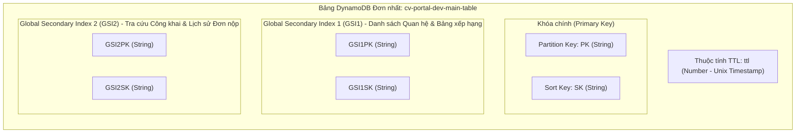
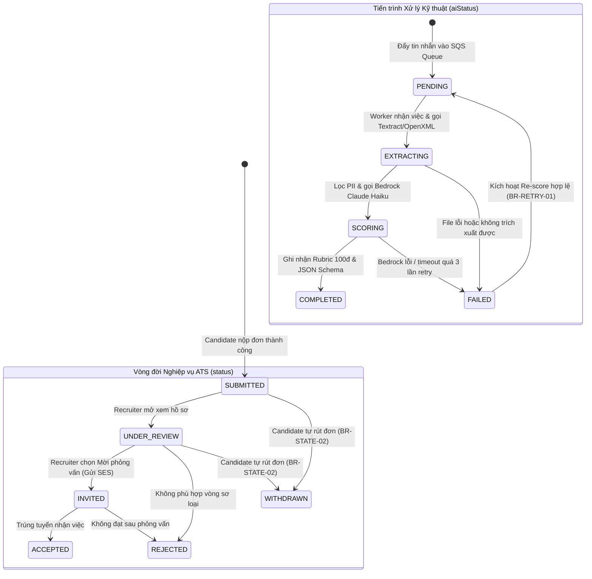
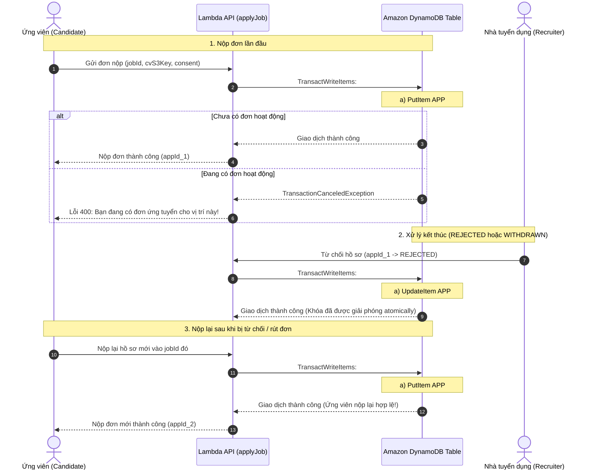

# THIẾT KẾ CƠ SỞ DỮ LIỆU (DATABASE ARCHITECTURE SPECIFICATION)

# Hệ thống: AI CV Screening Portal
> **Tài liệu:** Thiết kế Cơ sở Dữ liệu NoSQL DynamoDB Single-Table Design  
> **Mã tài liệu:** `DOC-SW-03-DB`  
> **Phiên bản:** `2.0` (Đồng bộ toàn diện sau thẩm định) · **Ngày ban hành:** 28/10/2026 · **Trạng thái:** Đã chuẩn hóa kiến trúc  
> **Kiến trúc áp dụng:** Amazon DynamoDB On-Demand (Single-Table Design Pattern)  
> **Tài liệu đối chiếu:** [01-requirements.md](./01-requirements.md) (SRS v1.0), [02-use-cases.md](./02-use-cases.md) (Use Cases v2.1), [review-uc-database.md](./review-uc-database.md)

---

## 1. Tổng quan & Các Quyết định Kiến trúc Cốt lõi

### 1.1. Bối cảnh & Mục tiêu Kỹ thuật
Hệ thống **AI CV Screening Portal** vận hành theo mô hình **AWS Serverless** hoàn chỉnh. Cơ sở dữ liệu nghiệp vụ chính được thiết kế trên **Amazon DynamoDB** nhằm đảm bảo:
1. **Độ trễ mili-giây đơn vị (Single-digit Millisecond Latency):** Phản hồi tức thì cho ứng viên nộp hồ sơ và nhà tuyển dụng duyệt bảng xếp hạng ứng viên.
2. **Khả năng tự động co giãn không cần quản lý cụm (Zero-server Scaling):** Chịu tải đột biến khi mở các đợt tuyển dụng lớn.
3. **Chi phí tối ưu Pay-as-you-go:** Chế độ **On-Demand Capacity**, chi phí bằng 0 USD khi không có request.
4. **Chuẩn hóa Định dạng Thuộc tính (CamelCase Convention):** Toàn bộ thuộc tính lưu trữ trong DynamoDB và các DTOs giao tiếp API đều thống nhất theo chuẩn `camelCase` (ví dụ `status`, `aiStatus`, `candidateId`, `jobId`, `submittedAt`).

---

### 1.2. Chiến lược Single-Table Design & Giới hạn 2 GSIs



#### Nguyên tắc cốt lõi:
* **Tách rời dữ liệu nhị phân (Binary Offloading):** File CV gốc (PDF/DOCX) và avatar lưu trữ trên **Amazon S3**; DynamoDB chỉ lưu đường dẫn S3 Key (`s3Key`), dung lượng (`fileSize`), mã băm toàn vẹn (`fileHash`) và văn bản bóc tách phục vụ AI.
* **Nguồn xác thực Email Authoritative:** **Amazon Cognito User Pool** là nguồn xác thực chính thức và quản lý tính duy nhất của email người dùng. Để bảo đảm kiểm tra email nhanh và toàn vẹn trong DynamoDB, hệ thống sử dụng thêm item phụ tra cứu email (`PK = EMAIL#<email>`, `SK = USER#<userId>`).
* **Hai chỉ số toàn cục (GSI Minimalist):**
  * **`GSI1` (Quan hệ nội bộ & Bảng xếp hạng):** Quản lý danh sách thành viên Recruiter trong công ty, danh sách tin JD theo công ty, bảng xếp hạng ứng viên theo điểm số AI đệm (`SCORE#<padScore>#<appId>`), và hồ sơ trong Talent Pool.
  * **`GSI2` (Lọc việc làm & Lịch sử Ứng viên):** Hỗ trợ tìm kiếm việc làm đang mở (`JOBS#STATUS#OPEN`) sắp xếp theo thời gian tạo mới nhất, và tra cứu toàn bộ đơn ứng tuyển của một Ứng viên.

---

## 2. Ma trận Thực thể & Định dạng Khóa (Entity Schema Matrix)

| Thực thể | Mô tả nghiệp vụ | Định dạng PK | Định dạng SK | Định dạng GSI1PK | Định dạng GSI1SK | Định dạng GSI2PK | Định dạng GSI2SK | TTL |
| :--- | :--- | :--- | :--- | :--- | :--- | :--- | :--- | :---: |
| **User (Candidate)** | Hồ sơ tài khoản ứng viên | `USER#<userId>` | `PROFILE` | `ROLE#CANDIDATE` | `CREATED#<isoDate>` | — | — | ❌ |
| **User (Recruiter)** | Chuyên viên nhân sự | `USER#<userId>` | `PROFILE` | `COMPANY#<companyId>` | `MEMBER#<userId>` | — | — | ❌ |
| **User (Admin)** | Quản trị viên sàn | `USER#<userId>` | `PROFILE` | `ROLE#ADMIN` | `CREATED#<isoDate>` | — | — | ❌ |
| **Email Lookup** | Khóa tra cứu email duy nhất | `EMAIL#<email>` | `USER#<userId>` | — | — | — | — | ❌ |
| **Company** | Hồ sơ doanh nghiệp tuyển dụng | `COMPANY#<companyId>` | `METADATA` | `COMPANIES` | `NAME#<companyName>` | `STATUS#<status>` | `CREATED#<isoDate>` | ❌ |
| **Job (JD)** | Tin tuyển dụng việc làm | `JOB#<jobId>` | `METADATA` | `COMPANY#<companyId>` | `JOB#<status>#<createdAt>` | `JOBS#STATUS#<status>` | `CREATED#<isoDate>` | ❌ |
| **Job Moderation** | Nhật ký kiểm duyệt tin của Admin | `JOB#<jobId>` | `MODERATION#<isoDate>#<adminId>` | — | — | — | — | ❌ |
| **Candidate CV** | Kho CV cá nhân tải sẵn | `USER#<candidateId>` | `CV#<cvId>` | `USER#<candidateId>` | `CV#DEFAULT#<isDefault>` | — | — | ❌ |
| **Favorite Job** | Việc làm ứng viên đã lưu | `USER#<candidateId>` | `FAVORITE#<jobId>` | — | — | — | — | ❌ |
| **Job Alert** | Đăng ký thông báo nhận tin việc làm | `USER#<candidateId>` | `ALERT#<alertId>` | — | — | — | — | ❌ |
| **Application** | Đơn nộp & Kết quả phân tích AI | `APP#<applicationId>` | `METADATA` | `JOB#<jobId>` | `SCORE#<padScore>#<appId>` | `USER#<candidateId>` | `APP#<submittedAt>` | ❌ |
| **Active App Lock** | Khóa chống nộp trùng lặp có vòng đời | `USER#<candidateId>` | `ACTIVE_APP#<jobId>` | — | — | — | — | ❌ |
| **Application Review** | Đánh giá độc lập của HR Team | `APP#<applicationId>` | `REVIEW#<reviewerId>` | — | — | — | — | ❌ |
| **AuditTrail** | Nhật ký kiểm toán can thiệp đơn nộp | `APP#<applicationId>` | `AUDIT#<isoDate>#<auditId>` | `ACTOR#<actorId>` | `AUDIT#<isoDate>` | — | — | ❌ |
| **CV Access Log** | Nhật ký xem / tải file CV gốc | `APP#<applicationId>` | `ACCESS_LOG#<isoDate>#<logId>` | — | — | — | — | ✅ (180d) |
| **TalentPool** | Ứng viên lưu vào kho tài năng | `COMPANY#<companyId>` | `POOL#<candidateId>` | `POOL#<companyId>` | `SCORE#<padScore>#<cdd>` | `USER#<candidateId>` | `COMPANY#<companyId>` | ❌ |
| **ConsentLog** | Lịch sử đồng thuận xử lý dữ liệu | `USER#<candidateId>` | `CONSENT#<isoDate>#<purpose>` | — | — | — | — | ❌ |
| **Upload Session** | Phiên Presigned URL tạm thời | `UPLOAD#<token>` | `SESSION` | — | — | — | — | ✅ (15m) |
| **Rescore RateLimit** | Bộ đếm tần suất gọi AI chấm điểm lại | `RATELIMIT#<applicationId>` | `RESCORE#<hourSlot>` | — | — | — | — | ✅ (1h) |
| **Notification Log** | Theo dõi gửi email SES & Idempotency | `NOTIF#<idempotencyKey>` | `EMAIL` | — | — | — | — | ✅ (30d) |

---

## 3. Đồng bộ Vòng đời Trạng thái Kép (Dual Status Lifecycle)

Hệ thống tuân thủ nghiêm ngặt quy định tại Mục 6 của SRS v1.0 ([01-requirements.md](./01-requirements.md)) và các Use Cases ([02-use-cases.md](./02-use-cases.md)), tách biệt giữa **Trạng thái Tuyển dụng Nghiệp vụ (`status`)** và **Tiến trình Xử lý Kỹ thuật AI (`aiStatus`)**:

```text
Bản ghi Application trên DynamoDB:
├── status:   [ SUBMITTED | UNDER_REVIEW | INVITED | ACCEPTED | REJECTED | WITHDRAWN ] (Nghiệp vụ ATS)
└── aiStatus: [ PENDING | EXTRACTING | SCORING | COMPLETED | FAILED ]                  (Pipeline AI)
```

### 3.1. Sơ đồ Máy Trạng thái (State Machine)



### 3.2. Ma trận Chuyển đổi Trạng thái Hợp lệ & Điều kiện DynamoDB

| Trạng thái hiện tại | Thao tác tác động | Tác nhân | Điều kiện kiểm tra (`ConditionExpression`) | Trạng thái mới |
| :--- | :--- | :---: | :--- | :--- |
| `SUBMITTED` | Recruiter mở xem chi tiết đơn | `RCT` | `attribute_exists(PK) AND #status = :submitted` | `UNDER_REVIEW` |
| `UNDER_REVIEW` | Gửi thư mời phỏng vấn | `RCT` | `attribute_exists(PK) AND #status = :underReview` | `INVITED` |
| `UNDER_REVIEW` | Từ chối hồ sơ chưa đạt | `RCT` | `attribute_exists(PK) AND #status = :underReview` | `REJECTED` |
| `INVITED` | Đánh giá trúng tuyển | `RCT` | `attribute_exists(PK) AND #status = :invited` | `ACCEPTED` |
| `INVITED` | Đánh giá không đạt sau phỏng vấn | `RCT` | `attribute_exists(PK) AND #status = :invited` | `REJECTED` |
| `SUBMITTED` hoặc `UNDER_REVIEW` | Ứng viên tự rút đơn | `CDD` | `attribute_exists(PK) AND #candidateId = :userId AND #status IN (:sub, :rev)` | `WITHDRAWN` |
| `PENDING` | Worker bắt đầu bóc tách văn bản | `SYS` | `attribute_exists(PK) AND #aiStatus = :pending` | `EXTRACTING` |
| `EXTRACTING` | Bắt đầu gọi Bedrock chấm điểm | `SYS` | `attribute_exists(PK) AND #aiStatus = :extracting` | `SCORING` |
| `SCORING` | Lưu điểm Rubric thành công | `SYS` | `attribute_exists(PK) AND #aiStatus = :scoring` | `COMPLETED` |
| `EXTRACTING` / `SCORING` | Xử lý thất bại đẩy vào DLQ | `SYS` | `attribute_exists(PK) AND #aiStatus IN (:ext, :sco)` | `FAILED` |
| `COMPLETED` / `FAILED` | Kích hoạt Re-score hợp lệ | `RCT` | `attribute_exists(PK) AND #aiStatus IN (:comp, :fail)` | `PENDING` |

> [!IMPORTANT]
> Tuyệt đối không cho phép chuyển trạng thái theo điều kiện `ANY` chung chung. Mọi câu lệnh cập nhật trạng thái trong Lambda phải có `ConditionExpression` đối soát đúng giá trị trạng thái hiện tại trong cơ sở dữ liệu.

---

## 4. Vòng đời Khóa Chống Nộp Trùng & Chính sách Nộp lại Hợp lệ

Theo quy định tại `BR-DOC-02` ([01-requirements.md](./01-requirements.md)), mỗi ứng viên chỉ được phép có **tối đa 1 đơn ứng tuyển đang hoạt động** cho mỗi vị trí tuyển dụng. Đơn ứng tuyển được định nghĩa là "đang hoạt động" khi `status` thuộc nhóm `{SUBMITTED, UNDER_REVIEW, INVITED}`. Ứng viên **được phép nộp lại** khi đơn trước đó đã chuyển sang trạng thái kết thúc `{REJECTED, WITHDRAWN}`.

### 4.1. Cơ chế Khóa Hoạt động (Active Application Lock)
Để ngăn chặn tình trạng nộp trùng lặp (kể cả race-condition khi bấm nộp liên tục) nhưng vẫn hỗ trợ nộp lại sau khi kết thúc, hệ thống sử dụng một item phụ:
* **Khóa chính:** `PK = USER#<candidateId>`, `SK = ACTIVE_APP#<jobId>`.
* **Thuộc tính:** `applicationId`, `status`, `appliedAt`.



> [!NOTE]
> * **Trạng thái `ACCEPTED` (Trúng tuyển):** Khóa `ACTIVE_APP#<jobId>` **không bị xóa** (hoặc cập nhật thành `HIRED`), đảm bảo ứng viên đã được nhận việc không thể tiếp tục nộp thêm đơn vào chính vị trí đó.
> * **Tính Nguyên tử (Atomicity):** Việc tạo khóa và mở khóa luôn đi kèm với thao tác chuyển đổi trạng thái của `Application` trong cùng một khối `TransactWriteItems`, triệt tiêu hoàn toàn rủi ro khóa treo hoặc lệch dữ liệu.

---

## 5. Mô hình Đánh giá Đồng đội của HR Team (Multi-Reviewer Architecture)

Theo yêu cầu của **UC-RCT-05** ([02-use-cases.md](./02-use-cases.md)) và nguyên tắc làm việc cộng tác trong HR Team (`BR-AUTH-03`), một hồ sơ ứng viên có thể được nhiều thành viên tuyển dụng hoặc Tech Lead cùng đánh giá, chấm điểm sao và ghi chú.

### 5.1. Tách biệt Review Item độc lập
Để tránh tình trạng ghi đè nhận xét của nhau khi lưu gộp trong một object đơn lẻ, mỗi đánh giá của một chuyên viên nhân sự được lưu thành một item riêng biệt:
* **Khóa chính:** `PK = APP#<applicationId>`, `SK = REVIEW#<reviewerId>`.
* **Thuộc tính:**
  * `reviewId`: Mã đánh giá duy nhất.
  * `applicationId`, `jobId`, `companyId`.
  * `reviewerId`, `reviewerName`, `reviewerEmail`.
  * `rating`: Đánh giá định lượng từ 1 đến 5 sao.
  * `manualNotes`: Ghi chú nhận xét chuyên môn.
  * `recommendation`: Đề xuất nhân sự (`INVITE`, `REJECT`, `NEUTRAL`).
  * `createdAt`, `updatedAt`, `version`.

### 5.2. Đồng bộ Dữ liệu Tổng hợp trên Application
Bản ghi Application chính (`PK = APP#<applicationId>`, `SK = METADATA`) duy trì các trường số liệu tổng hợp được cập nhật tự động khi có đánh giá mới:
* `reviewCount`: Tổng số lượng thành viên đã đánh giá (Atomic Counter).
* `avgRating`: Điểm đánh giá trung bình của HR Team (Ví dụ: `4.2`).
* `latestReviewedAt`: Mốc thời gian đánh giá gần nhất.

---

## 6. Mô hình Quản trị Sự Đồng ý (Consent) & Chiến lược DSR Anonymization

### 6.1. Quản lý Sự đồng ý Phân mảnh (Granular Consent Management)
Theo quy định tại `BR-PRIV-01`, hệ thống tách bạch sự đồng ý theo từng mục đích xử lý:
1. **`AI_SCREENING` (Bắt buộc khi nộp đơn):** Đồng thuận cho hệ thống xử lý nội dung CV bằng LLM cho vị trí tuyển dụng này.
2. **`TALENT_POOL` (Tùy chọn):** Cho phép doanh nghiệp lưu trữ hồ sơ để tái liên hệ khi có cơ hội việc làm mới.
3. **`JOB_ALERTS` (Tùy chọn):** Đồng thuận nhận thông báo việc làm định kỳ qua email.

Mỗi khi người dùng chấp thuận (Grant) hoặc rút lại sự đồng ý (Revoke), một bản ghi bất biến được ghi nhận:
* **Khóa chính:** `PK = USER#<candidateId>`, `SK = CONSENT#<isoTimestamp>#<purpose>`.
* **Thuộc tính:** `consentId`, `candidateId`, `purpose`, `scope` (`JOB#<jobId>` hoặc `GLOBAL`), `termsVersion` (ví dụ `v1.0`), `status` (`GRANTED` hoặc `REVOKED`), `ipAddress`, `userAgent`, `timestamp`.

### 6.2. Bảng Truy xuất Nguồn gốc Xóa Dữ liệu Cá nhân (DSR Anonymization Lineage)
Khi Ứng viên thực hiện quyền yêu cầu xóa tài khoản (Right to be Forgotten - `BR-PRIV-02`):

| Vị trí lưu trữ dữ liệu | Đối tượng dữ liệu | Hành động xử lý DSR | Cơ sở pháp lý & Kỹ thuật |
| :--- | :--- | :--- | :--- |
| **Amazon S3** | File CV gốc (`.pdf`, `.docx`) | **Xóa vật lý vĩnh viễn** (`s3.deleteObject`) | Triệt tiêu bản sao tài liệu cá nhân gốc. |
| **DynamoDB User** | `PK = USER#<id>`, `SK = PROFILE` | **Khử định danh:** Thay `fullName = "ANONYMIZED_USER"`, xóa `phone`, `bio`, `links`. Băm `email` thành SHA-256 một chiều. Đổi `status = "ANONYMIZED"`. | Vô hiệu hóa tài khoản, ngăn chặn đăng nhập lại. |
| **DynamoDB Email Lookup** | `PK = EMAIL#<email>`, `SK = USER#<id>` | **Xóa bản ghi** (`DeleteItem`) | Giải phóng email để hệ thống không giữ PII tra cứu. |
| **DynamoDB CV Items** | `PK = USER#<id>`, `SK = CV#<cvId>` | **Xóa toàn bộ bản ghi** (`DeleteItem`) | Xóa danh mục CV lưu trữ của người dùng. |
| **DynamoDB Application** | `PK = APP#<id>`, `SK = METADATA` | **Khử định danh:** Thay `candidateName = "ANONYMIZED_USER"`, xóa `candidateEmail`, `coverLetter`, xóa `cv.s3Key` và `extractedText`. **Giữ nguyên:** `jobId`, `aiEvaluation.totalScore`, `status`. | Bảo toàn số liệu báo cáo tuyển dụng và thống kê của Doanh nghiệp. |
| **DynamoDB Active Lock** | `PK = USER#<id>`, `SK = ACTIVE_APP#<jobId>` | **Xóa bản ghi** (`DeleteItem`) | Tránh lưu vết khóa treo. |
| **DynamoDB TalentPool** | `PK = COMPANY#<comp>`, `SK = POOL#<id>` | **Xóa vật lý vĩnh viễn** (`DeleteItem`) | Rút lại consent tự động thu hồi quyền lưu trữ trong kho nhân tài. |
| **DynamoDB Favorites/Alerts**| `FAVORITE#<jobId>`, `ALERT#<alertId>` | **Xóa toàn bộ bản ghi** (`DeleteItem`) | Hủy đăng ký nhận tin và danh sách quan tâm. |
| **DynamoDB AuditTrail** | `PK = APP#<id>`, `SK = AUDIT#...` | **Giữ nguyên (Không chỉnh sửa)** | Bản ghi kiểm toán bất biến; chỉ chứa thông tin thao tác của Recruiter, không chứa PII của ứng viên. |
| **DynamoDB ConsentLog** | `PK = USER#<id>`, `SK = CONSENT#...` | **Thêm bản ghi mới `REVOKED_ALL`** | Bằng chứng kiểm toán chứng minh hệ thống đã thực thi quyền DSR của người dùng. |

---

## 7. Nhật ký Truy cập CV & Kiểm duyệt Nội dung

### 7.1. Nhật ký Truy cập Tải CV (Security CV Access Log)
Đáp ứng tiêu chuẩn an toàn thông tin **NFR-SEC-05** và **UC-RCT-12** ([02-use-cases.md](./02-use-cases.md)): Mỗi khi một chuyên viên tuyển dụng sinh đường dẫn Presigned URL để xem hoặc tải file CV gốc của ứng viên, hệ thống tự động ghi nhật ký:
* **Khóa chính:** `PK = APP#<applicationId>`, `SK = ACCESS_LOG#<isoTimestamp>#<logId>`.
* **Thuộc tính:** `logId`, `applicationId`, `jobId`, `companyId`, `actorId` (Recruiter ID), `actorEmail`, `action` (`CV_VIEW` hoặc `CV_DOWNLOAD`), `purpose` (`APPLICANT_SCREENING`), `ipAddress`, `userAgent`, `timestamp`, `ttl` (Tự động thu hồi sau 180 ngày).
* **Đồng thời:** Phát một bản tin log cấu trúc JSON có gắn `traceId` lên **Amazon CloudWatch Logs** phục vụ phát hiện xâm nhập.

### 7.2. Kiểm duyệt Tin Tuyển dụng (Job Moderation)
Phục vụ chức năng giám sát của Quản trị viên sàn Tuyển dụng (**UC-AD-03**):
* Bản ghi Job chính bổ sung các trường kiểm duyệt:
  * `moderationStatus`: `APPROVED` | `FLAGGED` | `LOCKED`.
  * `moderationReason`: Lý do khóa hoặc cảnh báo vi phạm.
  * `moderatedBy`: Admin ID xử lý.
  * `moderatedAt`: Mốc thời gian xử lý.
* Bản ghi lịch sử kiểm duyệt:
  * `PK = JOB#<jobId>`, `SK = MODERATION#<isoTimestamp>#<adminId>`.
  * Thuộc tính: `adminId`, `adminEmail`, `action` (`LOCK`, `UNLOCK`, `APPROVE`, `FLAG`), `reason`, `timestamp`.

---

## 8. Danh mục 32 Mẫu Truy cập (Access Patterns - AP01 → AP32)

Bảng phân tích toàn bộ 32 Access Patterns được thiết kế chuẩn xác, bao phủ toàn vẹn các phân hệ của hệ thống:

| Mã AP | Tên Mẫu Truy Cập Nghiệp Vụ | Tác Nhân | Thao Tác | Target Index | Cú Pháp Query / Key Expression |
| :---: | :--- | :---: | :---: | :---: | :--- |
| **AP01** | Lấy thông tin tài khoản người dùng theo `userId` | `ALL` | `GetItem` | Bảng chính | `PK = USER#<userId>` AND `SK = PROFILE` |
| **AP02** | Tra cứu tài khoản theo `email` (Kiểm tra trùng lặp) | `SYS, AD` | `GetItem` | Bảng chính | `PK = EMAIL#<email>` AND begins_with(`SK`, `USER#`) |
| **AP03** | Tạo mới hoặc cập nhật thông tin hồ sơ cá nhân | `CDD, RCT` | `Put/Update` | Bảng chính | `PK = USER#<userId>` AND `SK = PROFILE` |
| **AP04** | Liệt kê toàn bộ chuyên viên nhân sự trong một Công ty | `RCT, AD` | `Query` | `GSI1` | `GSI1PK = COMPANY#<companyId>` AND begins_with(`GSI1SK`, `MEMBER#`) |
| **AP05** | Liệt kê tài khoản người dùng theo vai trò kiểm tra | `AD` | `Query` | `GSI1` | `GSI1PK = ROLE#<role>` |
| **AP06** | Lấy thông tin hồ sơ doanh nghiệp theo `companyId` | `ALL` | `GetItem` | Bảng chính | `PK = COMPANY#<companyId>` AND `SK = METADATA` |
| **AP07** | Tạo mới hoặc cập nhật hồ sơ doanh nghiệp | `RCT, AD` | `Put/Update` | Bảng chính | `PK = COMPANY#<companyId>` AND `SK = METADATA` |
| **AP08** | Liệt kê danh sách doanh nghiệp đã xác thực trên sàn | `ALL` | `Query` | `GSI1` | `GSI1PK = COMPANIES` |
| **AP09** | Lấy thông tin chi tiết tin tuyển dụng theo `jobId` | `ALL` | `GetItem` | Bảng chính | `PK = JOB#<jobId>` AND `SK = METADATA` |
| **AP10** | Lấy toàn bộ tin tuyển dụng của một công ty (cả tin đóng) | `RCT, AD` | `Query` | `GSI1` | `GSI1PK = COMPANY#<companyId>` AND begins_with(`GSI1SK`, `JOB#`) |
| **AP11** | Tìm kiếm tin tuyển dụng đang mở (`OPEN`) mới nhất | `CDD, ALL` | `Query` | `GSI2` | `GSI2PK = JOBS#STATUS#OPEN` (ScanIndexForward: false, kèm FilterExpression) |
| **AP12** | Tạo mới / Cập nhật / Đóng tin tuyển dụng | `RCT` | `Put/Update` | Bảng chính | `PK = JOB#<jobId>` AND `SK = METADATA` |
| **AP13** | Quản trị viên khóa hoặc phê duyệt tin tuyển dụng | `AD` | `UpdateItem` | Bảng chính | `PK = JOB#<jobId>` AND `SK = METADATA` (kèm ghi item `MODERATION#...`) |
| **AP14** | Liệt kê danh mục việc làm yêu thích của Ứng viên | `CDD` | `Query` | Bảng chính | `PK = USER#<candidateId>` AND begins_with(`SK`, `FAVORITE#`) |
| **AP15** | Thêm mới hoặc xóa việc làm khỏi danh sách yêu thích | `CDD` | `Put/Delete` | Bảng chính | `PK = USER#<candidateId>` AND `SK = FAVORITE#<jobId>` |
| **AP16** | Quản lý cấu hình đăng ký thông báo việc làm (Job Alert) | `CDD` | `Put/Query` | Bảng chính | `PK = USER#<candidateId>` AND begins_with(`SK`, `ALERT#`) |
| **AP17** | Lấy toàn bộ danh sách CV cá nhân tải sẵn của Ứng viên | `CDD` | `Query` | Bảng chính | `PK = USER#<candidateId>` AND begins_with(`SK`, `CV#`) |
| **AP18** | Tải lên CV mới hoặc xóa CV cá nhân | `CDD` | `Put/Delete` | Bảng chính | `PK = USER#<candidateId>` AND `SK = CV#<cvId>` |
| **AP19** | Thiết lập một CV làm mặc định (Transaction hủy bản cũ) | `CDD` | `TransactWrite` | Bảng chính | Cập nhật `defaultCvId` trên `PROFILE` & toggle `isDefault` |
| **AP20** | Kiểm tra ứng viên có đơn nộp đang hoạt động hay không | `CDD, SYS` | `GetItem` | Bảng chính | `PK = USER#<candidateId>` AND `SK = ACTIVE_APP#<jobId>` |
| **AP21** | Nộp đơn ứng tuyển mới (Atomic Transaction kèm tạo Lock) | `CDD` | `TransactWrite` | Bảng chính | Put `APP#<id>` VÀ Put `ACTIVE_APP#<jobId>` (`attribute_not_exists(PK)`) |
| **AP22** | Xem chi tiết 1 đơn ứng tuyển kèm kết quả phân tích AI | `CDD, RCT` | `GetItem` | Bảng chính | `PK = APP#<applicationId>` AND `SK = METADATA` |
| **AP23** | Bảng xếp hạng ứng viên theo điểm AI giảm dần của 1 JD | `RCT` | `Query` | `GSI1` | `GSI1PK = JOB#<jobId>` AND begins_with(`GSI1SK`, `SCORE#`) (ScanIndexForward: false) |
| **AP24** | Tra cứu toàn bộ các đơn nộp của 1 Ứng viên theo thời gian | `CDD` | `Query` | `GSI2` | `GSI2PK = USER#<candidateId>` AND begins_with(`GSI2SK`, `APP#`) (ScanIndexForward: false) |
| **AP25** | Rút đơn hoặc chuyển trạng thái kết thúc (Atomic mở Lock)| `CDD, RCT` | `TransactWrite` | Bảng chính | Update `APP#<id>` SET `status = REJECTED/WITHDRAWN` VÀ Delete `ACTIVE_APP#<jobId>` |
| **AP26** | Thêm hoặc cập nhật đánh giá của thành viên HR Team | `RCT` | `Put/Update` | Bảng chính | `PK = APP#<applicationId>` AND `SK = REVIEW#<reviewerId>` |
| **AP27** | Lấy toàn bộ danh sách đánh giá của các thành viên HR Team | `RCT` | `Query` | Bảng chính | `PK = APP#<applicationId>` AND begins_with(`SK`, `REVIEW#`) |
| **AP28** | Ghi nhận sự kiện kiểm toán can thiệp đơn nộp bất biến | `RCT, SYS` | `PutItem` | Bảng chính | `PK = APP#<applicationId>` AND `SK = AUDIT#<isoDate>#<auditId>` |
| **AP29** | Ghi nhận và truy vấn nhật ký tải/mở CV (Access Audit Log) | `RCT, AD` | `Put/Query` | Bảng chính | `PK = APP#<applicationId>` AND begins_with(`SK`, `ACCESS_LOG#`) |
| **AP30** | Khai thác Kho tài năng: Lưu ứng viên & Lấy danh sách | `RCT` | `Put/Query` | `GSI1` | `GSI1PK = POOL#<companyId>` AND begins_with(`GSI1SK`, `SCORE#`) |
| **AP31** | Ghi nhận sự đồng thuận / thu hồi dữ liệu (Consent Log) | `CDD` | `Put/Query` | Bảng chính | `PK = USER#<candidateId>` AND begins_with(`SK`, `CONSENT#`) |
| **AP32** | Quản lý phiên tạm thời có TTL (Upload, Rescore, Email) | `SYS` | `Put/Get` | Bảng chính | `PK = UPLOAD#... / RATELIMIT#... / NOTIF#...` (Atomic TTL) |

---

## 9. Ma trận Truy xuất Nguồn gốc Yêu cầu (Traceability Matrix: 32 Use Cases → 32 APs)

| Mã Use Case | Tên Use Case | Phân Hệ | Thao Tác DB / Dịch Vụ AWS | Mã AP Áp Dụng | Target Index / Key |
| :--- | :--- | :---: | :--- | :---: | :--- |
| **UC-CDD-01** | Đăng ký tài khoản Ứng viên | Auth | PutItem User Profile & Email Lookup | **AP01, AP02, AP03** | `USER#<id>`, `EMAIL#<email>` |
| **UC-CDD-02** | Cập nhật Hồ sơ năng lực cá nhân | Profile | UpdateItem User Profile | **AP03** | `USER#<id> / PROFILE` |
| **UC-CDD-03** | Quản lý Kho CV cá nhân & Đặt mặc định | CV Storage | Put/Delete CV, TransactWrite default | **AP17, AP18, AP19** | `USER#<id> / CV#<id>` |
| **UC-CDD-04** | Tìm kiếm & Khám phá việc làm | Jobs | Query Open Jobs with FilterExpression | **AP11** | `GSI2: JOBS#STATUS#OPEN` |
| **UC-CDD-05** | Lưu việc làm yêu thích & Đăng ký tin | Saved Jobs | Put/Delete Favorite, Put Job Alert | **AP14, AP15, AP16** | `USER#<id> / FAVORITE#...` |
| **UC-CDD-06** | Nộp hồ sơ ứng tuyển trực tuyến | Apply | TransactWrite (App + ActiveLock + Consent) | **AP20, AP21, AP31** | `APP#<id>`, `ACTIVE_APP#<id>` |
| **UC-CDD-07** | Theo dõi tiến trình tuyển dụng kép | Tracker | Query applications by candidate | **AP24** | `GSI2: USER#<candidateId>` |
| **UC-CDD-08** | Xem báo cáo đánh giá AI minh bạch | Evaluation | GetItem Application metadata | **AP22** | `APP#<id> / METADATA` |
| **UC-CDD-09** | Rút đơn ứng tuyển tuyển dụng | Withdraw | TransactWrite (status=WITHDRAWN + Del Lock)| **AP25** | `APP#<id>`, `ACTIVE_APP#<id>` |
| **UC-CDD-10** | Quản lý quyền riêng tư & Yêu cầu DSR | Privacy | DSR Anonymization Transaction | **AP03, AP31** | User Profile, S3, CV, Consent |
| **UC-CDD-11** | Nhận email thông báo tự động | Notification| Put Notification Log & SES Event | **AP32** | `NOTIF#<idempotencyKey>` |
| **UC-RCT-01** | Đăng ký tài khoản & Company Profile | HR Team | Put Company & User (Role: Recruiter) | **AP03, AP04, AP06, AP07**| `COMPANY#<id>`, `MEMBER#<id>`|
| **UC-RCT-02** | Tạo & Đăng tin tuyển dụng mới | Job Posting | PutItem Job metadata with Rubric | **AP09, AP12** | `JOB#<id> / METADATA` |
| **UC-RCT-03** | Quản lý danh sách tin tuyển dụng | Job Mgmt | Query Jobs by Company | **AP10** | `GSI1: COMPANY#<companyId>` |
| **UC-RCT-04** | Xem bảng xếp hạng ứng viên theo AI | Leaderboard | Query Applications by Job sorted by score | **AP23** | `GSI1: JOB#<jobId>` |
| **UC-RCT-05** | Side-by-side Review & Đánh giá nhóm | HITL Review | Put/Query Application Reviews (Multi-HR) | **AP26, AP27** | `APP#<id> / REVIEW#<revId>` |
| **UC-RCT-06** | Chuyển trạng thái tuyển dụng & Mời PV | ATS Action | TransactWrite Status Change & Audit Trail | **AP25, AP28** | `APP#<id> / AUDIT#...` |
| **UC-RCT-07** | Yêu cầu chấm điểm lại (Re-score) | AI Control | Update aiStatus=PENDING with RateLimit check | **AP22, AP32** | `RATELIMIT#<applicationId>` |
| **UC-RCT-08** | Báo cáo Phân tích Skill Gap theo JD | Analytics | Aggregate query on Job Applications | **AP23** | `GSI1: JOB#<jobId>` |
| **UC-RCT-09** | Lưu ứng viên vào Kho tài năng công ty | Talent Pool | PutItem TalentPool record | **AP30** | `COMPANY#<id> / POOL#<cdd>` |
| **UC-RCT-10** | Gợi ý ứng viên tiềm năng (Rediscovery)| Talent Pool | Query TalentPool by Score & matching skills| **AP30** | `GSI1: POOL#<companyId>` |
| **UC-RCT-11** | Gửi email tuyển dụng hàng loạt / cá nhân | Notification| Put Notification Log & Amazon SES | **AP32** | `NOTIF#<idempotencyKey>` |
| **UC-RCT-12** | Tải CV gốc & Xem nhật ký kiểm toán | Audit & Sec | Put Access Log & Query Audit Trail | **AP28, AP29** | `APP#<id> / ACCESS_LOG#...` |
| **UC-AD-01** | Dashboard giám sát chỉ số sàn toàn diện| Operations | Query CloudWatch Metrics & DynamoDB aggregates| **AP05, AP08** | `GSI1: COMPANIES, ROLE#...` |
| **UC-AD-02** | Khóa tài khoản người dùng vi phạm | Moderation | UpdateItem User status = SUSPENDED | **AP01, AP03** | `USER#<id> / PROFILE` |
| **UC-AD-03** | Kiểm duyệt & Gỡ bỏ tin JD vi phạm | Moderation | Update Job moderationStatus & Moderation Log| **AP12, AP13** | `JOB#<id> / MODERATION#...` |
| **UC-AD-04** | Giám sát & Tái xử lý hàng đợi DLQ | Resilience | SQS Dead-Letter Queue & CloudWatch Alarm | Dịch vụ ngoài | SQS DLQ Redrive & CloudWatch |
| **UC-AD-05** | Phê duyệt yêu cầu hủy định danh DSR | Compliance | Execute DSR Anonymization Pipeline | **AP03, AP31** | User Profile, S3, Consent |
| **UC-SYS-01** | Bóc tách văn bản đa định dạng (PDF/DOCX)| Worker | Read S3 -> Textract / Mammoth -> Update status| **AP22** | `APP#<id>` SET aiStatus=EXTRACTING|
| **UC-SYS-02** | Lọc dữ liệu cá nhân & Khử thiên kiến | AI Pipeline | Mask PII text in worker memory | In-memory | Regex Redactor |
| **UC-SYS-03** | Bedrock LLM đối soát chấm điểm Rubric | AI Pipeline | Invoke Bedrock -> Save JSON Evaluation | **AP22** | `APP#<id>` SET aiStatus=COMPLETED |
| **UC-SYS-04** | Tự phục hồi lỗi & Đẩy DLQ khi quá tải | Resilience | Update aiStatus=FAILED & Send SQS DLQ | **AP22** | `APP#<id>` SET aiStatus=FAILED |

---

## 10. Đặc tả Chi tiết Cấu trúc Dữ liệu JSON Mẫu (Data Schemas)

### 10.1. Đơn Ứng tuyển Chuẩn hóa (`Application`)

```json
{
  "PK": "APP#app_01J9XAK4M6P8Q0R2T4V6W8Y0Z2",
  "SK": "METADATA",
  "GSI1PK": "JOB#job_01J9X9K2M3N4P5R6T7V8W9Y0Z1",
  "GSI1SK": "SCORE#082#app_01J9XAK4M6P8Q0R2T4V6W8Y0Z2",
  "GSI2PK": "USER#usr_cdd_01J9X8P3M4R7T2W1V0K5N6Y8QZ",
  "GSI2SK": "APP#2026-10-28T10:15:30.000Z",
  "entityType": "APPLICATION",
  "applicationId": "app_01J9XAK4M6P8Q0R2T4V6W8Y0Z2",
  "jobId": "job_01J9X9K2M3N4P5R6T7V8W9Y0Z1",
  "companyId": "comp_01J9X8A1B2C3D4E5F6G7H8J9K0",
  "candidateId": "usr_cdd_01J9X8P3M4R7T2W1V0K5N6Y8QZ",
  "candidateName": "Nguyễn Văn A",
  "candidateEmail": "nguyen.van.a@example.com",
  "jobTitle": "Senior Backend Node.js / TypeScript Engineer",
  "cv": {
    "s3Bucket": "cvscreen-dev-cv-storage-901234",
    "s3Key": "applications/job_01J9X9K2/app_01J9XAK4.pdf",
    "fileName": "NguyenVanA_Backend_CV.pdf",
    "fileSize": 184520,
    "fileType": "PDF",
    "uploadedAt": "2026-10-28T10:15:00.000Z"
  },
  "coverLetter": "Tôi rất hứng thú với vị trí Senior Backend và tin rằng kinh nghiệm AWS Serverless của mình sẽ đóng góp lớn cho dự án.",
  "status": "SUBMITTED",
  "aiStatus": "COMPLETED",
  "aiEvaluation": {
    "totalScore": 82,
    "matchLevel": "STRONG_MATCH",
    "criteriaScores": {
      "technicalSkills": { "score": 32, "maxScore": 40, "analysis": "Nắm vững Node.js và AWS DynamoDB/Lambda. Thiếu TypeScript nâng cao." },
      "workExperience": { "score": 26, "maxScore": 30, "analysis": "Hơn 3 năm xây dựng hệ thống phân tán chịu tải cao." },
      "educationCertifications": { "score": 12, "maxScore": 15, "analysis": "Cử nhân CNTT Đại học Bách Khoa. Chưa có AWS Certified Solutions Architect." },
      "softSkillsPresentation": { "score": 12, "maxScore": 15, "analysis": "Trình bày cấu trúc sáng rõ, rõ ràng theo từng dự án." }
    },
    "keyStrengths": [
      "Kinh nghiệm thực chiến với kiến trúc AWS Serverless (Lambda, DynamoDB, SQS)",
      "Nắm vững chuẩn RESTful API Design và Single-Table NoSQL Design"
    ],
    "areasForImprovement": [
      "Kinh nghiệm TypeScript tĩnh còn ít dự án thực tế chứng minh",
      "Cần bổ sung chứng chỉ chuyên môn AWS"
    ],
    "executiveSummary": "Ứng viên có nền tảng xuất sắc về Node.js Backend và hệ thống AWS Serverless. Hoàn toàn phù hợp để phỏng vấn vòng chuyên môn.",
    "suggestedInterviewQuestions": [
      "Bạn hãy giải thích cơ chế xử lý Cold-start của AWS Lambda khi viết bằng Node.js?",
      "Làm thế nào bạn thiết kế phân tán Partition Key để chống Hot Partition trong DynamoDB?"
    ],
    "evaluatedAt": "2026-10-28T10:16:15.000Z",
    "modelUsed": "anthropic.claude-3-haiku-20240307-v1:0"
  },
  "reviewCount": 2,
  "avgRating": 4.5,
  "reScoreCount": 0,
  "submittedAt": "2026-10-28T10:15:30.000Z",
  "updatedAt": "2026-10-28T11:00:00.000Z",
  "version": 1
}
```

---

### 10.2. Bản ghi Đánh giá của HR Team (`ApplicationReview`)

```json
{
  "PK": "APP#app_01J9XAK4M6P8Q0R2T4V6W8Y0Z2",
  "SK": "REVIEW#usr_rct_01J9X9B3N5M7K8L2P4Q6R8S0T2",
  "entityType": "APPLICATION_REVIEW",
  "reviewId": "rev_01J9XBP3N4M6",
  "applicationId": "app_01J9XAK4M6P8Q0R2T4V6W8Y0Z2",
  "jobId": "job_01J9X9K2M3N4P5R6T7V8W9Y0Z1",
  "companyId": "comp_01J9X8A1B2C3D4E5F6G7H8J9K0",
  "reviewerId": "usr_rct_01J9X9B3N5M7K8L2P4Q6R8S0T2",
  "reviewerName": "Trần Thị Mai (Tech Lead)",
  "reviewerEmail": "mai.tran@fptsoftware.com",
  "rating": 5,
  "manualNotes": "CV rất phù hợp với dự án Serverless đang triển khai. Tôi đề xuất mời phỏng vấn kỹ thuật ngay trong tuần này.",
  "recommendation": "INVITE",
  "createdAt": "2026-10-28T11:00:00.000Z",
  "updatedAt": "2026-10-28T11:00:00.000Z",
  "version": 1
}
```

---

### 10.3. Bản ghi Nhật ký Truy cập CV (`CvAccessLog`)

```json
{
  "PK": "APP#app_01J9XAK4M6P8Q0R2T4V6W8Y0Z2",
  "SK": "ACCESS_LOG#2026-10-28T11:05:00.000Z#log_01J9XBR4K2",
  "entityType": "CV_ACCESS_LOG",
  "logId": "log_01J9XBR4K2",
  "applicationId": "app_01J9XAK4M6P8Q0R2T4V6W8Y0Z2",
  "jobId": "job_01J9X9K2M3N4P5R6T7V8W9Y0Z1",
  "companyId": "comp_01J9X8A1B2C3D4E5F6G7H8J9K0",
  "actorId": "usr_rct_01J9X9B3N5M7K8L2P4Q6R8S0T2",
  "actorEmail": "mai.tran@fptsoftware.com",
  "action": "CV_DOWNLOAD",
  "purpose": "APPLICANT_SCREENING",
  "ipAddress": "118.69.182.10",
  "userAgent": "Mozilla/5.0 (Windows NT 10.0; Win64; x64) AppleWebKit/537.36",
  "timestamp": "2026-10-28T11:05:00.000Z",
  "ttl": 1808737500
}
```

---

### 10.4. Bản ghi Đồng thuận Dữ liệu (`ConsentLog`)

```json
{
  "PK": "USER#usr_cdd_01J9X8P3M4R7T2W1V0K5N6Y8QZ",
  "SK": "CONSENT#2026-10-28T10:15:30.000Z#AI_SCREENING",
  "entityType": "CONSENT_LOG",
  "consentId": "cst_01J9XAK5N2M4",
  "candidateId": "usr_cdd_01J9X8P3M4R7T2W1V0K5N6Y8QZ",
  "purpose": "AI_SCREENING",
  "scope": "JOB#job_01J9X9K2M3N4P5R6T7V8W9Y0Z1",
  "termsVersion": "v1.0",
  "status": "GRANTED",
  "ipAddress": "14.161.22.45",
  "userAgent": "Mozilla/5.0 (Windows NT 10.0; Win64; x64)",
  "timestamp": "2026-10-28T10:15:30.000Z"
}
```

---

## 11. Mã Nguồn Mẫu Khai báo Hạ tầng (AWS CDK v2 TypeScript)

Mã nguồn CDK TypeScript chính thức định nghĩa bảng DynamoDB Single-Table với 2 GSIs và TTL tại `infra/lib/storage-stack.ts`:

```typescript
import * as cdk from 'aws-cdk-lib';
import { Construct } from 'constructs';
import * as dynamodb from 'aws-cdk-lib/aws-dynamodb';

export interface StorageStackProps extends cdk.StackProps {
  stage: string;
}

export class StorageStack extends cdk.Stack {
  public readonly mainTable: dynamodb.TableV2;

  constructor(scope: Construct, id: string, props: StorageStackProps) {
    super(scope, id, props);

    // Bảng DynamoDB Single-Table chính
    this.mainTable = new dynamodb.TableV2(this, 'MainTable', {
      tableName: `cv-portal-${props.stage}-main-table`,
      partitionKey: { name: 'PK', type: dynamodb.AttributeType.STRING },
      sortKey: { name: 'SK', type: dynamodb.AttributeType.STRING },
      billing: dynamodb.Billing.onDemand(),
      timeToLiveAttribute: 'ttl',
      pointInTimeRecovery: props.stage === 'prod',
      removalPolicy: props.stage === 'prod' 
        ? cdk.RemovalPolicy.RETAIN 
        : cdk.RemovalPolicy.DESTROY,
      globalSecondaryIndexes: [
        {
          indexName: 'GSI1',
          partitionKey: { name: 'GSI1PK', type: dynamodb.AttributeType.STRING },
          sortKey: { name: 'GSI1SK', type: dynamodb.AttributeType.STRING },
          projectionType: dynamodb.ProjectionType.ALL,
        },
        {
          indexName: 'GSI2',
          partitionKey: { name: 'GSI2PK', type: dynamodb.AttributeType.STRING },
          sortKey: { name: 'GSI2SK', type: dynamodb.AttributeType.STRING },
          projectionType: dynamodb.ProjectionType.ALL,
        },
      ],
    });

    // Gắn tag quản trị chi phí & bảo mật
    cdk.Tags.of(this.mainTable).add('Project', 'AI-CV-Screening-Portal');
    cdk.Tags.of(this.mainTable).add('Environment', props.stage);
    cdk.Tags.of(this.mainTable).add('ManagedBy', 'AWS-CDK');
  }
}
```

---

## 12. Định nghĩa Hoàn thành & Kiểm chứng (Definition of Done)

- [x] **Đồng bộ Enum & State Machine:** Thống nhất 100% enum `status` (`SUBMITTED, UNDER_REVIEW, INVITED, ACCEPTED, REJECTED, WITHDRAWN`) và `aiStatus` (`PENDING, EXTRACTING, SCORING, COMPLETED, FAILED`) với SRS v1.0 và Use Cases v2.1.
- [x] **Khóa Chống Nộp Trùng Hoàn chỉnh:** Xây dựng cơ chế `ACTIVE_APP#<jobId>` tạo bằng giao dịch và tự động giải phóng khi đơn chuyển sang `REJECTED` hoặc `WITHDRAWN`, bảo đảm hỗ trợ nộp lại hợp lệ theo `BR-DOC-02`.
- [x] **Hỗ trợ HR Team Đánh giá Độc lập (Multi-Reviewer):** Tách `REVIEW#<reviewerId>` thành item riêng, lưu trữ nhận xét và điểm số của từng thành viên không bị ghi đè.
- [x] **Mô hình DSR & Quản trị Consent Toàn diện:** Lập bảng Data Lineage khử định danh chi tiết cho từng bản sao dữ liệu (S3, User, App, TalentPool, AuditTrail, ConsentLog).
- [x] **Nhật ký Truy cập CV & Kiểm duyệt:** Bổ sung thực thể `CvAccessLog` (NFR-SEC-05) và `JobModeration` (UC-AD-03).
- [x] **Ma trận Truy xuất Toàn diện (Traceability Matrix):** Ánh xạ đầy đủ **32 Use Cases → 32 Access Patterns** với chỉ đúng 1 bảng và 2 GSIs.
