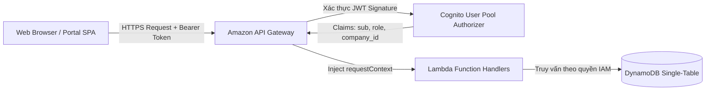

# ĐẶC TẢ GIAO DIỆN LẬP TRÌNH ỨNG DỤNG (RESTFUL API SPECIFICATION)

# Hệ thống: AI CV Screening Portal
> **Tài liệu:** Đặc tả Kỹ thuật Hệ thống RESTful API Endpoints  
> **Mã tài liệu:** `DOC-SW-04-API`  
> **Phiên bản:** `1.0` · **Ngày ban hành:** 28/10/2026 · **Trạng thái:** Đã phê duyệt (Approved Baseline)  
> **Kiến trúc áp dụng:** Amazon API Gateway (HTTP/REST API) + AWS Lambda (Node.js 20.x TypeScript)  
> **Tài liệu đối chiếu:** [01-requirements.md](./01-requirements.md) (SRS v1.0), [02-use-cases.md](./02-use-cases.md) (Use Cases v2.1), [03-database-design.md](./03-database-design.md) (DynamoDB Design v2.1)

---

## 1. Tiêu chuẩn Thiết kế & Quy ước Kỹ thuật Chung

### 1.1. Giao thức & Định dạng Truyền tải
* **Giao thức nền tảng:** 100% kết nối qua **HTTPS (TLS 1.3)** bắt buộc.
* **Định dạng dữ liệu:** `Content-Type: application/json; charset=utf-8` cho toàn bộ Request và Response bodies.
* **Quy chuẩn đặt tên (Naming Convention):** Thống nhất toàn bộ theo định dạng **`camelCase`** cho các trường JSON trong Request DTO, Response DTO và DynamoDB attributes (ví dụ: `candidateId`, `aiStatus`, `jobId`, `submittedAt`).
* **Phiên bản API (API Versioning):** Tiền tố URL chính thức là `/api/v1`.
* **Phân trang (Cursor-based Pagination):** Áp dụng phân trang không trạng thái sử dụng `cursor` (Base64 chuỗi `LastEvaluatedKey` của DynamoDB) và `limit` (mặc định 20, tối đa 50).

---

### 1.2. Xác thực & Phân quyền (Authentication & RBAC)

Hệ thống sử dụng **Amazon Cognito User Pool Authorizer** gắn trên Amazon API Gateway:
* Mọi request tới các endpoint bảo vệ bắt buộc phải đính kèm Header:
  ```http
  Authorization: Bearer <cognito_id_token>
  ```
* **Ma trận Phân quyền theo Nhóm (Cognito Groups):**
  * `candidate`: Ứng viên tìm việc (`CDD`).
  * `recruiter`: Nhà tuyển dụng / Chuyên viên nhân sự (`RCT`). Bắt buộc có custom attribute `custom:company_id` trong JWT payload.
  * `admin`: Quản trị viên vận hành sàn tuyển dụng (`AD`).
  * `public`: Các endpoint mở công khai (Tìm kiếm việc làm, Xem chi tiết JD, Xem hồ sơ công ty).



---

### 1.3. Cấu trúc Phản hồi Chuẩn hóa (Response Envelopes)

#### Phản hồi Thành công (Success Response):
```json
{
  "success": true,
  "data": { ... },
  "meta": {
    "pageLimit": 20,
    "nextCursor": "eyJQSyI6eyJTIjoiSk9CI2pvYl8xMjMifX0=",
    "hasMore": true
  }
}
```

#### Phản hồi Thất bại (Error Response):
```json
{
  "success": false,
  "error": {
    "code": "BAD_REQUEST",
    "message": "Thông điệp lỗi chi tiết, thân thiện với người dùng",
    "details": [
      {
        "field": "fileSize",
        "issue": "Tệp CV tải lên vượt quá giới hạn cho phép (tối đa 5MB theo BR-DOC-01)"
      }
    ],
    "traceId": "1-671fa302-7a8e9b0c1d2e3f4a5b6c7d8e"
  }
}
```

#### Bảng Mã Lỗi Chuẩn (HTTP Status Codes):
| HTTP Code | Mã Lỗi (`code`) | Ý nghĩa & Ngữ cảnh Phát sinh |
| :---: | :--- | :--- |
| **`200 OK`** | — | Yêu cầu xử lý thành công (GET, PUT, PATCH). |
| **`201 Created`** | — | Tạo mới tài nguyên thành công (POST). |
| **`204 No Content`**| — | Xử lý thành công không cần dữ liệu trả về (DELETE). |
| **`400 Bad Request`**| `BAD_REQUEST` | Dữ liệu đầu vào sai cú pháp hoặc vi phạm Business Rules (`BR`). |
| **`401 Unauthorized`**| `UNAUTHORIZED` | Thiếu hoặc token xác thực hết hạn / không hợp lệ. |
| **`403 Forbidden`**| `FORBIDDEN` | Người dùng không đủ quyền thực hiện hành động trên tài nguyên (Khác CompanyId). |
| **`404 Not Found`** | `NOT_FOUND` | Không tìm thấy tài nguyên yêu cầu (JobId, ApplicationId, UserId không tồn tại). |
| **`409 Conflict`** | `CONFLICT` | Xung đột phiên bản Optimistic Concurrency Control (OCC) hoặc vi phạm khóa chống nộp trùng. |
| **`429 Too Many Requests`**| `RATE_LIMIT_EXCEEDED`| Vượt quá tần suất cho phép (Ví dụ: Re-score vượt quá 3 lần/giờ theo `BR-RETRY-01`). |
| **`500 Internal Error`**| `INTERNAL_ERROR` | Lỗi nội bộ hệ thống hoặc sự cố dịch vụ AWS hạ tầng. |

---

## 2. Danh mục Tổng thể Các Endpoints (API Directory)

| Nhóm Phân Hệ | Phương Thức | Đường Dẫn Endpoint | Quyền Truy Cập (Role) | Mô Tả Nghiệp Vụ & Mã AP |
| :--- | :---: | :--- | :---: | :--- |
| **1. Auth & Profile** | `POST` | `/api/v1/auth/register` | `Public` | Đăng ký tài khoản mới (`CDD`, `RCT`) |
| | `POST` | `/api/v1/auth/confirm` | `Public` | Xác thực mã OTP email từ Cognito |
| | `GET` | `/api/v1/users/me` | `Authenticated` | Lấy hồ sơ tài khoản hiện tại (`AP01`) |
| | `PUT` | `/api/v1/users/me` | `Authenticated` | Cập nhật hồ sơ cá nhân (`AP03`) |
| | `GET` | `/api/v1/users/me/cvs` | `Candidate` | Danh mục CV cá nhân đã tải sẵn (`AP17`) |
| | `POST` | `/api/v1/users/me/cvs` | `Candidate` | Lưu bản CV mới vào kho cá nhân (`AP18`) |
| | `DELETE` | `/api/v1/users/me/cvs/{cvId}` | `Candidate` | Xóa bản CV cá nhân (`AP18`) |
| | `PATCH` | `/api/v1/users/me/cvs/{cvId}/default`| `Candidate` | Thiết lập CV mặc định (`AP19`) |
| | `GET` | `/api/v1/companies/{id}` | `Public` | Xem chi tiết hồ sơ công ty (`AP06`) |
| | `PUT` | `/api/v1/companies/{id}` | `Recruiter (Owner), Admin`| Cập nhật hồ sơ doanh nghiệp (`AP07`) |
| | `GET` | `/api/v1/companies/{id}/members` | `Recruiter, Admin` | Danh sách HR Team trong công ty (`AP04`) |
| **2. Jobs (Tin JD)** | `GET` | `/api/v1/jobs` | `Public` | Tìm kiếm & lọc việc làm `OPEN` (`AP11`) |
| | `GET` | `/api/v1/jobs/{id}` | `Public` | Xem chi tiết tin tuyển dụng (`AP09`) |
| | `POST` | `/api/v1/jobs` | `Recruiter` | Tạo và đăng tin JD mới (`AP12`) |
| | `PUT` | `/api/v1/jobs/{id}` | `Recruiter` | Cập nhật nội dung tin tuyển dụng (`AP12`) |
| | `PATCH` | `/api/v1/jobs/{id}/status` | `Recruiter` | Đóng/mở tin tuyển dụng (`AP12`) |
| | `GET` | `/api/v1/companies/{id}/jobs` | `Recruiter, Admin` | Danh sách tin của công ty (`AP10`) |
| | `POST` | `/api/v1/jobs/{id}/favorites` | `Candidate` | Thêm vào việc làm yêu thích (`AP15`) |
| | `DELETE` | `/api/v1/jobs/{id}/favorites` | `Candidate` | Xóa khỏi danh sách yêu thích (`AP15`) |
| | `GET` | `/api/v1/users/me/favorites` | `Candidate` | Danh sách việc làm đã lưu (`AP14`) |
| | `POST` | `/api/v1/users/me/alerts` | `Candidate` | Đăng ký nhận thông báo việc làm (`AP16`) |
| | `DELETE` | `/api/v1/users/me/alerts/{alertId}`| `Candidate` | Hủy đăng ký nhận tin (`AP16`) |
| **3. Applications** | `POST` | `/api/v1/applications/upload-url`| `Candidate` | Lấy Presigned URL tải CV định dạng PDF (`AP32`) |
| | `POST` | `/api/v1/applications` | `Candidate` | Nộp đơn ứng tuyển trực tuyến (`AP21`) |
| | `GET` | `/api/v1/applications/my` | `Candidate` | Lịch sử các đơn đã nộp (`AP24`) |
| | `GET` | `/api/v1/applications/{id}` | `Candidate, Recruiter` | Chi tiết đơn ứng tuyển (`AP22`) |
| | `POST` | `/api/v1/applications/{id}/withdraw`| `Candidate` | Rút đơn ứng tuyển (`WITHDRAWN`) (`AP25`) |
| | `GET` | `/api/v1/jobs/{id}/applications` | `Recruiter` | Bảng xếp hạng ứng viên theo điểm AI (`AP23`)|
| | `PATCH` | `/api/v1/applications/{id}/status` | `Recruiter` | Chuyển trạng thái tuyển dụng ATS (`AP25, AP28`)|
| **4. AI & Review** | `GET` | `/api/v1/applications/{id}/ai-report`| `Candidate, Recruiter` | Xem báo cáo đánh giá AI Rubric (`AP22`) |
| | `POST` | `/api/v1/applications/{id}/cv-access-url`| `Recruiter` | Cấp URL tải CV & Ghi Access Log (`AP29`) |
| | `GET` | `/api/v1/applications/{id}/reviews`| `Recruiter` | Xem danh sách đánh giá của HR Team (`AP27`)|
| | `POST` | `/api/v1/applications/{id}/reviews`| `Recruiter` | Thêm/cập nhật đánh giá của cá nhân (`AP26`)|
| | `POST` | `/api/v1/applications/{id}/rescore`| `Recruiter` | Kích hoạt AI chấm lại hồ sơ (`AP33`) |
| | `GET` | `/api/v1/jobs/{id}/skill-gap-analytics`| `Recruiter`| Báo cáo khoảng trống kỹ năng JD (`AP23`)|
| **5. Talent Pool** | `GET` | `/api/v1/talent-pool` | `Recruiter` | Danh sách ứng viên trong Kho tài năng (`AP30`)|
| | `POST` | `/api/v1/talent-pool` | `Recruiter` | Đưa ứng viên vào Kho tài năng (`AP30`) |
| | `DELETE` | `/api/v1/talent-pool/{candidateId}`| `Recruiter`| Xóa ứng viên khỏi Kho tài năng (`AP30`) |
| | `GET` | `/api/v1/jobs/{id}/talent-rediscovery`| `Recruiter`| AI gợi ý ứng viên phù hợp cho JD mới (`AP30`)|
| **6. Privacy & DSR**| `GET` | `/api/v1/privacy/consent` | `Candidate` | Lịch sử đồng thuận xử lý dữ liệu (`AP31`) |
| | `POST` | `/api/v1/privacy/consent` | `Candidate` | Bật/tắt sự đồng ý Talent Pool (`AP31`) |
| | `GET` | `/api/v1/privacy/export-data` | `Candidate` | Xuất toàn bộ dữ liệu cá nhân (JSON) |
| | `POST` | `/api/v1/privacy/delete-account` | `Candidate` | Yêu cầu xóa tài khoản (DSR Anonymization)|
| | `PATCH` | `/api/v1/admin/jobs/{id}/moderation`| `Admin` | Khóa hoặc gỡ bỏ tin JD vi phạm (`AP13`) |
| | `PATCH` | `/api/v1/admin/users/{id}/status` | `Admin` | Khóa tài khoản người dùng vi phạm (`AP03`)|

---

## 3. Đặc tả Chi tiết Từng Endpoint Nghiệp vụ

### 3.1. Phân hệ Xác thực & Hồ sơ Cá nhân (Auth & Profile)

---

#### `POST /api/v1/applications/upload-url`
* **Mục đích:** Cấp phát một **S3 Presigned URL (HTTP PUT)** có hạn dùng **5 phút** (`BR-DOC-03`) để trình duyệt tải trực tiếp tệp CV lên S3 mà không đi qua API Gateway, loại bỏ tắc nghẽn băng thông và giải phóng giới hạn payload.
* **Xác thực:** Bắt buộc (`Role = candidate`).
* **Request Body:**
```json
{
  "jobId": "job_01J9X9K2M3N4P5R6T7V8W9Y0Z1",
  "fileName": "NguyenVanA_Resume_2026.pdf",
  "fileType": "PDF",
  "fileSize": 184520
}
```
* **Validation Rules:**
  * `fileType`: Bắt buộc là `"PDF"` (`application/pdf`, phần mở rộng `.pdf`) (`BR-DOC-01`).
  * `fileSize`: Số nguyên dương, $\le 5,242,880$ bytes (5MB) (`BR-DOC-01`).
* **Response 200 OK:**
```json
{
  "success": true,
  "data": {
    "uploadUrl": "https://cvscreen-dev-cv-storage-901234.s3.amazonaws.com/temp-uploads/job_01J9X9K2/usr_cdd_01/upload_01J9XCP2.pdf?AWSAccessKeyId=...",
    "s3Key": "temp-uploads/job_01J9X9K2/usr_cdd_01/upload_01J9XCP2.pdf",
    "expiresInSeconds": 300
  }
}
```

---

#### `GET /api/v1/users/me/cvs` & `POST /api/v1/users/me/cvs`
* **Mục đích:** Quản lý kho tài liệu CV cá nhân của ứng viên (`UC-CDD-03`).
* **Xác thực:** Bắt buộc (`Role = candidate`).
* **POST Request Body:**
```json
{
  "fileName": "NguyenVanA_Backend_Senior.pdf",
  "fileType": "PDF",
  "fileSize": 210450,
  "s3Key": "users/usr_cdd_01J9X8P3M4R7T2W1V0K5N6Y8QZ/cvs/cv_01J9X8W2N1B4.pdf",
  "isDefault": true
}
```
* **Response 201 Created:**
```json
{
  "success": true,
  "data": {
    "cvId": "cv_01J9X8W2N1B4V6C8D0F2G4H6J8",
    "fileName": "NguyenVanA_Backend_Senior.pdf",
    "fileType": "PDF",
    "fileSize": 210450,
    "isDefault": true,
    "uploadedAt": "2026-10-28T10:00:00.000Z"
  }
}
```

---

### 3.2. Phân hệ Tin Tuyển dụng (Jobs)

---

#### `GET /api/v1/jobs`
* **Mục đích:** Ứng viên tìm kiếm, duyệt danh sách và lọc cơ hội việc làm đang mở (`UC-CDD-04`, `AP11`).
* **Xác thực:** Công khai (`Public`).
* **Query Parameters:**
  * `cursor` *(string, optional)*: Token phân trang (Base64 `LastEvaluatedKey`).
  * `limit` *(integer, optional, default: 20, max: 50)*: Số lượng tin trên một trang.
  * `department` *(string, optional)*: Lọc theo phòng ban (ví dụ: `Cloud & AI`).
  * `workplaceType` *(string, optional)*: `REMOTE` | `HYBRID` | `ON_SITE`.
  * `employmentType` *(string, optional)*: `FULL_TIME` | `PART_TIME` | `INTERNSHIP`.
  * `minSalary` *(number, optional)*: Lọc mức lương tối thiểu (USD).
  * `location` *(string, optional)*: Địa điểm làm việc (ví dụ: `Hồ Chí Minh`).
  * `keyword` *(string, optional)*: Lọc theo kỹ năng hoặc tiêu đề.
* **Response 200 OK:**
```json
{
  "success": true,
  "data": [
    {
      "jobId": "job_01J9X9K2M3N4P5R6T7V8W9Y0Z1",
      "companyId": "comp_01J9X8A1B2C3D4E5F6G7H8J9K0",
      "companyName": "FPT Software",
      "companyLogoUrl": "https://assets.cvportal.io/logos/fpt.png",
      "title": "Senior Backend Node.js / TypeScript Engineer",
      "department": "Cloud & AI Innovation Center",
      "workplaceType": "HYBRID",
      "employmentType": "FULL_TIME",
      "location": "TP. Hồ Chí Minh",
      "salary": {
        "min": 1500,
        "max": 2500,
        "currency": "USD",
        "isNegotiable": false
      },
      "skillsRequired": ["Node.js", "TypeScript", "AWS", "DynamoDB"],
      "status": "OPEN",
      "applicationCount": 14,
      "deadline": "2026-12-15T23:59:59.000Z",
      "createdAt": "2026-10-28T09:00:00.000Z"
    }
  ],
  "meta": {
    "pageLimit": 20,
    "nextCursor": "eyJQSyI6eyJTIjoiSk9CI2pvYl8xMjMifX0=",
    "hasMore": true
  }
}
```

---

#### `POST /api/v1/jobs`
* **Mục đích:** Nhà tuyển dụng tạo và xuất bản tin tuyển dụng mới kèm cấu hình Rubric trọng số đánh giá AI (`UC-RCT-02`, `AP12`).
* **Xác thực:** Bắt buộc (`Role = recruiter`). Hệ thống tự động trích xuất `companyId` từ token của người dùng.
* **Request Body:**
```json
{
  "title": "Senior Backend Node.js / TypeScript Engineer",
  "department": "Cloud & AI Innovation Center",
  "employmentType": "FULL_TIME",
  "workplaceType": "HYBRID",
  "location": "TP. Hồ Chí Minh",
  "salary": {
    "min": 1500,
    "max": 2500,
    "currency": "USD",
    "isNegotiable": false
  },
  "experienceLevel": "SENIOR",
  "skillsRequired": ["Node.js", "TypeScript", "AWS", "DynamoDB", "Serverless"],
  "description": "Tham gia phát triển các sản phẩm Cloud Serverless quy mô lớn...",
  "requirements": "- Tối thiểu 3 năm kinh nghiệm Node.js backend\n- Nắm vững kiến trúc AWS Serverless",
  "benefits": "- Môi trường làm việc quốc tế năng động\n- Lương tháng 13 và thưởng dự án",
  "rubricWeights": {
    "skills": 40,
    "experience": 30,
    "education": 15,
    "presentation": 15
  },
  "deadline": "2026-12-15T23:59:59.000Z"
}
```
* **Validation Rules:**
  * Tổng 4 thành phần trong `rubricWeights` bắt buộc bằng đúng **100** (`BR-SCORING-01`).
* **Response 201 Created:**
```json
{
  "success": true,
  "data": {
    "jobId": "job_01J9X9K2M3N4P5R6T7V8W9Y0Z1",
    "companyId": "comp_01J9X8A1B2C3D4E5F6G7H8J9K0",
    "status": "OPEN",
    "createdAt": "2026-10-28T09:00:00.000Z"
  }
}
```

---

### 3.3. Phân hệ Nộp Hồ sơ & Quản lý Đơn Tuyển dụng (Applications)

---

#### `POST /api/v1/applications`
* **Mục đích:** Ứng viên nộp hồ sơ ứng tuyển trực tuyến. Thực thi giao dịch nguyên tử (`TransactWriteItems`), khởi tạo khóa `ACTIVE_APP#<jobId>` chống nộp trùng (`BR-DOC-02`), lưu trữ đồng thuận (`BR-PRIV-01`) và đẩy message vào hàng đợi Amazon SQS để kích hoạt Pipeline AI (`UC-CDD-06`, `AP21`).
* **Xác thực:** Bắt buộc (`Role = candidate`).
* **Request Body:**
```json
{
  "jobId": "job_01J9X9K2M3N4P5R6T7V8W9Y0Z1",
  "cvSource": "UPLOADED",
  "s3Key": "temp-uploads/job_01J9X9K2/usr_cdd_01/upload_01J9XCP2.pdf",
  "fileName": "NguyenVanA_Resume.pdf",
  "fileType": "PDF",
  "fileSize": 184520,
  "coverLetter": "Tôi rất hứng thú với vị trí này và tin rằng kỹ năng của mình sẽ đóng góp lớn cho team.",
  "consents": {
    "aiScreening": true,
    "talentPool": true
  }
}
```
* **Validation & Business Logic:**
  * `consents.aiScreening`: Bắt buộc là `true` (`BR-PRIV-01`). Nếu `false`, API trả về mã lỗi `400 BAD_REQUEST`.
  * Nếu ứng viên đã có đơn nộp đang hoạt động (`SUBMITTED`, `UNDER_REVIEW`, `INVITED`), DynamoDB `ConditionalCheckFailed` được bắt và trả về mã lỗi `409 CONFLICT`.
* **Response 201 Created:**
```json
{
  "success": true,
  "data": {
    "applicationId": "app_01J9XAK4M6P8Q0R2T4V6W8Y0Z2",
    "jobId": "job_01J9X9K2M3N4P5R6T7V8W9Y0Z1",
    "status": "SUBMITTED",
    "aiStatus": "PENDING",
    "submittedAt": "2026-10-28T10:15:30.000Z",
    "message": "Nộp hồ sơ thành công! AI đang tiến hành phân tích sơ bộ năng lực (ước tính 30-60 giây)."
  }
}
```

---

#### `POST /api/v1/applications/{id}/withdraw`
* **Mục đích:** Ứng viên chủ động rút đơn ứng tuyển (`UC-CDD-09`, `AP25`).
* **Xác thực:** Bắt buộc (`Role = candidate`, chủ sở hữu đơn nộp).
* **Quy tắc nghiệp vụ (`BR-STATE-02`):** Chỉ cho phép rút đơn khi `status` thuộc nhóm `{SUBMITTED, UNDER_REVIEW}`. Khi rút thành công, hệ thống xóa khóa `ACTIVE_APP#<jobId>` để cho phép nộp lại sau này.
* **Request Body:**
```json
{
  "reason": "Tôi đã nhận được lời mời làm việc tại một công ty khác."
}
```
* **Response 200 OK:**
```json
{
  "success": true,
  "data": {
    "applicationId": "app_01J9XAK4M6P8Q0R2T4V6W8Y0Z2",
    "status": "WITHDRAWN",
    "withdrawnAt": "2026-10-28T11:00:00.000Z"
  }
}
```
* **Lỗi Ngoại lệ (400 Bad Request):**
  * Nếu hồ sơ đã ở trạng thái `INVITED`, `ACCEPTED` hoặc `REJECTED`: Trả về `400 BAD_REQUEST` kèm thông điệp: *"Hồ sơ đã bước vào giai đoạn phỏng vấn hoặc đã có kết quả chính thức, không thể thực hiện rút đơn."*

---

#### `GET /api/v1/jobs/{id}/applications`
* **Mục đích:** Nhà tuyển dụng xem Bảng xếp hạng ứng viên nộp vào tin tuyển dụng JD, được sắp xếp tự động theo điểm AI giảm dần (`UC-RCT-03`, `AP23`).
* **Xác thực:** Bắt buộc (`Role = recruiter` cùng `companyId`).
* **Query Parameters:**
  * `cursor` *(string, optional)*: Cursor phân trang.
  * `limit` *(integer, default: 20)*.
  * `status` *(string, optional)*: Lọc theo trạng thái nhân sự (`SUBMITTED`, `UNDER_REVIEW`, `INVITED`, `ACCEPTED`, `REJECTED`).
  * `matchLevel` *(string, optional)*: Lọc theo xếp loại AI (`STRONG_MATCH`, `POTENTIAL_MATCH`, `NOT_MATCH`).
* **Response 200 OK:**
```json
{
  "success": true,
  "data": [
    {
      "applicationId": "app_01J9XAK4M6P8Q0R2T4V6W8Y0Z2",
      "candidateId": "usr_cdd_01J9X8P3M4R7T2W1V0K5N6Y8QZ",
      "candidateName": "Nguyễn Văn A",
      "candidateEmail": "nguyen.van.a@example.com",
      "status": "UNDER_REVIEW",
      "aiStatus": "COMPLETED",
      "aiEvaluation": {
        "totalScore": 82,
        "matchLevel": "STRONG_MATCH",
        "executiveSummary": "Ứng viên có nền tảng xuất sắc về Node.js Backend và hệ thống AWS Serverless..."
      },
      "reviewCount": 2,
      "avgRating": 4.5,
      "submittedAt": "2026-10-28T10:15:30.000Z"
    }
  ],
  "meta": {
    "pageLimit": 20,
    "nextCursor": null,
    "hasMore": false
  }
}
```

---

#### `PATCH /api/v1/applications/{id}/status`
* **Mục đích:** Nhà tuyển dụng chuyển đổi trạng thái tuyển dụng nghiệp vụ của ứng viên và tự động ghi nhận bản ghi kiểm toán bất biến `AuditTrail` (`UC-RCT-06`, `AP25`, `AP28`).
* **Xác thực:** Bắt buộc (`Role = recruiter` cùng `companyId`).
* **Request Body:**
```json
{
  "newStatus": "INVITED",
  "reason": "Ứng viên đạt 82 điểm AI và có đánh giá đồng thuận 5 sao từ Tech Lead. Tiến hành mời phỏng vấn kỹ thuật vòng 1.",
  "expectedVersion": 1
}
```
* **Ma trận Chuyển đổi Trạng thái Hợp lệ (`BR-STATE-01`):**
  * `SUBMITTED` $\rightarrow$ `UNDER_REVIEW`
  * `UNDER_REVIEW` $\rightarrow$ `INVITED` | `REJECTED`
  * `INVITED` $\rightarrow$ `ACCEPTED` | `REJECTED`
* **Hành vi Tự động:**
  * Chuyển sang `INVITED`: Tự động gọi **Amazon SES** gửi email thư mời phỏng vấn kèm thông tin chi tiết (`BR-STATE-03`).
  * Chuyển sang `REJECTED`: Tự động kích hoạt xóa khóa `ACTIVE_APP#<jobId>` để cho phép ứng viên nộp lại, đồng thời gửi email thông báo từ chối lịch sự.
* **Response 200 OK:**
```json
{
  "success": true,
  "data": {
    "applicationId": "app_01J9XAK4M6P8Q0R2T4V6W8Y0Z2",
    "previousStatus": "UNDER_REVIEW",
    "status": "INVITED",
    "version": 2,
    "updatedAt": "2026-10-28T11:00:00.000Z"
  }
}
```

---

### 3.4. Phân hệ AI, Review Đội nhóm & Human-in-the-Loop

---

#### `GET /api/v1/applications/{id}/ai-report`
* **Mục đích:** Xem Báo cáo Đánh giá Năng lực chi tiết do Amazon Bedrock chấm điểm theo Rubric 100đ chuẩn hóa (`UC-CDD-08`, `UC-RCT-04`, `AP22`).
* **Xác thực:** Bắt buộc (Chủ sở hữu đơn nộp `CDD` hoặc Recruiter phụ trách `RCT`).
* **Response 200 OK:**
```json
{
  "success": true,
  "data": {
    "applicationId": "app_01J9XAK4M6P8Q0R2T4V6W8Y0Z2",
    "jobTitle": "Senior Backend Node.js / TypeScript Engineer",
    "aiStatus": "COMPLETED",
    "aiEvaluation": {
      "totalScore": 82,
      "matchLevel": "STRONG_MATCH",
      "criteriaScores": {
        "technicalSkills": {
          "score": 32,
          "maxScore": 40,
          "analysis": "Nắm vững Node.js và AWS DynamoDB/Lambda. Thiếu TypeScript nâng cao."
        },
        "workExperience": {
          "score": 26,
          "maxScore": 30,
          "analysis": "Hơn 3 năm xây dựng hệ thống phân tán chịu tải cao."
        },
        "educationCertifications": {
          "score": 12,
          "maxScore": 15,
          "analysis": "Cử nhân CNTT Đại học Bách Khoa. Chưa có chứng chỉ AWS Solution Architect."
        },
        "softSkillsPresentation": {
          "score": 12,
          "maxScore": 15,
          "analysis": "Trình bày cấu trúc mạch lạc, rõ ràng theo từng dự án."
        }
      },
      "keyStrengths": [
        "Kinh nghiệm thực chiến với kiến trúc AWS Serverless (Lambda, DynamoDB, SQS)",
        "Nắm vững chuẩn RESTful API Design và Single-Table NoSQL Design"
      ],
      "areasForImprovement": [
        "Kinh nghiệm TypeScript tĩnh còn ít dự án thực tế chứng minh",
        "Cần bổ sung chứng chỉ chuyên môn AWS"
      ],
      "executiveSummary": "Ứng viên có nền tảng xuất sắc về Node.js Backend và hệ thống AWS Serverless. Hoàn toàn phù hợp để phỏng vấn vòng chuyên môn.",
      "suggestedInterviewQuestions": [
        "Bạn hãy giải thích cơ chế xử lý Cold-start của AWS Lambda khi viết bằng Node.js?",
        "Làm thế nào bạn thiết kế phân tán Partition Key để chống Hot Partition trong DynamoDB?"
      ],
      "evaluatedAt": "2026-10-28T10:16:15.000Z",
      "modelUsed": "anthropic.claude-3-haiku-20240307-v1:0"
    }
  }
}
```

---

#### `POST /api/v1/applications/{id}/cv-access-url`
* **Mục đích:** Nhà tuyển dụng yêu cầu sinh **S3 Presigned URL (HTTP GET)** để xem/tải CV gốc phục vụ màn hình đối chiếu song song (Side-by-side Review) hoặc tải về máy (`UC-RCT-12`, `AP29`).
* **Xác thực:** Bắt buộc (`Role = recruiter` cùng `companyId`).
* **Hành vi Kiểm toán Bảo mật (`NFR-SEC-05`):**
  * Tự động ghi bản ghi nhật ký kiểm toán vào DynamoDB (`ACTION = "PRESIGNED_URL_ISSUED"` kèm TTL 180 ngày).
  * Nhúng tham số `grantId` / `traceId` vào Presigned URL để đối soát trực tiếp với S3 Server Access Logs khi client thực hiện tải file.
  * Presigned URL có thời hạn hiệu lực nghiêm ngặt là **5 phút** (`BR-DOC-03`).
* **Response 200 OK:**
```json
{
  "success": true,
  "data": {
    "downloadUrl": "https://cvscreen-dev-cv-storage-901234.s3.amazonaws.com/applications/job_01J9X9K2/app_01J9XAK4.pdf?AWSAccessKeyId=...&grantId=log_01J9XBR4K2",
    "fileName": "NguyenVanA_Backend_CV.pdf",
    "expiresInSeconds": 300,
    "grantId": "log_01J9XBR4K2"
  }
}
```

---

#### `POST /api/v1/applications/{id}/reviews`
* **Mục đích:** Chuyên viên nhân sự hoặc Tech Lead trong HR Team lưu nhận xét, đánh giá định lượng (1-5 sao) và đề xuất tuyển dụng cá nhân mà không ghi đè lên nhận xét của đồng đội (`UC-RCT-05`, `AP26`).
* **Xác thực:** Bắt buộc (`Role = recruiter` cùng `companyId`).
* **Request Body:**
```json
{
  "rating": 5,
  "manualNotes": "CV rất phù hợp với dự án Serverless đang triển khai. Tôi đề xuất mời phỏng vấn kỹ thuật ngay.",
  "recommendation": "INVITE"
}
```
* **Validation Rules:**
  * `rating`: Số nguyên từ 1 đến 5.
  * `recommendation`: `"INVITE"` | `"REJECT"` | `"NEUTRAL"`.
* **Response 200 OK:**
```json
{
  "success": true,
  "data": {
    "reviewId": "rev_01J9XBP3N4M6",
    "applicationId": "app_01J9XAK4M6P8Q0R2T4V6W8Y0Z2",
    "reviewerId": "usr_rct_01J9X9B3N5M7K8L2P4Q6R8S0T2",
    "reviewerName": "Trần Thị Mai (Tech Lead)",
    "rating": 5,
    "recommendation": "INVITE",
    "updatedAt": "2026-10-28T11:00:00.000Z"
  }
}
```

---

#### `POST /api/v1/applications/{id}/rescore`
* **Mục đích:** Kích hoạt yêu cầu AI chấm điểm lại hồ sơ khi có sự thay đổi tiêu chí JD hoặc kiểm tra lại kết quả (`UC-RCT-07`, `AP33`).
* **Xác thực:** Bắt buộc (`Role = recruiter` cùng `companyId`).
* **Hạn mức & Rate Limiting (`BR-RETRY-01`):** Tối đa **3 lần / giờ / hồ sơ**. Nếu gọi lần thứ 4 trong khung giờ, hệ thống trả về mã lỗi `429 RATE_LIMIT_EXCEEDED`.
* **Response 200 OK:**
```json
{
  "success": true,
  "data": {
    "applicationId": "app_01J9XAK4M6P8Q0R2T4V6W8Y0Z2",
    "aiStatus": "PENDING",
    "remainingRescoresThisHour": 2,
    "message": "Đã tiếp nhận yêu cầu chấm điểm lại. AI đang thực hiện phân tích đối soát mới."
  }
}
```

---

### 3.5. Phân hệ Kho Tài năng Doanh nghiệp (Talent Pool)

---

#### `GET /api/v1/talent-pool` & `POST /api/v1/talent-pool`
* **Mục đích:** Doanh nghiệp quản lý và lưu giữ hồ sơ ứng viên tiềm năng để tái liên hệ khi có vị trí tuyển dụng mới trong tương lai (`UC-RCT-09`, `AP30`).
* **Xác thực:** Bắt buộc (`Role = recruiter` cùng `companyId`).
* **Quy tắc Nghiệp vụ (`BR-POOL-01`, `BR-POOL-02`):**
  * Chỉ hồ sơ đạt mức `STRONG_MATCH` ($\ge 80$đ) hoặc `POTENTIAL_MATCH` ($60-79$đ) mới được đưa vào Talent Pool.
  * Ứng viên phải đồng ý điều khoản `consents.talentPool = true` khi nộp đơn.
* **POST Request Body:**
```json
{
  "applicationId": "app_01J9XAK4M6P8Q0R2T4V6W8Y0Z2",
  "notes": "Lưu lại cho dự án Cloud Backend quý 1 năm sau."
}
```
* **Response 201 Created:**
```json
{
  "success": true,
  "data": {
    "candidateId": "usr_cdd_01J9X8P3M4R7T2W1V0K5N6Y8QZ",
    "companyId": "comp_01J9X8A1B2C3D4E5F6G7H8J9K0",
    "candidateName": "Nguyễn Văn A",
    "aiScore": 82,
    "addedAt": "2026-10-28T11:30:00.000Z"
  }
}
```

---

#### `GET /api/v1/jobs/{id}/talent-rediscovery`
* **Mục đích:** AI tự động phân tích và gợi ý các ứng viên phù hợp nhất sẵn có trong Kho tài năng cho một tin tuyển dụng mới vừa tạo (`UC-RCT-10`, `AP30`).
* **Xác thực:** Bắt buộc (`Role = recruiter` cùng `companyId`).
* **Response 200 OK:**
```json
{
  "success": true,
  "data": [
    {
      "candidateId": "usr_cdd_01J9X8P3M4R7T2W1V0K5N6Y8QZ",
      "candidateName": "Nguyễn Văn A",
      "candidateEmail": "nguyen.van.a@example.com",
      "matchingSkills": ["Node.js", "AWS", "DynamoDB"],
      "previousScore": 82,
      "relevanceScore": 88,
      "notes": "Lưu từ đợt tuyển dụng Senior Backend tháng 10/2026"
    }
  ]
}
```

---

### 3.6. Phân hệ Quyền Riêng Tư & Yêu Cầu DSR (Privacy & Data Subject Rights)

---

#### `POST /api/v1/privacy/consent`
* **Mục đích:** Ứng viên chủ động bật hoặc thu hồi sự đồng ý đối với việc lưu trữ hồ sơ trong Talent Pool hoặc nhận email thông báo việc làm (`UC-CDD-10`, `AP31`).
* **Xác thực:** Bắt buộc (`Role = candidate`).
* **Request Body:**
```json
{
  "purpose": "TALENT_POOL",
  "status": "REVOKED",
  "termsVersion": "v1.0"
}
```
* **Hành vi Kỹ thuật:**
  * Hệ thống ghi nhận 1 bản ghi bất biến `ConsentLog` (`SK = CONSENT#...#TALENT_POOL`) với trạng thái `REVOKED`.
  * Tự động xóa bỏ toàn bộ các bản ghi của ứng viên trong bảng `TalentPool` của mọi doanh nghiệp liên quan.
* **Response 200 OK:**
```json
{
  "success": true,
  "data": {
    "purpose": "TALENT_POOL",
    "status": "REVOKED",
    "updatedAt": "2026-10-28T11:45:00.000Z",
    "message": "Đã thu hồi sự đồng thuận thành công. Hồ sơ của bạn đã được gỡ bỏ khỏi kho tài năng của các nhà tuyển dụng."
  }
}
```

---

#### `GET /api/v1/privacy/export-data`
* **Mục đích:** Ứng viên thực thi quyền xuất dữ liệu cá nhân (Right to Data Portability) dưới định dạng JSON tiêu chuẩn (`UC-CDD-10`).
* **Xác thực:** Bắt buộc (`Role = candidate`).
* **Response 200 OK:**
```json
{
  "success": true,
  "data": {
    "userProfile": {
      "userId": "usr_cdd_01J9X8P3M4R7T2W1V0K5N6Y8QZ",
      "fullName": "Nguyễn Văn A",
      "email": "nguyen.van.a@example.com",
      "phone": "+84901234567"
    },
    "applications": [
      {
        "applicationId": "app_01J9XAK4M6P8Q0R2T4V6W8Y0Z2",
        "jobTitle": "Senior Backend Node.js / TypeScript Engineer",
        "submittedAt": "2026-10-28T10:15:30.000Z",
        "status": "SUBMITTED",
        "aiScore": 82
      }
    ],
    "consentHistory": [
      {
        "purpose": "AI_SCREENING",
        "status": "GRANTED",
        "timestamp": "2026-10-28T10:15:30.000Z"
      }
    ],
    "exportedAt": "2026-10-28T11:50:00.000Z"
  }
}
```

---

#### `POST /api/v1/privacy/delete-account`
* **Mục đích:** Ứng viên kích hoạt quy trình xóa tài khoản và hủy định danh toàn diện (Right to be Forgotten theo `BR-PRIV-02`, `UC-CDD-10`, `UC-AD-05`).
* **Xác thực:** Bắt buộc (`Role = candidate`).
* **Request Body:**
```json
{
  "confirmationText": "XAC NHAN XOA TAI KHOAN",
  "reason": "Tôi không còn nhu cầu tìm việc trên sàn tuyển dụng."
}
```
* **Quy trình Thực thi:**
  * Kích hoạt tiến trình **Asynchronous DSR Pipeline**: Xóa file vật lý trên S3, xóa email lookup item, thay thế `candidateId` và `candidateName` thành `"ANONYMIZED_USER"` trên các `Application`, xóa toàn bộ output văn bản của AI (`executiveSummary`, `strengths`, `weaknesses`), xóa `TalentPool`, ghi nhận `REVOKED_ALL` vào `ConsentLog` và vô hiệu hóa tài khoản trên Amazon Cognito.
* **Response 202 Accepted:**
```json
{
  "success": true,
  "data": {
    "status": "PROCESSING",
    "requestId": "dsr_01J9XDW3M6P8",
    "message": "Yêu cầu xóa tài khoản đã được tiếp nhận và đang tiến hành khử định danh an toàn. Toàn bộ thông tin cá nhân và tệp CV của bạn sẽ bị xóa vĩnh viễn khỏi hệ thống."
  }
}
```

---

## 4. Đặc tả Typescript Interfaces / DTOs Đồng Nhất

Dưới đây là các định nghĩa TypeScript Interfaces cốt lõi được chia sẻ giữa Backend và Frontend (`shared/types/api.ts`):

```typescript
// Trạng thái chuẩn hóa
export type RecruitmentStatus = 
  | 'SUBMITTED' 
  | 'UNDER_REVIEW' 
  | 'INVITED' 
  | 'ACCEPTED' 
  | 'REJECTED' 
  | 'WITHDRAWN';

export type AIPipelineStatus = 
  | 'PENDING' 
  | 'EXTRACTING' 
  | 'SCORING' 
  | 'COMPLETED' 
  | 'FAILED';

export type MatchLevel = 'STRONG_MATCH' | 'POTENTIAL_MATCH' | 'NOT_MATCH';

// Đơn ứng tuyển DTO
export interface ApplicationDto {
  applicationId: string;
  jobId: string;
  companyId: string;
  candidateId: string;
  candidateName: string;
  candidateEmail?: string;
  jobTitle: string;
  status: RecruitmentStatus;
  aiStatus: AIPipelineStatus;
  aiEvaluation?: AIEvaluationDto;
  reviewCount: number;
  avgRating?: number;
  submittedAt: string;
  updatedAt: string;
}

// Kết quả đánh giá Rubric AI
export interface AIEvaluationDto {
  totalScore: number;
  matchLevel: MatchLevel;
  criteriaScores: {
    technicalSkills: { score: number; maxScore: number; analysis: string };
    workExperience: { score: number; maxScore: number; analysis: string };
    educationCertifications: { score: number; maxScore: number; analysis: string };
    softSkillsPresentation: { score: number; maxScore: number; analysis: string };
  };
  keyStrengths?: string[];
  areasForImprovement?: string[];
  executiveSummary?: string;
  suggestedInterviewQuestions?: string[];
  evaluatedAt: string;
  modelUsed: string;
}

// Đánh giá cá nhân của HR Team
export interface ApplicationReviewDto {
  reviewId: string;
  applicationId: string;
  reviewerId: string;
  reviewerName: string;
  rating: number;
  manualNotes: string;
  recommendation: 'INVITE' | 'REJECT' | 'NEUTRAL';
  updatedAt: string;
}
```

---

## 5. Định nghĩa Hoàn thành (Definition of Done)

- [x] Đặc tả đầy đủ **100% các Endpoints** trải dài qua 6 phân hệ nghiệp vụ (`Auth`, `Jobs`, `Applications`, `AI Review`, `Talent Pool`, `Privacy & DSR`).
- [x] Thống nhất chuẩn đặt tên thuộc tính `camelCase` (`aiStatus`, `status`, `candidateId`, `jobId`) đồng bộ tuyệt đối với SRS v1.0, Use Cases v2.1 và Database Design v2.1.
- [x] Mỗi endpoint đều có mô tả URL, Method, Header xác thực, Request Body, Response Schema, Validation Rules và Error Codes.
- [x] Quy chuẩn cơ chế tải CV trực tiếp qua S3 Presigned URL và cấp quyền xem CV an toàn có thời hạn 5 phút (`grantId` audit correlation).
- [x] Cung cấp đầy đủ các TypeScript DTOs làm nền tảng cho việc lập trình Backend và Frontend ở Phase 1 & 2.
