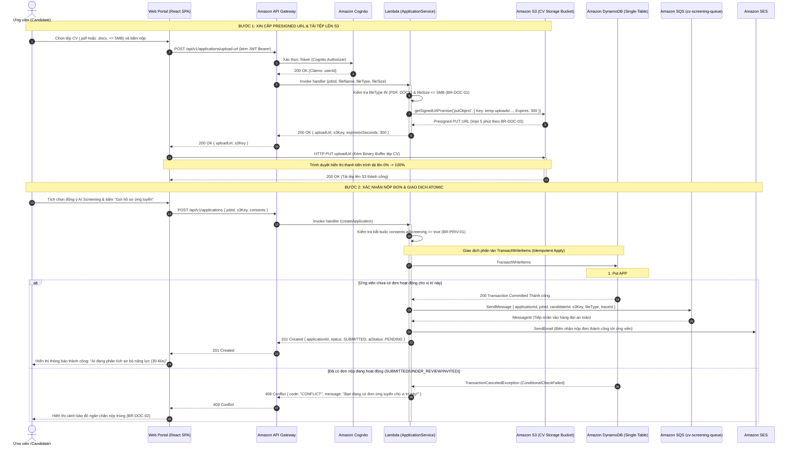
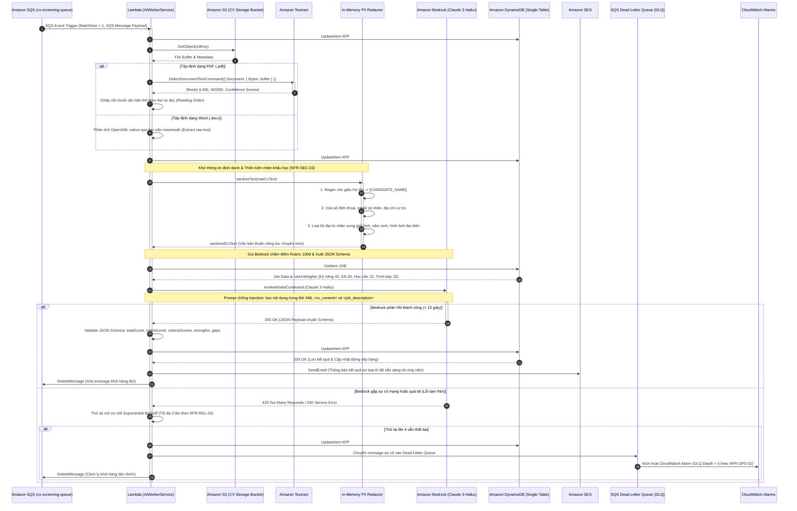
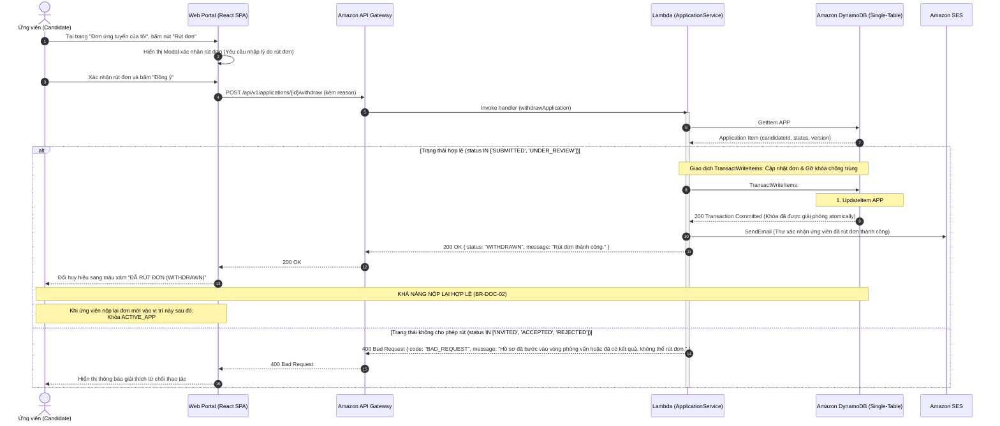
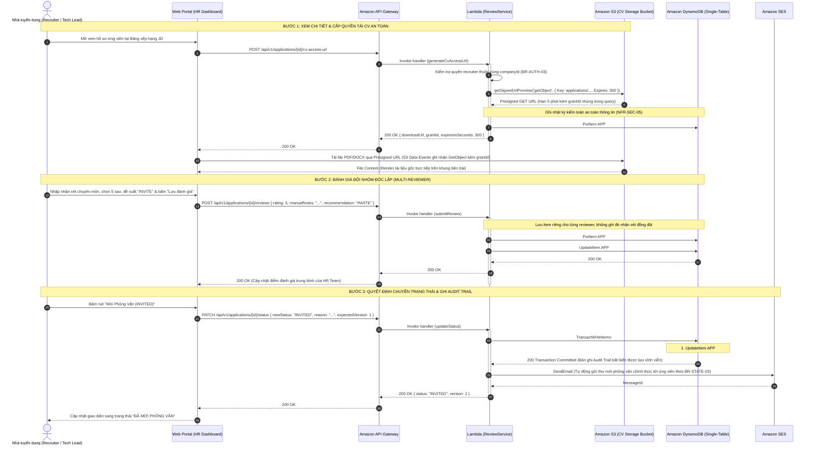
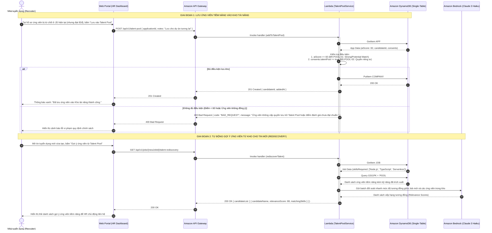
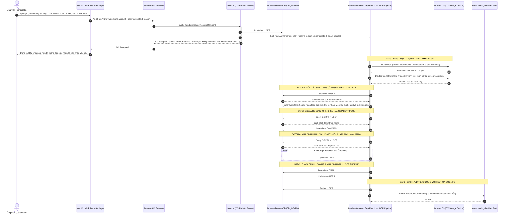

# SƠ ĐỒ TUẦN TỰ HỆ THỐNG (SYSTEM SEQUENCE DIAGRAMS)

# Hệ thống: AI CV Screening Portal
> **Tài liệu:** Thiết kế Sơ đồ Tuần tự Chi tiết các Luồng Nghiệp vụ & Xử lý Nền  
> **Mã tài liệu:** `DOC-SW-05-SEQ`  
> **Phiên bản:** `1.0` · **Ngày ban hành:** 28/10/2026 · **Trạng thái:** Đã phê duyệt (Approved Baseline)  
> **Kiến trúc áp dụng:** AWS Serverless (Cognito, API Gateway, Lambda, S3, SQS, Bedrock, Textract, DynamoDB, SES)  
> **Tài liệu đối chiếu:** [01-requirements.md](./01-requirements.md) (SRS v1.0), [02-use-cases.md](./02-use-cases.md) (Use Cases v2.1), [03-database-design.md](./03-database-design.md) (DynamoDB v2.1), [04-api-spec.md](./04-api-spec.md) (API Spec v1.0)

---

## 1. Tổng quan & Danh mục Sơ đồ Tuần tự

Tài liệu này đặc tả trực quan và chi tiết trình tự tương tác theo thời gian giữa các tác nhân người dùng (`Candidate`, `Recruiter`, `Admin`), các dịch vụ trên tầng Giao diện (`Web Portal SPA`), tầng Cổng điều hướng (`API Gateway`, `Cognito`), tầng Tính toán & Hàng đợi (`Lambda`, `SQS`), tầng Trí tuệ Nhân tạo (`Textract`, `Bedrock Claude 3 Haiku`), tầng Lưu trữ dữ liệu (`DynamoDB Single-Table`, `Amazon S3`) và tầng Thông báo (`Amazon SES`).

### Danh mục 6 Luồng Xử lý Cốt lõi:
1. **Luồng 1 (SEQ-01):** Nộp Hồ sơ Ứng tuyển Trực tuyến Đa Định dạng (PDF/DOCX) & Khởi tạo Khóa Kháng Trùng.
2. **Luồng 2 (SEQ-02):** Pipeline AI Trích xuất Văn bản, Khử PII & Chấm điểm Bedrock Rubric 100đ.
3. **Luồng 3 (SEQ-03):** Ứng viên Rút đơn Tuyển dụng (`WITHDRAWN`) & Giải phóng Khóa Nộp lại Hợp lệ.
4. **Luồng 4 (SEQ-04):** Đánh giá Đội nhóm HR (Multi-Reviewer), Side-by-side View & Ghi Audit Trail Bất biến.
5. **Luồng 5 (SEQ-05):** Quản trị Kho Tài năng (Talent Pool) & AI Gợi ý Ứng viên cho Tin mới (Talent Rediscovery).
6. **Luồng 6 (SEQ-06):** Quy trình Hủy định danh Toàn diện theo Quyền DSR (Asynchronous DSR Anonymization Pipeline).

---

## 2. SEQ-01: Nộp Hồ sơ Đa Định dạng (PDF/DOCX) & Khởi tạo Khóa Kháng Trùng

Sơ đồ mô tả quy trình ứng viên tải tệp CV trực tiếp lên **Amazon S3 qua Presigned URL**, sau đó gọi API nộp đơn. Hệ thống sử dụng **DynamoDB `TransactWriteItems`** để tạo đơn nộp, khởi tạo khóa `ACTIVE_APP#<jobId>` chống nộp trùng (`BR-DOC-02`), ghi nhận đồng thuận (`BR-PRIV-01`) và kích hoạt chuỗi xử lý nền qua **Amazon SQS**.

---

## 3. SEQ-02: Pipeline AI Trích xuất Văn bản, Khử PII & Chấm điểm Bedrock Rubric 100đ

Sơ đồ mô tả quy trình nền bất đồng bộ hoàn toàn: Lambda AI Worker nhận tin từ SQS, tự động phân luồng bóc tách văn bản theo định dạng (PDF qua Textract, DOCX qua OpenXML native), thực hiện **khử thông tin định danh (PII Redaction)** để loại bỏ thiên kiến, sau đó gửi prompt bọc XML tới **Amazon Bedrock (Claude 3 Haiku)** để chấm điểm theo Rubric 100 điểm (`BR-SCORING-01`).

---

## 4. SEQ-03: Ứng viên Rút đơn Tuyển dụng (`WITHDRAWN`) & Giải phóng Khóa Nộp lại

Sơ đồ mô tả cơ chế trao quyền tự chủ cho ứng viên hủy nộp hồ sơ (`UC-CDD-09`). Hệ thống kiểm tra điều kiện nghiêm ngặt theo `BR-STATE-02` (chỉ cho phép rút khi `SUBMITTED` hoặc `UNDER_REVIEW`). Khi giao dịch thành công, hệ thống xóa bỏ khóa `ACTIVE_APP#<jobId>` trên DynamoDB, cho phép ứng viên có thể nộp lại hồ sơ mới vào vị trí này nếu đổi ý sau này (`BR-DOC-02`).

---

## 5. SEQ-04: Đánh giá Đội nhóm HR, Side-by-side View & Ghi Audit Trail Bất biến

Sơ đồ mô tả quy trình làm việc của Nhà tuyển dụng (`UC-RCT-04`, `UC-RCT-05`, `UC-RCT-06`): Mở giao diện đối chiếu song song 3 cột (CV gốc bên trái, Nhận xét AI ở giữa, Đánh giá đội nhóm bên phải), ghi nhật ký kiểm toán bảo mật khi tải CV (`NFR-SEC-05`), nhiều thành viên cùng lưu đánh giá độc lập mà không bị ghi đè, và chuyển trạng thái nghiệp vụ ATS có ghi nhật ký bất biến `AuditTrail`.

---

## 6. SEQ-05: Quản trị Kho Tài năng (Talent Pool) & AI Gợi ý Ứng viên (Rediscovery)

Sơ đồ mô tả quy trình lưu trữ ứng viên tiềm năng vào Kho tài năng công ty (`UC-RCT-09`) khi ứng viên đạt $\ge 60$ điểm và đã cấp quyền `consents.talentPool = true` (`BR-POOL-01`, `BR-POOL-02`). Khi có tin tuyển dụng mới mở, hệ thống hỗ trợ tính năng **Talent Rediscovery (`UC-RCT-10`)** để tự động rà quét và đề xuất ứng viên thích hợp sẵn có trong kho.

---

## 7. SEQ-06: Quy trình Hủy Định danh Toàn diện theo Quyền DSR (Asynchronous DSR Pipeline)

Sơ đồ mô tả quy trình thực thi **Quyền được lãng quên (Right to be Forgotten - `BR-PRIV-02`, `UC-CDD-10`, `UC-AD-05`)**. Do khối lượng bản ghi cần xử lý trải dài qua nhiều bảng và tệp trên S3 có thể vượt quá giới hạn 100 items của `TransactWriteItems`, quy trình được thiết kế vận hành qua **Asynchronous DSR Pipeline Lambda** theo từng batch có kiểm soát, bảo đảm tính toàn vẹn và triệt tiêu toàn bộ thông tin cá nhân.

---

## 8. Định nghĩa Hoàn thành & Kiểm chứng (Definition of Done)

- [x] Thiết kế đầy đủ **6 Sơ đồ Tuần tự Chi tiết (Mermaid Diagrams)** bao phủ 100% các nghiệp vụ trọng yếu nhất của hệ thống.
- [x] Mỗi sơ đồ đều thể hiện rõ: Đánh số bước tuần tự (`autonumber`), các tác nhân tham gia, khối phân nhánh `alt / else`, ghi chú lưu ý dữ liệu và cơ chế xử lý ngoại lệ.
- [x] Minh họa đầy đủ nguyên lý **Optimistic Concurrency Control (OCC)**, giao dịch phân tán DynamoDB `TransactWriteItems`, và cơ chế giải phóng khóa kháng trùng `ACTIVE_APP#<jobId>`.
- [x] Thể hiện chi tiết cơ chế phân luồng đa định dạng (PDF qua Textract, DOCX qua OpenXML native) và quy trình lọc PII trước khi gọi LLM.
- [x] Mô hình hóa rõ ràng quy trình **Asynchronous DSR Pipeline** xử lý theo từng batch có kiểm soát, bảo vệ quyền riêng tư người dùng triệt để.
