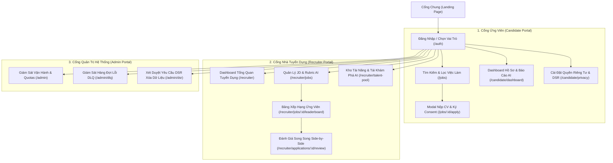

# Đặc Tả Thiết Kế Giao Diện UI/UX (AWS AI CV Screening Portal)

Tài liệu này tổng hợp cấu trúc điều hướng, Site Map, và hệ thống Prompt thiết kế giao diện cho công cụ **StitchAI** (nằm trong thư mục [`ui/`](file:///d:/AWS/workshop/ui/README.md)).

---

## 1. Bản Đồ Điều Hướng Hệ Thống (Site Map)

---

## 2. Hệ Thống Prompt Thiết Kế Cho StitchAI

Toàn bộ các prompt đã được chuẩn hóa gọn gàng theo 3 trọng tâm: **Bố cục (Layout)**, **Thành phần giao diện (Components)**, và **Màu sắc & Phong cách (Colors & Style)** trong thư mục [`ui/`](file:///d:/AWS/workshop/ui/README.md):

| Nhóm Màn Hình | Tên Trang | Đường Dẫn File Prompt | Mục Đích Chính |
|---|---|---|---|
| **Chung** | Quy định Template | [`ui/00-template-chung.md`](file:///d:/AWS/workshop/ui/00-template-chung.md) | Khung prompt mẫu & Bảng mã màu chuẩn |
| **Xác thực** | Đăng nhập / Chọn vai trò | [`ui/auth/login-register.md`](file:///d:/AWS/workshop/ui/auth/login-register.md) | Đăng nhập đa vai trò, SSO, MFA |
| **Ứng viên** | Tìm kiếm & Lọc việc làm | [`ui/candidate/01-job-search.md`](file:///d:/AWS/workshop/ui/candidate/01-job-search.md) | Bộ lọc kỹ năng, địa điểm, mức lương |
| **Ứng viên** | Modal Nộp CV & Consent | [`ui/candidate/02-apply-modal.md`](file:///d:/AWS/workshop/ui/candidate/02-apply-modal.md) | Dropzone PDF, Upload S3, Thỏa thuận AI |
| **Ứng viên** | Dashboard & AI Skill Gap | [`ui/candidate/03-dashboard-skillgap.md`](file:///d:/AWS/workshop/ui/candidate/03-dashboard-skillgap.md) | Theo dõi tiến độ hồ sơ & Báo cáo kỹ năng |
| **Ứng viên** | Quyền riêng tư & DSR | [`ui/candidate/04-privacy-dsr.md`](file:///d:/AWS/workshop/ui/candidate/04-privacy-dsr.md) | Bật/tắt Consent, Xuất JSON, Xóa tài khoản |
| **Recruiter** | Dashboard Tuyển dụng | [`ui/recruiter/01-recruiter-dashboard.md`](file:///d:/AWS/workshop/ui/recruiter/01-recruiter-dashboard.md) | Chỉ số KPI, phễu tuyển dụng, phân bổ điểm AI |
| **Recruiter** | Quản lý JD & Rubric AI | [`ui/recruiter/02-job-management.md`](file:///d:/AWS/workshop/ui/recruiter/02-job-management.md) | Cấu hình 4 thanh trượt trọng số Rubric (100%) |
| **Recruiter** | Bảng xếp hạng ứng viên | [`ui/recruiter/03-candidate-leaderboard.md`](file:///d:/AWS/workshop/ui/recruiter/03-candidate-leaderboard.md) | Leaderboard theo điểm AI, ngăn trượt xem nhanh |
| **Recruiter** | Đánh giá Song song (Side-by-side) | [`ui/recruiter/04-side-by-side-review.md`](file:///d:/AWS/workshop/ui/recruiter/04-side-by-side-review.md) | Đối chiếu CV gốc vs Phân tích AI, Ghi đè điểm |
| **Recruiter** | Kho tài năng & Rediscovery | [`ui/recruiter/05-talent-pool.md`](file:///d:/AWS/workshop/ui/recruiter/05-talent-pool.md) | Tìm kiếm ứng viên tiềm năng bằng câu lệnh AI |
| **Admin** | Giám sát vận hành & Quotas | [`ui/admin/01-system-overview.md`](file:///d:/AWS/workshop/ui/admin/01-system-overview.md) | Giám sát AWS Textract, Bedrock, SQS, DynamoDB |
| **Admin** | Giám sát hàng đợi lỗi DLQ | [`ui/admin/02-dlq-monitor.md`](file:///d:/AWS/workshop/ui/admin/02-dlq-monitor.md) | Theo dõi CV lỗi, nút Re-drive xử lý lại |
| **Admin** | Xét duyệt yêu cầu DSR | [`ui/admin/03-dsr-approval.md`](file:///d:/AWS/workshop/ui/admin/03-dsr-approval.md) | Phê duyệt yêu cầu ẩn danh hóa dữ liệu cá nhân |
