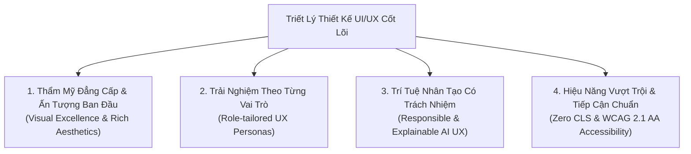
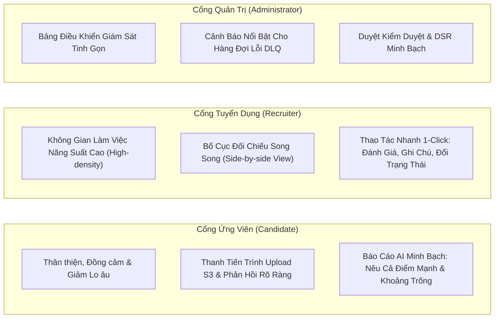
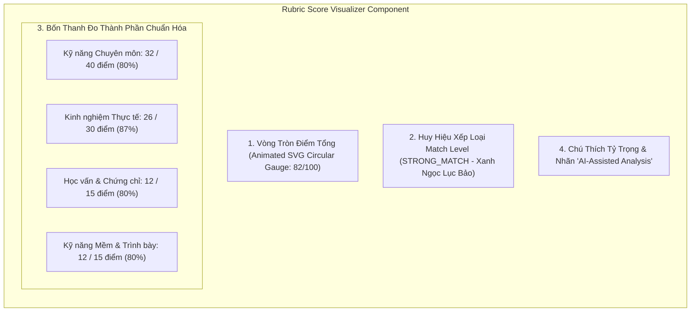
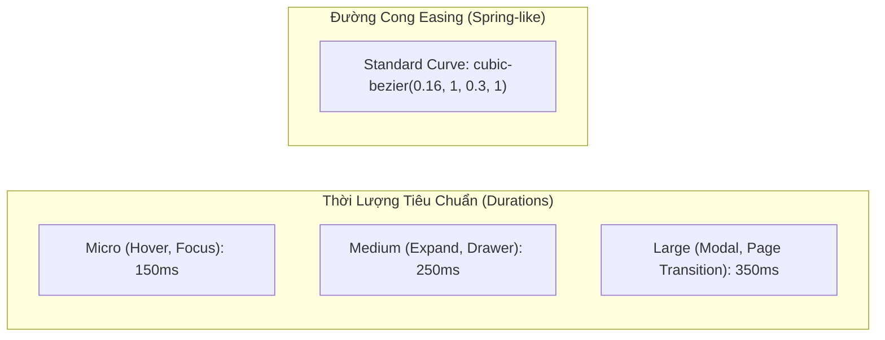

# BỘ QUY TẮC THIẾT KẾ GIAO DIỆN & TRẢI NGHIỆM NGƯỜI DÙNG (UI/UX DESIGN SYSTEM & GUIDELINES)

# Hệ thống: AI CV Screening Portal
> **Tài liệu:** Bộ Quy Chuẩn Thiết Kế Giao Diện, Hệ Thống Design Tokens & Trải Nghiệm Người Dùng  
> **Mã tài liệu:** `DOC-SW-UI-RULES`  
> **Phiên bản:** `1.0` (Chính thức) · **Ngày ban hành:** 28/10/2026 · **Trạng thái:** Đã phê duyệt áp dụng  
> **Công nghệ áp dụng:** React (Vite) + **100% Vanilla CSS** (CSS Custom Properties & Design Tokens)  
> **Tiêu chuẩn tuân thủ:** WCAG 2.1 AA Accessibility, Responsible & Transparent AI UX, Zero Cumulative Layout Shift (CLS)  
> **Tài liệu đối chiếu:** [01-requirements.md](./01-requirements.md), [02-use-cases.md](./02-use-cases.md), [tech-stack.md](../architecture/tech-stack.md)

---

## 1. Mục đích & Triết lý Thiết kế Cốt lõi (Core Design Philosophy)

Tài liệu này xác lập bộ quy tắc thiết kế toàn diện, bắt buộc tuân thủ khi xây dựng giao diện ứng dụng Web của hệ thống **AI CV Screening Portal**. Toàn bộ các trang màn hình, thành phần tương tác (Components) và chuyển động (Micro-animations) phải tuân theo 4 trụ cột triết lý sau:



### 1.1. Thẩm Mỹ Đẳng Cấp & Ấn Tượng Ban Đầu (Visual Excellence)
* **Gây ấn tượng ngay từ cái nhìn đầu tiên ("WOW" at first glance):** Tuyệt đối không sử dụng các bảng màu nhạt nhòa, đơn điệu hoặc giao diện khung mẫu MVP rẻ tiền.
* **Phong cách Dark Mode Sleek & Light Mode Tinh tế:**
  * **Dark Mode (Mặc định cho Recruiter Workspace & Tech View):** Sử dụng tông nền xám Obsidian / Deep Slate sâu thẳm (`hsl(222, 47%, 11%)`), kết hợp hiệu ứng kính mờ tinh tế (**Glassmorphism**) với viền sáng mỏng 1px (`rgba(255, 255, 255, 0.08)`), tạo chiều sâu không gian cao cấp.
  * **Light Mode (Tùy chọn cho Cổng thông tin Ứng viên):** Tông màu trắng sứ / nền xám ngọc trai dịu mắt (`hsl(210, 40%, 98%)`), độ tương phản cao, chống mỏi mắt.
* **Màu sắc HSL Tailored:** Không dùng màu cơ bản (`red`, `green`, `blue`). Sử dụng dải màu HSL tùy biến có độ bão hòa được kiểm soát, kết hợp dải gradient mềm chuyển sắc hiện đại.

---

### 1.2. Trải Nghiệm Tối Ưu Cho 3 Tác Nhân (Role-tailored UX Personas)



1. **Ứng viên (Candidate — Empathetic & Anxiety-Free):**
   * Giảm thiểu căng thẳng khi nộp đơn: Giao diện kéo thả tệp trực quan, hiển thị tiến trình phần trăm thực tế khi tải tệp lên S3 (0% $\rightarrow$ 100%).
   * Phản hồi minh bạch: Thể hiện song song tiến độ xử lý kỹ thuật AI (`aiStatus`) và trạng thái xét duyệt của doanh nghiệp (`status`), loại bỏ cảm giác đơn bị thất lạc vào "hố đen".
   * Báo cáo AI mang tính xây dựng: Không phán xét tiêu cực; luôn cân bằng giữa điểm sáng năng lực (Strengths) và gợi ý lộ trình bồi dưỡng kỹ năng còn thiếu (Skill Gaps).
2. **Nhà tuyển dụng (Recruiter — High-velocity & High-density Workspace):**
   * Tối ưu hóa tốc độ đánh giá: Bảng xếp hạng Leaderboard hiển thị điểm số Rubric 100đ rõ ràng, lọc nhanh ứng viên theo tiêu chí.
   * Màn hình đối chiếu song song (**Side-by-side Split View**): Trình chiếu file CV gốc bên trái và Nhận xét phân tích AI bên phải, giảm 80% thời gian mở tab qua lại.
   * Thao tác cộng tác đội nhóm: Form nhập ghi chú và chấm sao độc lập, hiển thị dòng thời gian kiểm toán bất biến (**Audit Trail Timeline**).
3. **Quản trị viên (Admin — Operational Clarity):**
   * Giám sát sức khỏe sàn tuyển dụng qua biểu đồ trực quan, cảnh báo nổi bật khi Dead-Letter Queue (DLQ) có bản tin lỗi, duyệt DSR một chạm.

---

### 1.3. Trí Tuệ Nhân Tạo Có Trách Nhiệm (Responsible & Explainable AI UX)
* **Nguyên tắc Hỗ trợ Quyết định (Decision Support):** AI không bao giờ tự động loại hay nhận ứng viên. Mọi điểm số và nhận xét từ Bedrock đều gắn nhãn rõ ràng:  
  `✨ Phân tích Hỗ trợ bởi Amazon Bedrock (Claude 3 Haiku)`.
* **Giải trình Đa Chiều (Explainability by Design):** Không bao giờ hiển thị một con số điểm trơ trọi. Điểm số bắt buộc phải bóc tách thành:
  1. Thang đo 4 tiêu chí Rubric chuẩn hóa (`BR-SCORING-01`).
  2. Huy hiệu phân loại Match Level (`Strong Match`, `Potential Match`, `Not Match`).
  3. Đoạn tóm tắt nhận định khách quan.
  4. Danh sách kỹ năng trùng khớp và kỹ năng còn thiếu.
* **Khử Thiên Kiến Trực Quan (Visual De-biasing):** Trong chế độ chấm sơ bộ, giao diện che giấu ảnh chân dung, tuổi tác, giới tính và địa chỉ nhà riêng để đảm bảo đánh giá 100% dựa trên năng lực.

---

## 2. Hệ Thống Design Tokens Chuẩn Hóa (Vanilla CSS Variables)

Toàn bộ các giá trị màu sắc, kiểu chữ, khoảng cách và đổ bóng được khai báo tập trung trong tệp `frontend/src/styles/tokens.css` bằng **CSS Custom Properties**:

### 2.1. Bảng Màu Hệ Thống (Color Palette)

```css
:root {
  /* Brand Primary (Deep Electric Violet / Indigo) */
  --color-primary-50:  hsl(245, 100%, 97%);
  --color-primary-100: hsl(245, 95%, 92%);
  --color-primary-200: hsl(245, 90%, 84%);
  --color-primary-300: hsl(245, 85%, 75%);
  --color-primary-400: hsl(245, 82%, 67%);
  --color-primary-500: hsl(243, 75%, 59%); /* Brand Main */
  --color-primary-600: hsl(243, 70%, 50%);
  --color-primary-700: hsl(243, 65%, 42%);
  --color-primary-800: hsl(243, 60%, 32%);
  --color-primary-900: hsl(243, 55%, 22%);

  /* Secondary Accent (Vibrant Cyan / Tech Glow) */
  --color-accent-400:  hsl(188, 94%, 55%);
  --color-accent-500:  hsl(190, 90%, 46%);
  --color-accent-600:  hsl(192, 85%, 38%);

  /* AI Rubric Match Levels */
  --color-match-strong:    hsl(158, 64%, 52%); /* Strong Match >= 80đ (Emerald) */
  --color-match-potential: hsl(38, 92%, 50%);  /* Potential Match 60-79đ (Amber) */
  --color-match-not:       hsl(0, 72%, 51%);   /* Not Match < 60đ (Rose Coral) */

  /* ATS Recruitment Status Colors */
  --color-status-submitted:    hsl(217, 91%, 60%); /* Blue */
  --color-status-under-review: hsl(270, 70%, 60%); /* Purple */
  --color-status-invited:      hsl(150, 70%, 45%); /* Green */
  --color-status-accepted:     hsl(45, 93%, 47%);  /* Gold */
  --color-status-rejected:     hsl(350, 65%, 55%); /* Rose */
  --color-status-withdrawn:    hsl(215, 16%, 47%); /* Slate Gray */

  /* Neutral Dark Theme (Obsidian & Deep Slate) */
  --bg-dark-base:      hsl(222, 47%, 8%);
  --bg-dark-surface:   hsl(217, 33%, 14%);
  --bg-dark-elevated:  hsl(215, 25%, 20%);
  --bg-dark-overlay:   hsla(222, 47%, 8%, 0.85);

  --text-dark-primary:   hsl(210, 40%, 98%);
  --text-dark-secondary: hsl(215, 20%, 75%);
  --text-dark-muted:     hsl(215, 16%, 55%);

  --border-dark-subtle:   hsla(0, 0%, 100%, 0.08);
  --border-dark-medium:   hsla(0, 0%, 100%, 0.16);
  --border-dark-hover:    hsla(245, 82%, 67%, 0.4);

  /* Neutral Light Theme */
  --bg-light-base:     hsl(210, 40%, 98%);
  --bg-light-surface:  hsl(0, 0%, 100%);
  --bg-light-elevated: hsl(210, 25%, 95%);
  --bg-light-overlay:  hsla(0, 0%, 100%, 0.9);

  --text-light-primary:   hsl(222, 47%, 11%);
  --text-light-secondary: hsl(215, 25%, 35%);
  --text-light-muted:     hsl(215, 16%, 50%);

  --border-light-subtle:  hsla(222, 47%, 11%, 0.08);
  --border-light-medium:  hsla(222, 47%, 11%, 0.16);
  --border-light-hover:   hsla(243, 75%, 59%, 0.4);
}
```

---

### 2.2. Nghệ Thuật Đổ Bóng & Hiệu Ứng Kính (Glassmorphism & Shadows)

```css
:root {
  /* Glassmorphism Specs */
  --glass-bg: hsla(217, 33%, 14%, 0.7);
  --glass-bg-hover: hsla(217, 33%, 18%, 0.85);
  --glass-border: 1px solid hsla(0, 0%, 100%, 0.08);
  --glass-blur: blur(16px) saturate(180%);

  /* Layered Shadows */
  --shadow-sm: 0 1px 2px 0 rgba(0, 0, 0, 0.2);
  --shadow-md: 0 4px 6px -1px rgba(0, 0, 0, 0.3), 0 2px 4px -2px rgba(0, 0, 0, 0.25);
  --shadow-lg: 0 10px 15px -3px rgba(0, 0, 0, 0.4), 0 4px 6px -4px rgba(0, 0, 0, 0.3);
  --shadow-xl: 0 20px 25px -5px rgba(0, 0, 0, 0.5), 0 8px 10px -6px rgba(0, 0, 0, 0.4);

  /* AI Glow Highlights */
  --glow-primary: 0 0 20px -3px hsla(243, 75%, 59%, 0.35);
  --glow-strong: 0 0 20px -3px hsla(158, 64%, 52%, 0.4);
  --glow-accent: 0 0 20px -3px hsla(188, 94%, 55%, 0.35);
}
```

---

### 2.3. Hệ Thống Kiểu Chữ (Typography Scale)

* **Font Tiêu Đề (Headings & Metrics):** `'Outfit', sans-serif` — Hình khối hiện đại, công nghệ cao, sắc nét.
* **Font Nội Dung & Bảng Biểu (Body & Data Tables):** `'Inter', -apple-system, BlinkMacSystemFont, sans-serif` — Khả năng đọc vượt trội, hỗ trợ bộ ký tự tiếng Việt đầy đủ.

| Token Kiểu Chữ | Size / Line-height | Font Weight | Phạm Vi Áp Dụng |
| :--- | :---: | :---: | :--- |
| `--font-display` | `36px / 44px` | `700 (Bold)` | Hero Section, Điểm Rubric tổng quan lớn |
| `--font-h1` | `28px / 36px` | `700 (Bold)` | Tiêu đề trang chính (Dashboard, JD Detail) |
| `--font-h2` | `22px / 28px` | `600 (SemiBold)`| Tiêu đề Section, Card Header |
| `--font-h3` | `18px / 24px` | `600 (SemiBold)`| Tiêu đề Modal, Thẻ việc làm |
| `--font-body-lg` | `16px / 24px` | `400 / 500` | Đoạn tóm tắt nhận xét AI, Lời mở đầu |
| `--font-body-md` | `14px / 20px` | `400 (Regular)` | Văn bản thông thường, Dòng bảng dữ liệu |
| `--font-caption` | `12px / 16px` | `500 (Medium)` | Badges, Timestamp, Tooltip, Ghi chú nhỏ |
| `--font-code` | `13px / 18px` | `400 (Monospace)`| JSON Schema view, TraceId, ID tài nguyên |

---

### 2.4. Hệ Thống Khoảng Cách & Bo Góc (Spacing & Radii)

Quy chuẩn theo **bội số của 4px / 8px**:
* **Spacing:**
  * `--space-1`: `4px`
  * `--space-2`: `8px` (Khoảng cách giữa các chip, icon & text)
  * `--space-3`: `12px` (Padding nút nhỏ, input fields)
  * `--space-4`: `16px` (Padding Card tiêu chuẩn, khoảng cách cột nhỏ)
  * `--space-6`: `24px` (Padding Card lớn, khoảng cách giữa các khối)
  * `--space-8`: `32px` (Khoảng cách giữa các Section)
  * `--space-12`: `48px` (Padding đỉnh trang)
* **Bo góc (Border Radius):**
  * `--radius-sm`: `6px` (Checkboxes, Tag nhỏ)
  * `--radius-md`: `10px` (Input fields, Buttons)
  * `--radius-lg`: `16px` (Cards, Containers, Bảng xếp hạng)
  * `--radius-xl`: `24px` (Modals, Dropzone tải file)
  * `--radius-full`: `9999px` (Pills, Avatar, Huy hiệu Match Level)

---

## 3. Quy Chuẩn Thành Phần Giao Diện Cốt Lõi (Core UI Components)

### 3.1. Thẻ Hiển Thị Điểm Rubric 100đ (Rubric Score Visualizer)



* **Vòng tròn Điểm Tổng quan:**
  * Sử dụng vòng tròn SVG có bán kính động (`stroke-dasharray` / `stroke-dashoffset`).
  * Hiệu ứng chuyển động chạy từ 0 đến điểm thực tế trong 1.2s (`ease-out`).
  * Đổi màu động theo ngưỡng điểm:
    * $\ge 80$đ: Viền xanh lục bảo (`--color-match-strong`) kèm hiệu ứng phát sáng nhẹ (`--glow-strong`).
    * $60 - 79$đ: Viền vàng hổ phách (`--color-match-potential`).
    * $< 60$đ: Viền đỏ san hô (`--color-match-not`).
* **4 Thanh Đo Thành Phần:**
  * Chiều cao thanh đo: `8px`, bo góc tròn `4px`, nền rãnh trượt mờ `rgba(255, 255, 255, 0.06)`.
  * Hiển thị tỷ trọng bên cạnh: `Kỹ năng chuyên môn (40%)` — `32/40đ`.

---

### 3.2. Bố Cục Đối Chiếu Song Song (Side-by-side Split View)

Áp dụng cho Màn hình Review của Nhà tuyển dụng (**UC-RCT-04**):

```text
+---------------------------------------------------------------------------------------------------------+
| [Header] Ứng viên: Nguyễn Văn A  |  Vị trí: Senior Backend Engineer  |  Điểm AI: 82/100 [Strong Match]   |
+----------------------------------------------------+----------------------------------------------------+
| KHUNG TRÁI: CV GỐC (50% WIDTH)                     | KHUNG PHẢI: PHÂN TÍCH AI & ĐỘI NHÓM HR (50% WIDTH) |
| - Thanh công cụ: [Zoom -/+] [Tải file] [Trang 1/2] | - Tab 1: Báo cáo AI Rubric 4 tiêu chí               |
| - Bộ đọc PDF/DOCX nhúng trực tiếp                  | - Tab 2: Điểm mạnh & Khoảng trống kỹ năng           |
| - Highlight từ khóa kỹ năng phù hợp                | - Tab 3: Đánh giá Đội ngũ HR (Multi-Reviewer)      |
|                                                    | - Form Chấm sao 1-5 & Ghi chú nội bộ               |
|                                                    | - Nút hành động: [Mời Phỏng Vấn] [Từ Chối]         |
+----------------------------------------------------+----------------------------------------------------+
```

* **Quy tắc Bố cục:**
  * Trên màn hình Desktop ($\ge 1024px$): Hai khung được cố định độc lập (`height: calc(100vh - 80px)`), mỗi khung có thanh cuộn riêng (`overflow-y: auto`), thanh chia có thể kéo giãn tùy chỉnh tỷ lệ (40/60 hoặc 50/50).
  * Trên màn hình Tablet/Mobile ($< 1024px$): Tự động chuyển đổi thành dạng Tabs chuyển đổi linh hoạt `[Xem CV Gốc]` $\leftrightarrow$ `[Xem Đánh Giá AI]`.

---

### 3.3. Khung Kéo Thả Nộp Hồ Sơ (Dropzone & Presigned Uploading)

* **Trạng thái Mặc định:** Viền nét đứt 2px (`border: 2px dashed var(--border-dark-medium)`), nền mờ `var(--glass-bg)`, icon đám mây, thông báo: *"Kéo thả tệp PDF hoặc DOCX (tối đa 5MB) vào đây hoặc bấm để chọn tệp"*.
* **Trạng thái Đang Kéo Tệp Trên Vùng (Drag-over):** Viền chuyển sang màu Primary phát sáng (`border-color: var(--color-primary-400)`), nền đổi sang ánh tím nhẹ, icon nảy nhẹ (Pulse animation).
* **Trạng thái Đang Tải Lên (Uploading):**
  * Hiển thị thanh tiến trình thực tế 0% $\rightarrow$ 100% với gradient tím-cyan mượt.
  * Hiển thị thông số: `"Đang tải lên Amazon S3: 2.1 MB / 3.4 MB (62%)"`.
* **Trạng thái Thành công:** Đổi sang viền xanh lá, hiển thị tên tệp, dung lượng và nút xóa/thay đổi tệp.

---

### 3.4. Trạng Thái Tải Dữ Liệu (Skeleton Loaders & Zero CLS)

* **Nguyên tắc "Không Spinner Giữa Trang":** Tuyệt đối không sử dụng loading spinner đơn điệu quay tròn chiếm toàn màn hình gây khó chịu và giật layout khi dữ liệu về.
* **Skeleton Shimmer Loading:**
  * Sử dụng các khối hình chữ nhật bo tròn có chiều rộng và chiều cao cố định đúng với kích thước thật của nội dung sắp xuất hiện.
  * Hiệu ứng vệt sáng quét qua mượt mà:
    ```css
    @keyframes shimmer {
      0% { background-position: -200% 0; }
      100% { background-position: 200% 0; }
    }
    .skeleton {
      background: linear-gradient(90deg, 
        hsla(0, 0%, 100%, 0.04) 25%, 
        hsla(0, 0%, 100%, 0.12) 50%, 
        hsla(0, 0%, 100%, 0.04) 75%);
      background-size: 200% 100%;
      animation: shimmer 1.8s infinite ease-in-out;
      border-radius: var(--radius-sm);
    }
    ```

---

## 4. Chuyển Động Vi Mô & Tương Tác (Micro-interactions & Animations)



### 4.1. Quy tắc Tương tác Nút Bấm & Thẻ (Cards & Buttons)
* **Nút bấm Primary:**
  * Hover: Nâng nhẹ `transform: translateY(-1px)`, tăng độ đổ bóng phát sáng `box-shadow: var(--glow-primary)`.
  * Active (Click): Lún nhẹ `transform: translateY(1px)`, giảm shadow tạo cảm giác vật lý bấm nút.
  * Focus-visible: Xuất hiện vòng viền Focus Ring kép nổi bật (`outline: 2px solid var(--color-primary-400); outline-offset: 2px`).
* **Thẻ Việc Làm (Job Card) & Dòng Bảng Xếp Hạng:**
  * Hover: Đổi màu nền sáng hơn 5%, viền sáng rõ hơn (`border-color: var(--border-dark-hover)`), icon mũi tên trượt sang phải 4px.

### 4.2. Giao Diện Tối Ưu Lạc Quan (Optimistic UI Updates)
* Khi Ứng viên bấm lưu việc làm yêu thích (Bookmark) hoặc bật/tắt Consent: Biểu tượng lập tức đổi trạng thái ngay trong 0ms (Đổi màu đỏ / gạt nút).
* Yêu cầu API được gửi ngầm. Nếu xảy ra lỗi mạng, giao diện tự động hoàn tác (rollback) trạng thái cũ và hiện Toast thông báo lịch sự.

---

## 5. Tiêu Chuẩn Tiếp Cận & Khả Năng Đọc (Accessibility - WCAG 2.1 AA)

* **Tương phản Màu Sắc (Color Contrast Ratio):**
  * Văn bản bình thường (`14px - 16px`): Đạt tỷ lệ tương phản tối thiểu **4.5:1** so với màu nền.
  * Tiêu đề lớn (`>= 18px Bold`): Đạt tỷ lệ tương phản tối thiểu **3.0:1**.
  * Các thành phần điều khiển (Input border, nút bấm): Tối thiểu **3.0:1**.
* **Điều Khiển Hoàn Toàn Bằng Bàn Phím (Keyboard Navigation):**
  * Phím `Tab` di chuyển tuần tự qua mọi liên kết và nút bấm theo luồng logic từ trên xuống dưới, từ trái sang phải.
  * Phím `Escape` lập tức đóng các Modal, Dropdown hoặc Drawer đang mở.
  * Phím `Enter` / `Space` kích hoạt nút bấm và checkbox.
* **Thuộc tính Hỗ Trợ Trình Đọc Màn Hình (Screen Readers):**
  * Các Modal bắt buộc có `role="dialog"`, `aria-modal="true"`, `aria-labelledby="modal-title"`.
  * Các thông báo Toast lỗi/thành công bắt buộc có `role="alert"` hoặc `aria-live="polite"`.
  * Các icon hành động đơn lẻ bắt buộc có `aria-label="Tải file CV gốc"` hoặc `aria-label="Đóng modal"`.

---

## 6. Ma Trận Breakpoint & Thiết Kế Thích Ứng (Responsive Matrix)

| Kích Thước Màn Hình | Breakpoint | Định Dạng Thiết Bị | Quy Tắc Bố Cục UI Đặc Thù |
| :--- | :---: | :--- | :--- |
| **Mobile** | `< 640px` | Smartphone dọc | Header dạng hamburger menu; bảng chuyển thành danh sách thẻ dọc; Side-by-side chuyển thành 2 tabs chuyển đổi; padding cạnh 16px. |
| **Tablet** | `640px - 1023px` | iPad / Tablet ngang | Grid 2 cột; bảng hiển thị các cột quan trọng nhất; bộ lọc dạng Drawer trượt từ cạnh phải. |
| **Desktop** | `1024px - 1439px` | Laptop / Màn hình chuẩn| Bố cục đầy đủ; thanh điều hướng cố định; Side-by-side View hiển thị song song 50/50; Container tối đa 1280px. |
| **Ultra-wide** | `≥ 1440px` | Màn hình ngoài lớn | Giữ Container trung tâm 1400px có căn giữa; mở rộng khung Side-by-side View tối đa cho tài liệu PDF hai trang. |

---

## 7. Định Nghĩa Hoàn Thành Thiết Kế UI (Definition of Done)

- [x] Thiết lập bộ Design Tokens hoàn chỉnh bằng 100% Vanilla CSS Variables (Bảng màu HSL, Shadows, Typography, Radii, Spacing).
- [x] Định hình rõ ràng phong cách giao diện cao cấp: Dark Mode Obsidian kết hợp Glassmorphism mờ viền sáng 1px.
- [x] Quy định cụ thể nguyên tắc thiết kế cho 3 vai trò: Ứng viên (thân thiện, giảm lo âu), Nhà tuyển dụng (năng suất cao, đối chiếu Side-by-side), Quản trị viên (giám sát rõ ràng).
- [x] Quy chuẩn hóa thành phần hiển thị AI có trách nhiệm: Thẻ điểm Rubric 100đ, Match Level, 4 tiêu chí thành phần, nhãn AI rõ ràng.
- [x] Đạt tiêu chuẩn tiếp cận WCAG 2.1 AA (Tương phản 4.5:1, Focus rings, Hỗ trợ bàn phím đầy đủ).
- [x] Áp dụng chuẩn Skeleton Shimmer loading và Optimistic UI nhằm triệt tiêu độ trôi giao diện (CLS = 0).
