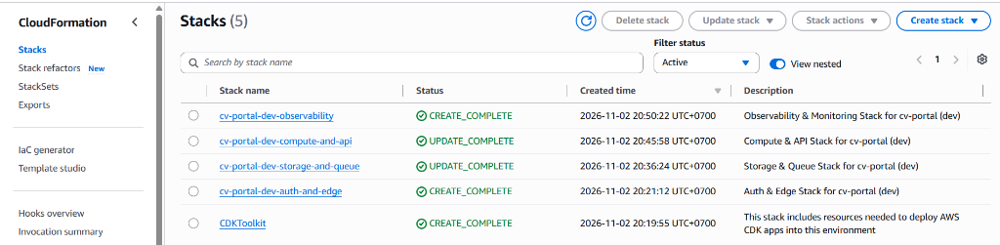
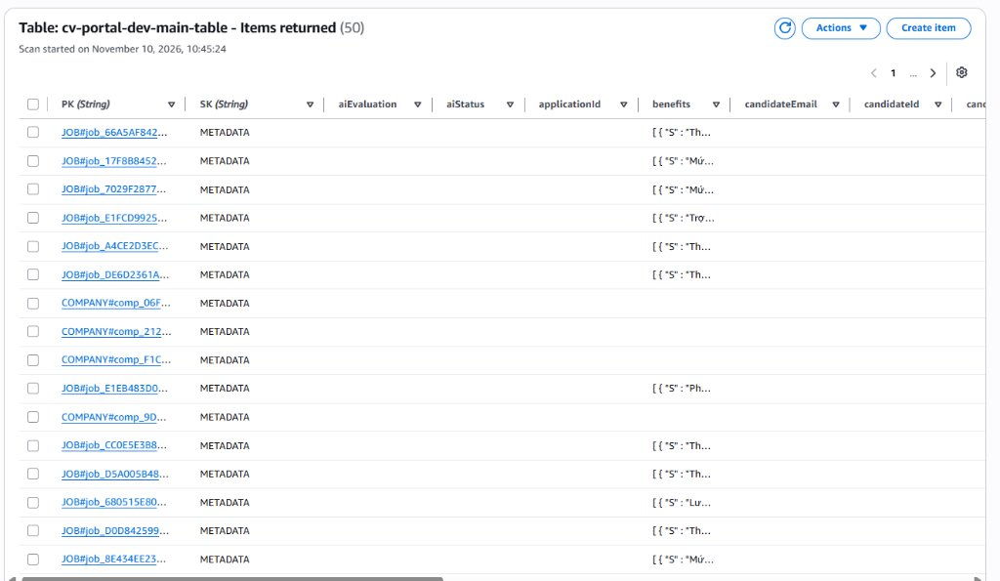
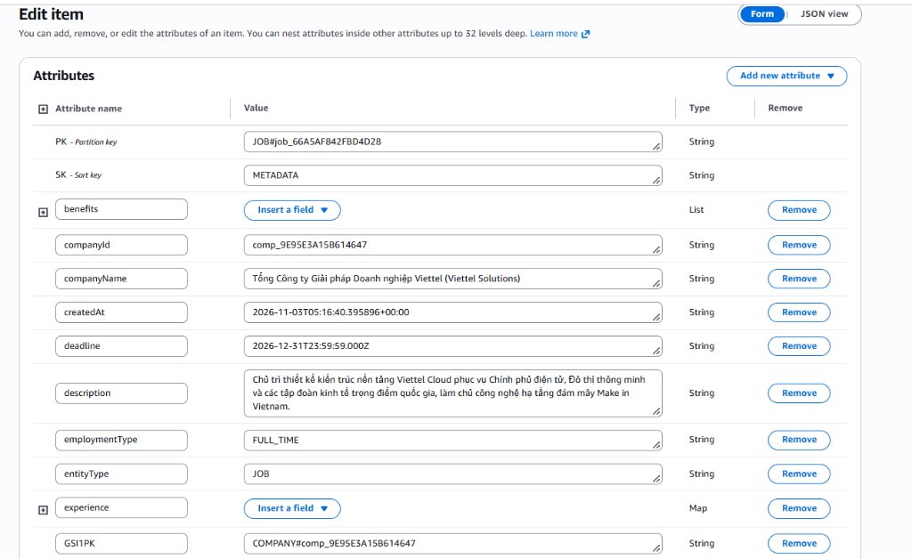
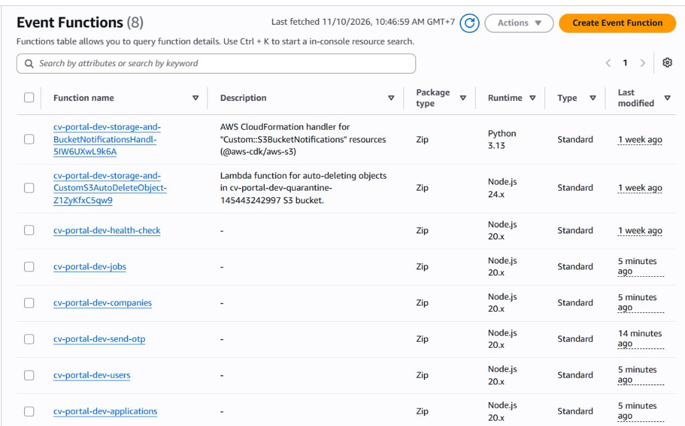

# Báo Cáo Minh Chứng Hoàn Thiện Phase 2 (Workshop Evidence Report)

**Dự án:** AI CV Screening Portal (AWS Pure Serverless Architecture)  
**Thời gian hoàn thành:** 10/11/2026  
**Môi trường:** AWS Cloud (Region: `us-east-1` | Account ID: `145443242997`)  

---

## 1. Tổng quan Kiến trúc & Hạ tầng CloudFormation

Hệ thống đã triển khai thành công 100% 4 cụm stack hạ tầng theo mô hình AWS Pure Serverless (Zero-VPC, Zero-EC2), tuân thủ AWS Well-Architected Framework:

| Tên Stack CloudFormation | Trạng thái | Chức năng chính |
| :--- | :--- | :--- |
| `cv-portal-dev-auth-and-edge` | `CREATE_COMPLETE` | Cognito User Pool, Client ID, Route53, CloudFront Edge |
| `cv-portal-dev-storage-and-queue` | `UPDATE_COMPLETE` | DynamoDB Single-Table (`cv-portal-dev-main-table`), S3 Quarantine Bucket, SQS Queue & DLQ, KMS CMK |
| `cv-portal-dev-compute-and-api` | `UPDATE_COMPLETE` | API Gateway REST API, 6 cụm Lambda microservices |
| `cv-portal-dev-observability` | `CREATE_COMPLETE` | CloudWatch Dashboards, Metric Filters, Alarms, SNS alerts |

### Minh chứng 1: Trạng thái các CloudFormation Stacks
Hạ tầng hoàn tất triển khai và cập nhật tự động bằng AWS CDK v2:

---

## 2. Lưu trữ Dữ liệu Thực tế trên DynamoDB Single-Table

Dữ liệu tuyển dụng, doanh nghiệp, hồ sơ người dùng và đơn ứng tuyển đã được lưu trữ tập trung trên cơ sở dữ liệu phân tán DynamoDB (`cv-portal-dev-main-table`), không lưu dữ liệu tĩnh trên frontend.

- **Khóa chính:** Phân vùng đơn bảng (`PK` / `SK`) hỗ trợ truy vấn đa thực thể.
- **Chỉ mục phụ:** `GSI1` (truy vấn theo doanh nghiệp `COMPANY#...`), `GSI2` (truy vấn việc làm theo trạng thái `JOBS#STATUS#OPEN`).

### Minh chứng 2: Danh sách Items trong bảng `cv-portal-dev-main-table`
Bảng chứa đầy đủ các phân vùng dữ liệu: `JOB#...`, `COMPANY#...`, `USER#...` và các đơn ứng tuyển:

### Minh chứng 3: Chi tiết Thuộc tính Bản ghi Job (`JOB#...`)
Cấu trúc bản ghi tuân thủ chặt chẽ tiêu chuẩn tuyển dụng, phân quyền và bảo mật:

---

## 3. Cụm Lambda Microservices (Compute & Business Logic)

Backend API vận hành hoàn toàn không máy chủ (Serverless), chia tách theo nguyên tắc Single Responsibility:

1. **`cv-portal-dev-jobs`**: Quản lý tin tuyển dụng (CRUD), xác thực Rubric 100đ, lọc nâng cao theo từ khóa và vị trí địa lý.
2. **`cv-portal-dev-companies`**: Quản lý hồ sơ doanh nghiệp, phân quyền thành viên HR nội bộ (Anti-IDOR).
3. **`cv-portal-dev-applications`**: 
   - Cấp S3 Presigned PUT URL có thời hạn (5 phút), giới hạn định dạng PDF dung lượng tối đa 5MB.
   - Ghi đơn ứng tuyển bằng `TransactWriteItems`, thiết lập khóa chống nộp trùng lặp (`ACTIVE_APP#...`).
   - Lưu vết nhật ký chấp thuận AI Screening tuân thủ Nghị định 356/2025/NĐ-CP.
   - Hỗ trợ ứng viên rút đơn (`WITHDRAWN`) và HR xem CV an toàn có kiểm toán (`ACCESS_LOG#...`).
4. **`cv-portal-dev-users`**: Quản lý thông tin ứng viên và kho CV cá nhân (CV Vault).
5. **`cv-portal-dev-send-otp`**: Xác thực OTP đăng ký tài khoản qua AWS SES.
6. **`cv-portal-dev-health-check`**: Kiểm tra trạng thái sẵn sàng (Readiness check) của API.

### Minh chứng 4: Danh sách Lambda Event Functions trên AWS Console
Tất cả các hàm đã được đóng gói và cập nhật mã nguồn mới nhất:

---

## 4. Tóm tắt Kiểm thử & Tính tương thích

- **Unit Tests Backend:** 17/17 tests PASS (`npm test --prefix backend`).
- **Frontend Build:** Hoàn tất thành công (Vite + TypeScript, 0 errors, 0 warnings).
- **CI/CD:** Tự động kích hoạt build và deploy lên AWS Amplify Hosting từ nhánh `main`.
